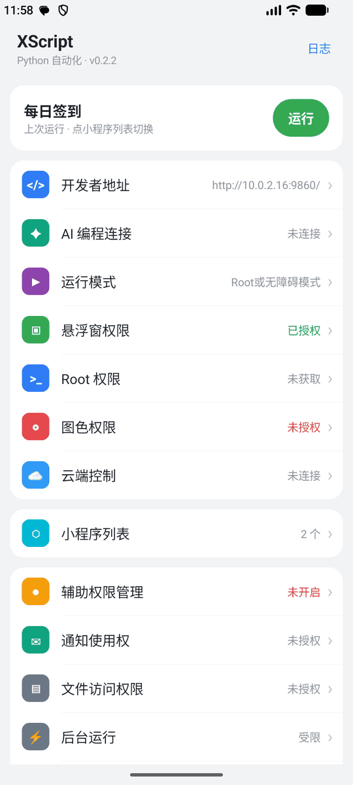
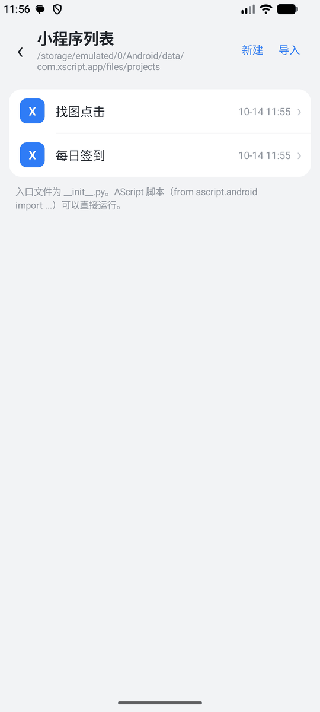
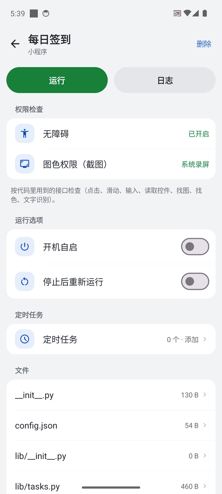
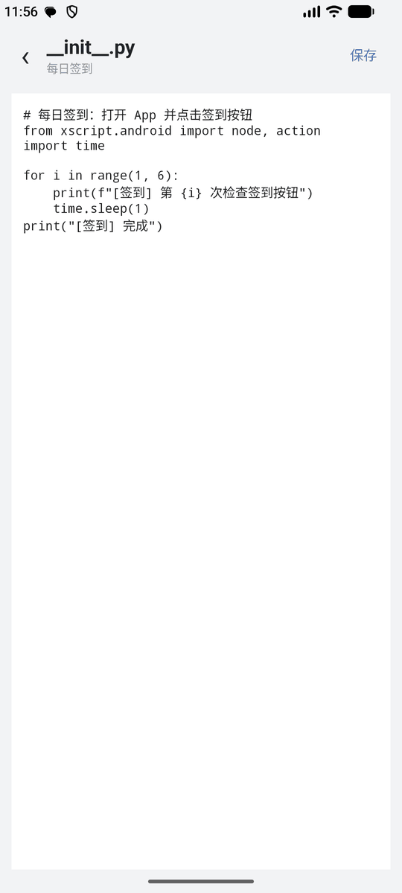
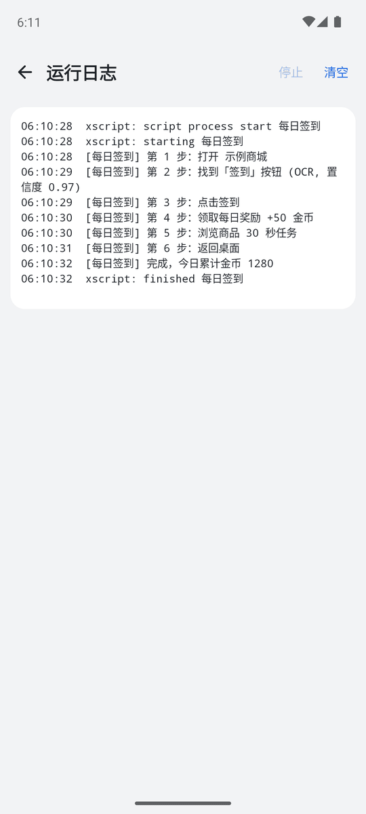
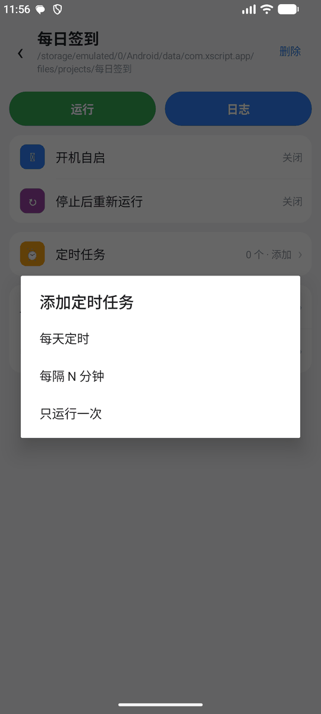
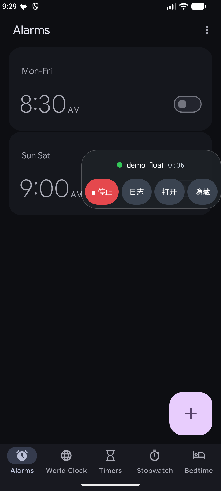
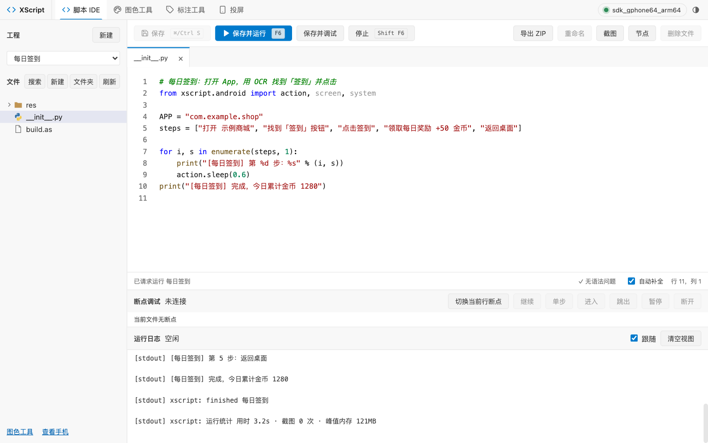
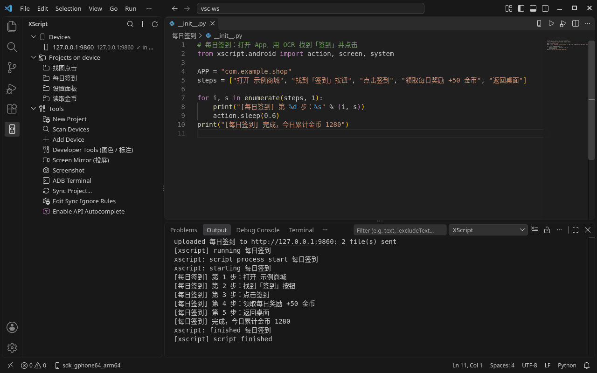
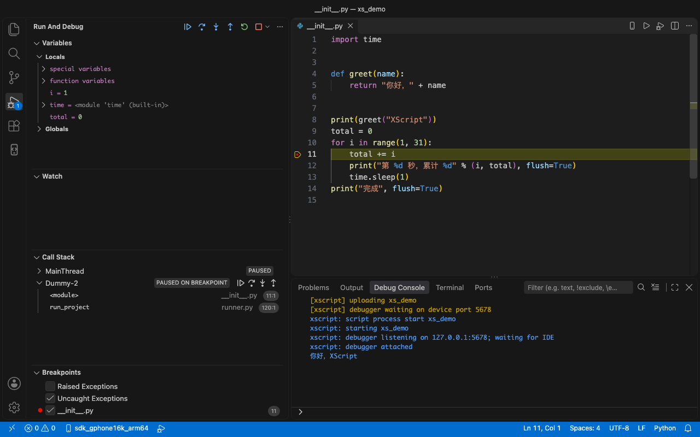

# XScript

English | [简体中文](README.md)

[](https://github.com/JackLuguibin/xscript/actions/workflows/ci.yml) [](https://github.com/JackLuguibin/xscript/releases/latest) [](LICENSE)

**A Python automation development platform for Android.**

XScript combines an on-device Python runtime, automation APIs, browser-based development tools, and a self-hostable admin backend. You write scripts on your computer, upload the project to a phone or emulator, run UI operations, image recognition and device tasks there, and track down problems with logs and breakpoint debugging.

The project provides a native `xscript.android.*` API and an `ascript.android.*` compatibility layer that covers part of the public AScript interfaces. XScript is an independent project and is not affiliated with AScript.

> **Note:** Most detailed docs (user manual, API, architecture, debugging, packaging, deployment, …) are currently in Chinese. Links below point to the Chinese documents where no English version exists. Command lines, file paths and API names are the same in both languages.

[Usage guide](#usage-guide) · [Reliability, security and performance](#reliability-security-and-performance) · [Quick start](#quick-start) · [Script example](#script-example) · [Development and testing](#development-and-testing) · [Documentation](#documentation) · [Contributing](#contributing)

## Features

- **Android automation**: accessibility and Root operation channels; tap, swipe, multi-touch gestures, key events, text input, UI node selectors and XPath queries, plus DOM selectors for WebWindow pages (`WebSelector`).
- **Image and visual recognition**: screenshots, color picking and color finding, template matching, OCR, image and dot-matrix font libraries (`Ocr.matrix`), AI screen vision (`screen.ai_find` / `ai_ask` on any OpenAI-compatible vision model) and an AI agent (`agent.run("goal")` looks at the screen and acts until the goal is reached), OpenCV image processing, the GP image/color pipeline (including project-defined GP tasks), and YOLO and PaddleOCR inference on ONNX Runtime.
- **Script development and debugging**: multi-file editing in the browser, save-and-run, logs, breakpoints (conditional, hit-count and logpoints plus watch expressions in the desktop client), step execution, call stack and variable inspection; a VS Code / Cursor extension, an MCP server and Python type stubs.
- **Device services**: permission requests, read-only SMS queries, location, sensors, event listeners, notifications, clipboard, KeyValue storage, and HTML / floating UI.
- **Project and run management**: project import/export, installing Python dependencies at runtime, run on boot, scheduled tasks, restart-on-error control, and launch links (`xscript://`, also AScript's `ascript://run?local=…`).
- **Self-hosted admin backend**: device groups, batch tasks, remote operation, screen wall, logs, alerts, account roles and operation audit; the overview page charts daily activations, online devices, new devices and expirations. Data lives in a SQLite file by default; large fleets can use PostgreSQL instead (optional).
- **App distribution**: script release and rollback, standalone APK packaging (on the backend by default, or on separate packaging machines), signed updates and activation-code (license) management.

The visual AI client supports explicitly configured inference services of your own; the project does not include a vision large-model service. YOLO models are supplied by the user. See the [third-party notices](THIRD_PARTY_NOTICES.md) for the licenses and terms of specific models and third-party dependencies.

## Reliability, security and performance

**Scripts that don't get stuck**

- Template matching no longer hangs when `confidence` is 0 or negative; the value is clamped to 0.01–1.
- Wait-style APIs take a configurable polling interval: `screen.ocr_wait`, `Selector.find / find_all / exists / wait_gone` and `event.loop` accept `interval=`, and the defaults are unchanged. The last wait is cut short at the deadline, so a call never runs past its `timeout`. Waits use a monotonic clock, so changing the system time doesn't affect them.

**Keys stay private**

- The app sends its device key to the cloud server in an `Authorization: Bearer` header instead of the URL, so it never appears in server or reverse-proxy access logs. The legacy `?token=` form still works and is logged as `token=***`.
- The cloud URL shown in the device's cloud status, in the device info reported to the server and in `GET /settings` displays the key as `token=***`.
- Signed-in users changing their password or turning two-factor authentication on or off are rate-limited too: 5 failures lock that account for 5 minutes, across all of its sessions.
- Rate limits on the public endpoints hold under concurrent requests, and license tokens with forged signatures are throttled per IP.

**A backend that scales with your fleet**

- Device status frames and `cloud.send()` data are written in one batch every 15 seconds instead of one transaction each. The console still shows live status and data.
- The overview page is cheaper: card stats come from a single query, crashes are filtered in the database, and the page refreshes every 15 seconds. The groups list reads only the columns it needs, device logs are indexed per device, and log exports stream so memory stays flat however many lines you export.
- Scheduled tasks run up to 4 at a time, so one slow task no longer delays the others due in the same round.
- Authentication reuses the request's database session, and system settings are cached for 5 seconds.
- Filtering by online state and targeting groups keep working beyond SQLite's bound-parameter limit (over 30,000 online devices).
- PostgreSQL can replace the default SQLite file: set `XSCRIPT_DATABASE_URL` and the schema is created and upgraded automatically; existing SQLite data moves over with backup and restore. CI runs the backend tests again on PostgreSQL 16 whenever backend code changes.

**A lighter UI**

- In a background browser tab, the web console pauses the screen wall, log following and the build log, and resumes where it left off when you come back.
- The desktop client's screen wall asks a device for its next picture only after the previous one has arrived, backs off on errors and pauses while the window is hidden.
- In a very narrow desktop window, the LAN connect row wraps instead of scrolling sideways.

**Development and CI**

- The web console has vitest + Testing Library unit tests, run in CI and by `scripts/verify.sh`. Its largest pages are split into smaller components.
- `verify.sh` also checks the desktop client. The desktop layout test uses a bundled test font, so the result doesn't depend on the fonts installed on the machine. Development requires Node 22+.
- CI caches npm and pip dependencies, and Dependabot opens weekly update PRs for GitHub Actions, npm and pip.

See the [changelog](CHANGELOG.md) (Chinese) for the full list of changes.

## Usage guide

If you would rather not build it yourself, use the published packages. All you need is an Android 8.0+ phone or emulator and a computer.

**1. Install the app**: download `xscript-v0.3.0-release.apk` from [GitHub Release v0.3.0](https://github.com/JackLuguibin/xscript/releases/tag/v0.3.0), then `adb install` it or copy it to the phone and tap to install. Official builds v0.2.1–v0.2.3 can be upgraded in place; a device that has a Debug build installed must uninstall it first (this clears the app data).

**2. Grant permissions**: on first launch allow **Notifications** first (otherwise the development service does not start), then enable, as needed, **Accessibility** (required for taps and UI node operations), the **overlay (floating window) permission**, and the **screen capture permission** (for screenshots).

**3. Manage and run mini-programs on the phone**:

| Home | Mini-program list | Mini-program details |
| :---: | :---: | :---: |
|  |  |  |
| Developer address, permission status, one-tap run of the last mini-program | **New** / **Import**, tap one to open it | **Run** / **Log**, run on boot, re-run after stop, scheduled tasks |
| **View code** | **Run log** | **Scheduled tasks** |
|  |  |  |
| Tap a file on the details page to view and make simple edits | `print` output shows live; **Stop** / **Clear** | Daily at a time, every N minutes, run once |

**4. Background floating window**: when a script is running and you send XScript to the background, a floating window appears at the edge of the screen (green dot + project name + elapsed time). After a few seconds without touch it shrinks into a semi-transparent ball. Dragging snaps it to the left or right edge with easing (staying clear of the status bar and navigation bar) and remembers the position, one for portrait and one for landscape. Tap it to expand **Stop / Log / Open / Hide** (icon above, small label below; colors follow the light/dark theme) plus any buttons the script added with `FloatWindow.add_menu`, so you can stop a script without returning to the app. If a script ends with an error the window turns red and stays for a few seconds. **Floating window display** on the home screen can be set to show while running (default) / always show in the background / off. It needs the **overlay permission**; without it the window is simply not shown and scripts run normally. It collapses when you return to the app or when the script ends.



**5. Write scripts on the computer**: the **developer address** on the home screen is the address your computer connects to. On the same LAN, open `http://<developer address>/tools/` directly; over USB or with an emulator, run `adb forward tcp:19860 tcp:9860` first and then open `http://127.0.0.1:19860/tools/`, and go to the **Script IDE**.



- **New** project from a template (empty, Hello, AScript-compatible, check-in, find image and tap, OCR readout, floating UI; the phone app's **New** offers the same list); **New** file / folder: file paths look like `utils/net.py` and go into the folder selected in the tree by default; the tree works like VS Code's.
- ⌘/Ctrl+S saves; **Save and run** (F6) runs on the phone, **Stop** (Shift+F6) ends the run; **Save and debug** supports breakpoints, stepping and variable inspection.
- **Delete file**: the entry file `__init__.py` cannot be deleted, and a folder must be emptied first. The dark theme can be switched at the top right.

### VS Code extension

If you prefer not to use the web IDE, you can write scripts in VS Code (or Cursor). Download `xscript-vscode-<version>.vsix` from the [GitHub Release](https://github.com/JackLuguibin/xscript/releases/latest) (the version equals the app's; checksums are in `SHA256SUMS`), then run `code --install-extension xscript-vscode-<version>.vsix` (Releases up to v0.2.4 have no vsix; you can package it yourself as described in the [extension README](ide/vscode-extension/README.md)). Afterwards an **XScript** icon appears in the activity bar:



- **Devices**: **Scan devices** (ADB and LAN) or **Add device** with the developer address from the app; click a device to make it the current one.
- **Run**: open `__init__.py` and press **Ctrl+Shift+R** (or the ▶ at the top right of the editor): only changed files are synced to the phone and run, with live log output; pressing it again stops and then re-runs, and **Shift+F6** stops. `.vscode/.syncignore` controls which files are not uploaded.
- **New project**, **pulling a project** from the phone, screenshots, an ADB terminal and screen mirroring are also in this view.



For an item-by-item comparison with the official AScript extension and the features not implemented, see the [extension README](ide/vscode-extension/README.md) (Chinese).

More (shortcuts, error messages, color and annotation tools, the VS Code extension, the admin backend) is in the [user manual](docs/使用手册.md) (Chinese).

## Project layout

```text
xscript/
├── android/       Android app, on-device Python runtime and tests
├── backend/       FastAPI admin service, React console and APK packaging tools
├── ide/           VS Code / Cursor extension, MCP server and type stubs
├── protocol/      OpenAPI contract of the device HTTP API
├── examples/      Examples for automation, device services, image/color and debugging
├── scripts/       Verification, stub generation and device test scripts
├── deploy/        Container deployment configuration
└── docs/          Usage, API, architecture and deployment docs
```

The device side can be used on its own; deploy the admin backend only if you need it. Computer-side tools connect to the app through the device HTTP API; cloud control uses a WebSocket connection that the device opens itself.

## Requirements

- **Runtime device**: a phone or emulator running Android 8.0 / API 26 or later. Devices with 4 KB and 16 KB memory pages are both supported (16 KB devices rely on the `pageSizeCompat` compatibility mode in the manifest, verified on an Android 17 emulator; see the [feature comparison](docs/功能对照.md) (Chinese)).
- **Android build**: JDK 17+, Android SDK Platform 37 with matching Build Tools, Python 3.10, and a Bash environment. Gradle runs through the wrapper in the repository.
- **Optional admin backend**: Python 3.10+; building the web console needs Node.js and npm.
- **Python versions**: the admin backend, the MCP server and the build machine all require Python 3.10+; the Python built into the device is 3.10 (Chaquopy); the `ide/python-stubs` type stubs work from Python 3.8.
- **Optional IDE tools**: the MCP server needs Python 3.10+; the editor extension needs VS Code 1.90+ or a compatible Cursor.

The build scripts try the JBR bundled with Android Studio by default and look for Python 3.10. Point them at your local installations with `JAVA_HOME`, `ANDROID_HOME` and `XSCRIPT_BUILD_PYTHON`. Other build details are in the [Android development notes](android/README.md) (Chinese).

## Quick start

### 1. Get the source and build

```bash
git clone https://github.com/JackLuguibin/xscript.git
cd xscript
./android/build.sh
```

The debug APK is written to:

```text
android/app/build/outputs/apk/debug/app-debug.apk
```

### 2. Install and start

Make sure the device is connected over ADB, then install:

```bash
adb devices
adb install -r android/app/build/outputs/apk/debug/app-debug.apk
```

> If the device already has an XScript signed with a different key (for example an official build, or a Debug build made on another computer), `adb install -r` fails with `INSTALL_FAILED_UPDATE_INCOMPATIBLE`. The only way is `adb uninstall com.xscript.app` and then installing again, and **uninstalling clears the app data (projects, settings, licenses)**, so export the projects you need first.

Open **XScript** on the device. After a fresh install grant the notification permission first, otherwise the HTTP service does not start; then enable accessibility, the overlay or the screen-capture permission depending on the features you use. Root is an optional channel and not a prerequisite for every feature. SMS, location and notification features need their own system permissions.

### 3. Connect development tools

The app's home screen shows the developer address. The default port is `9860`; if it is taken, ports up to `9869` are tried in turn, so go by what the device shows.

Over USB or with an Android Studio emulator you can forward the port:

```bash
adb forward tcp:19860 tcp:9860
curl http://127.0.0.1:19860/status
```

If several devices are connected, add `-s <device serial>` to the ADB commands; if the device-side port is not `9860`, adjust the forwarding target accordingly.

Open `http://127.0.0.1:19860/tools/` in a browser to enter the Script IDE, create a project, edit `__init__.py`, then save and run. The IDE's directory tree, file management and shortcuts are described in the [user manual](docs/使用手册.md#脚本-ide) (Chinese).

### 4. Run and debug the examples

- [Basic automation](examples/settings_search/__init__.py): operate the UI by finding nodes.
- [Breakpoint debugging](examples/debug_demo/__init__.py): set line breakpoints, watch variables and step through.
- [Device services](examples/device_services/__init__.py): SMS permission, location and sensor examples.
- [GP pipeline](examples/gp_pipeline/__init__.py): local image-processing task orchestration.
- [Your own vision service](examples/as_demo/vlm_custom_service.py): configure a VLM client.

For detailed connection troubleshooting see the [getting started guide](docs/GETTING_STARTED.md) (Chinese); for breakpoints and the debugging lifecycle see the [debugging notes](docs/DEBUGGING.md) (Chinese).

## Script example

Each project is a Python package whose entry point is `__init__.py`. The working directory at run time is the project directory.

```python
from xscript.android import node

button = node.Selector().text("搜索").find(timeout=5)
if button:
    button.click()
else:
    print("当前界面未找到搜索控件")
```

(The example looks for a control whose text is "搜索" ("Search"); the message printed when it is not found means "the search control was not found on the current screen".)

A project can contain Python submodules, resource files and a `requirements.txt`. Whether a third-party dependency works depends on its Python version and Android platform support; not every desktop Python package can be installed on the device.

When migrating AScript projects you can use the `ascript.android.*` compatibility entry points. Some interfaces still behave differently or are not implemented yet, so read the [feature comparison](docs/功能对照.md) and the [compatibility implementation notes](docs/ASCRIPT_RECONSTRUCTION.md) first (both Chinese).

## Optional components

### Admin backend

Install and initialize it in a separate Python 3.10+ environment:

```bash
python3.10 -m venv .venv
.venv/bin/python -m pip install -e ./backend
(cd backend/web && npm ci && npm run build)
.venv/bin/python -m xscript_server init --data xscript-data
.venv/bin/python -m xscript_server serve --data xscript-data --port 8765
```

Then visit `http://127.0.0.1:8765/`. Initialization prompts you to create an administrator account. For container deployment, device keys, storage and backups see the [backend notes](backend/README.md) (Chinese).

### Editor and MCP

- [IDE tools](ide/README.md): install the VS Code / Cursor extension, upload projects and view logs.
- [MCP server](ide/mcp-server/README.md): configure device access for MCP-capable clients.
- [Type stubs](ide/python-stubs/README.md): set up `xscript.*` and `ascript.*` autocompletion.

## Development and testing

The Python backend/MCP tests and the on-device runtime tests use separate environments:

```bash
# Backend and MCP
python3.10 -m venv .venv
.venv/bin/python -m pip install -e './backend[test]' -e ./ide/mcp-server

# Host-side tests of the device API
python3.10 -m venv .venv-rt
.venv-rt/bin/python -m pip install numpy==1.26.4 opencv-python-headless==4.10.0.84 pillow==10.4.0

# Web console and editor extension
(cd backend/web && npm ci)
(cd ide/vscode-extension && npm ci)

# Desktop client (optional; verify.sh skips it when missing)
python3.10 -m venv .venv-desktop
.venv-desktop/bin/python -m pip install -e './desktop/app[test]'
(cd desktop/frontend && npm ci)

# Repository checks and Android JVM tests
./scripts/verify.sh
./android/build.sh :app:testDebugUnitTest
```

`verify.sh` covers the Python runtime, backend, MCP, type stubs, web IDE, editor extension, the desktop client (when `.venv-desktop` exists) and mock integration flows. Node 22+ is required (see `.nvmrc`). Full device behavior must be verified separately on a connected phone or emulator.

After changing the public Python API, regenerate the type stubs:

```bash
python3 scripts/gen_stubs.py
python3 scripts/gen_completions.py   # completion index of the web IDE
```

The device debugging regression test creates and cleans up its own temporary project; make sure no other script is running before you start it:

```bash
python3 scripts/device_debug_smoke.py --base http://127.0.0.1:19860
# Screen-capture permission (taps the system grant dialog automatically on an emulator) and /screen scaling check
scripts/emulator_grant_capture.sh emulator-5554
python3 scripts/device_screen_smoke.py http://127.0.0.1:19860
```

## Status and limitations

The project is under active development. Basic DAP debugging, SMS queries and accelerometer callbacks have been verified on an ARM64 Android 17 / API 37 emulator; different devices, ROMs and permission policies may still affect real behavior.

The following are not fully implemented:

- **App update**: a forced APK update is downloaded inside the app and then handed to the system installer; the user has to allow "Install unknown apps", and there is no silent install. Packages built before the update have no server address and must be repackaged once before they read announcements.
- **Login IP allowlist**: behind a reverse proxy it needs `--behind-proxy`.
- **Not available**: the raw HID hardware channel and running fully V4-encrypted scripts. (The built-in input method, loading external APK/JAR plugins, BLE and per-use cards are implemented; see the feature comparison.)
- **Web IDE**: project-wide search is plain text matching (no replace preview; undo-replace keeps only the most recent replace, one step). The screenshot panel captures a single static frame. Completion and syntax checking are lightweight local implementations: completion covers `xscript.*` / `ascript.*` and names in the file, with no type inference; syntax checking only catches common bracket, quote, colon and indentation errors and is no substitute for running the script. There are no hover tips, go-to-definition or refactoring, and not all debugging features of a full IDE.
- **Admin backend licenses**: renewal stacking, trial cards, multi-device cards, abuse alerts (the counting window is stored in the database and survives restarts), in-app renewal, per-device blocklist and per-use cards (one use per script start) are supported.
- **VS Code / Cursor extension**: it is packaged as a vsix and was load-verified in Cursor (activation, 11 commands, debug type, shortcuts). One-click debugging, conditional / hit-count breakpoints, log points and variable modification were verified on two emulators with adapter scripts. A full round of clicking through the editor's debug UI with the mouse was not done (the debug UI cannot be driven in a headless Cursor host).

The exact scope is in the [feature comparison](docs/功能对照.md) (Chinese).

## Documentation

Most detailed docs are currently in Chinese.

- [User manual](docs/使用手册.md): entry points for each component.
- [Getting started](docs/GETTING_STARTED.md): building, connecting a device and common problems.
- [Script API](docs/API.md): device-side interfaces.
- [Breakpoint debugging](docs/DEBUGGING.md): web debugging and the DAP API.
- [Cloud control protocol](docs/CLOUD.md): device connection and command forwarding.
- [Packaging and licensing](docs/PACKAGING.md): standalone APK, updates and activation codes.
- [Release process](docs/发布.md): pushing a tag makes GitHub Actions build the signed APK and the VS Code extension and publish a Release; what CI covers.
- [Architecture](docs/ARCHITECTURE.md): modules and run flow.
- [Device HTTP contract](protocol/openapi.yaml): the API definition shared by clients and the device.
- [Roadmap](docs/路线图.md): planned work.
- [Changelog](CHANGELOG.md): user-facing changes per version.

## Contributing

Report problems, make suggestions or submit Pull Requests through [Issues](https://github.com/JackLuguibin/xscript/issues).

When reporting a problem, include the Android version, the device/emulator model, reproduction steps and relevant logs. When submitting code, keep the scope of the change clear, add the necessary tests and docs, and make sure the relevant checks pass.

Commit messages follow Conventional Commits, for example:

```text
feat(vision): add a new image-processing operation
fix(android): handle service disconnection
docs: improve setup instructions
```

## Security

The device development HTTP service requires a **pairing code** by default (app home → 开发与连接 → 配对码): the desktop client, VS Code extension, MCP server and browser tools ask for it once, and USB-connected desktops pair automatically. The device also refuses cross-site requests and non-IP Host headers (DNS rebinding). The code travels over plain HTTP, so use a trusted network or USB/ADB forwarding and do not expose the port to the internet. Pairing can be switched off in the app (open like AScript); then any client that can reach the port can upload and run code. Packaged apps have the development service off by default.

A self-hosted backend exposed to the internet should use HTTPS/WSS and protect device keys, administrator credentials and signing private keys. The app sends its device key in an `Authorization` header, and status and settings endpoints show it only as `token=***`. Custom clients should use the header too rather than putting the key in the URL (see the [cloud protocol](docs/CLOUD.md), Chinese). See the [backend notes](backend/README.md) (Chinese) for deployment and backup requirements. Do not attach these credentials or personal device data when reporting problems.

## License and third-party components

XScript is open source under the [MIT License](LICENSE), Copyright (c) 2026 Jack Lu (JackLuguibin). The licenses and terms of third-party components apply separately.

For dependency information see [THIRD_PARTY_NOTICES.md](THIRD_PARTY_NOTICES.md); the source and license of the bundled debugpy wheel are in [android/wheels/README.md](android/wheels/README.md).
