# XScript 桌面端（Windows 为目标平台）

设计文档：[`docs/桌面端设计.md`](../docs/桌面端设计.md)。本目录实现其 §12.1 路线图：**P0**（验证与脚手架）已完成，**P1**（壳 + 设备 + 工程）大部分已实现，**P2**（流程编辑器）部分已实现，**P4**（云控与管理）已实现（见下面「P4 云控」），**P5**（安装包、自动更新、诊断包）已实现（见下面「P5 安装包与更新」），P3 见下面的「没做」。
入口执行方式的实测结论：[`docs/桌面端-入口执行实测.md`](../docs/桌面端-入口执行实测.md)。

> **状态：P0 完成，P1 大部分、P2 部分，P4、P5 完成。只在 macOS 上开发和验证（Windows 安装包只在 CI 的 Windows 构建机上做过安装 / 自检 / 卸载）。** 所有 Windows 专属行为（`adb.exe` 定位、`CREATE_NO_WINDOW`、凭据管理器、
> 打包、安装器、高 DPI、杀软/SmartScreen……）**均未验证**，代码和文档里用「⚠ Windows 未验证」标注。
> v0.4.0 起 macOS arm64 的 dmg（ad-hoc 签名、未公证）随 App 一起附在 GitHub Release；之后的版本还会附 Windows x64 安装包（未签名，见「P5」）。桌面端版本号跟随 App（`pyproject.toml` / `package.json` 都是 0.4.0），见设计 §13-14。

## P0 里有什么

| 内容 | 位置 | 验证 |
| --- | --- | --- |
| PySide6 外壳：`QWebEngineView` + 自定义协议 `xsapp://app/`（提供前端、`qwebchannel.js`、设备截图）+ CSP（页面不能自己发网络请求）+ 导航白名单 | `app/xscript_desktop/{main,window,scheme}.py` | macOS ✅ |
| QWebChannel **JSON-RPC 桥**（一个 `Bridge` 对象：`call(json)` 进、`message(json)` 出，请求/应答/事件/取消） | `app/xscript_desktop/{bridge,rpc,runtime,context}.py` | macOS ✅ |
| 设备连接：`adb devices` → `adb forward tcp:<自动端口> tcp:9860` → `GET /status`；局域网/手输 `host:port`；LAN 扫描（9860–9869）；健康轮询；退出时只删自己建的 forward | `app/xscript_desktop/services/` | macOS ✅（单测 + 两台模拟器） |
| React 19 + Vite + TypeScript 前端：设备页（侧边栏导航、设备卡片、状态徽标、截图预览、空/加载/错误状态、浅/深/跟随系统主题、设计令牌、键盘焦点与对比度）；网页里没有 `fetch`/`WebSocket`（有测试守着） | `frontend/` | macOS ✅ |
| 设备如何执行工程入口的实测 + 探针工具 | `docs/桌面端-入口执行实测.md`、`app/tools/entry_probe.py` | 两台模拟器 ✅ |

## P1 已实现的部分（macOS 验证，分支 `feat/desktop-improvements`）

| 功能 | 说明 | 位置 |
| --- | --- | --- |
| **工程页** | 选在线设备 → 工程列表 / 新建 → 文件列表 → 编辑与保存（⌘/Ctrl+S）→ 保存并运行（F6）/ 停止（Shift+F6）→ 按 `seq` 游标跟随 `/logs`（约 1 s 轮询，最多 2000 行）；文件 **新建 / 重命名 / 删除**（入口 `__init__.py` 受保护）；文件夹整体删除（确认框列出其中的文件，`project.deleteFile` 带 `recursive: true`）；**在工程中搜索**（⌘⇧F / Ctrl+Shift+F；区分大小写、正则；结果按文件分组，点开选中匹配；RPC `project.search`）；返回 / 主页 / 最近任务 按键 | `frontend/src/components/ProjectsPage.tsx`、`ProjectSearch.tsx`、`app/xscript_desktop/services/project_search.py` |
| **Monaco 编辑器** | 本地打包（无 CDN，CSP 下可用），只注册 Python；按需加载（约 4 MB 的独立 chunk）；**补全** 来自 `ide/python-stubs`：`import` / `from … import` / 别名 `x.` / 类成员，带签名与文档。数据重新生成：`python3 frontend/scripts/gen_stub_completions.py`（`--check` 由 pytest 守着）。浏览器演示模式与 jsdom 测试里回退为 `<textarea>` | `frontend/src/editor/`、`components/CodeEditor.tsx` |
| **本地文件夹同步** | 移植 VS Code 插件 `sync.ts`：`.vscode/.syncignore`、跳过点文件 / `__pycache__` / `*.pyc` / 虚拟环境；**增量**＝设备上大小相同 *且* 内容哈希等于上次本机上传的才跳过；分批 `PUT /files`（每批约 2 MB，推送 `sync.progress`）；全量上传；拉取到本地（只写新增/变化，本地多出的不动）。哈希在应用数据库的 `sync_cache` 表（设计 §14.5）；若数据目录里还有旧的 `sync-cache.json`，启动时导入一次。文件夹必须含 `__init__.py` 或 `build.as`，上限 5000 个文件 / 200 MB。原生「选择文件夹」对话框 | `app/xscript_desktop/services/sync.py`、`store.py`、`dialogs.py`、`frontend/src/components/SyncPanel.tsx` |
| **屏幕（投屏 + 操控）** | 每台设备只开一条 `GET /screen/stream`（MJPEG，默认 fps=12、scale=0.5、quality=60），扇出给订阅者。最新一帧放内存，页面用 `xsapp://app/_frame/<id>?seq=N` 取（事件 `mirror.frame`，加载中到达的帧丢掉）。开流前先看 `/status.capture`，未授权绝不开流。页面顶部的「截图状态」读 `/status.capture_via` / `capture_lost`（`components/CaptureStatus.tsx`）：能截图时工具栏显示方式，不能时显示原因和恢复步骤，「重新检查」调 `device.refresh`，「在手机上授权」调 `device.requestCapture`（手机 `POST /capture/request`：弹出系统录屏授权窗口并发通知；旧版 App 404 时提示升级）。429 时改轮询 `GET /screen`（约 2 fps，max=480）并按 0.5–8 秒退避重试（每次不早于关闭后 1.5 秒），成功后回到流。3 秒无帧则主动断开且不自动重试。最后一个订阅者离开、断开设备或退出时立刻关闭上游。点按/长按/滑动与按键、文字仍走 `device.action`。设备卡片上的单张截图仍走 `/_shot/`，不占观看槽 | `app/xscript_desktop/services/mirror.py`、`frontend/src/components/MirrorPage.tsx` |
| **断点调试** | 移植 VS Code 插件 `dap.ts`：Python 侧 `DebugSession` 当 DAP 客户端（页面不能联网），经 `POST /projects/{name}/debug` → `/debug/connect`（409 时重试）→ `/debug/request` + `/debug/messages?since=` 轮询驱动设备上的 debugpy；握手顺序 initialize → attach（不等响应）→ `initialized` → setBreakpoints → setExceptionBreakpoints(uncaught) → configurationDone。Monaco **装订线断点**（点行号左侧或 F9），暂停行高亮并自动打开对应文件；工具栏 调试/继续（F5）、单步跳过（F10）、进入（F11）、跳出（Shift+F11）、暂停、分离、停止（Shift+F5）；**调用栈**（工程外的帧会标出来）、**变量**（Locals 自动展开，Globals 与子对象按需展开）、在栈帧上**求值**、调试控制台。停止时先发 DAP `disconnect(terminateDebuggee=false)` 再关通道，然后只停自己启动的脚本（设备忙时报 409「已在运行」，不会停别人的脚本）；会话中切换断点会立即下发 | `app/xscript_desktop/services/debugger.py`、`frontend/src/components/DebugPanel.tsx` |
| **中 / 英界面** | 侧栏底部切换，记住选择，设置 `<html lang>`；两套词典键由类型和测试保证一致 | `frontend/src/strings.ts`、`src/i18n.ts` |
| **已保存设备** | SQLite `desktop.db`（WAL，专用线程）。连接成功后记住设备；**不保存 adb 自动分配的本地端口**，下次按序列号重新 `forward`。断开后卡片留在列表里显示离线，忘记才删除。可改名称、分组、备注，以及「自动重连」：第一次连上的设备默认勾上，打开窗口时并行重连，ADB 设备重新插上（或刚授权）时也会自动连接；设备页顶部「自动重连设备」是全局开关（设计 §14.5）。数据库损坏会改名后重建并提示；来自更新版本则只读。不写密钥 | `app/xscript_desktop/services/store.py`、`frontend/src/components/DevicePage.tsx` |
| **全局快捷键** | `⌘/Ctrl+K` 命令面板；`⌘/Ctrl+1…5` 切换设备/屏幕/工程/设备墙/流程；设备页 `⌘/Ctrl+R` 与 `F5` 刷新 ADB（其它页的 `F5` 仍留给调试）；`⌘/Ctrl+L` 聚焦地址；`⌘/Ctrl+B` 侧栏只留图标（流程页里改为显示/隐藏节点库）；`⌘/Ctrl+Shift+T` 循环主题；`⌘/Ctrl+,` 打开设置（语言、主题、adb 路径、凭据、单键快捷键、图标侧栏）；`?` 快捷键帮助，可在设置里关闭（WCAG 2.1.4）。`Esc` 关闭浮层并归还焦点。输入框里 `?` 不触发。macOS 上修饰键是 `⌘` | `frontend/src/shortcuts.ts`、`components/GlobalShortcuts.tsx` |
| **凭据** | 设置里按名称保存环境变量、后台地址、设备配对槽。值只进系统凭据库（`keyring`；Windows 凭据管理器 ⚠ 未在 Windows 上验证）。保存后界面不再显示值，RPC 应答也不带回值。名称记在数据目录的 `slot-index.json`，**不进** SQLite | `services/secrets.py`、`components/CredentialsForm.tsx` |
| **设备工具页** | 图色 / 标注 / 投屏网页 / 工具首页在**独立窗口、独立 profile** 里打开设备自己的 `/tools/`。没有桥，所以那个页面调不了桌面 RPC。请求只允许这台设备的地址；点外部链接交给系统浏览器。页面传入的 URL 一律忽略 | `tools_view.py`、`services/tool_pages.py` |
| **控件树 / 取色 / 截图** | 屏幕页可切换操控、选控件、取色。选控件读 `GET /ui-tree`，点画面或点树里的一行，高亮并复制 `Selector()` 片段和 XPath。取色先 `POST /tools/snapshots` 再 `POST /tools/vision`（`op=pixel`）。保存截图由系统对话框选路径，页面不能指定路径。「放到流程画布」把选中的控件变成流程里的「查找 → 找到就点击」（有文本用查找控件节点，没有文本用带完整 Selector 的代码节点），接在主流程末尾 | `components/ScreenTools.tsx`、`ui-tree.ts` |
| **设备墙** | 每台设备一张 `/_shot/` 缩略图（约 2 秒刷新），**不开** `/screen/stream`，所以不占两个观看槽。勾选后按键广播；在一张图上点击，把同一相对位置发给所有勾选的在线设备（没勾选时只发给被点的那台） | `components/WallPage.tsx` |
| **流程编辑器（P2 部分）** | 蓝图式画布与文本 DSL（`*.xflow`）是同一张图，改一边另一边跟着变；节点库（搜索、分类、自定义函数/节点；树形键盘导航，搜索框回车添加第一个结果）、检查器（常规 / 输入 / 输出 / 代码 / 缓存分组可折叠，数字字段就地校验；⌘⇧I / Ctrl+Shift+I 收起，≤1100 px 时没有选中就自动收起）、变量面板（变量 / 环境 / 工程参数 / 局部 / 循环变量，可拖到画布）；撤销重做、注释框、便签、折叠、进入子图、复制粘贴；问题面板与接线检查。**本地调试**：运行 / 单步 / 断点，按 trace 回放到画布。**试跑节点**：设备类节点经 `device.eval` 发到当前设备执行，其它节点在本地模拟。**在设备上运行**：编译成带 `__xf_trace` 的 Python，写进与流程同名的工程（`flows/<name>.py`、`.xflow`、`.xflow.map.json`、`.xflow.layout.json` 和入口 `__init__.py`），然后运行并跟随日志；设备上的 traceback 按部署时的 source map 反查到节点，画布标红，「问题」页签写出节点、行号和异常；工程里已有别人写的 `__init__.py` 时拒绝覆盖。窗口 ≤1280px 时节点库默认收起，打开时自动取景 | `frontend/src/components/FlowPage.tsx`、`src/flow/*`（`dsl.ts` 解析/打印/编译，`session.ts` 调试会话，`deploy.ts` 部署） |

新增 RPC：`project.list|create|files|read|write|deleteFile|move|run|stop`（`deleteFile` 带 `recursive: true` 时删除整个文件夹）、`device.logs`、`device.action`（仅 `click|swipe|input|key`）、`device.eval`（流程试跑：一段代码发到设备 `POST /eval`，64 KB 以内，超时 200–15000 ms）、`device.update|forget`、`device.uiTree`、`device.pixel`、`device.saveScreenshot`、`sync.preview|upload|pull`、`app.pickDirectory`、`app.copyText`、`app.setUnsaved`（页面报告编辑器是否有未保存修改；有则关窗前先确认）、`secret.list|set|delete|has`、`tools.open`、`debug.start|status|setBreakpoints|step|scopes|variables|evaluate|stop`、`mirror.subscribe|unsubscribe|retry`；事件 `sync.progress`、`debug.state`、`debug.output`、`mirror.frame`、`mirror.state`。`device.list` 含已保存但未连接的设备（状态「离线」）。所有路径参数按设备同样的规则校验（相对、无 `..` / `.` / 空段 / 反斜杠）。`secret.set` 的值不会出现在应答里。

断点列表里每个断点可点 ✎ 设置**条件**（为真才停）、**命中次数**（如 `3`、`>= 3`、`% 2`）或**日志消息**（日志点：不暂停，`{表达式}` 求值后打印到调试控制台）；编辑器行号旁条件断点是带环的红点，日志点是蓝色菱形。**监视**区添加的表达式按工程保存，每次暂停时在选中的栈帧求值（DAP `evaluate` 的 `watch` 上下文）。这几项已用 `scripts/device_desktop_debug_e2e.py`（直接驱动 `DebugSession`）在 arm64 模拟器的真实 debugpy 上验证（条件 `i == 3` 停在 i=3、会话中改成命中次数 2 停在 i=5、日志点逐次输出、监视求值）；实测发现 debugpy 的日志点输出是 `category: stdout` 加空的 `source: {}`，以前被当成脚本输出的重复而丢掉，已修复。

调试的限制：每台设备一个会话；多线程切换还没做。测试用的是 `app/tests/fake_debug_device.py` 里脚本化的 debugpy（`scripts/mock_device.py` 不支持 `/debug/*`）；设备上的真实 debugpy 用上面的脚本验证过；桌面窗口里的完整点击流程只在 fake 设备上做了 e2e。

**没做**：trace 节流的真机预算核对（设计 §14.7；编译器已按 200 行突发 / 每秒 500 行生成 `__xf_trace`，还没在真机上测）；流程编辑器的剩余部分：状态机回退（有回边或汇合的图）里，被整体内联的容器（match / sequence / try / parallel / wait_until / retry 和封闭的循环）分支不能跳出容器，也不能 `break` / `continue` 外层被拆成状态的循环（会报错并指出节点）（React Flow 在 Qt 里的验证见 [`docs/桌面端-ReactFlow验证.md`](../docs/桌面端-ReactFlow验证.md)；语义 JSON 的 schema 在 `desktop/schema/`）、`pyside6-deploy` 与 PyInstaller 对比；Developer ID 签名 / 公证和 Windows 代码签名（没有证书）；Windows 上的自动更新只测了脚本文本，没在真机上跑过。镜像流的方案 A（scheme 直接吐 multipart）没做，方案 B 已实现；本轮没有对真机开流。Windows 凭据管理器只按 `keyring` 的接口接上，没有在 Windows 上读写过。设计和 Mac 上能做的验证不等 Windows。

**设备页美化前 → 后**（macOS 真实外壳，经 adb forward 连接 5554 模拟器；设计细节见设计文档 §14.15）：

| 美化前（P0） | 美化后 · 浅色 |
| --- | --- |
| 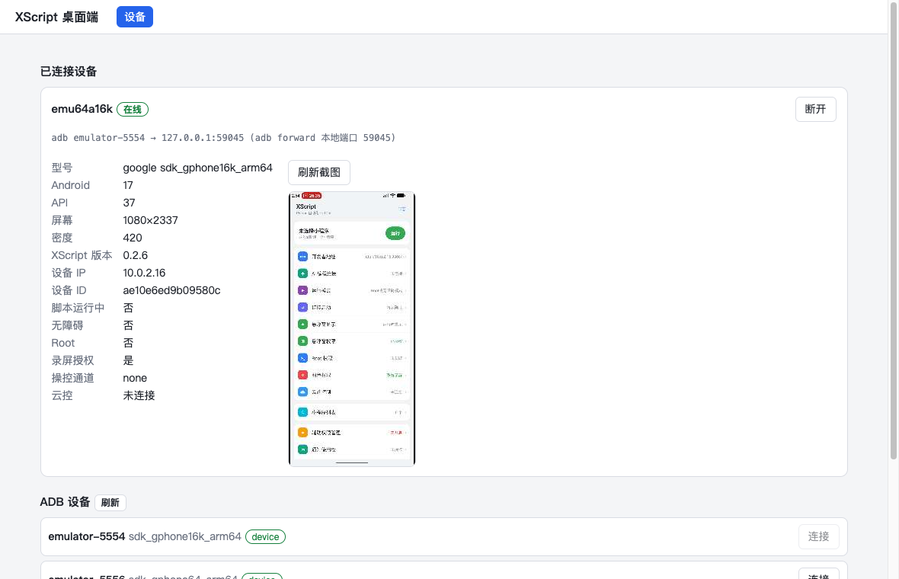 | 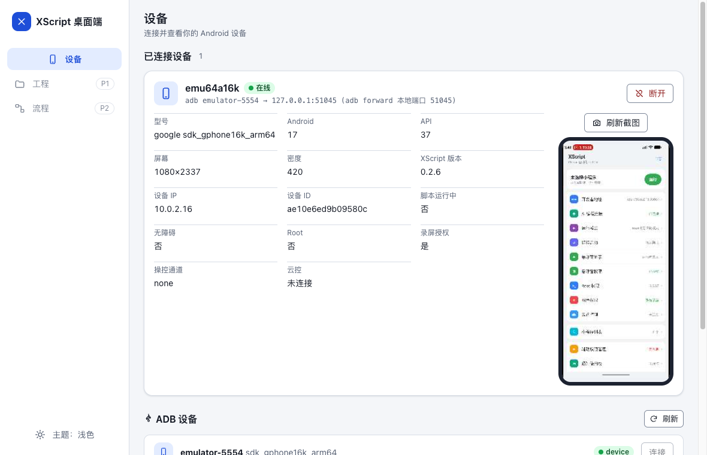 |

| 美化后 · 深色 | 窄窗口（图标栏 + 叠放） |
| --- | --- |
| 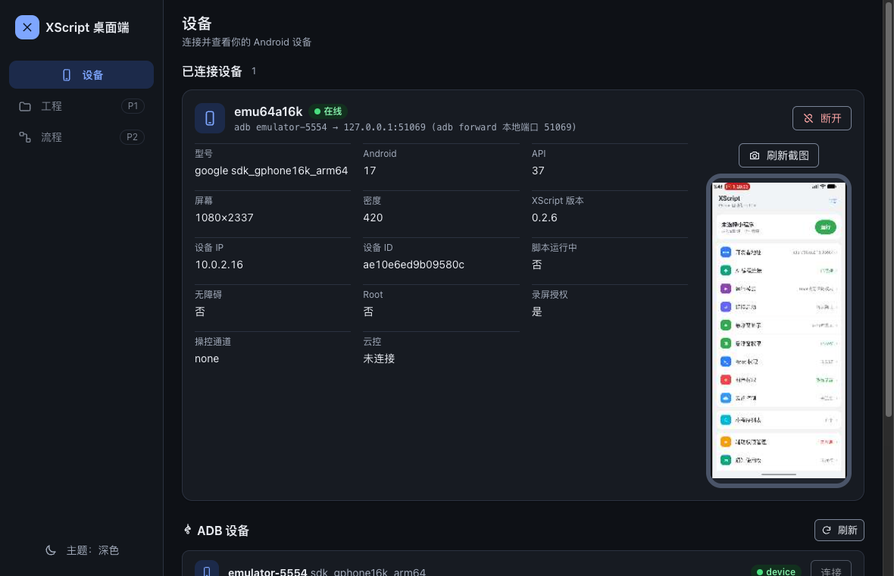 | 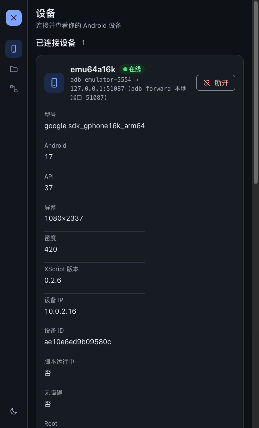 |

重新生成：`python -m xscript_desktop --screenshot out.png --connect-adb emulator-5554 --click-screenshot --theme dark --size 1180x760`（`--theme` 会真的去按侧栏的主题按钮）。

工程页（文件夹列表、文件列表、编辑器；第二行是在工程中搜索）：

| 浅色 | 深色 |
| --- | --- |
|  | 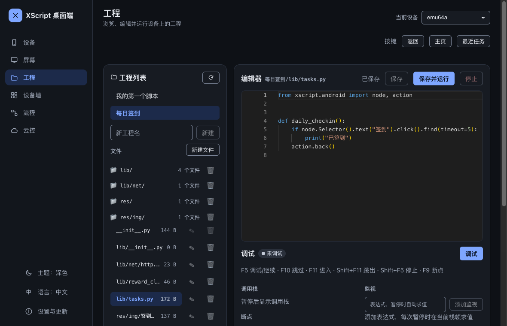 |
|  | 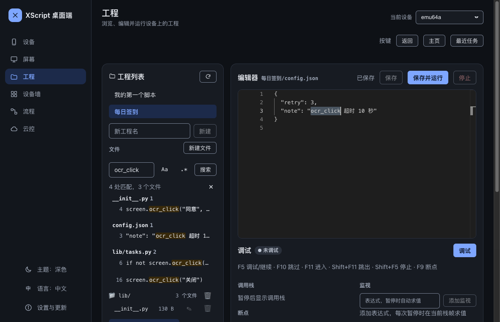 |

重新生成：设备上放一个带子文件夹的工程「每日签到」，然后 `python -m xscript_desktop --screenshot out.png --connect-adb <serial> --run-js tools/screenshot-projects.js --screenshot-delay 4 --theme light --size 1180x760`（`--run-js` 在设备连上后在页面里执行脚本：打开工程页、选工程、打开 `lib/tasks.py`）。截图规则和其他截图的生成方式见 [docs/截图.md](../docs/截图.md)。

工程页的「最近运行」（重新生成：`python scripts/mock_device.py` 换个端口起一个模拟设备并放一个工程「每日签到」，再用 `--run-js tools/screenshot-recent-runs.js`，脚本里的地址改成模拟设备的地址）：

| 浅色 | 深色 |
| --- | --- |
|  | 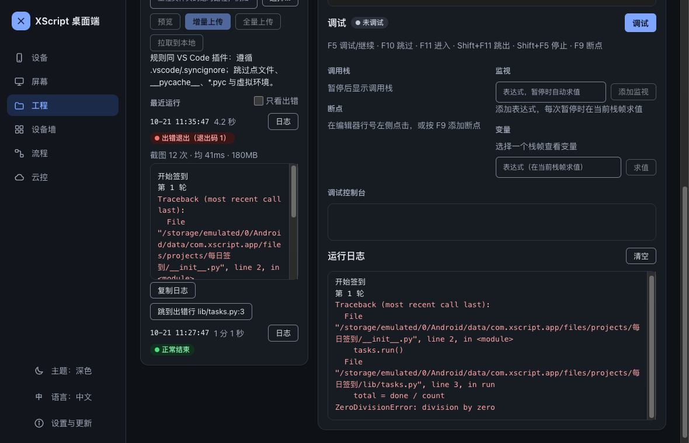 |

点「跳到出错行」后编辑器整行选中出错的那一行（`--run-js tools/screenshot-run-error-line.js`，模拟设备同上，日志里需有一段指向工程文件的 Traceback）：

| 浅色 | 深色 |
| --- | --- |
| 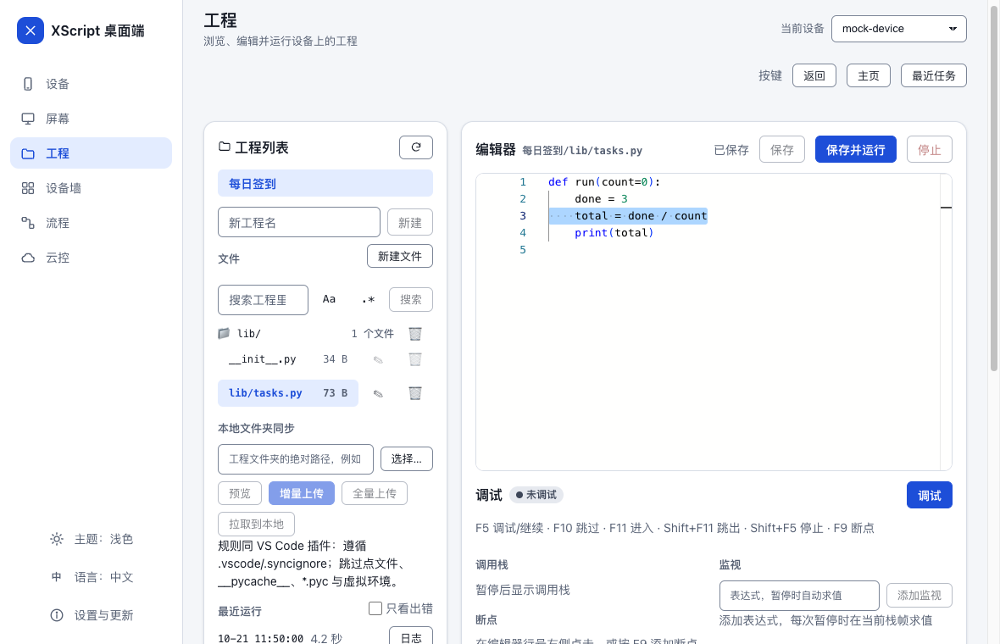 | 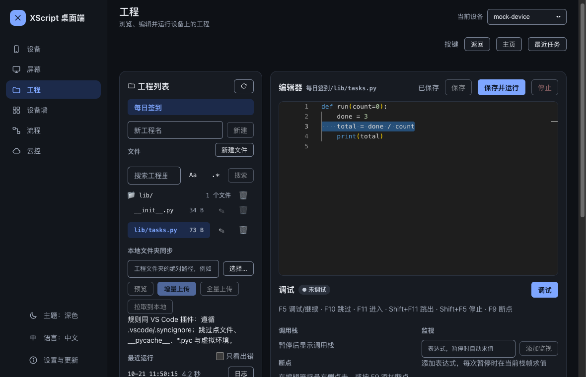 |

工程页打开 `.ui.json` 时的界面设计器（保存时生成 `.html` 与 `ui_<名称>.py`；重新生成：模拟设备上放 `res/ui/settings.ui.json`，`--run-js tools/screenshot-ui-designer.js`）：

| 浅色 | 深色 |
| --- | --- |
|  | 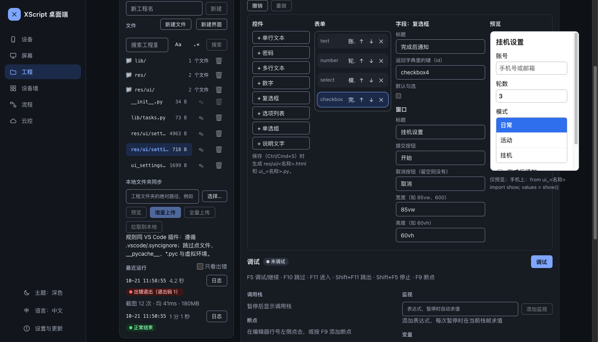 |

连不上设备时的提示（带「连不上怎么办」链接，打开 [docs/TROUBLESHOOTING.md](../docs/TROUBLESHOOTING.md)）：

| 浅色 | 深色 |
| --- | --- |
|  | 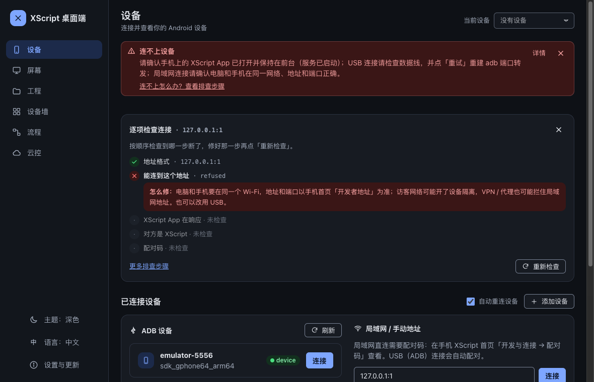 |

重新生成：`python -m xscript_desktop --data-dir <临时目录> --screenshot out.png --run-js tools/screenshot-connect-error.js --screenshot-delay 6 --theme light --size 1180x760`（脚本在设备页连接 `127.0.0.1:1`，不需要设备；下面同时出现「逐项检查连接」，停在「能连到这个地址」）。

连接失败后自动出现的「逐项检查连接」（USB 设备，手机上的 XScript 没打开）：

| 浅色 | 深色 |
| --- | --- |
|  | 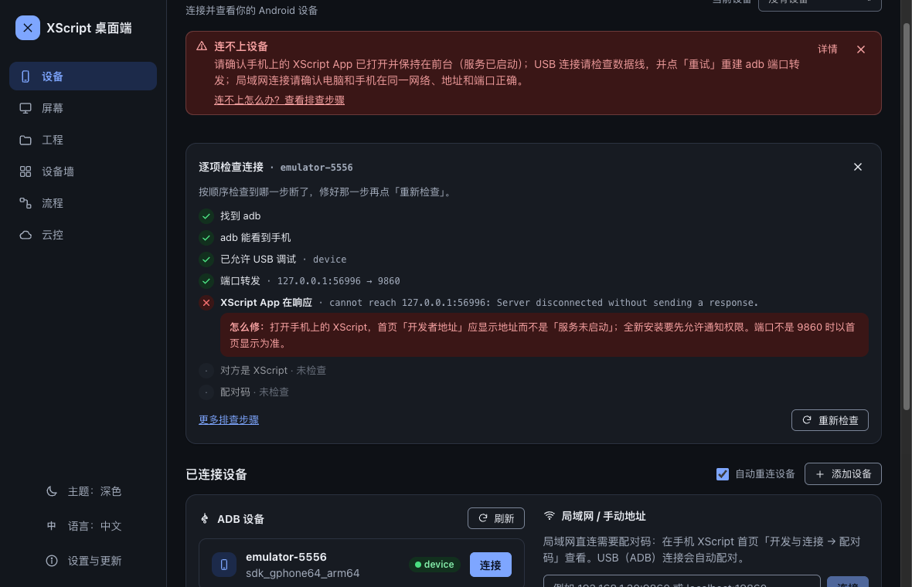 |

重新生成：手机上先强制停止 XScript，然后把上面的 `--run-js` 换成 `tools/screenshot-connect-check.js`、`--screenshot-delay 9`。

屏幕页的「截图状态」卡片（模拟器冷启动后系统录屏授权失效、无障碍关闭）：

| 浅色 | 深色 |
| --- | --- |
|  | 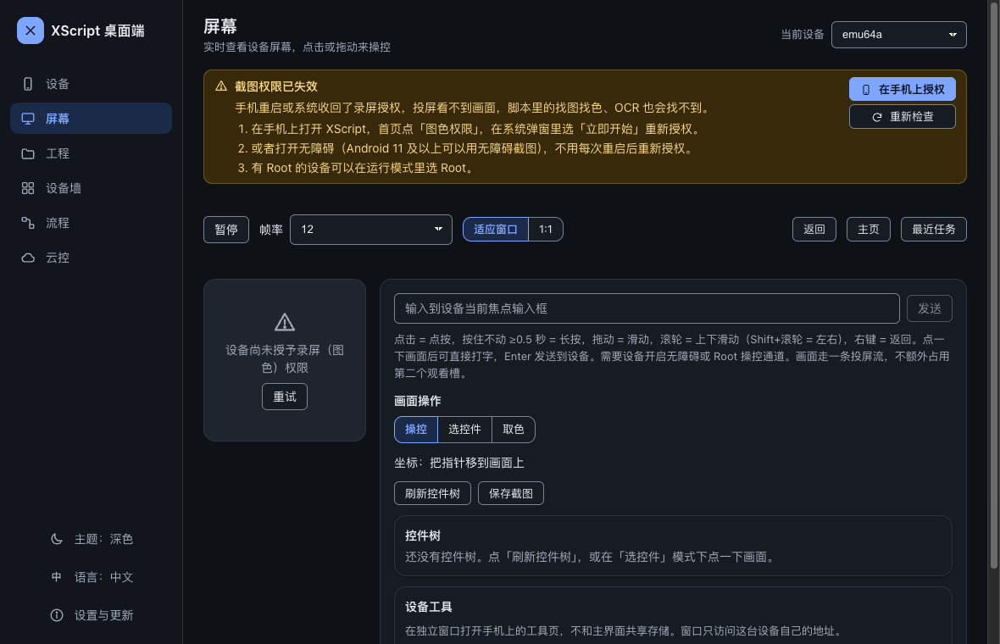 |

重新生成：模拟器冷启动后关闭无障碍、打开 XScript，然后 `PYTHON_KEYRING_BACKEND=keyring.backends.null.Keyring python -m xscript_desktop --data-dir <临时目录> --adb <adb> --connect-adb <serial> --screenshot out.png --run-js tools/screenshot-capture-status.js --screenshot-delay 8 --theme light --size 1180x760`（`PYTHON_KEYRING_BACKEND` 让这次运行不把配对码写进系统钥匙串）。

## P5 安装包与更新（已实现）

| 内容 | 说明 | 位置 |
| --- | --- | --- |
| macOS dmg | PyInstaller 打包，**只用 ad-hoc 签名**（没有 Developer ID，未公证）。`check_macos_dmg.sh` 证明 dmg 在本机真的能打开：校验签名 → 复制出 App → 直接启动和经 LaunchServices（`open`）各跑一次 `--selftest`，`--gui` 再正常开窗 8 秒。全程临时 `--data-dir`，不碰 `/Applications` 和用户数据 | `app/packaging/build_macos_app.sh`、`build_macos_dmg.sh`、`check_macos_dmg.sh` |
| Windows 安装包 | PyInstaller onedir + Inno Setup：按用户安装到 `%LOCALAPPDATA%\Programs\XScript`，不需要管理员权限；同一个 AppId 原地升级。**没有代码签名**（SmartScreen 提示「更多信息 → 仍要运行」，见 `release-notes-windows.md`）。CI 在 windows-latest 上构建、静默安装到临时目录、跑安装目录里的 `XScript.exe --selftest --report`、再静默卸载（安装后约 573 MB） | `app/packaging/build_windows.sh`、`xscript.iss`、`check_windows_install.sh` |
| 自动更新 | 更新清单 `desktop-update.json`（版本、每个平台文件的大小和 sha256）用 **Ed25519** 签名（`.sig`）。客户端先验签名再解析，下载后核对大小和 sha256，**用户确认后**才安装：macOS 把新 App 复制到旁边并校验签名 / bundle id / 版本，退出后由小助手脚本换掉旧 App 并重新打开（失败会还原）；Windows 退出后静默运行新安装包再打开。只有比当前新的版本才会提示；只接受 https（或本机 http 测试源） | `app/xscript_desktop/services/updater.py`、`packaging/make_update_feed.py` |
| 设置 → 关于与更新 | 侧栏「设置与更新」：当前版本、检查更新、下载进度、「安装并重启」（确认框）、启动时自动检查（每天最多一次，有新版本时按钮上有小圆点） | `frontend/src/components/UpdatePanel.tsx` |
| 诊断包 | 「导出诊断包…」写一个 zip：`info.json`（版本、系统、设备数量和状态、更新状态）+ 桌面端日志（`<数据目录>/logs/desktop.log`，轮转 3 × 1 MB）。令牌、密码、配对码、私钥替换成 `***`，家目录写成 `~`；不读系统凭据库，不上传 | `app/xscript_desktop/services/diagnostics.py` |

| 设置 → 关于与更新（本地测试更新源） | English |
| --- | --- |
|  | 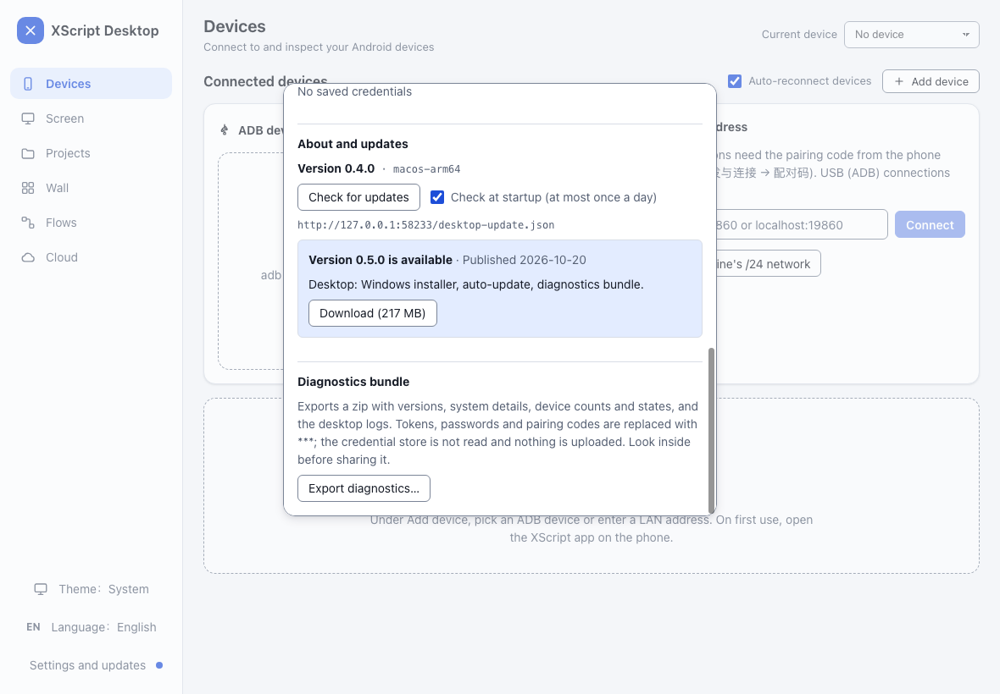 |

**更新签名密钥还没有**：正式版本的客户端里 `UPDATE_PUBLIC_KEYS` 是空的，所以「检查更新」会说明「没有配置更新签名公钥」，正式 Release 也不会带更新清单。要启用：生成一把 Ed25519 密钥（`python packaging/make_update_feed.py --new-key key.txt`），私钥放进仓库 Secrets `DESKTOP_UPDATE_KEY`，打印出来的公钥写进 `UPDATE_PUBLIC_KEYS`；之后 `release.yml` 会签出清单一起发布。这一步需要仓库管理员操作。

**不用真实 Release 测试自动更新**（macOS）：

```bash
desktop/app/.venv/bin/python scripts/desktop_update_e2e.py
```

它构建当前版本和一个测试版本 `X.Y.(Z+1)-dev1`（临时 git worktree），确认两个 dmg 都能打开，把旧版装到临时「应用程序」目录，用临时密钥签一个本地更新源，然后：用别的公钥运行 → 拒绝、不下载；用对的公钥 `--update-now` → 下载、校验、替换、重新打开，新版 `--selftest` 报告新版本号。手动试也可以：设置环境变量 `XSCRIPT_UPDATE_FEED=http://127.0.0.1:端口/desktop-update.json` 和 `XSCRIPT_UPDATE_PUBKEY=<公钥>` 再启动。

`release.yml` 在改到打包或工作流的 PR、以及手动运行时演练：构建 dmg 和 setup.exe 并各自验证，再用一次性密钥签一个包含两者的更新清单，用客户端自己的校验代码检查，全部作为 artifact 上传，不建 Release、不打标签。

## P4 云控（已实现）

侧栏「云控」（Ctrl+6）连接自托管管理后台 `backend/xscript_server`，在桌面端管理云控设备。所有请求都经 Python 发出，页面本身不联网。

| 分区 | 做什么 | 角色 |
| --- | --- | --- |
| 连接 | 填后台地址和 **API 令牌**（后台「账号 → API 令牌」新建，`xsk_` 开头）。令牌只存系统凭据库（`backend/<地址>`），不进日志、数据库或 RPC 应答；换后台时删掉旧令牌。只接受 https，或本机 `http://localhost` / `127.0.0.1`。令牌失效、连不上分别提示；代理账号不能用 | 全部 |
| 概览 | 后台整体情况（和网页「概览」同一份 `GET /api/overview`）：在线 / 运行中 / 设备总数、24 小时活跃，定时任务、打包、小程序数量，24 小时告警和异常退出，最近备份；可跳到对应分区（#219，计划见 `docs/plans/desktop-admin-console.md`） | 全部 |
| 设备 | 后台设备表：搜索 ID / 型号 / 备注，按分组、应用、在线状态筛选，分页；多选跨页、跨筛选保留。上方「批量命令」对勾选设备运行工程 / 停止，结果逐台列出（离线的标出来） | 查看：全部；命令：操作员+ |
| 画面 | 在线设备实时缩略图（和设备墙同样的卡片，可暂停）。图片走 `xsapp://app/_cloudshot/<id>.jpg`，由 Python 经后台转发设备的 `/screen` | 操作员+（后台只允许他们转发屏幕） |
| 日志 | 按设备检索后台保存的运行日志（文字、日志流筛选，往前翻页；设备离线也能查） | 全部 |
| 任务 | 服务端定时任务：启用 / 停用、立即运行、删除，新建运行 / 停止任务（每天定时或间隔） | 查看：全部；编辑：操作员+ |
| 部署 | 把流程编辑器当前打开的流程作为后台小程序的新版本上传（第一次自动建小程序；不发布、不影响热更新），装到选定分组的在线设备并运行；「历史版本」可回滚 | 管理员 |
| 打包 | 后台 APK 打包任务：状态、日志、取消、「保存 APK…」 | 查看 / 保存：全部；取消：操作员+ |
| 后台网页 | 在系统浏览器打开后台各页（设备、设备墙、定时任务、小程序、打包、审计）。**不内嵌**：网页用自己的登录，桌面端令牌不进网址或网页 | 全部 |

按钮按角色灰显并说明原因；后台对每个请求还会再检查一次权限。

| 设备与批量命令 | 只读账号（灰显） |
| --- | --- |
|  | 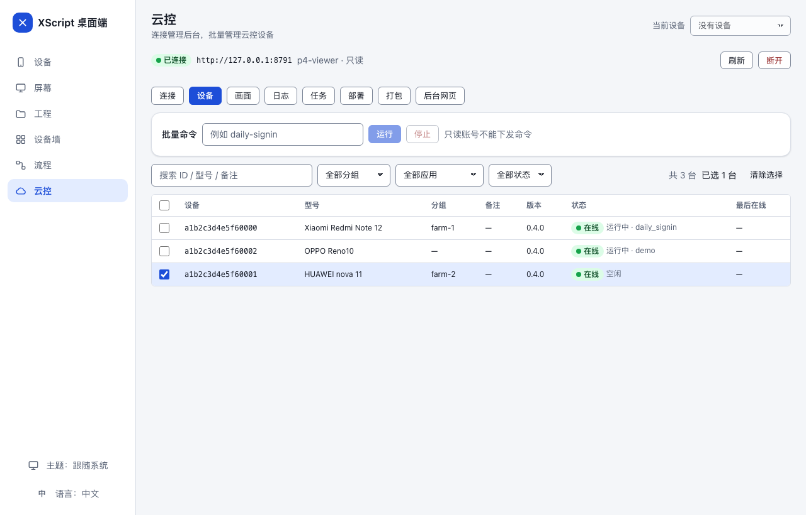 |

| 部署与回滚 | 画面 |
| --- | --- |
| 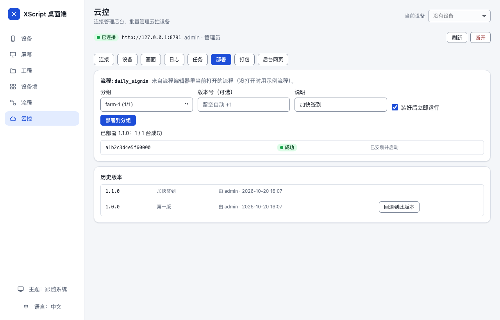 | 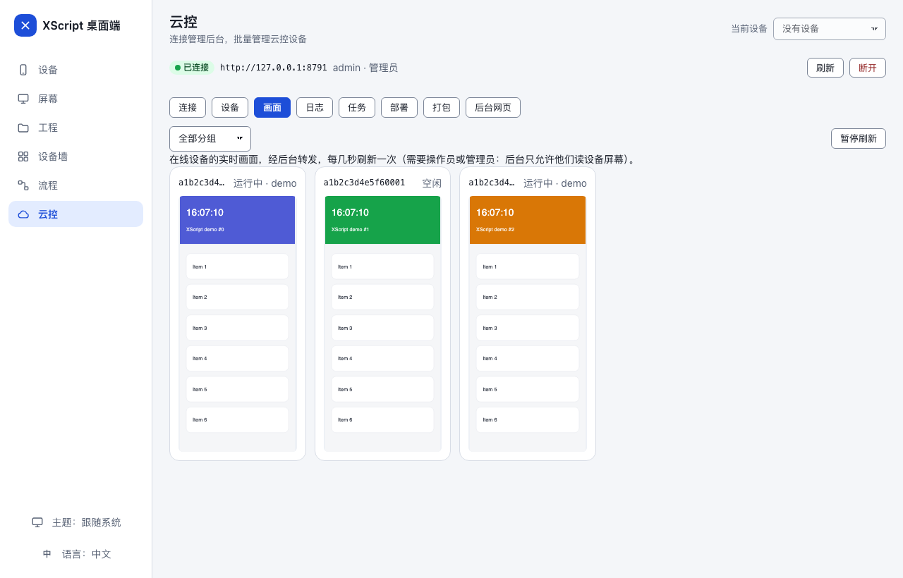 |

| 日志 | 后台网页 |
| --- | --- |
| 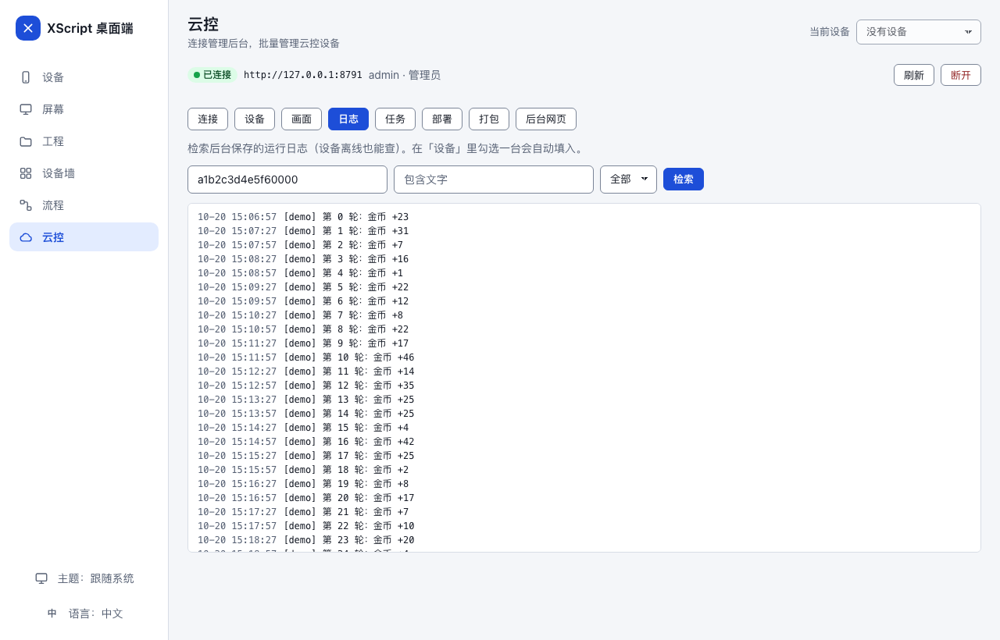 | 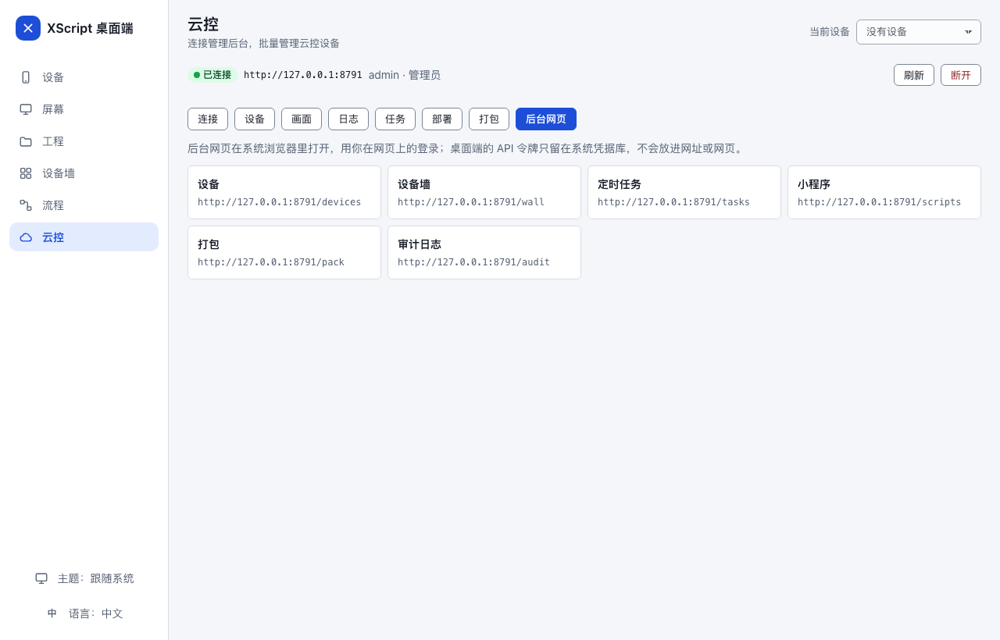 |

其余截图：[连接](../docs/images/desktop-cloud-connect.png)、[任务](../docs/images/desktop-cloud-tasks.png)、[打包](../docs/images/desktop-cloud-pack.png)。截图来自本地后台（`scripts/desktop_cloud_e2e.py serve`，演示手机），真实桌面窗口。

测试：`app/tests/test_cloud.py`（`tests/fake_backend.py` 假后台：错误码、令牌不外泄、参数校验、各角色）、`test_shell.py` 里的 `_cloudshot` 图片路径、前端 `tests/cloud.test.tsx`（演示后台 `src/cloud-demo.ts`）。端到端：

```bash
.venv/bin/python scripts/desktop_cloud_e2e.py serve /tmp/p4.json            # 本地后台 + 管理员 / 只读令牌（只写进 0600 文件）
desktop/app/.venv/bin/python scripts/desktop_cloud_e2e.py check /tmp/p4.json emulator-5554 9860 com.xscript.app.perf
```

`check` 让模拟器上的 App 连上这个后台（分组 `p4-e2e`），再用桌面端自己的 `cloud.*` 接口走一遍：连接 → 设备表 → 部署两个版本 → 批量运行 → 检索日志 → 回滚 → 停止 → 任务 → 打包列表 → 缩略图；再用只读账号确认命令、部署和缩略图被后台拒绝。最后删掉设备上的测试工程，并让 App 断开云控（`cloud.close()`，会清掉 App 里保存的云控地址）。

## 目录

```text
desktop/
  app/        Python 包 xscript_desktop（PySide6 外壳 + 服务层 + 桥）
    xscript_desktop/   main.py（入口）、window.py、scheme.py、bridge.py、rpc.py、context.py、runtime.py、services/
    tests/             pytest：单元、Qt 集成（offscreen）、真机（需 XSCRIPT_DEVICE_TESTS=1）
    tools/entry_probe.py
  frontend/   React + Vite + TS；构建产物写进 app/xscript_desktop/resources/app/（已 .gitignore）
```

## 运行（macOS / Linux 开发）

需要：Python ≥ 3.10、Node ≥ 22、`adb`（Android platform-tools；找法见下）。

```bash
# 1) 前端
cd desktop/frontend && npm ci && npm run build          # 产物 -> desktop/app/xscript_desktop/resources/app/

# 2) Python 外壳
cd ../app && python3.10 -m venv .venv && .venv/bin/pip install -e '.[test]'
.venv/bin/python -m xscript_desktop                      # 打开窗口
.venv/bin/python -m xscript_desktop --selftest           # 无头自检：加载前端、桥往返一次，退出码 0/1
.venv/bin/python -m xscript_desktop --selftest --connect-adb emulator-5554   # 并连上设备、打印设备信息
```

打包成 macOS 应用：`app/packaging/build_macos_app.sh` → `app/dist/XScript.app`（PyInstaller，自带 `.icns` 图标，Dock/菜单栏显示 XScript；`dist/XScript.app/Contents/MacOS/XScript --selftest` 可无头自检）。脚本最后会重新做 ad-hoc 签名并用 `app/packaging/verify_macos_app.sh` 校验（`codesign --verify --deep --strict`、Info.plist 已绑定、arm64）；签名之后不能再改动 bundle 里的任何文件，否则下载后的应用会被 macOS 报“已损坏”。`app/packaging/build_macos_dmg.sh` 打包成 `app/dist/xscript-desktop-vX.Y.Z-macos-arm64.dmg`，并在 dmg 内再校验一次；发布时由 release 工作流在 macOS 运行器上构建并附到 Release（`app/packaging/release-notes-macos.md` 是首次打开说明）。

`adb` 的查找顺序：`--adb` 参数 → `XSCRIPT_ADB` → `ANDROID_SDK_ROOT`/`ANDROID_HOME` → `PATH` → 各系统默认目录（macOS `~/Library/Android/sdk`；Windows `%LOCALAPPDATA%\XScript\platform-tools`、`%LOCALAPPDATA%\Android\Sdk`，⚠ Windows 未验证）。

前端热更新开发：`cd frontend && npm run dev`，再 `python -m xscript_desktop --dev-url http://localhost:5173`（外壳会把 `qwebchannel.js` 注入页面）。
直接用浏览器打开 `http://localhost:5173` 是「演示模式」（假数据，不连设备）。

## 测试

完整方案与用例编号表：[`docs/桌面端-测试方案.md`](../docs/桌面端-测试方案.md)（分层：单元 / 集成 / 前端组件 / 真实外壳 e2e / 安全 / 视觉回归 / 性能 / Windows 逻辑模拟 / 真机）。

```bash
cd desktop/app && .venv/bin/python -m pytest -q                                   # 433 个通过、5 个真机用例默认跳过（macOS，约 2 min；含 10 张视觉回归与工程页/投屏 e2e）
cd desktop/app && .venv/bin/python -m pytest -q --cov --cov-report=term-missing   # 覆盖率 96%（含子进程里的 --selftest/--screenshot）
cd desktop/app && XSCRIPT_DEVICE_TESTS=1 .venv/bin/python -m pytest -m device -v  # 真机/模拟器（只读 + adb forward；5554 与 5556 已通过）
cd desktop/frontend && npm run typecheck && npm run test:coverage                  # tsc + vitest（216 个，含对比度/令牌检查）
python desktop/app/tools/gen_test_matrix.py --check                                # 测试方案里的编号表没有过期
```

e2e 用例要先 `npm run build`（否则自动跳过）。视觉回归的基线按平台存放（`app/tests/baselines/darwin/`，只有 macOS 的；Linux CI 与 Windows 没有基线所以跳过）；`XSCRIPT_UPDATE_BASELINES=1 pytest -m visual` 重新生成。

## 设备连接的约定

- **ADB**：每台设备建自己的 forward，本地端口由 adb 自动分配（`forward tcp:0 tcp:9860`），**不占用 19860 之类的固定端口**，所以不会与 VS Code 扩展 / 其它工具抢端口。只删除本进程创建的 forward，别人的不动。要用固定端口，可以先自己 `adb forward tcp:19860 tcp:9860`，再在「局域网/手动地址」里填 `localhost:19860`。
- **配对码**：设备 API 默认需要配对码。ADB 连接经 `adb forward tcp:0 localabstract:xscript-pair.<包名>` 自动读取（只有 adb 守护进程能读到，不用 `adb shell`）；局域网连接在设备卡片上输入一次，保存在系统钥匙串（凭据槽 `device/<设备 id>`）。手机上重新生成配对码后，卡片会变成「待配对」。
- **局域网**：手机关闭了配对（或 App 版本较旧）时，非回环地址会显示警告；优先用 ADB。
- 页面 → Python 的所有请求都走桥；截图这种二进制走 `xsapp://app/_shot/<设备id>.jpg`，不走 JSON。
- 本阶段**不会**对设备做 `adb install` / `uninstall` / `pm clear`（`AdbService` 里没有这些封装）。
