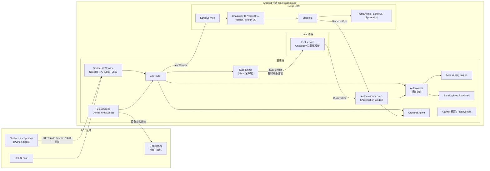
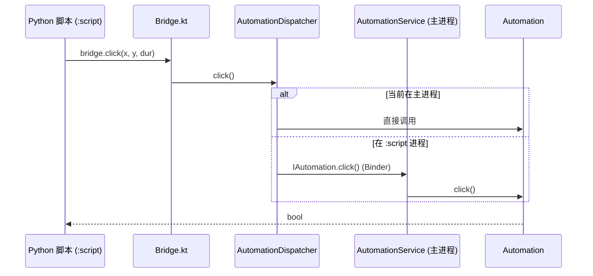
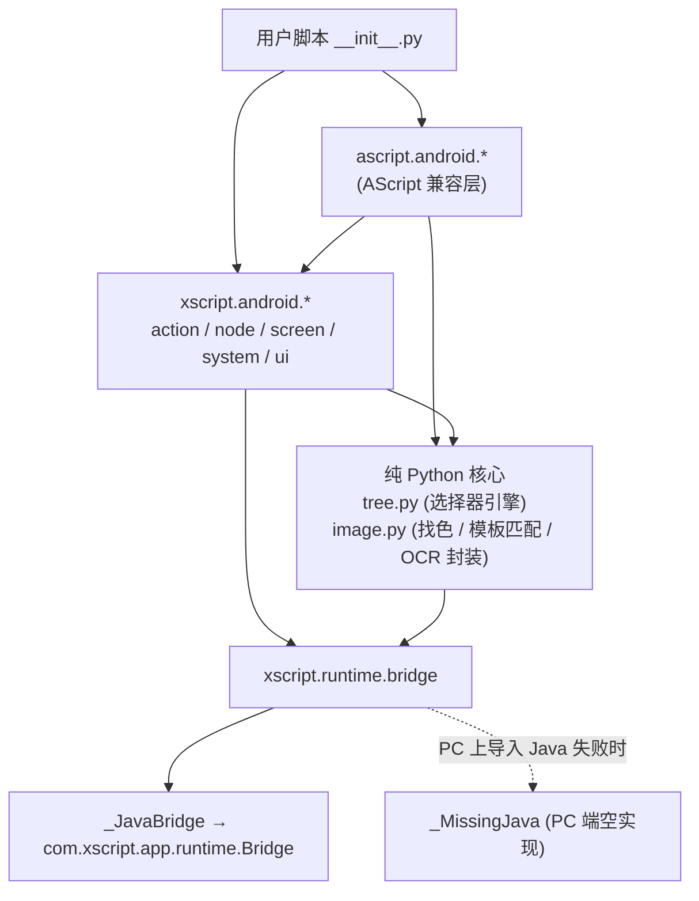
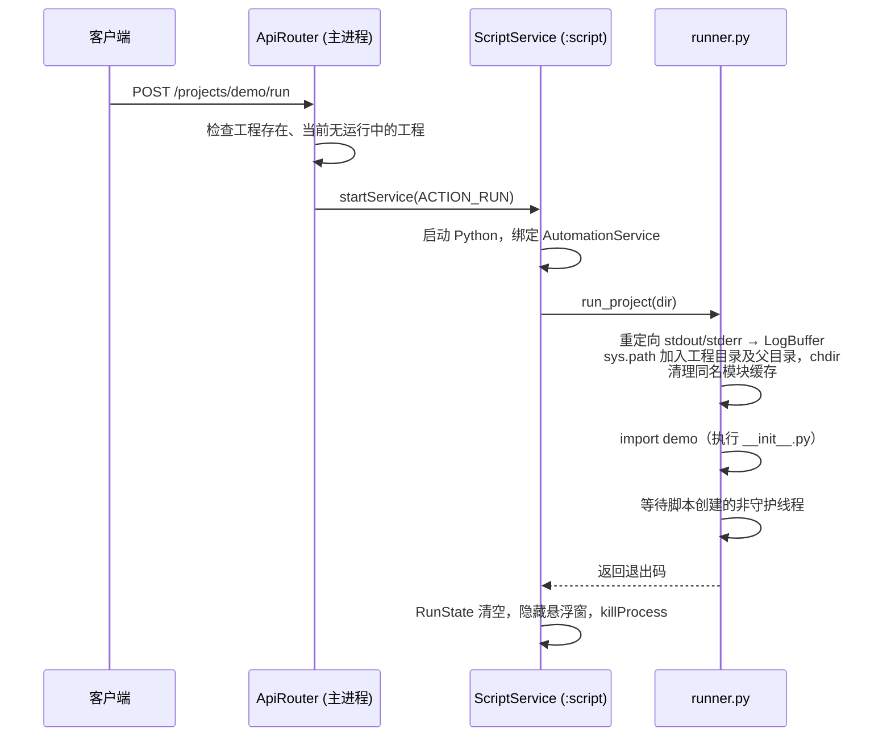

# XScript 技术架构

XScript 是一个运行在 Android 上的 Python 自动化 App（AScript 风格）。PC 端（浏览器、Cursor MCP、云控服务器）通过 HTTP / WebSocket 把脚本推送到手机，手机上用内嵌的 CPython 3.10 执行，并通过无障碍服务或 root 完成点击、取节点树、截图、OCR 等操作。

本文基于当前仓库源码整理（Android 端约 5.9k 行 Kotlin，Python 端约 6.5k 行）。

## 1. 总览



## 2. 仓库结构

| 目录 | 语言 | 职责 |
| --- | --- | --- |
| `android/` | Kotlin | App 本体：HTTP 服务、云控、无障碍/root 引擎、截图、OCR、悬浮窗、Chaquopy 集成 |
| `android/app/src/main/assets/tools/` | HTML/JS | 设备提供的网页开发工具：图色工具、标注工具、投屏 |
| `python-runtime/xscript/` | Python | 设备端原生 API：`action`、`node`、`screen`、`system`、`ui`，以及 `runtime`（桥接、运行器） |
| `python-runtime/ascript/` | Python | AScript（ascript-tip 1.3.0）兼容层，基于 `xscript` 实现 |
| `python-runtime/tests/` | Python | PC 端单测（使用假的 bridge，不依赖手机） |
| `python-stubs/` | `.pyi` | 由 `scripts/gen_stubs.py` 生成的类型存根，供 PC 端 IDE 补全 |
| `protocol/openapi.yaml` | YAML | 设备 HTTP 接口契约 |
| `mcp-server/` | Python | Cursor MCP 服务 `xscript-mcp` |
| `scripts/` | Bash/Python | 构建、存根生成、mock 设备、端到端冒烟、本地校验 |
| `examples/` | Python | 示例工程（原生 API 与 AScript API 各一套） |

## 3. 技术栈

| 层 | 选型 |
| --- | --- |
| Android | Kotlin、JDK 17、`minSdk 26` / `targetSdk 34` / `compileSdk 37`，ABI 仅 `arm64-v8a`、`x86_64` |
| 嵌入式 Python | Chaquopy 17，CPython 3.10（选 3.10 是因为 Chaquopy 的 OpenCV wheel 最高只到 3.10） |
| Python 依赖（APK 内） | `numpy 1.23.3`、`opencv-python 4.5.1.48`、`pillow 9.2.0`、`pyyaml 6.0.3`、`requests 2.32.3` |
| HTTP 服务 | NanoHTTPD 2.3.1 |
| 云控 / 网络 | OkHttp 4.12.0（WebSocket） |
| OCR | Google ML Kit `text-recognition-chinese` 16.0.1（离线模型） |
| UI | AndroidX AppCompat + Material，界面为代码构建（`UiKit.kt`），无 Compose |
| MCP | `mcp 2.2.0`（兼容 1.x FastMCP）、`httpx 0.28.1` |

## 4. Android 端

### 4.1 进程模型

App 有三个进程，这是整个架构最核心的设计：

| 进程 | 组件 | 生命周期 |
| --- | --- | --- |
| 主进程 `com.xscript.app` | `XscriptApp`、各 Activity、`XscriptAccessibilityService`、`DeviceHttpService`（前台服务）、`AutomationService`（Binder）、`CloudClient`、`CaptureEngine`、`FloatControl` | 常驻 |
| `:script` 进程 | `ScriptService`、Chaquopy 解释器、`Bridge`、`ScriptUi`、`OcrEngine`、`SystemApi` | 每次运行一个工程，结束或停止时 `Process.killProcess` 自杀 |
| `:eval` 进程 | `EvalService`、Chaquopy 解释器 | 首次 `/eval` 时拉起并常驻；超时或崩溃时被杀，下次调用重新拉起 |

这样拆分的原因（见 `ScriptService.kt`、`IAutomation.aidl` 注释）：

- 停止脚本 = 杀进程。任意 Python 代码（死循环、阻塞的 native 调用、子线程、悬浮窗）都无法被可靠地中断，杀进程是唯一可靠手段。
- 脚本崩溃不会带走无障碍服务和 MediaProjection 截图会话，它们都留在主进程里。

`:eval` 和 `:script` 一样通过 `IAutomation` 访问主进程的自动化能力，因此 eval 里的代码与脚本里的代码行为一致。

`XscriptApp.onCreate` 通过进程名判断 `isMainProcess`，只有主进程会探测 root、启动 `AutomationService` 并自动连接云控。

### 4.2 跨进程通信



- `AutomationDispatcher` 是统一入口：主进程内直接调用 `Automation`，`:script` 进程内走 `IAutomation` Binder。Binder 连接是异步建立的，`rpc()` 最多等 3 秒。
- 大数据（节点树 JSON、截图原始帧）经 `ParcelFileDescriptor.createPipe()` 传输（`Pipes.kt`），绕开 Binder 1 MB 事务限制。
- 截图帧格式由 `FrameCodec` 定义：8 字节小端头（宽、高）+ ARGB_8888 原始像素。Python 侧用 numpy 直接解码，不走 PNG 编解码。
- `AutomationService` 的每个方法都包了一层 `safe {}`，异常时返回空值 / `false`，避免远程异常把脚本进程打挂。
- 其它跨进程状态用文件共享：
  - `RunState`：`filesDir/running-project` 记录当前运行的工程名，主进程再用进程列表校验 `:script` 是否还活着，避免崩溃后一直显示“运行中”。
  - `LogBuffer`：`filesDir/logs/runtime.jsonl`（JSON Lines）+ `seq` 序号文件。跨进程用文件锁互斥，进程内先用 JVM 锁串行化（同一进程重复 `FileChannel.lock()` 会抛异常而不是阻塞）。超过 2 MB 截断保留尾部 512 KB。`/logs?since=` 从文件尾部按 64 KB 分块反向扫描，读到调用方已有的序号就停止，所以轮询成本与新增条目数成正比，与文件大小无关；序号被重置（清除数据）时返回最新条目。

### 4.3 自动化通道（`Automation.kt`）

根据设置里的“运行模式”（`auto` / `accessibility` / `root`）选择通道：

| 能力 | 无障碍通道 | Root 通道 |
| --- | --- | --- |
| 点击 / 滑动 / 手势 | `dispatchGesture` | `input tap` / `input swipe`；多点手势退化为首笔画的 `input motionevent` 回放 |
| 节点树 | `AccessibilityNodeInfo` → `NodeDumper` | `uiautomator dump`（部分 ROM / MuMu 模拟器上不可用） |
| 节点操作 | `performAction` | 按节点中心坐标模拟点击 / 输入 / 滑动 |
| 文本输入 | `ACTION_SET_TEXT` | `input text` |
| 按键 | 全局动作；`key:<code>` 强制走 root `input keyevent` | `input keyevent` |

规则：

- `auto` 模式优先无障碍，其次 root。
- 只要无障碍开着，节点树和节点操作就一律走无障碍（更快、信息更全），即使运行模式是 root。
- `RootShell.run` 复用一个常驻 `su` shell 执行手势、按键、文本输入等只关心退出码的命令：每条命令包在 `sh -c` 里，后面追加带序号的结束标记来读取退出码；超时或 shell 退出时重建会话，失败时回退到一次性的 `su -c`。需要输出或二进制数据的命令（`screencap`、`uiautomator dump`、`dumpsys`、`system.shell`）仍然用 `exec` / `execRaw` 单独起进程。在 MuMu 模拟器上实测，每次 `su` 启动约 250 ms，`/action` 按键请求由此从约 250 ms 降到约 8 ms。
- root 状态缓存，否定结果每 30 秒后台重新探测一次。

节点路径（`path`）是真实树中的索引路径，即使 mode 0 精简输出时剪掉了兄弟节点，也能据此重新定位节点。

### 4.4 截图（`CaptureEngine.kt`）

来源按优先级降级：

1. MediaProjection（系统录屏，需要一次授权，最快）。屏幕静止时不会产生新帧，所以缓存最后一帧。
2. 无障碍截图（API 30+），系统限流约 3 fps，代码里做了 340 ms 节流。
3. Root `screencap`（不带 `-p`，直接读原始 RGBA，省去 PNG 编码）。

有一个针对模拟器的兜底：MuMu、雷电等模拟器的无障碍截图可能是全黑的。引擎用 12×12 采样网格检测纯黑帧，如果 root 截图正常，就在 10 分钟内不再信任无障碍截图。

### 4.5 对外 API（`ApiRouter.kt`）

`ApiRouter` 与传输层无关，被 HTTP 服务和云控 WebSocket 共用，因此两种入口暴露的是完全相同的接口（契约见 `protocol/openapi.yaml`）：

| 分类 | 接口 |
| --- | --- |
| 设备 | `GET /status`、`GET /screen`（png / jpg）、`GET /ui-tree?mode=`、`POST /action`、`GET/PUT /settings` |
| 工程 | `GET /projects`、`POST/DELETE /projects/{name}`、`GET/PUT /projects/{name}/files`、`GET/DELETE /projects/{name}/file`、`GET/PUT /projects/{name}/zip`、`POST /projects/{name}/run`、`POST /projects/{name}/stop` |
| AScript 迁移 | `GET /ascript/projects`、`POST /ascript/import`（从 `/sdcard/airscript/model` 导入） |
| 调试 | `GET/DELETE /logs`、`POST /eval` |
| 开发工具 | `GET /tools/`（网页）、`/tools/snapshots`、`POST /tools/vision`、`/tools/datasets/...`、`GET /screen/stream`（投屏） |

异常统一映射：`IllegalArgumentException` → 400，`IllegalStateException` → 409，其它 → 500。

`Reply` 可以携带内存字节，也可以携带文件（`Reply.file`）。zip 导出先写临时文件，`?raw=1` 读取工程文件时直接返回原文件，HTTP 层都以流的方式发送。

**HTTP 服务**（`DeviceHttpServer` / `DeviceHttpService`）：

- 作为前台服务运行（`dataSync | mediaProjection`），监听 `0.0.0.0`，默认端口 9860，被占用时依次尝试到 9869。刻意避开 AScript 的 9096 及其备用端口，两个 App 可以同时安装、同时运行，`adb forward` 也不会转到错误的 App。
- **无鉴权**：任何能访问端口的人都可以调用全部接口。
- **无 CORS 头**：不发送 `Access-Control-Allow-*`，其他网站的页面无法读取接口响应。设备自带的开发工具页面（`/tools/`）与接口同源，不受影响。
- **请求体**：上限 200 MB，先校验 `Content-Length`。4 MB 以内放内存，更大的写入 `cacheDir/http-spool` 临时文件，交给路由时以流读取，请求结束后删除。仍然不用 NanoHTTPD 的 `parseBody`，避免破坏二进制上传。
- 请求头 `X-XScript-Client` 用于 `ClientTracker` 在首页展示已连接客户端。

**云控**（`CloudClient`）：设备主动外连 `ws://` / `wss://`，能穿透 NAT。协议是 JSON 文本帧：

```text
device → server  {"type":"hello","device":{...status}}
server → device  {"type":"request","id":"1","method":"GET","path":"/status","query":{},"body":"<base64>"}
device → server  {"type":"response","id":"1","status":200,"mime":"...","body":"<base64>"}
```

请求由 2 线程的线程池处理，25 秒 ping 保活，断线后 5 秒重连。鉴权完全交给服务端（例如 URL 中带 token）。云控无法流式传输，文件类回复会用 `Reply.bytes()` 读进内存后 base64 发送。

### 4.6 开发工具（`tools/`：图色、标注、投屏）

对应 AScript 网页端的图色工具、YOLO 标注工具和投屏。页面放在 `assets/tools/`（原生 HTML/JS，无构建步骤），由设备的 HTTP 服务直接提供，浏览器打开 `http://<ip>:<端口>/tools/` 即可使用。

| 组件 | 职责 |
| --- | --- |
| `ToolsRouter` | 处理 `/tools/*`：静态页面、快照、裁剪模板、图色测试、数据集 |
| `SnapshotStore` | 把当前屏幕冻结为 PNG（`filesDir/tools/snapshots`，保留最近 20 张），取色、裁剪、测试都基于同一帧，数值前后一致 |
| `vision.py`（`:eval` 进程） | `POST /tools/vision` 经 `IEval.vision` 在 `:eval` 进程执行 pixel / 找色 / 比色 / 找图 / OCR，复用脚本使用的 `xscript.android.image`，所以工具里测出来的结果与脚本运行时一致；超时同样杀进程 |
| `DatasetStore` | 标注数据集（外部存储 `datasets/<name>/`：`meta.json`、`images/`、`labels/<id>.json`，框以像素存储）；导出 Ultralytics 格式 zip（`images/`、`labels/` 的 train/val 划分 + `data.yaml`） |
| `ScreenStream` | 投屏：生产线程截图、缩放、JPEG 编码后写入管道，HTTP 以 chunked `multipart/x-mixed-replace` 推给浏览器；客户端断开时写入失败，线程退出；最多 2 路 |

投屏页的点击和拖动按画面比例映射回屏幕像素，再调用 `/action`，因此走的是和脚本相同的自动化通道（无障碍或 root）。帧率取决于截图来源：MuMu 上 root `screencap` 约 2.5 fps，授予图色权限（MediaProjection）后更快。

MCP 也提供了对应工具（`take_snapshot`、`vision_test`、`crop_template`、`list_datasets`、`export_dataset`），AI 可以先在冻结的截图上调好颜色、相似度和区域，再写进脚本。

### 4.7 工程存储（`ProjectStore.kt`）

- 工程目录：`<外部 files 目录>/projects/<name>/`，入口为 `__init__.py`，资源约定放在 `res/img/`。
- 目录名同时是 Python 包名，所以必须是合法标识符（允许中文，与 AScript 一致）。
- 相对路径做了规范化，拒绝 `..` 和空段，防止路径穿越。
- 支持 zip 导入 / 导出和 AScript 工程导入。
- zip 导入逐条目流式解压到 `import-tmp/` 暂存目录，确认包含 `__init__.py` 后才删除旧工程并移动文件（同一文件系统内是 rename），所以坏的 zip 不会破坏已有工程，大文件也不会整块读进内存。

### 4.8 脚本侧原生能力

这些组件运行在 Python 所在进程，由 `Bridge.kt` 以静态方法暴露给 Python：

- `OcrEngine`：ML Kit 中文 + 拉丁离线识别，返回行 / 元素及坐标。ML Kit 的初始化 Provider 只覆盖主进程，所以非主进程会手动初始化。
- `ScriptUi`：toast、阻塞式对话框、悬浮 WebView 窗口（注入 `xscript` / `airscript` 两个 JS 接口）、绘图画布。Python 通过 `ui_poll` 轮询窗口事件，没有 Java→Python 回调，线程模型简单。
- `SystemApi`：打开应用、设备 / 电量 / 内存信息、剪贴板、KeyValue 存储、shell（默认 root）、音量、亮度、TTS、振动等，以 `op` + JSON 参数分发。

### 4.9 界面

`MainActivity` 是仿 AScript 的首页（开发者地址、AI 编程连接、运行模式、各项权限、云控、小程序列表等），另有工程列表、工程详情、简易编辑器、日志页。`FloatControl` 是运行时的悬浮停止按钮，放在主进程，这样脚本进程被杀后按钮也能正常收起。

## 5. Python 运行时

### 5.1 分层



- `bridge.py` 是 Python 与 Java 之间唯一的接触面。导入 Java 类失败（即在 PC 上）时自动换成 `_MissingJava`，所有调用返回“不可用”的值，单测再对它打 monkeypatch。
- `tree.py` 是纯 Python 的节点查询引擎：对 dump 出来的树建立父子 / 兄弟索引，按“过滤 → 关系（parent / child / brother）→ 过滤 …”的流水线求值。`node.Selector` 每次查找都重新 dump 一次整棵树，在 Python 侧匹配。
- `image.py`（约 900 行）是图色核心，`xscript.android.screen` 和 `ascript.android.screen` 共用：原始帧 → numpy BGR、多点找色、带 alpha 掩码的多尺度模板匹配（OpenCV，含降采样粗筛 + 局部精修）、OCR 结果封装。
- `ascript/` 按 ascript-tip 1.3.0 的 API 形状实现，已有 AScript 工程无需修改即可运行。暂不支持的接口通过 `_compat.warn_once` 提示。

### 5.2 运行流程



- 同一时间只运行一个工程，重复运行返回 409。
- 停止：`POST /stop` 或悬浮按钮 → `ScriptService` 收到 `ACTION_STOP` → 杀进程。
- `_wait_for_threads` 模拟 CPython 退出时 join 非守护线程的行为。在 Chaquopy 下解释器的“主线程”是 Android UI Looper，永远不会结束，所以显式跳过它和 `_DummyThread`。

### 5.3 `/eval`

`/eval` 面向 MCP 的短小探测（看一下节点、测一个颜色），约定把结果赋给 `_result`，超时时间限制在 200 ms～15 s 之间，长逻辑应放进工程里运行。

- 主进程的 `EvalRunner` 只是客户端：它绑定 `:eval` 进程里的 `EvalService`，通过 `IEval.run(code)` 执行，自己在线程池里等待结果。
- 超时后通过 `IEval.pid()` 拿到进程号并 `killProcess`，死循环和阻塞的 native 调用都会随进程一起结束。下次调用重新拉起进程（冷启动约 0.7～1.2 s，热调用约 10 ms）。
- 代码崩溃（例如 `os._exit`）会表现为 `DeadObjectException`，返回 `ok=false`，下次调用自动重连。
- 同一时间只执行一个 eval，因为超时杀进程会连带杀掉并发的其他 eval。
- MCP 侧拒绝 `while True` 的检查只是给 AI 的提示，真正的保证来自设备端杀进程。

## 6. PC 端工具链

### 6.1 MCP 服务（`mcp-server/`）

`xscript-mcp` 是一个 stdio MCP 服务，`DeviceClient` 用 httpx 调用设备 HTTP API，目标地址由环境变量 `XSCRIPT_DEVICE` 或 `connect_device` 工具设置。提供的工具：

- 设备：`connect_device`、`get_device_status`、`screen_capture`（返回 MCP Image）、`dump_ui_tree`、`device_action`
- 工程：`list_projects`、`list_project_files`、`read_project_file`、`upload_file`、`upload_directory`（本地打 zip 后上传，跳过 `.git`、`__pycache__` 等）、`delete_project`、`run_project`、`stop_project`、`get_run_log`
- 调试：`eval_python`（拒绝包含 `while True` 的代码）
- 文档：`get_module_apis`、`search_api`，查询本地 `api_catalog.json`

`docs/AGENT_RULES.md` 是给 AI 编程时用的约束说明。

### 6.2 存根与校验

- `scripts/gen_stubs.py`：用 `ast` 从 `python-runtime/` 生成 `.pyi`，保留签名、docstring 和常量，去掉函数体和私有成员；`--check` 用于检查存根是否过期。
- `scripts/mock_device.py`：按 `openapi.yaml` 实现的进程内 HTTP mock。
- `scripts/vertical_slice.py`：端到端走一遍 status → tree → upload → run → logs → screenshot，可以对 mock 或真机运行。
- `scripts/verify.sh`：运行时单测（`.venv-rt`，含 numpy / opencv）→ MCP 单测（`.venv`）→ 存根检查 → mock 端到端 → 检查 APK 是否存在。
- `scripts/build_android.sh`：定位 JDK、Android SDK 和 Python 3.10（可借助 `uv python find 3.10`），然后执行 Gradle 构建。Chaquopy 要求构建机 Python 的次版本号与内嵌解释器一致。

## 7. 关键设计取舍

| 设计 | 收益 | 代价 |
| --- | --- | --- |
| 脚本独立进程，停止即杀进程 | 停止可靠；脚本崩溃不影响无障碍和截图 | 每次运行都要冷启动 Python 并重新加载 numpy / cv2；跨进程调用有 Binder 开销 |
| eval 独立常驻进程，超时即杀 | eval 的死循环 / 崩溃不影响主进程；热调用快 | 多一个进程的常驻内存；超时后 eval 里的模块状态丢失 |
| 无鉴权 + 无 CORS | PC 端无需任何配置即可连接；浏览器网页无法读取接口响应 | 同一网络内任何设备都能上传文件、执行任意 Python |
| `ApiRouter` 与传输层解耦 | 局域网 HTTP 与云控接口完全一致 | 云控的 body 走 base64，大文件（截图、zip）体积增加约 33% |
| Python 侧做节点匹配 | 选择器逻辑可以在 PC 上单测，Java 侧只负责 dump | 每次 `find` 都要序列化并传输整棵树，复杂页面开销较大 |
| 原始 RGBA 帧 + Pipe | 截图不做 PNG 编解码，避开 Binder 限制 | 单帧体积大（1080×2400 约 10 MB），每次截图都要完整拷贝 |
| 通道自动降级（无障碍 → root） | 适配无 root / 无无障碍 / 模拟器等多种环境 | 多点手势在 root 下只能近似回放；常驻 `su` 会话串行执行命令 |
| 用文件做跨进程状态（RunState / LogBuffer） | 实现简单，进程被杀后状态仍然存在 | 每条日志都要打开文件、加锁、读写 seq 文件 |

## 8. 风险与后续方向

以下问题已经处理：CORS、eval 隔离与超时、大请求 / 大文件的内存占用、root 命令延迟、日志轮询成本（见第 4、5 节）。仍然存在的风险与可做的改进：

1. **局域网接口无鉴权**。同一网络内任何能访问端口的设备都可以上传文件、执行任意 Python（`/eval`、`/projects/<name>/run`）。只在可信网络中使用，或者通过 USB + `adb forward` 连接。
2. **云控通道没有设备侧鉴权**。它完全依赖中继服务器的认证，而且会把大文件整块读进内存再做 base64（体积增加约 33%）。可以考虑分片传输。
3. **依赖版本偏旧**。`opencv-python 4.5.1.48`、`numpy 1.23.3` 受 Chaquopy / Python 3.10 的 wheel 约束，升级 Python 版本前需要先确认 Chaquopy 对 OpenCV 的支持情况。
4. **投屏帧率受截图来源限制**。root `screencap` 每帧约 400 ms；未授予 MediaProjection 时投屏只有 2～3 fps。可以考虑 `screenrecord` H.264 流或 scrcpy 协议。
5. **截图和节点树的传输开销**。每帧原始 RGBA 约 8～10 MB，`Selector.find` 每次都要 dump 整棵树。可以做帧缓存 / 区域截图下推，或者把简单的选择器下推到 Java 侧过滤。
6. **日志写入**。每条日志都要打开文件、加锁、读写 seq 文件，高频 `print` 时开销明显。可以在 Python 侧按时间窗口批量写入。
