# XScript 使用手册

这份手册说明每个系统从哪里进入、怎么打开、第一次使用要做什么。更细的接口和参数见文末的“深入文档”。第一次用？先看[十分钟写出第一个脚本](十分钟上手.md)。

下面的命令以 MuMu 模拟器（adb 地址 `127.0.0.1:16384`）为例；用真机时把 `-s 127.0.0.1:16384` 换成真机的序列号，或者只接一台设备时直接去掉。

仓库按三部分组织：`android/`（手机 App 和设备端 Python 运行时）、`backend/`（云控、打包、卡密后台）、`ide/`（VS Code 插件、Cursor MCP、补全存根）。

## 总览：五个入口

| 系统 | 在哪里打开 | 地址 / 命令 | 用途 |
| --- | --- | --- | --- |
| 手机 App 首页 | 手机桌面 → XScript | — | 授权、选择运行模式、运行和管理小程序 |
| 网页开发工具 | 电脑浏览器 | `http://127.0.0.1:9860/tools/` | 脚本 IDE、图色工具、标注工具、投屏 |
| VS Code / Cursor 插件 | 编辑器命令面板 → `XScript:` | `ide/vscode-extension` | 一键上传运行、一键调试（断点 / 单步 / 变量）、跟随日志、运行选中代码、截图、API 补全 |
| Cursor AI 编程 | Cursor 的 MCP | `.cursor/mcp.json` 里的 `xscript` | 让 AI 看屏幕、写脚本、上传、运行、看日志 |
| 管理后台 | 电脑浏览器 | `http://<服务器>:8765/`（账号登录） | 云控（多设备批量启动、截图、发消息、分组、定时）、卡密、在线打包 APK、用户和操作日志 |

前两个入口每次使用前都要让电脑能访问到手机（第 2 节）。管理后台需要先在电脑或服务器上启动（第 5 节）。

---

## 1. 手机 App 首页

### 安装

```bash
./android/build.sh
adb -s 127.0.0.1:16384 install -r android/app/build/outputs/apk/debug/app-debug.apk
```

打开桌面上的 **XScript**。

### 第一次使用：逐项授权

首页从上到下每一行都可以点：

| 行 | 作用 | 怎么开 |
| --- | --- | --- |
| 开发者地址 | 服务运行时显示 `http://<手机IP>:<端口>/`，点一下复制；没连 Wi-Fi 时显示「127.0.0.1:<端口>（仅 USB）」，点一下弹出要在电脑上执行的 `adb forward` 命令，可一键复制；服务没启动时显示「服务未启动，点此启动」；9860–9869 全被占用时显示红字，点一下重试 | 不用设置。端口默认 9860，被占用时顺延到 9869 |
| AI 编程连接 | Cursor 连上后显示“已连接” | 见第 3 节 |
| 运行模式 | Root 或无障碍 / 仅无障碍 / 仅 Root | 一般保持默认 |
| 悬浮窗显示 | 运行时显示 / 后台一直显示 / 已关闭 | 点一下选择，默认“运行时显示”；没授权时显示“需授权” |
| 悬浮窗权限 | 后台悬浮窗、脚本的悬浮窗 | 点进去打开“允许显示在其他应用上层” |
| Root 权限 | 有 root 时手势、截图更稳 | 点一下，在 root 管理器里允许 |
| 图色权限 | 系统录屏截图，最快 | 点一下，在弹窗里选“立即开始”。手机重启或系统收回授权后显示红字「已失效，点此重新授权」 |
| 云端控制 | 连接云控服务器 | 见第 5 节 |
| 小程序列表 | 进入工程列表 | 见下文 |
| 辅助权限管理 | **无障碍服务，必须开** | 点进去 → 已下载的应用 → XScript → 打开 |
| 通知使用权 | 脚本监听通知时需要 | 点进去打开 XScript |
| 文件访问权限 | 读写 `/sdcard` 里的文件 | 点进去允许 |
| 后台运行 | 防止系统杀后台 | 点进去选“不限制” |

**图色权限失效提醒**：系统录屏授权只在本次运行有效，手机重启、App 被系统杀掉或系统收回授权后就没了。XScript 会弹出通知「图色权限已失效」，点通知直接弹出授权窗口，选“立即开始”即可；首页的图色权限一行也会变红。脚本这时截不到图，找图找色返回空结果，运行日志里会写一行原因（每次失效只写一次），不会只留下一句看不懂的报错。开着无障碍（Android 11+）或 Root 时会自动改用较慢的截图方式。

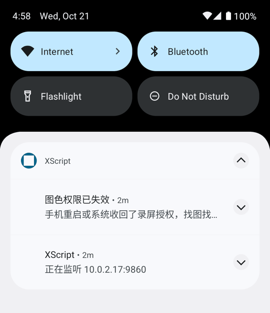

模拟器上可以用 adb 一次开好无障碍和悬浮窗：

```bash
adb -s 127.0.0.1:16384 shell settings put secure enabled_accessibility_services com.xscript.app/com.xscript.app.a11y.XscriptAccessibilityService
adb -s 127.0.0.1:16384 shell settings put secure accessibility_enabled 1
adb -s 127.0.0.1:16384 shell cmd appops set com.xscript.app SYSTEM_ALERT_WINDOW allow
```

（第一行会覆盖已开启的无障碍服务列表。）

### 悬浮窗（后台运行控制）

脚本在运行、你把 XScript 切到后台（回桌面或打开别的 App）时，屏幕边上会出现一个悬浮窗：圆点表示状态（绿 = 运行中、灰 = 空闲、红 = 出错），后面是工程名和已运行时间（`1:19`）。

- **小球**：约 5 秒没碰它，悬浮窗缩成一个 48dp 的半透明小球（里面还是已运行时间，红点 `!` 表示刚出错），不挡内容；碰一下恢复不透明。脚本里 `dim` 设的透明度会一直生效，小球在它的基础上再淡一些。
- **拖动**：按住移动，松手后带缓动吸附到左边或右边，位置会记住（重启 App 也在）；横屏和竖屏各记一个位置，旋转后自动重新摆放。悬浮窗不会盖住状态栏、刘海 / 摄像头挖孔和底部导航条 / 手势条。
- **展开**：点一下（小球或药丸都行）展开面板：**运行 / 停止**、**日志**、**打开**、**隐藏** 四个“图标在上、小字在下”的按钮（运行是播放图标，运行中变成红色停止图标），每个不小于 48dp，按下有水波纹；面板跟随系统深浅色（浅色模式浅底深图标，深色模式深底浅图标）；再点一下收起，10 秒没操作缩回小球。**停止** 和 App 里的停止一样（杀脚本进程，不会触发“停止后重新运行”）；空闲时按钮是 **运行**，运行上次的小程序。**隐藏** 让悬浮窗消失，直到下次运行脚本或回到 App 再出现。
- **脚本自己的按钮**：`FloatWindow.add_menu("rec", R.img("rec.png"), on_click)` 往展开面板里加一个“图标 + id 小字”的按钮（图标就是你给的图片，没给或读不到就用通用图标；一行最多 4 个，多了换行），点它会在脚本里调用 `on_click()`；`remove_system=True` 隐藏内置的 运行 / 日志 / 打开 / 隐藏；脚本结束按钮一起消失。
- **出错提示**：脚本非正常结束（报错、进程被杀）时悬浮窗不立刻收起，变成红点 + “工程名 出错”，保留约 8 秒；正常结束或点了停止不会这样。
- **读屏**：整个悬浮窗有朗读文字（“XScript 悬浮窗，运行中，工程名，已运行 0:12，点按展开”），各按钮有各自的说明；字体变大或切换深色模式后自动重建。
- **什么时候出现**：首页 **悬浮窗显示** 选 **运行时显示**（默认）时，脚本运行且 App 在后台才出现；打开 App 就收起，脚本结束也收起。选 **后台一直显示** 时，没有脚本运行也会在后台显示一个“空闲”的悬浮窗，方便随手点 **运行**。选 **已关闭** 则不显示。脚本里调用 `ui.float_show()` 会在本次运行里强制显示（设置里关闭、App 在前台也显示），`ui.float_hide()` 强制隐藏。
- **权限**：需要 **悬浮窗权限**（首页同名一行，“未授权，点此开启”会跳到系统页面）。第一次把 **悬浮窗显示** 设为非“已关闭”而没授权时会弹窗引导。没授权时悬浮窗不显示，脚本照常运行，不报错。
- **和通知的关系**：悬浮窗放在主进程，由已有的前台服务通知保活，不额外加通知；主进程被系统杀掉重启后，脚本还在运行时会自动恢复悬浮窗。部分系统的设置、支付等页面会为了防止点击劫持隐藏所有悬浮窗，这时看不到是系统行为。
- **打包 App**：同样有这个悬浮窗和 **悬浮窗显示** 一行。
- 检查：`GET /status` 的 `overlay` 字段给出 `enabled / always / mode / permitted / visible / state（ball / pill / panel）/ expanded / app_foreground / side / reason / error / menus / insets` 以及可见时的位置、大小、`alpha` 和整屏尺寸。

真机 / 模拟器验证（用 `appops` 授权，真实按 HOME、点击、拖动，用 `dumpsys window` 和 uiautomator 检查悬浮窗窗口）：

```sh
adb forward tcp:19860 tcp:9860
python3 scripts/device_float_e2e.py emulator-5554 http://127.0.0.1:19860   # 134 项：前台不显示 / HOME 后显示 / 计时 / 小球 / 展开与 48dp 触点 / 拖动贴边避开状态栏导航条 / 记位置 / 日志 / 隐藏 / 停止 / 一直显示 / 关闭 / 撤销授权 / CPU / 字体与深色 / 出错提示 / add_menu / 横竖屏 / FloatWindow.show·hide
```

### 小程序列表

首页 → **小程序列表**：

- 右上角 **新建**：新建一个空工程（名字必须是合法的 Python 标识符，可以用中文）。
- 右上角 **导入**：从 zip 导入，或从 AScript（`/sdcard/airscript/model`，需要 root）导入。
- 点某个小程序进入详情页，可以：运行 / 停止、看日志、打开 **开机自启** 和 **停止后重新运行**、添加 **定时任务**、查看和编辑文件、删除。
- 详情页的 **权限检查** 按这个小程序代码里用到的接口，列出它需要的权限和现在的状态：点击 / 滑动 / 控件要 **无障碍**（有 Root 且运行模式允许时也可以），找图找色 / 文字识别要 **图色权限**（系统录屏、无障碍截图或 Root 截图任一可用即可），悬浮窗、监听通知、读写 `/sdcard` 各有对应权限。红字一行点一下直接去开启。缺权限时卡片下方有 **一键开启全部（N 项）**：逐项说明这一项做什么、在系统设置里怎么开，开好按返回键回到详情页就接着下一项（每一步可以 **跳过** 或 **结束**；开了无障碍后截图也能用时，图色那一步会自动略过），最后告诉你是否都开好了、还缺哪几项。在系统设置里时手机把 XScript 关掉了（内存紧张时常见）也没关系，返回详情页会接着刚才那一步继续。缺权限时点 **运行** 会先列出缺哪几项、在哪个文件第几行用到，可以选 **去开启**（进入同样的逐项引导）、**仍然运行** 或取消。这是按代码文字判断的，动态拼出来的调用可能检查不到。

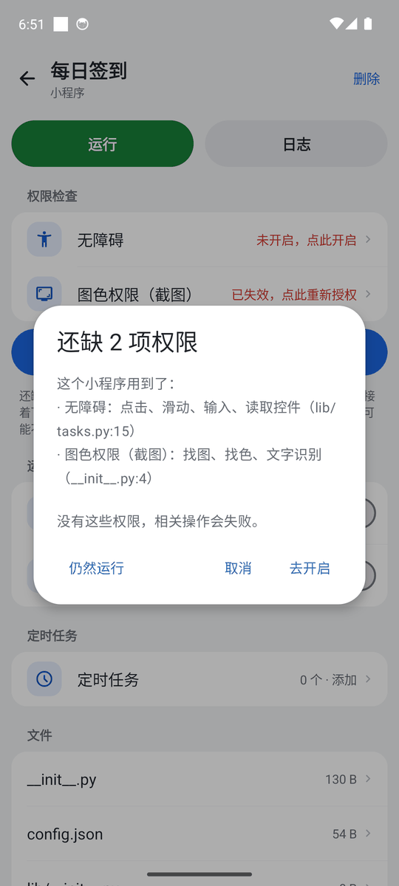

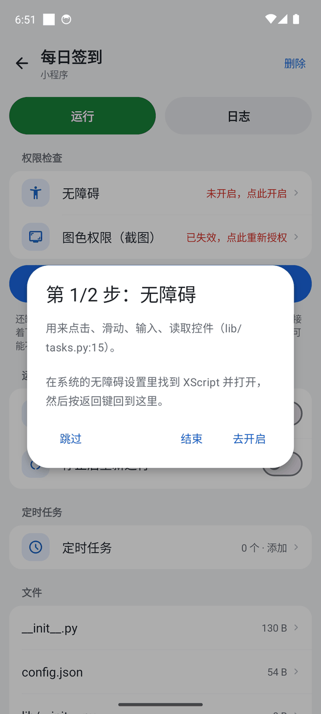

- **截图失败时停止脚本**（运行选项）：打开后，这个小程序每次运行都相当于在代码开头写了 `screen.strict_capture(True)`：截不到图（图色权限失效等）时找图、找色、OCR 直接抛出 `screen.CaptureError` 停止，日志里写明原因和修法，而不是返回空结果继续往下跑。默认关闭；改了下次运行生效。也可以用 HTTP `PUT /projects/<名称>/config {"strict_capture": true}` 打开。

  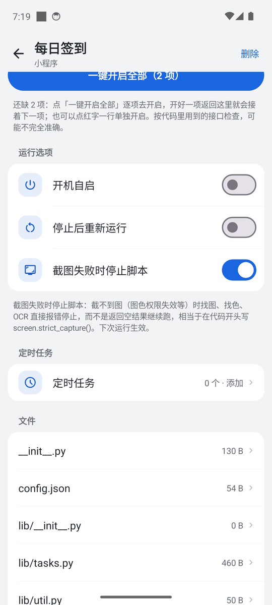

- **最近运行**：详情页列出这个小程序最近 5 次运行（手机上保存最近 20 次）：开始时间、用了多久、怎么结束的（正常结束 / 已停止 / 出错退出（退出码 N）/ 进程意外退出，出错的标红）；脚本自己结束的运行还有第二行：截了几次图、平均每次多久、峰值内存（来自日志末尾的「运行统计」行，点停止的运行没有）。电脑端可以用 HTTP `GET /projects/<名称>/runs` 读同样的记录（见 `protocol/openapi.yaml`）。点一行打开那一次运行的日志，只显示那次的输出；日志被清空或被新日志挤掉时会说明。有出错的运行时上方多一个「只看出错的运行」开关，打开后从保存的 20 次里只列出出错退出和进程意外退出的（点停止的不算），方便找较早的失败；HTTP 接口加 `?failed=1` 得到同样的结果。

  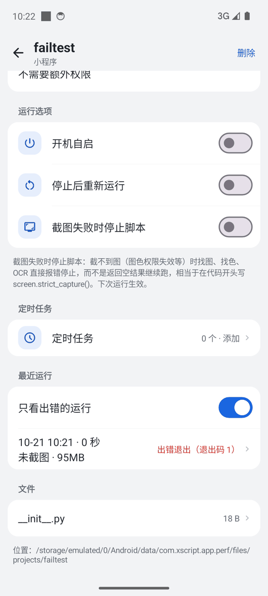

  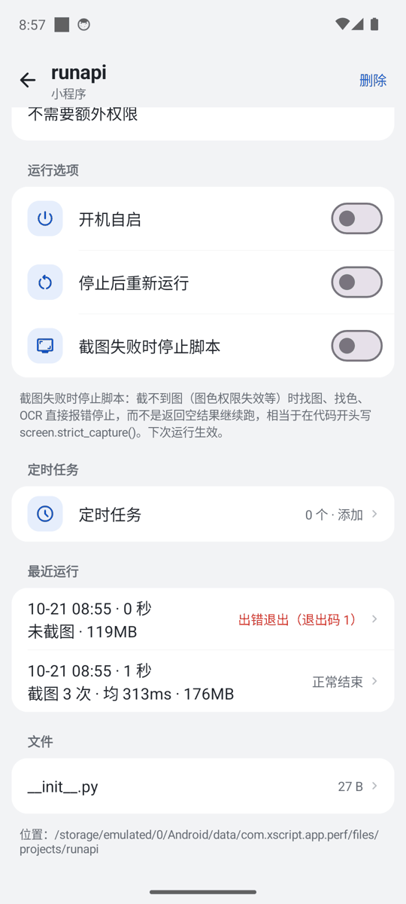

  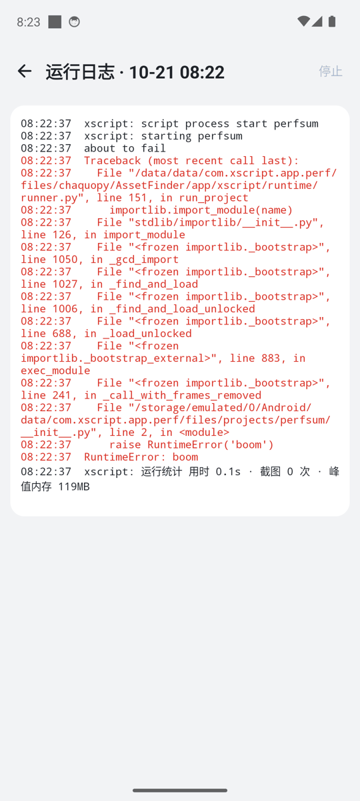

首页顶部的卡片显示上次运行的小程序，右侧按钮直接运行或停止。右上角 **日志** 查看所有运行输出。

### 链接启动（xscript:// / ascript://）

浏览器、其他 App 或 adb 可以用链接直接运行脚本：

| 链接 | 作用 |
| --- | --- |
| `xscript://run?name=<工程名>` | 运行工程；工程名含中文要做 URL 编码 |
| `xscript://run?name=<工程名>&params=<URL 编码的 JSON 对象>` | 同上，并传入启动参数（脚本里用 `runner.params()` 或 AScript 的全局变量方式读取，最长 4096 字符） |
| `xscript://stop` | 停止当前任务 |
| `xscript://open?name=<工程名>` | 只打开小程序详情页，不运行 |

兼容 AScript 的链接：`ascript://run?local=<工程名>`（`local` 等同 `name`）、`ascript://open?local=…`、`ascript://stop`，以及不写动作的 `ascript://?local=…`（按运行处理）都可以直接用；`ascript://run?id=<数字>` 是 AScript 应用商店的在线小程序编号，这里没有，会提示改用 `local=`。

例如：`adb shell "am start -a android.intent.action.VIEW -d 'xscript://run?name=demo'"`（`&` 要放在引号里）。

**安全**：任何网页或 App 都能发出这种链接，所以首页 **链接启动** 默认是 **每次确认**——弹出对话框显示工程名和来源，点 **运行** 才会启动。可改为 **直接运行**（只在你信任所有来源时使用）或 **已关闭**（链接一律忽略）。停止链接不会弹窗，关闭时同样被忽略。名字不合法、工程不存在、已有脚本在运行、卡密未授权时会提示原因，不会启动。

打包出来的 App 用自己的链接协议：完整包名和包名最后一段（与 AScript 规则相同，如 `com.acme.app://run` 和 `app://run`；分发链接优先用完整包名，短协议可能和别的 App 重名），只能运行打包进去的那个小程序，`name` 可省略，`id` / `local` 会被忽略。

**注意**：浏览器会把网页自己（没有点击）发起的跳转也交给 App（Chrome 113 实测会），所以保护靠确认对话框，不要为了方便设成「直接运行」。确认框里的「来自」是浏览器给出的页面地址，由页面决定，只能参考。Chrome 147 以上第一次打开内网地址（如测试用的 10.0.2.2）会问「附近设备」权限，要允许一次。

真机 / 模拟器验证（页面由本机起的 http 服务提供，用 uiautomator 真实点击 Chrome 里的链接）：

```sh
adb forward tcp:19860 tcp:9860
python3 scripts/device_scheme_e2e.py emulator-5554 http://127.0.0.1:19860        # 20 项：确认框 / 取消 / 运行 / 停止 / 参数 / 非法 / 三种模式
python3 scripts/device_packed_scheme_e2e.py emulator-5554                        # 打包 App 自己的协议（需要已安装的打包 App）
```

---

## 2. 让电脑访问手机

网页开发工具和 Cursor 都通过 HTTP 访问手机上的 XScript。

### USB / 模拟器（推荐）

```bash
adb connect 127.0.0.1:16384                         # 只有 MuMu 需要
adb -s 127.0.0.1:16384 forward tcp:9860 tcp:9860    # 端口以首页“开发者地址”为准
curl http://127.0.0.1:9860/status                   # 返回设备 JSON 就说明通了
```

**模拟器重启、adb 重启后 forward 会失效，需要重新执行这两条命令。** 这是连不上时最常见的原因。其他原因见 [连不上手机怎么办](TROUBLESHOOTING.md)。

### 局域网

手机和电脑在同一个 Wi-Fi 下时，直接用首页“开发者地址”里的 IP，例如 `http://192.168.1.23:9860/`。

> 除了设备识别（`/status` 的基本信息）和配对页，所有接口都要先输入首页的**配对码**：浏览器打开 `/tools/` 时会跳到配对页，插件和桌面端第一次连接时会提示输入（USB 连接时桌面端能自动读取）。配对码相当于密码，不要发给别人。连接仍是不加密的 HTTP，同一网络里的人能看到传输内容，所以只在可信网络里使用，不确定时用 USB。

---

## 3. Cursor AI 编程（MCP）

### 第一次配置

```bash
python3.12 -m venv .venv && .venv/bin/pip install -e ide/mcp-server -e ide/python-stubs
```

仓库里的 `.cursor/mcp.json` 已经配置好 `xscript` 服务，默认连接 `127.0.0.1:9860`（配合第 2 节的 adb forward）。用局域网 IP 时改 `XSCRIPT_DEVICE`。

然后在 Cursor 里打开 **Settings → MCP**，确认 `xscript` 是开启状态（绿色）。第一次或改过配置后，关掉再打开一次。

### 使用

在 Cursor 对话里直接说需求，例如“打开设置，搜索 WLAN 并点进去，写成一个小程序”。AI 会先截图、读控件树，再写脚本、上传、运行、看日志。手机首页的“AI 编程连接”会显示“已连接”。

常用工具（AI 会自动调用，也可以点名让它用）：

- 看设备：`get_device_status`、`screen_capture`、`dump_ui_tree`
- 工程：`upload_directory`、`run_project`、`stop_project`、`get_run_log`
- 图色调试：`take_snapshot` → `vision_test`（找色、比色、数色、色块、主色、找图、OCR、YOLO；找色类可选 `color_space=hsv/lab`，找图可选 `method`）→ `crop_template`
- 模型和包：`upload_model`、`pip_install`、`pip_list`
- 运行选项：`project_run_options`、`add_schedule`

### 连不上时

1. 先在终端 `curl http://127.0.0.1:9860/status`。不通就重做第 2 节的 forward。
2. `curl` 通但 Cursor 不通：在 MCP 设置里把 `xscript` 关掉再打开，错误信息在 **Output → MCP Logs**。

### VS Code / Cursor 插件

不用 AI、自己写脚本时用插件。第一次构建并安装：

```bash
cd ide/vscode-extension
npm ci && npm run package             # 生成 xscript-vscode-<版本>.vsix（也可从 GitHub Release 下载）
code --install-extension xscript-vscode-<版本>.vsix   # Cursor 用 cursor --install-extension
```

打开一个工程目录（带 `__init__.py` 或 `build.as`）后：

- 左侧活动栏的 **XScript** 图标：**Devices**（保存的设备，在线 / 离线和运行状态；点一下选为当前设备；行内 ▶ / ■）、**Projects on device**（手机上的工程，行内运行、拉取）、**Tools**。视图标题栏的放大镜是**扫描设备**（ADB + 局域网），＋ 是手动添加设备。
- 状态栏左下角显示设备型号；点它手填设备地址（设置项 `xscript.device`，默认 `127.0.0.1:9860`）。编辑器右上角的手机图标可以随时换设备。
- 手机截不了图时（录屏授权失效、也没有无障碍 / Root 截图），状态栏型号后面显示「⚠ 截图权限已失效」或「⚠ 不能截图」；点它（或命令 **在手机上授权截图**）选 **在手机上授权**，手机上会弹出系统录屏授权窗口。PyCharm 插件的状态栏同样显示并可点击授权，桌面端对应的是屏幕页的「截图状态」卡片。

  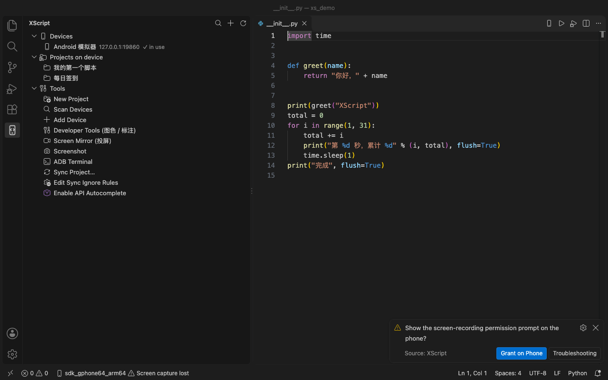
- 手填地址后会先**逐项检查**：地址格式 → 能连到这个地址 → XScript App 在响应 → 对方是 XScript → 配对码，每一步写到 **Output → XScript**。通过（或只差配对码，接着会让你输入）才保存；没通过时提示停在哪一步和修法，可以 **修改地址**、**仍然保存** 或打开 **排查文档**。命令 **XScript: 逐项检查连接** 对当前地址只做检查；运行、上传等连不上时的错误提示里也有 **Check Connection**。步骤和修法与桌面端、PyCharm 相同（见 [连不上手机怎么办](TROUBLESHOOTING.md)）。
- **Ctrl+Shift+R**（AScript 同款，F6 也行）/ 编辑器右上角 ▶：先停止正在运行的脚本，再把改动的文件同步到手机，然后运行，日志实时输出到 **Output → XScript**。**Shift+F6** / ■ 停止。运行时 ▶ 会换成 ■。
- **Alt+F6** / 编辑器右上角的调试按钮 / 右键工程文件夹 **Debug Project on Device**：保存并上传工程，在手机上以调试方式启动，VS Code 切到调试视图。点行号左侧下断点，脚本停在断点后可以看调用栈和变量、单步（F10 / F11 / Shift+F11）、继续（F5）、在调试控制台里对当前栈帧求值。停止调试（Shift+F5）会同时结束手机上的脚本。
- **XScript: 新建工程**：选模板（空 / Hello / AScript 写法）和位置，生成 `__init__.py`、`build.as`、`res/`。
- **XScript: 工程同步**：上传（全量）或从手机拉取工程（本地有差异的文件先确认）。**编辑同步忽略规则** 打开 `.vscode/.syncignore`（gitignore 风格，AScript 同一路径）。
- 资源管理器里右键工程文件夹：**Upload Project** / **Upload and Run Project**。
- 选中几行代码右键 **Run Selection on Device**，在手机上执行并显示结果（走 `/eval`，默认 8 秒超时）。
- 命令面板：**XScript: Screenshot**（截图在编辑器里打开）、**Open Developer Tools**（浏览器打开图色 / 标注）、**投屏**、**ADB 终端**、**Enable API Autocomplete**（把插件自带的 `xscript.*` / `ascript.*` 存根加到 `python.analysis.extraPaths`）。

和 AScript 官方扩展的逐项对照（以及没有做的：Windows 本地运行、iOS、`.was` 导包、AScript 云服务入口）见 `ide/vscode-extension/README.md`。

---

## 4. 网页开发工具（脚本 IDE / 图色 / 标注 / 投屏）

完成第 2 节后，电脑浏览器打开：

```
http://127.0.0.1:9860/tools/
```

页面由手机上的 App 提供，不用安装任何东西，断网也能用。顶部导航栏可以在各个工具之间切换。

### 脚本 IDE

地址 `http://127.0.0.1:9860/tools/ui/editor.html`。左侧选择或新建工程，右侧编辑、保存、运行、调试，下方看日志。

**工程与文件**

- **新建工程**：名字以字母或下划线开头，只能包含字母（可以是中文）、数字、下划线，自动生成入口 `__init__.py`。名字不合法或重名会直接提示，不会覆盖已有工程。
- **新建文件**：输入相对路径，例如 `utils.py` 或 `lib/config.json`，不存在的文件夹自动创建。建好后马上可以编辑并保存。同名文件或文件夹已存在时会报错，不会覆盖。
- **新建文件夹**：点 **文件夹**，例如 `res/data`。空文件夹也会显示在目录树里。
- **默认位置**：新建文件和文件夹时，输入框默认填好当前选中的位置：选中文件夹就放进这个文件夹，选中文件就放进它所在的文件夹。
- **重命名 / 移动**：选中文件或文件夹后按 **F2**、点 **重命名**，或右键选 **重命名…**，输入新的相对路径（改上级目录就是移动，缺少的文件夹会自动创建）；也可以把目录树里的项目拖到文件夹上（拖到空白处移到工程根目录）。已打开的标签页、未保存的修改、断点和展开状态会跟着走；目标已存在会提示冲突，不会覆盖。入口 `__init__.py` 不能重命名或移动。
- **删除**：对目录树里选中的项目生效，先确认再删除。删除正在编辑的文件时，会关闭它的标签页、清掉它的断点，再打开 `__init__.py`；未保存的修改会一起丢弃。入口 `__init__.py` 不能删；文件夹只能在清空后删除。
- 路径一律相对于工程目录，带 `..`、`.`、空段或以 `/` 开头的路径会被拒绝。

**目录树**

- 文件夹在前、文件在后，同类按名称排序。点击左侧箭头只展开/折叠，不影响当前选中和正在编辑的文件；点击文件夹名称会选中并展开/折叠；点击文件会打开它。未保存的文件右侧有小圆点。
- 展开了哪些文件夹，刷新、新建、删除和切换工程后都会保留；打开或新建文件时，它的上级文件夹会自动展开。
- 键盘：在目录树里用 ↑ / ↓ 移动，→ 展开文件夹（已展开时进入第一个子项），← 折叠文件夹（或回到上级），Enter / 空格打开文件或展开/折叠文件夹，Home / End 跳到首尾。

**编辑器**

- ⌘/Ctrl+S 保存，F6 保存并运行，Shift+F6 停止，Tab 插入 4 个空格（补全弹窗打开时 Tab 用来接受建议）。断点调试见 [DEBUGGING.md](DEBUGGING.md)。
- Python 语法高亮为本地内置的轻量词法着色（关键字、内置函数、字符串、注释、数字、装饰器、`def`/`class` 名称、`self`），只对 `.py`/`.pyw` 生效，超过 300 KB 的文件按纯文本显示；f-string 的 `{...}` 内部按字符串整体着色。
- **多标签页**：每个打开的文件一个标签页。点标签右侧的 **×**、鼠标中键点标签、或按 **Alt+W** 关闭当前标签；右键标签可选 **关闭 / 关闭其他 / 关闭右侧 / 关闭已保存 / 全部关闭**。要关闭的文件有未保存修改时会先确认（一次列出所有有修改的文件），确认后修改被丢弃；重新打开会读回设备上保存的内容。关掉最后一个标签后编辑器为空。
- **工程内搜索 / 替换**：点文件区的 **搜索** 或按 **Ctrl/Cmd+Shift+F**（编辑器里选中的单行文字会自动填入）。输入后按 Enter 或点 **搜索**；**Aa** 区分大小写，**ab** 全字匹配，**.\*** 正则表达式（单行 `^`/`$`，不能匹配空串）；「文件」栏可写 `*.py, lib/**, !tests/**` 限定范围（不含 `/` 的写法匹配任意目录下的文件名）。结果按文件分组，点一行跳到该处并选中。已打开文件按编辑器里的内容（含未保存修改）搜索；二进制文件和超过 1 MB 的文件跳过，单文件最多 500 处、总共 2000 处。**全部替换** 或某个文件的 **替换** 先确认：没有未保存修改的文件直接写入设备；替换后可点 **撤销替换** 恢复最近一次「全部替换」（只保留一步；替换后又改过的文件不会被动，会在提示里列出；刷新页面后失效）；有未保存修改的文件只改编辑器里的内容，仍需自己保存。正则模式会拒绝 `(a+)+` 这类嵌套无限重复，其余正则单个文件运行超过 2.5 秒会被中止（提示「正则表达式运行超时」），不会卡住页面。手机屏幕（宽度 ≤ 600px）上文件区收进左上角的 **☰ 文件** 抽屉，选文件后自动收起。中等宽度的桌面窗口（约 721–1180px）里工具栏不显示快捷键提示，按钮保持一行（快捷键仍可用）；860px 以下按钮变紧凑，800px 以下侧栏收窄到 210px、工具栏图标隐藏，仍放不下时工具栏可左右滑动。正则替换里可用 `$1`、`$<名字>`、`$&`、`$$`；普通模式下替换文本原样插入。Esc 返回文件列表。
- **深色主题**：网页工具跟随系统深浅色，也可以点右上角 **◑** 切换（记在浏览器里）。两种主题下正文、次要文字和链接的对比度都不低于 4.5:1，有自动化测试（`scripts/tests/editor-theme.test.cjs`）：

  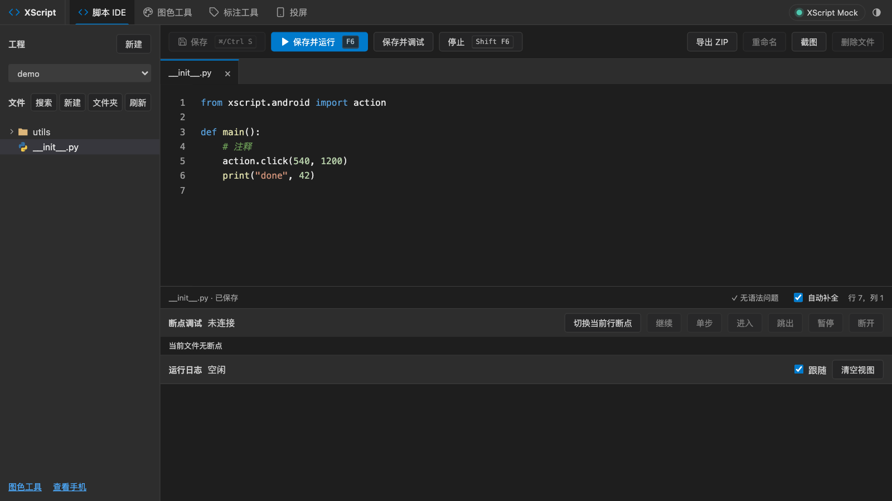


  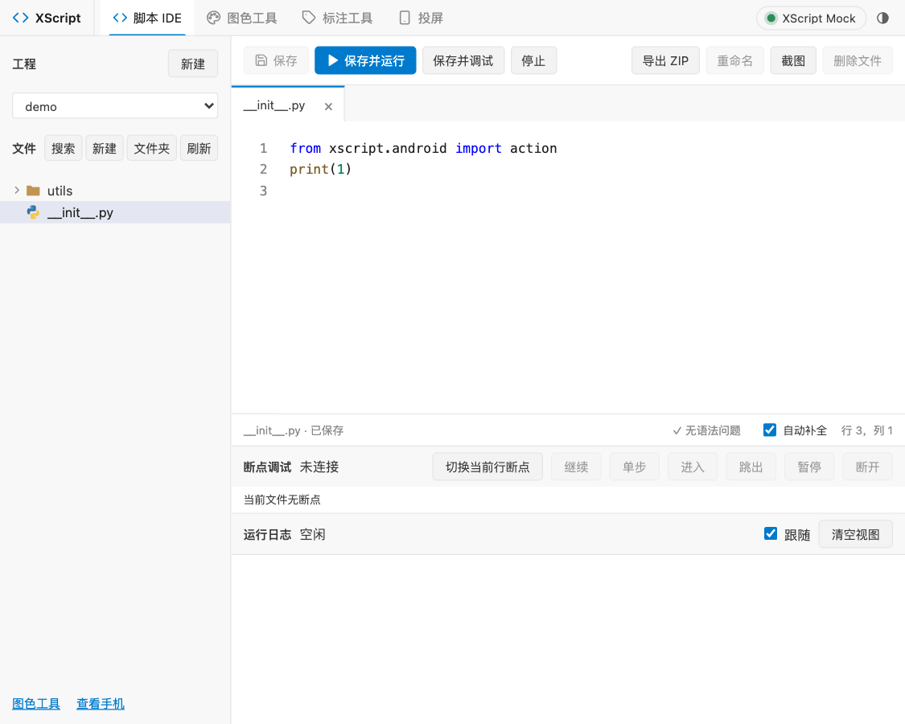

- **手机截图面板**：工具栏 **截图** 打开面板并截取一帧（需要手机已授权屏幕截取，否则提示去授权）。点击画面显示该点的 `x、y` 和颜色，**插入坐标** 把 `x, y` 写到编辑器光标处，**保存到工程** 存成 `res/img/shot-日期-时间.png`（可直接用于找图），**下载** 保存到电脑。画面是静态一帧，要实时画面用「投屏」。
- **自动补全**：输入时自动弹出（至少 2 个字符，或在 `.` 之后），也可以随时按 **Ctrl/Cmd+空格**（或 Alt+/）；↑/↓ 选择，Enter 或 Tab 接受，Esc 关闭，也可以直接点击。内容来自设备运行时自带的 `xscript.*`、`ascript.*` 接口索引（离线可用，带签名和说明），覆盖：`import` 和 `from ... import` 的模块路径和成员、`模块.` 和 `类.` 之后的成员、`x = SomeClass(...)` 之后的 `x.`、当前文件里的 import 和 def/class/变量、内置函数、关键字、文件里出现过的单词。在字符串和注释里不弹出；状态栏的 **自动补全** 复选框可以关掉自动弹出（偏好保存在浏览器里），快捷键仍可用。补全不做类型推断，只认上面这些写法。
- **参数提示**：输入函数调用的 `(` 之后，编辑器上方显示该函数的签名，当前参数加下划线（按位置、`名字=` 或 `*args` 判断，嵌套调用和多行调用都认），下方是文档第一段。光标离开括号、按 Esc 或失去焦点时关闭；**Ctrl/Cmd+Shift+空格** 随时手动打开。状态栏的 **自动补全** 关掉后不自动出现，快捷键仍可用。

  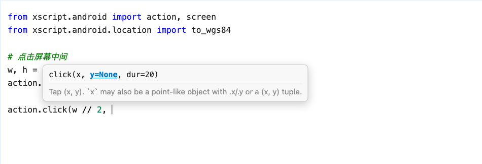
- **悬停文档**：鼠标停在 `xscript.*` / `ascript.*` 的模块、函数、类或方法名上约 0.4 秒，显示签名、完整名字（如 `xscript.android.action.click`）和完整文档字符串。认识 `import`、`from ... import`、别名、`x = SomeClass(...)` 实例和再导出的名字；字符串、注释和内置函数不显示。手机触屏没有悬停，用参数提示即可。

  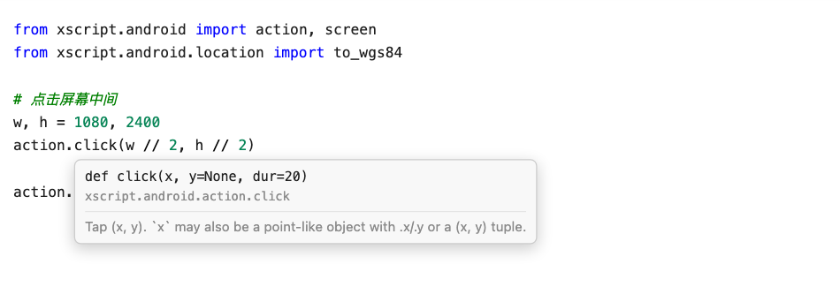

  停在**工程里自己定义的名字**上时，显示它的签名或推断出的类型和定义位置（文件:行）：函数和方法显示 `def 类.方法(参数=默认值) -> 返回注解` 和文档字符串的开头，类显示 `class 名字(父类)`，变量和 `self.` 属性显示 `(变量) 名字: 类型`，参数显示 `(参数) 名字: 类型 = 默认值`。类型按赋值推断：字面量（`int`、`float`、`str`、`list`、`dict` 等）、`类名(...)` 的实例、带返回注解的函数调用、`len()` 等内置函数、简单的算术和比较，以及类型注解；推断不出的只显示名字。跨文件的 import 和别名同样认识。

  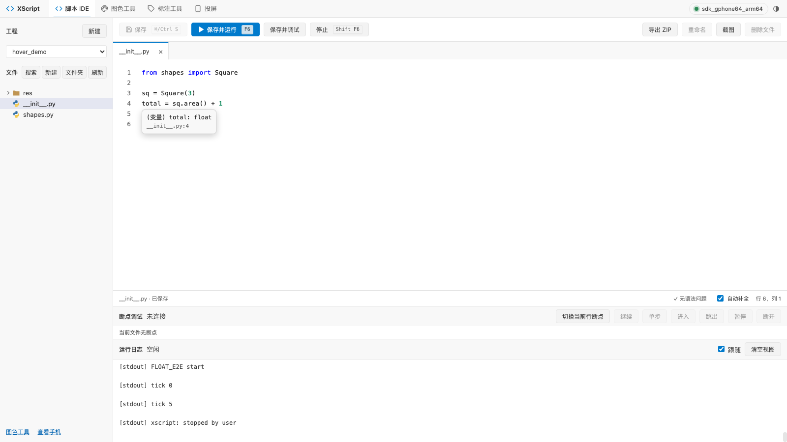

  参数提示和悬停文档的内容来自 `ide/python-stubs`（与 VS Code 扩展、桌面端同一份类型存根），由 `scripts/gen_editor_docs.py` 生成 `editor-docs.js`，离线可用。
- **语法检查**：停止输入约 0.35 秒后在本地检查 `.py` / `.pyw`。编辑器内置了一个按 Python 3.10 语法（手机上运行的版本）写的解析器，和 Python 自己一样只报**第一个**语法错误，改好后再显示下一个；报错的行与 Python 的 `ast.parse` 相同。能发现：括号不匹配或未闭合、字符串（含三引号）未结束、`if`/`def`/`for` 等行缺少冒号、缩进错误（意外缩进、缺少代码块、对不齐）、Python 2 的 `print x`、无效字符，以及以前查不出的错误，例如 `f() = 1`（给函数调用赋值）、`f(a=1, b)`（位置参数在关键字参数后面）、`def f(a=1, b)`、`x = [1, 2 3]`（少逗号）、`x = 1 if y`（缺少 else）、`try` 没有 `except`/`finally`、`0x` 这类错误数字。出问题的位置画红色波浪线，行号变红（悬停显示原因），状态栏显示问题数，点它跳到问题处。用 CPython 的报错样例和仓库里全部 Python 文件做回归测试，Python 3.9 标准库 675 个文件零误报；Python 3.11/3.12 才有的写法（如 `def f[T]()`、`type X = ...`、f-string 里套同种引号）会报错，因为手机上的 Python 3.10 也不支持。语法检查不执行代码，没有提示不代表脚本一定能运行，运行时错误仍以日志为准。超过 400 KB 的文件不检查。
- **基本检查**：语法没有问题时，再按工程符号表做下面几类检查，用**橙色**波浪线和橙色行号标出（只是警告，不影响保存和运行）：
  - **未定义的名字**：在当前作用域、外层函数、模块和内置函数里都找不到的名字，例如拼错的 `totl`。能看到的名字（局部变量、外层函数、模块、内置函数）里有拼写很接近的，提示会写「（是不是 total？Ctrl+. 改正）」，光标放在上面按 **Ctrl+.**（Mac 上 **⌘.**）直接改正，可以 Ctrl+Z 撤销；能从工程里别的文件导入时优先提示导入。 `import` 进来的名字（包括 `xscript.*` 以外不认识的模块）都算已定义；文件里有 `from 模块 import *` 时不检查。

    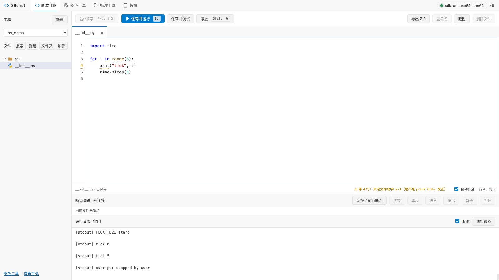

  - **调用参数不对**：调用工程里自己写的函数、类（按 `__init__`）和方法时，位置参数太多、关键字参数名不存在、同一个参数传了两次、缺少没有默认值的参数。关键字参数名拼错、而函数里有拼写很接近且这次没有传的参数时（规则同下面的「不存在的属性」，3 个字母以下的名字不猜），提示会写「（是不是 seconds？Ctrl+. 改正）」，波浪线画在关键字上，按 **Ctrl+.**（Mac 上 **⌘.**）直接改名，可以 Ctrl+Z 撤销。带装饰器的函数（`@staticmethod`、`@classmethod` 除外）、`*args` / `**kwargs` 展开调用、通过类名调用普通方法、库函数都不检查。

    

  - **参数类型不对**：调用工程里的函数、类和方法时，直接写的字面量（数字、字符串、`True`/`False`/`None`、列表、字典等）和参数上的简单注解（`int`、`float`、`str`、`bytes`、`bool`、`list`、`dict`、`set`、`tuple`、`complex`）明显不符，例如 `def wait(seconds: float)` 却写了 `wait("2")`，波浪线画在这个参数上。只被赋值过一次、且是 `名字 = 字面量` 的变量也按这个字面量算，例如 `d = "2"` 后的 `wait(d)`；被重新赋值、链式或解包赋值、带注解、循环变量、参数和 `global` 改写过的变量不检查。`int` 可以传给 `float` / `complex`，`True`/`False` 可以传给数字参数，默认值是 `None` 的参数可以传 `None`；变量、表达式和 `Optional[...]`、`list[int]`、字符串注解等复杂注解都不判断。

    转换方式确定无误时，提示末尾会写「（Ctrl+. 改为 …）」，光标放在上面按 **Ctrl+.**（Mac 上 **⌘.**）直接改好，可以 Ctrl+Z 撤销：只含数字的字符串传给 `int` / `float` 参数时去掉引号（`"2"` → `2`），数字传给 `str` 参数时加上引号（`3` → `"3"`）；变量则包一层 `str(n)`、`int(d)`、`float(d)`。其他情况（例如 `"1.5"` 传给 `int`、f-string、科学计数法）只提示，不提供改正。

    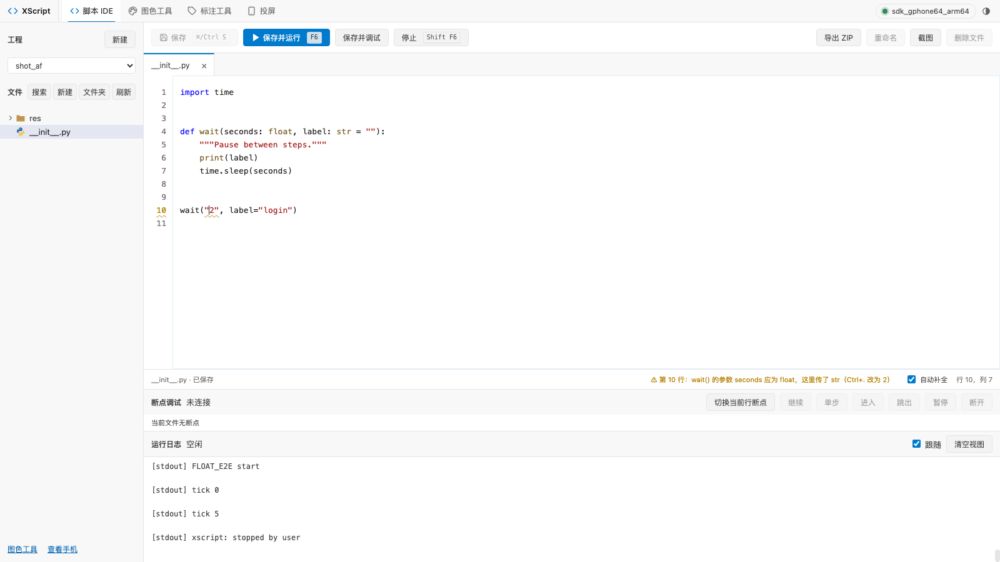

    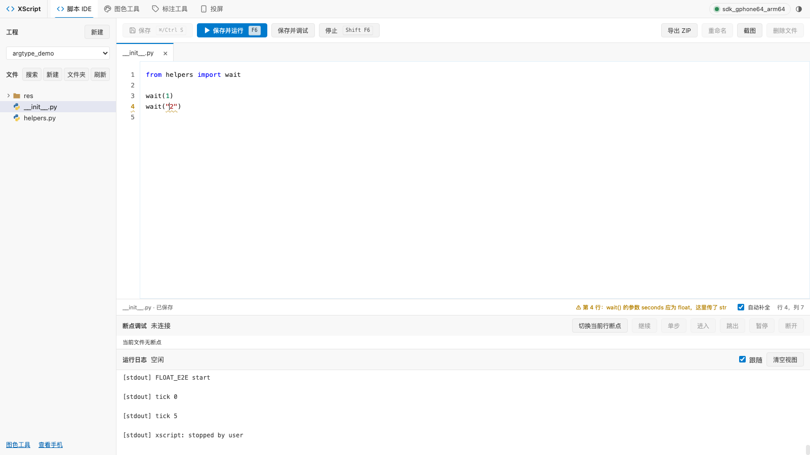

  - **返回值类型不对**：函数带简单的返回注解（同上，`int`、`str` 等）时，`return` 后直接写的字面量和注解明显不符（例如 `-> int` 却 `return "ok"`）、`return` 后面什么也没写，或者整个函数一个带值的 `return` 都没有。生成器、`async` 函数、只有 `...` / `pass` / 文档字符串的空函数、`-> None` 和复杂注解不检查；最后一句是循环、`if`、`try`、`with`、`match` 或 `raise` 的函数也不报「没有 return」。

    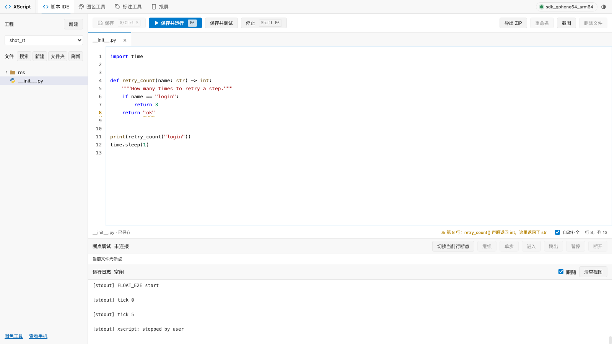

  - **不存在的属性或方法**：`self.xxx`（普通方法里）、类名和 `x = 类名(...)` 实例上用了类（含工程里的父类）里没有的属性或方法，例如把 `self.side` 写成 `self.sid`。类里有拼写很接近的名字（短名字差 1 个字母、6 个字母以上差 2 个、相邻字母颠倒或只差大小写）时，提示会写「（是不是 side？Ctrl+. 改正）」，光标放在上面按 **Ctrl+.**（Mac 上 **⌘.**）直接改成它，可以 Ctrl+Z 撤销；有两个同样接近的名字时不猜。只检查确定的情况：被工程里其他类继承的类里的 `self.`（父类常用子类才定义的属性）、静态/类方法、带装饰器或继承未知类的类、工程里任何地方赋过值的属性名（`obj.x = ...`）、双下划线名字，以及用了 `setattr`、`__getattr__`、`__dict__`、`__slots__` 的文件都不报。

    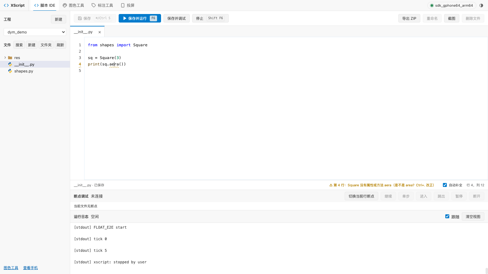

  状态栏显示「⚠ N 个问题（点击跳转）」，点它依次跳到每个警告。只报能确定的问题，仓库里全部 Python 文件作为回归测试零误报；没有警告不代表没有运行时错误。
- **快速修复（Ctrl+.）**：未定义的名字如果是工程里另一个文件在顶层定义的函数、类或变量，提示里会写「（Ctrl+. 从 模块 导入）」。光标放在这个名字上按 **Ctrl+.**（Mac 上 **⌘.**），就在文件开头的文档字符串和 import 之后加上 `from 模块 import 名字`，光标留在原处；有几个文件都定义了它时先弹出编号列表让你选。只改编辑器内容（标为未保存），不想要可以按 **Ctrl+Z**（Mac 上 **⌘Z**）撤销，和普通输入一样进撤销历史。以下划线开头的名字和只是被别的文件 import 进来的名字不提示。

  
- **未使用的 import 和变量**：没有用到的 import 和函数里赋值后没再用到的局部变量会**变淡**显示（不是问题，不画波浪线、不计入问题数）；光标移到上面时状态栏说明原因。光标放在未使用的 import 上按 **Ctrl+.**（Mac 上 **⌘.**）删除它：一行只导入它一个时删整行，否则只从列表里去掉这个名字；可以 Ctrl+Z 撤销。为避免误报，这些情况不提示：`from __future__`、行尾带 `# noqa` 的 import、子目录里包的 `__init__.py`（工程根目录的入口 `__init__.py` 照常检查）、有 `__all__` 的文件、只由 import 组成的模块和相对导入（通常是转出口）、被工程里其他文件 import 走的名字、以下划线开头的名字、元组解包 / `for` / `with ... as` 绑定的变量、用到 `locals()` / `eval` / `exec` 的文件，以及在 f-string 里出现的名字。

  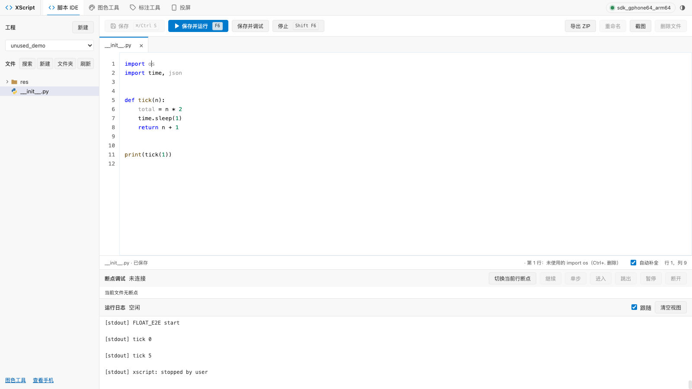

- **执行不到的代码**：同一个代码块里，写在 `return`、`raise`、`continue` 或 `break` 后面的语句永远不会执行，整行**变淡**显示（同样不计入问题数），光标移到上面时状态栏写「执行不到的代码（前面已经 return；Ctrl+. 删除）」，按 **Ctrl+.**（Mac 上 **⌘.**）把这一段执行不到的代码整行删掉（从第一行到最后一行，中间的空行和注释一起删），可以 Ctrl+Z 撤销。只看同一代码块里的直接先后：`if` / `else` 两边都 return 之后的代码、`while True` 后面的代码不判断；`return` 后紧跟的 `yield`（空生成器的写法）、带 `# noqa` 的代码也不提示。

  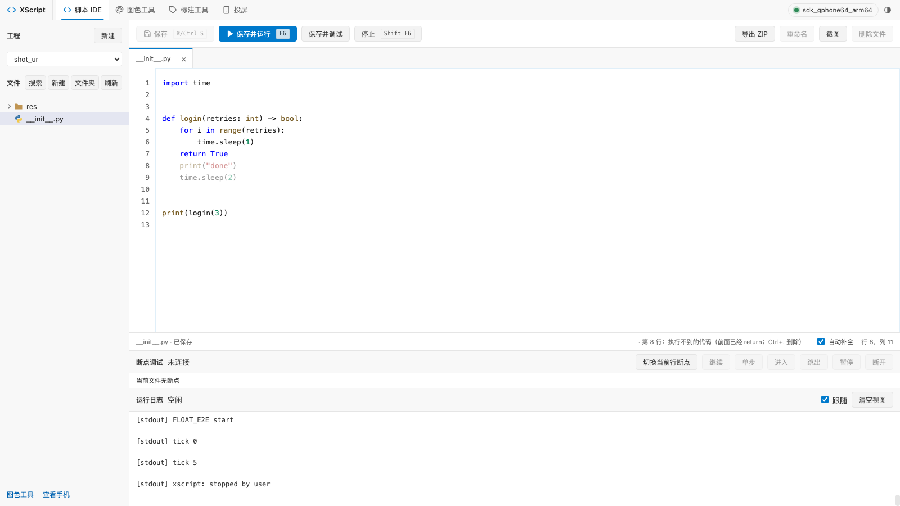

  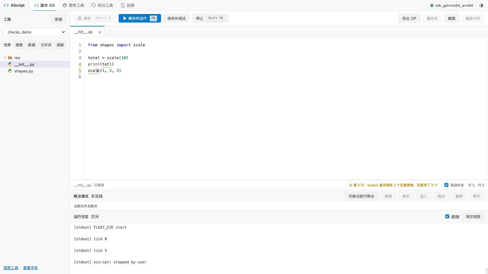
- **跳转到定义**：光标放在名字上按 **F12**，或按住 **Ctrl**（Mac 上 **⌘**）点击名字，跳到它的定义：同一文件里的函数、类、变量、参数，工程里其他文件的函数和类（认识 `import 模块`、`from 模块 import 名字`、`as` 别名、包和 `from . import` 相对导入），`x = 类名(...)` 实例和 `self.` 的方法和属性（含工程里父类的方法）。跳到别的文件时会打开它的标签页并选中定义处，状态栏显示「定义 · 文件:行」。光标在 `xscript.*` / `ascript.*` 库函数上时不跳转，而是直接显示它的存根签名和文档。内置函数、不知道类型的参数（如 `def f(s): s.area()` 里的 `area`）找不到定义，状态栏会提示。

  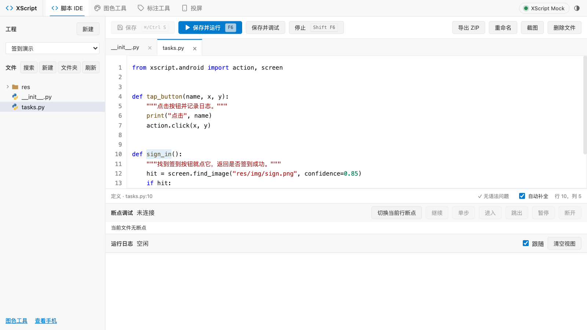

  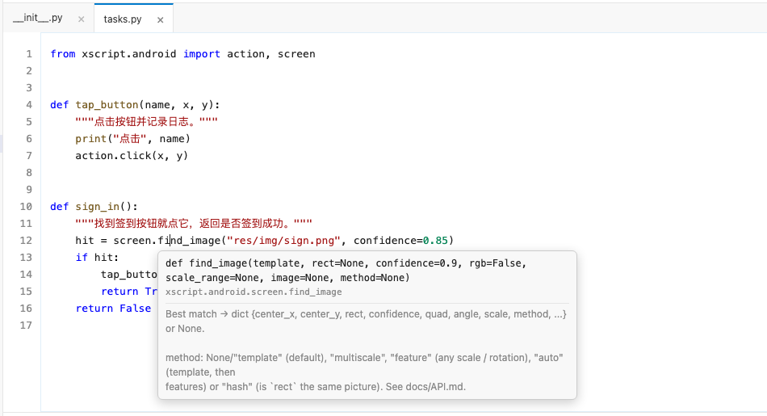
- **查找引用**：光标放在名字上按 **Shift+F12**，左侧显示工程里所有指向同一个定义的地方（按文件分组，定义处标「定义」，包括 import 那一行和别名），点一行跳过去，↑/↓ 在列表里移动，Esc 或 **返回文件** 回到文件列表。同名但不是同一个东西的名字（比如另一个函数里的同名局部变量）不算。已打开文件按编辑器里的内容（含未保存修改）分析。
- **重命名符号**：光标放在名字上按 **F2**（在编辑器里；目录树里的 F2 仍是重命名文件），输入新名字并确认后，工程里所有指向同一个定义的地方一起改，包括其他文件和 import 那一行（`as` 别名保持不变）。没有未保存修改的文件直接写入设备，有未保存修改的只改编辑器内容；改错了点搜索面板里的 **撤销替换** 恢复。新名字不是合法的 Python 名字、和同一作用域里已有的名字冲突、库函数（`xscript.*` 等）、内置函数和模块名都不能这样重命名，状态栏会说明原因。

  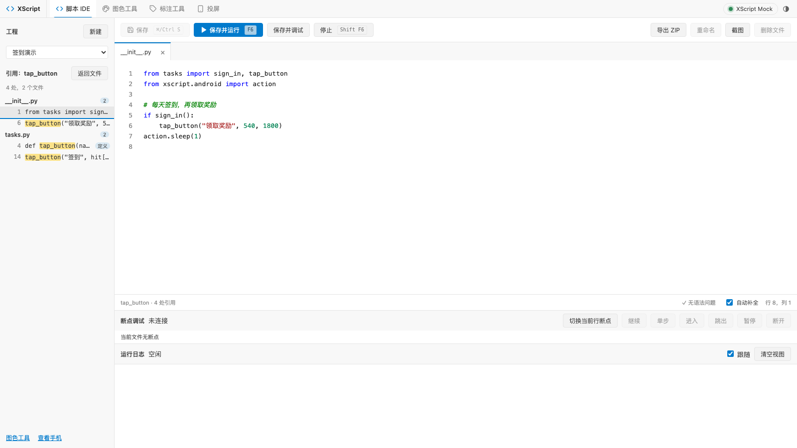


**界面设计器（`res/ui/<名称>.ui.json`）**

不写 HTML 也能给脚本做一个设置界面。新建文件 `res/ui/settings.ui.json`（名称用字母、数字、下划线，可以是中文），打开时显示设计器而不是文本：左边点或拖控件进表单（单行文本、密码、多行文本、数字、复选框、选项列表、单选组、说明文字），中间拖动或用 ↑ ↓ 排序、✕ 删除，右边改字段的标题、返回字典里的键、默认值、选项、必填，以及窗口标题、按钮和大小，最右是预览。工具栏的 **文本** / **设计** 在 JSON 文本和设计器之间切换；表单有问题（键不是合法的 Python 名字、重复、选项为空）时会标红，保存时不生成代码。

保存（⌘/Ctrl+S，或保存并运行）时同时生成两个文件，打开着的生成文件标签会跟着刷新（有未保存修改的不会被覆盖）：

- `res/ui/settings.html`：脚本用 `ui.Window` 显示的页面；
- `ui_settings.py`：`show(values=None)` 显示表单并等到用户提交，返回按类型转换好的 dict，取消返回 `None`。

```python
from ui_settings import show
values = show({"rounds": 5})   # 可选：预填
if values:
    print(values["rounds"])
```

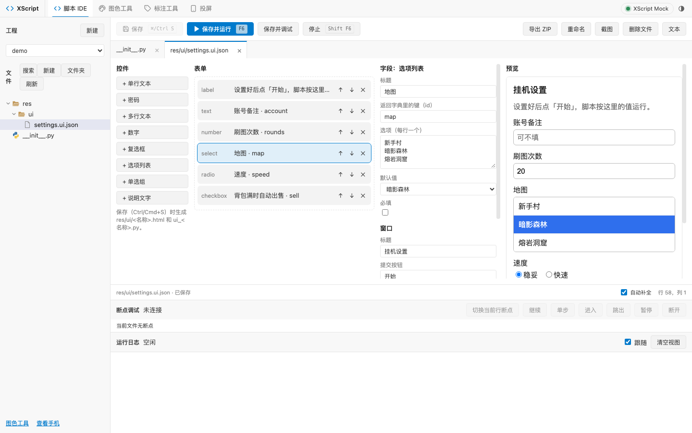

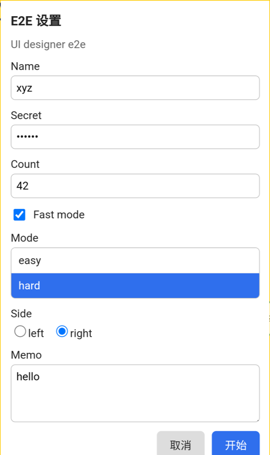

设计器和生成代码与 VS Code 扩展的 UI 设计器是同一份（`tools/ui-form.js`、`tools/ui-designer.js`），在哪边编辑结果都一样。生成的文件每次保存都会重写，改界面请改 `.ui.json`。

### 图色工具

先点 **截图** 冻结一帧，之后所有取色、测试都基于这一帧。滚轮缩放，按住空格拖动画面。

- **取色**：点击图片添加颜色点，右侧生成 `x,y,#RRGGBB|...`，可以一键复制 `FindColors.find(...)` / `CompareColors.compare(...)` 代码（AScript 或 XScript 写法）。
- **框选**：拖动框出区域，可以复制成 `rect`，或者存为工程里的模板图片（`res/img/...`）。
- **测试**：多点找色、多点比色（逐点显示期望值和实际值）、找图、OCR。用的是和脚本完全相同的引擎，结果直接画在图上。

### 标注工具

用来做 YOLO 训练数据。

1. 新建数据集，填写类别。
2. **截图加入** 当前屏幕，或上传图片。
3. 拖动画框；数字键 1–9 切换类别，A / D 切换上一张 / 下一张，Delete 删除选中的框。自动保存。
4. **导出 YOLO** 下载训练包（`images/`、`labels/`、`data.yaml`）。

训练和部署到手机：

```bash
yolo detect train data=data.yaml model=yolo11n.pt imgsz=640
yolo export model=runs/detect/train/weights/best.pt format=onnx imgsz=640
```

把 `best.onnx` 放进工程的 `res/`，脚本里 `yolo.load(R.res("best.onnx")).detect()`。

### 投屏

实时显示手机画面。在画面上点击就是点击手机，拖动就是滑动，下方按钮是 返回 / 主页 / 最近任务。授予“图色权限”后帧率明显更高；只用 root 截图时约 2 fps。

---

## 5. 管理后台（云控 / 卡密 / 打包）

网页后台，用来同时管理多台设备（手机不需要和电脑在同一网络）、生成和管理卡密、在线打包 APK。技术上是 FastAPI 服务 + React 控制台，代码在 `backend/`。

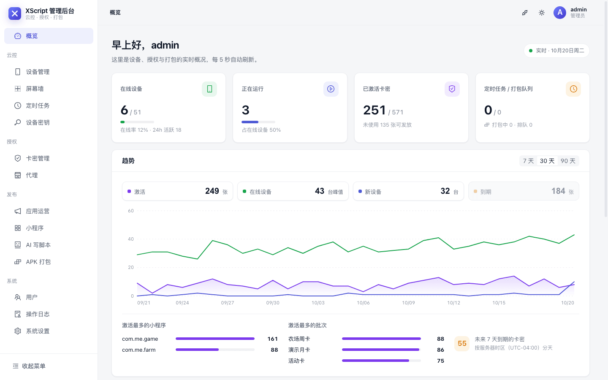

| 设备管理 | 屏幕墙 | 卡密管理 |
| :---: | :---: | :---: |
| 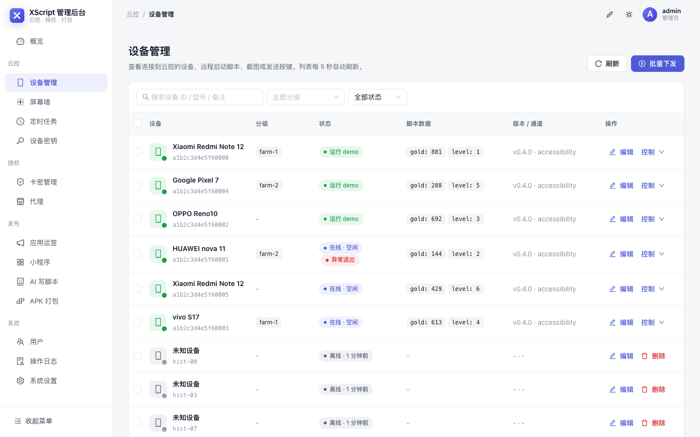 | 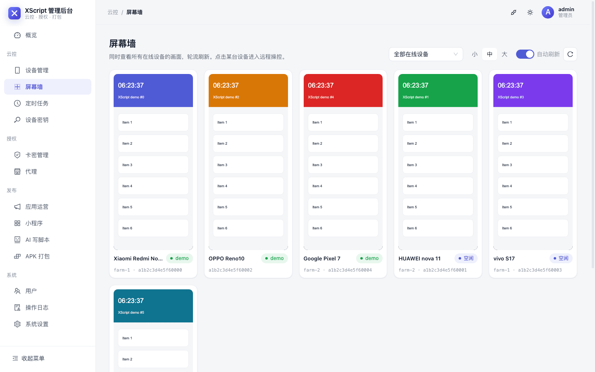 | 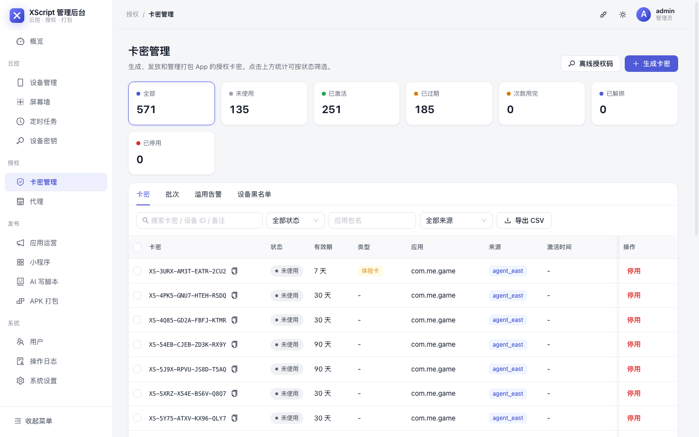 |

### 第一次安装和启动

在仓库根目录执行：

```bash
.venv/bin/pip install -e backend                                  # 服务端依赖
(cd backend/web && npm ci && npm run build)                       # 构建网页控制台（需要 Node 20+）
.venv/bin/python -m xscript_server init  --data xscript-data      # 创建管理员账号，按提示设置密码
.venv/bin/python -m xscript_server serve --data xscript-data --port 8765
```

浏览器打开 `http://127.0.0.1:8765/`，用刚才的账号登录。

- 所有数据在 `xscript-data/` 目录：数据库、卡密签名私钥（`keys/private.pem`）、打包产物。**备份这个目录**，不要提交到 git。
- 默认只监听本机。给其他电脑或公网用时加 `--host 0.0.0.0`，公网务必在前面加 nginx / Caddy 做 HTTPS，并加 `--behind-proxy`。
- **部署到服务器推荐用 Docker**：`cd deploy && cp .env.example .env`，填域名和管理员密码，`docker compose up -d --build`，自动申请 HTTPS 证书。详见 [部署.md](部署.md)。
- 然后在 **系统设置** 里填写 **服务器公网地址**（例如 `https://cloud.example.com`）。打包的 App 用它激活卡密、连接云控。
- 忘记密码：`.venv/bin/python -m xscript_server reset-password --data xscript-data admin`。

### 告警通知、备份和存储清理

**系统设置 → 告警通知**：添加企业微信 / 钉钉 / 飞书机器人（或通用 Webhook）的地址，选择要推送的事件：设备离线（离线超过设定的分钟数才发，短暂断线不打扰）、恢复在线、脚本异常退出、打包成功 / 失败、定时任务失败、未使用卡密不足。钉钉、飞书开了「加签」的话把密钥填进去。保存前可以点 **发送测试**。同一台设备的同一种告警 10 分钟内只发一次。

**系统设置 → 备份与存储**：

- 默认每天凌晨 4 点自动备份（数据库、卡密签名私钥、小程序源码，不含 APK），保留最近 7 份；也可以随时 **立即备份** 并下载。**备份里有签名私钥，请复制到别的机器或网盘保存。**
- 恢复：先停止服务，再运行 `.venv/bin/python -m xscript_server --data xscript-data restore 备份文件.tar.gz`（数据目录里已有数据库时加 `--force`）。
- 存储清理和备份一起执行：只保留最近 20 个打包任务的 APK（更早的删文件、保留记录），操作日志保留 180 天。都可以改，0 表示永久保留。
- 升级 xscript-server 前先备份。新版本第一次启动会自动升级数据库结构。

### 用户和权限

**用户** 页面新建账号，三种角色：

| 角色 | 能做什么 |
| --- | --- |
| 只读 | 查看设备、任务、卡密、打包记录 |
| 操作员 | 下发指令、改分组、管理定时任务、生成 / 停用 / 导出卡密、打包 |
| 管理员 | 全部，包括用户、设备密钥、离线授权码、操作日志、系统设置 |

所有操作都记在 **操作日志** 里。右上角头像 → **账号与令牌** 可以修改密码、开启 **两步验证**（用 Google Authenticator、Microsoft Authenticator 或「腾讯身份验证器」小程序扫码，之后登录要多输一个 6 位验证码）、创建 API 令牌，并在 **登录设备** 里查看自己在哪些浏览器登录过，退出某一个或全部其他登录（比如在别人电脑上忘了退出时）。

### 登录 IP 白名单

**系统设置 → 安全 → 登录 IP 白名单**：每行一个 IP 或网段（如 `203.0.113.7`、`10.0.0.0/8`、`2001:db8::/32`）。设置后只有名单内的 IP 能登录后台、使用已登录的会话和 API 令牌；留空 = 不限制。设备云控连接、卡密激活和 App 的公开接口不受影响。

- 名单不包含你当前的 IP 时无法保存（页面上有「加入我的 IP」按钮）。
- 在反向代理（Caddy / nginx）后面时，服务器要用 `--behind-proxy` 启动，否则看到的都是代理的 IP，白名单就没有意义。
- 如果仍被锁在外面：在服务器上执行 `xscript-server reset-allowlist`（docker：`docker compose exec xscript xscript-server reset-allowlist`）清空名单。
- 被拦截的登录会记在操作日志里（`auth.ip_denied`，同一个 IP 短时间内只记几条）。

### 应用运营：公告和强制更新

左侧 **发布 → 应用运营**，两个标签页：

- **公告**：给某个打包 App（填包名）或所有应用（`*`）发公告，选级别、可设起止时间。操作员以上可以增删改。App 通过 `GET /pub/app-notices?app=<包名>` 取到最多 5 条纯文本公告。
- **版本更新**：管理员为每个应用设置最新版本，来源二选一：「用本站打包的 APK」（选一个打包成功的任务，版本号、版本名、大小和 SHA-256 自动取自任务，这个任务的 APK 会被保留）或「外部下载链接」（自己填版本号）。再设置 **最低版本号**：低于它的 App 必须更新（0 = 不强制，不能高于最新版本号）。App 通过 `GET /pub/app-update?app=<包名>&version_code=<当前版本号>` 得到 `update` / `force` / `url` / `sha256` / `notes`。

> 打包出来的 App 打开首页时会读取这两个接口：新公告弹窗显示一次；有新版本时提示；低于最低版本号时弹出无法关闭的更新对话框、脚本不能启动，点「下载并安装」后由系统安装程序完成（首次需要允许该 App 安装未知应用）。后台打包会自动填入服务器公网地址（系统设置里的「服务器公网地址」必须填写，手机能访问到）；之前打的包没有这个地址，需要重新打包一次。后台里没有可用 APK 时不会拦截用户。

### 让设备连上来

1. **设备密钥** → **新建密钥**，复制弹出的地址（形如 `ws://<服务器>:8765/ws?token=xsd_…`，只显示一次）。
2. 手机 XScript 首页 → **云端控制** → 粘贴地址 → **连接**。首页显示“已连接”后，**设备管理** 里就会出现这台设备。

- **模拟器连本机后台**：先执行 `adb -s 127.0.0.1:16384 reverse tcp:8765 tcp:8765`，地址里的主机填 `127.0.0.1`。
- 可以按渠道或客户分别建密钥。**停用** 某个密钥会立即断开用它连接的设备。
- 打包 App 时勾选「连接云控」，后台会为这个 App 单独生成密钥并写进 APK。

### 设备管理

- 列表显示在线状态、分组、正在运行的小程序、脚本 `cloud.send()` 上报的数据、XScript 版本。可以按 ID / 型号 / 备注搜索，按分组、在线状态筛选。
- 每行 **控制**：启动小程序（可带 JSON 参数，脚本里 `system.params()` 读取；可带卡密顺便激活）、停止、截图、主页键、返回键、发消息给脚本（`cloud.on_message` 接收）。
- 勾选多台后 **批量控制** / **设置分组**；右上角 **批量下发** 可以按分组、应用或全部设备下发。
- 点设备名打开详情：系统信息、脚本数据、实时截图。
- **编辑** 设置分组和备注。后台设置的分组优先于设备上报的分组。

### 屏幕墙

**屏幕墙**（操作员及以上）同时显示所有在线设备的画面，轮流刷新，可以按分组筛选、调整缩略图大小。点击任意一台直接进入远程操控。设备很多时每轮刷新会慢一些（每次同时取 4 台）。

### 运行日志和崩溃

设备详情 → **运行日志** 有两种模式：

- **实时**：通过云控直接读手机上的日志，每 2 秒刷新，红色是错误输出。设备要在线。
- **历史**：设备每 3 秒把新日志上传到服务器，默认保存 7 天（系统设置 → 备份与存储 → 设备运行日志保留天数，0 = 不保存）。设备离线后也能看，可以按内容搜索、只看错误输出、按时间范围筛选、往前翻页和导出成文本文件。

脚本异常退出时（退出码不是 0 且不是手动停止，例如没抓住的 `screen.CaptureError`），App 会把退出码和最后 40 行日志报给后台：设备列表的状态栏多一个红色「异常退出」标签（鼠标停上去看工程、退出码和最后一行错误输出，下次开始运行时消失；状态筛选选「异常退出」只列这些设备；桌面端云控的设备表也一样），运行日志标签上出现红点，日志页顶部显示错误信息，配置了告警（`script_crash`）还会推送到群。

### 设备的最近运行

设备详情里的 **最近运行**（操作员及以上）通过云控连接读取手机上保存的运行记录（每个工程最近 20 次，App v0.5.0 起），不需要和手机在同一网络：选择工程（默认是正在运行或上次运行的工程），列出开始时间、耗时、结束方式（出错退出标红、点停止为灰色）和「运行统计」（截图次数、平均耗时、峰值内存）。打开「只看出错」只列出错的运行。点一行展开那次运行自己的日志（只取那次的输出，报错标红）；那段日志已被手机的日志缓冲区挤掉时会说明。出错的运行如果日志里有指向这个工程的 Python 报错（Traceback），日志上方会标出 **出错位置：<文件>:<行号>**（可一键复制）和报错信息，方便到 IDE 或桌面端里找到那一行。记录只在手机上，服务端不保存，所以设备离线时看不到；手机端版本较旧或工程已删除时会说明。

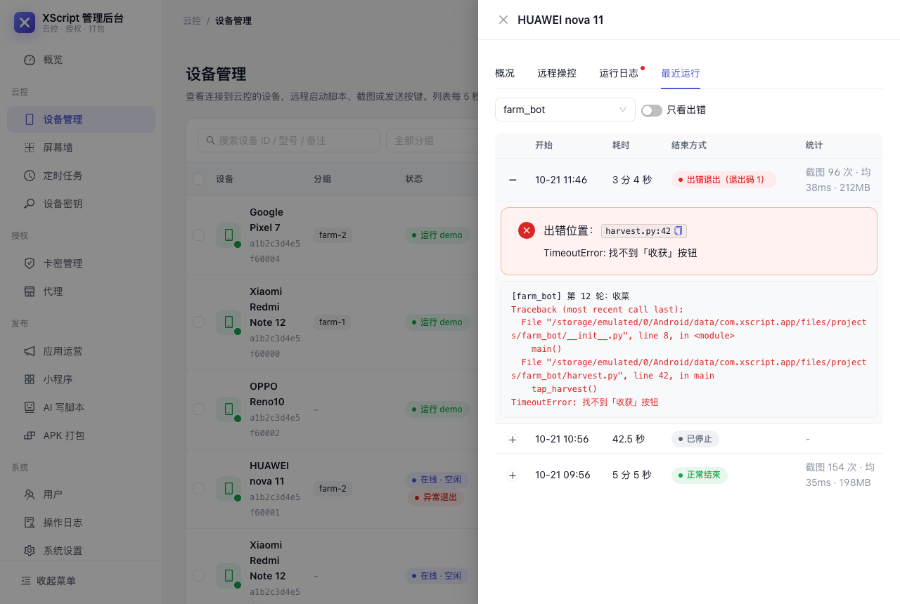

### 远程操控

设备详情里的 **远程操控** 通过云控连接实时查看画面并操作，不需要和手机在同一网络：

- 打开 **实时** 持续刷新画面（流畅 / 清晰两档）；或点刷新只取一帧。
- 在画面上 **点击** = 点击，**按住** = 长按，**拖动** = 滑动。下方按钮：返回、主页、多任务、通知栏、停止脚本。
- 需要设备开着无障碍或 Root，并且能截图（和本地运行脚本的要求相同）。

### 小程序（版本、发布、下发）

**小程序** 页面管理要分发的工程，对应 AScript 开发者后台的小程序列表：

1. **新建小程序**：名称、工程名（设备上的目录名 / Python 包名）、是否 **代码保护**。
2. 打开小程序 → **上传新版本**：拖入工程 zip，版本号留空会自动递增，可写更新说明。
3. 每个版本可以：
   - **发布**（管理员）：设为当前版本。开启了 **热更新** 的打包 App 会在启动时、以及之后每 30 分钟检查一次，自动下载这个版本，下次运行生效。发布旧版本即可 **回滚**。
   - **下发**（管理员）：通过云控直接把这个版本安装到选中的在线设备（覆盖同名工程），可选装完立即启动并带参数。适合用 XScript App 跑脚本的设备。
   - **打包**：跳到 APK 打包页并选好这个版本。
   - 下载源码 zip、删除（不能删当前发布的版本）。

开启 **代码保护** 后，下发、热更新和打包都只发送编译后的 Python 字节码（`.pyc`），不含源码。这能防止直接复制和改代码，但字节码仍可能被反编译，不等于加密。需要运行后台的机器上有 Python 3.10。

### 定时任务

**定时任务** → **新建任务**：选目标（全部 / 分组 / 应用）、指令（启动小程序 / 停止 / 发消息）、每天几点或每隔多少分钟。可以暂停、立即执行，列表里显示下次执行时间和上次结果。

管理员还可以选 **下发小程序**：每次执行时把某个小程序当前发布的版本安装到目标设备并启动，适合每天定时把设备统一到最新版本。

这是服务端的任务，需要后台一直在线；设备本地的定时任务（离线也能跑）在手机 App 里设置。

### 在桌面端管理（云控页）

桌面端侧栏的 **云控** 也能管理这个后台，不用开网页：

1. 在后台网页 **账号 → API 令牌** 新建一个令牌（`xsk_` 开头，只显示一次）。用什么账号建，桌面端就是什么权限：管理员、操作员或只读。代理账号不能用。
2. 桌面端 **云控 → 连接**：填后台地址（`https://…`，本机测试可以用 `http://127.0.0.1:端口`）和令牌，点 **连接**。令牌只存在系统凭据库里。
3. 之后可以用这些分区：**设备**（筛选、多选、批量运行 / 停止）、**画面**（实时缩略图）、**日志**（检索运行日志）、**任务**（定时任务）、**部署**（把流程编辑器里的流程作为新版本装到一个分组，可回滚）、**打包**（看打包任务、保存 APK）、**后台网页**（在浏览器打开后台各页）。

没有权限的按钮会灰显并写明原因：只读账号只能看；批量命令、任务编辑、实时画面需要操作员；部署和回滚需要管理员。令牌过期或被撤销时，「连接」里会提示重新填写。

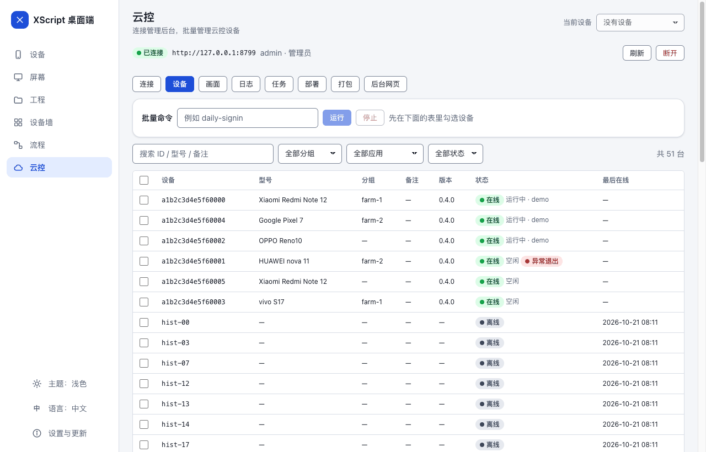

> 设备密钥等于设备的控制权，拿到它的人可以在手机上运行任意代码。不要发到公开的地方。

---

## 6. 卡密管理

在后台 **卡密管理** 页面操作。

- **生成卡密**：数量、有效天数（从激活开始算，0 = 永久）、限定应用（打包时的包名，`*` 表示所有应用）、备注。生成后可以全部复制或导出 CSV；**批次** 标签页可以按批次查看和导出。
- 卡密在第一次激活时绑定设备。列表显示状态（未使用 / 已激活 / 已过期 / 已解绑 / 已停用）、绑定的设备、激活和到期时间。
- 单张或勾选多张后：**停用**（App 最多 6 小时内联网复核时失效）、**恢复**、**解绑**（允许换设备，到期时间不变）、**延期**、**删除**（管理员）。
- **卡类型**（生成卡密时选）：**正式卡**可设「可绑定设备数」（大于 1 即多设备卡，几台设备共用一个到期时间；列表里点 **设备** 可单独解绑某一台）和 **续期叠加**（默认开：同一台设备在同一应用上还有没到期的卡时，新卡从旧卡到期后开始算；永久卡、多设备卡不叠加）。**体验卡**按小时计（最长 720 小时），只能绑一台设备，每台设备每个应用只能用一张，解绑和删除都不会重置。
- **滥用告警**标签页：24 小时内的异常激活——一张卡被多台设备尝试、一台设备激活很多张卡、一个 IP 给很多台设备激活、一个 IP 反复猜不存在的卡密。阈值在 **系统设置 → 安全** 里改（0 为关闭），也可以在 **告警通知** 里订阅「卡密滥用告警」推到群里。
- **设备黑名单**标签页（操作员以上）：填设备 ID（App 首页底部有）加入；黑名单里的设备不能再激活卡密，已激活的授权在 App 下次联网复核（最多 6 小时）时失效，离线授权码不受影响。滥用告警里「单设备激活大量卡密」那一行可以直接点「加入黑名单」。告警的 24 小时窗口和每小时一次的冷却保存在数据库里，后台重启不会清零。
- **用户续期**：打包 App 已激活后，点首页的「卡密授权」就是续期，输入新卡密，时长接在当前到期时间之后（叠加规则同上）。
- **离线授权码**（管理员）：用户的设备不联网时，填他发来的设备 ID，签发一段长授权码让他粘贴。

签名私钥在 `xscript-data/keys/private.pem`，后台第一次启动时自动生成。**一定要备份**：每个开启卡密的 App 都内嵌对应的公钥，私钥丢了或换了，已发布的 App 就无法再激活。

以前用命令行 `xscript_license.py` 的，把旧数据导入后台，已发布的 App 不受影响：

```bash
.venv/bin/python -m xscript_server import-legacy --data xscript-data \
    --key keys/private.pem --licenses licenses.db --token 旧的云控token --state xscript_cloud_state.json
```

`--token` 导入后，已经连着旧服务端的设备不用改地址。

### 用户那边怎么激活

打开打包的 App → **卡密授权** → 输入卡密 → **激活**。对话框里显示本机的设备 ID，离线授权时把它发给你。

---

## 7. APK 打包

在后台 **APK 打包** 页面：


1. **工程来源**：上传工程 zip（带 `__init__.py`，AScript 导出的也可以），或选 **小程序版本**（留空版本 = 当前发布版本）。
2. 填包名（如 `com.me.game`）、App 名称、版本号、versionCode，可选图标（PNG）。
3. 勾选 **需要卡密授权**、**连接云控**、**热更新**（只有从小程序版本打包时可用）、**代码保护**。前三个需要先在系统设置里填服务器公网地址。高级选项里可以选 CPU 架构、开机自启、正式签名等。
4. **开始打包**。右侧列表显示排队和构建进度，**日志** 查看实时构建输出，完成后 **下载** APK。
5. **分发**：在打包记录里点 **分发** 生成公开下载链接和二维码（可设有效期）。用户用手机扫码或打开链接即可下载安装，不需要登录后台；列表里能看到下载次数，删除链接立即失效。

开启热更新的 App 以后只需在「小程序」页上传并发布新版本，不用重新打包；只有改了包名、图标、权限、卡密或云控设置时才需要重新打包。

打包在运行后台的那台机器上进行，需要和构建 XScript 相同的环境（Android SDK、JDK 17+、Python 3.10）。一次构建一个，其他任务排队。只打 `arm64-v8a` 时约 77 MB。发布更新时增大 versionCode（提交后会自动加 1）。正式发布要用正式签名，否则无法覆盖升级：启动后台前设置 `XSCRIPT_KEYSTORE`、`XSCRIPT_STORE_PASS` 等环境变量（见 [PACKAGING.md](PACKAGING.md)）。

不用后台也可以在命令行打包：

```bash
.venv/bin/python backend/xscript_pack.py 你的工程目录 \
    --app-id com.me.game --name "我的脚本" --icon icon.png \
    --version 1.0.0 --version-code 1 --abis arm64-v8a \
    --license-key xscript-data/keys/private.pem --license-server https://你的服务器 \
    --out dist/
```

打包出来的 App 打开后是一个简化界面：启动 / 停止按钮、卡密授权、需要的权限（无障碍、悬浮窗、截图、Root、后台运行）、云控状态、设备 ID。它没有开发者首页和局域网调试接口（加 `--dev-server` 才有）。

注意：打包的 App 是独立应用，**无障碍服务要单独为它开启**，和 XScript 本身的授权互不影响。

---

## 桌面端：安装、更新与诊断包

桌面端 **工程** 页可以浏览、编辑、运行设备上的工程。文件列表上方列出各个文件夹和其中的文件数；点文件夹右侧的 🗑 会先列出其中的文件请你确认，然后整个文件夹一起删除（入口 `__init__.py` 不在任何文件夹里，不受影响）。名字太长放不下时末尾显示为「…」，鼠标悬停可以看到完整路径。

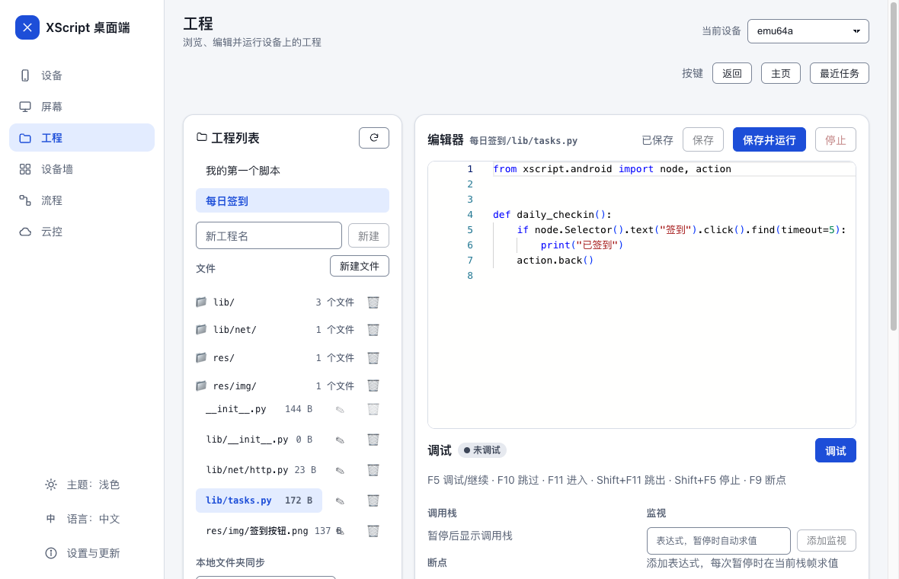

**在工程中搜索**：文件列表上方的搜索框（任何位置按 Ctrl+Shift+F / ⌘⇧F 都能跳到这里）搜索工程里所有文本文件，结果按文件分组，匹配处高亮；点一条结果就打开那个文件并选中匹配的文字（当前文件有未保存的修改时会先问你）。**Aa** 区分大小写，**.\*** 按正则表达式搜索；Esc 或 ✕ 清除结果。图片、二进制和超过 512 KB 的文件不搜，最多显示前 500 处。

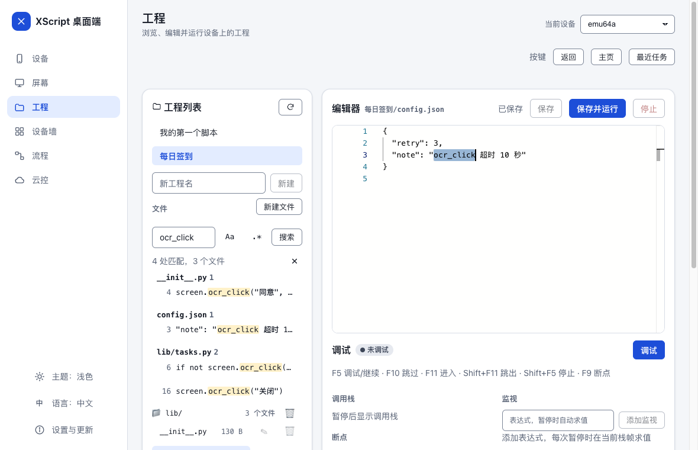

**最近运行**：选中工程后，文件列表下方列出手机上记录的这个工程最近几次运行（来自手机的 `GET /projects/<名称>/runs`）：开始时间、用了多久、怎么结束的（出错的标红），脚本自己结束的运行还有截图次数、平均截图耗时和峰值内存。点 **日志** 展开那一次运行的输出；那段日志已被手机的日志缓冲区挤掉时会说明。展开后点 **复制日志** 把这段输出复制到剪贴板；出错的运行如果日志里有 Python 报错（Traceback），还会出现 **跳到出错行 <文件>:<行号>**，点它在编辑器里打开工程中最后出错的那一行，整行选中并短暂标红（文件改短了时停在最后一行）（只认这个工程里的文件，按钮的提示里是报错信息；当前文件有未保存的修改时会先问你）。有出错的运行时标题右侧有「只看出错」，勾选后只列出错退出和进程意外退出的运行。每次运行结束后列表自动刷新。手机上的 XScript 版本较旧、没有这个接口时，这里会提示版本较旧。

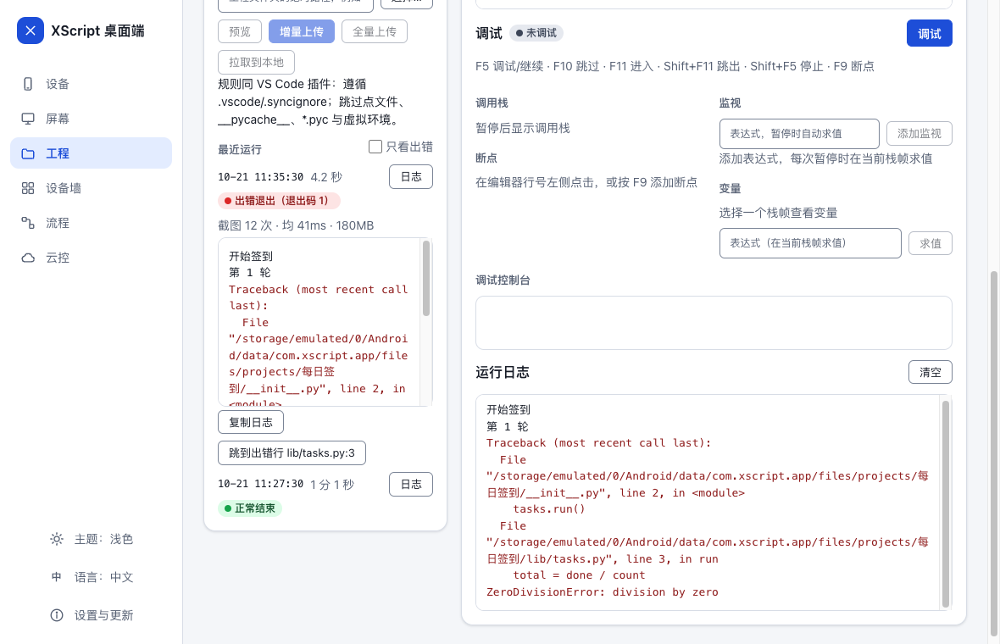

**界面设计器**：在工程页打开 `res/ui/<名称>.ui.json`（和 VS Code 扩展、网页 IDE 用同一个设计器）时，默认显示设计视图：左边点或拖控件加入表单，中间调整字段顺序或删除，右边改字段属性和窗口标题、按钮、宽高，最右是实时预览（编辑区较窄时这四栏自动排成两行或一列，预览始终留在编辑区内）。点 **JSON** 切到文本编辑（下方仍有只读预览，文件有问题时列出原因），点 **设计** 切回来。设计器上方的 **撤销** / **重做**（Ctrl/⌘+Z、Ctrl/⌘+Shift+Z）逐步撤回或重做设计器里的修改，在「JSON」里改过的内容也算一步；在属性输入框里按这些键只作用于那个输入框。改动没保存时，打开别的文件、切换工程或关窗口都会先问你。**保存**（Ctrl+S / ⌘S）时同时生成 `res/ui/<名称>.html` 和 `ui_<名称>.py`，脚本里 `from ui_<名称> import show; values = show()` 即可弹出表单；JSON 有错时只保存文本、不生成，并提示原因。点 **在手机上试运行** 先保存，再把生成的 `.html` / `ui_<名称>.py` 放进手机上的临时工程 `_ui_try`（带一个只调用 `show()` 并打印结果的 `__init__.py`）运行：手机上弹出这个界面，提交或取消后运行日志里出现 `界面返回：{...}`（取消时是 `null`）。当前工程和它的 `__init__.py` 不会被改动；`_ui_try` 每次试运行都会被覆盖，不需要时可在工程列表里删除。新建界面：点文件列表上方的 **新建界面**，输入名称（字母、数字、下划线，例如 `settings`），会创建 `res/ui/<名称>.ui.json`（空表单，窗口标题就是这个名称）并在设计器里打开；同名界面已存在时会提示。用 **新建文件** 输入以 `.ui.json` 结尾的路径也会带一个空表单。

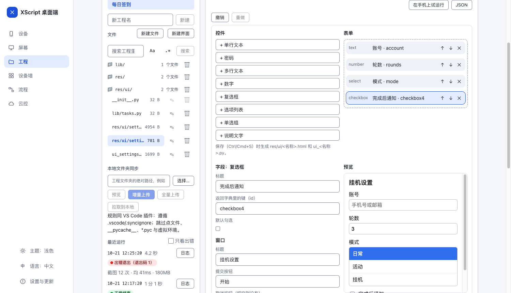

**连不上设备时**：设备页顶部的红色提示说明可能的原因，下面的「连不上怎么办？查看排查步骤」会在浏览器里打开 [连不上手机怎么办](TROUBLESHOOTING.md)。设备响应超时、需要配对、地址不像 XScript 设备时也有这条链接。

连接失败后，提示下面会自动出现 **逐项检查连接**：USB 设备按「找到 adb → adb 能看到手机 → 已允许 USB 调试 → 端口转发 → XScript App 在响应 → 对方是 XScript → 配对码」，局域网地址按「地址格式 → 能连到这个地址 → XScript App 在响应 → 对方是 XScript → 配对码」逐步检查，停在第一个不通的步骤并给出修法。修好后点 **重新检查**；全部通过时出现 **连接** 按钮。检查本身不会连接设备，也不会留下端口转发。

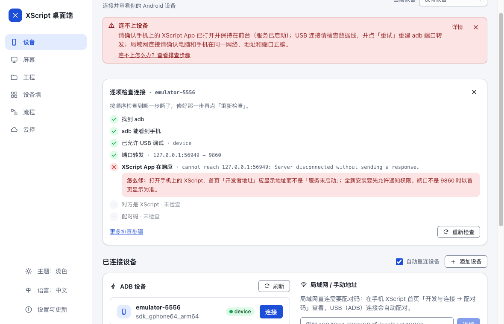

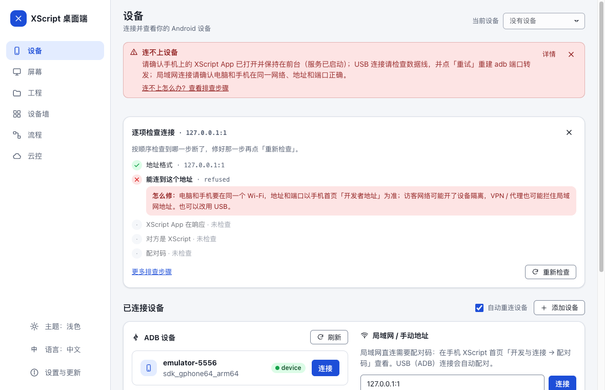

**截图状态**：**屏幕** 页的工具栏显示设备现在用哪种方式截图（「截图：系统录屏 / 无障碍截图 / Root 截图」；系统录屏授权已失效、改用无障碍时，鼠标悬停会说明）。设备截不了图时，页面顶部出现 **截图状态** 卡片：手机重启或系统收回录屏授权时显示「截图权限已失效」，从没授权时显示「设备还不能截图」，下面列出恢复步骤（首页「图色权限」重新授权、打开无障碍、Root）。点 **在手机上授权** 可以直接在手机上弹出系统录屏授权窗口（同时发一条通知「电脑端请求开启图色权限」，窗口没出现时点通知），在手机上选「立即开始」。在手机上处理好后点 **重新检查**，卡片消失、投屏恢复。「在手机上授权」需要本版本及之后的手机 App，旧版会提示升级。需要 v0.4.0 之后的 App（`/status` 里有 `capture_via`），v0.4.0 及更早的 App 只在没有录屏授权时显示「设备还不能截图」。脚本里对应的检查是 `screen.capture_status()`。

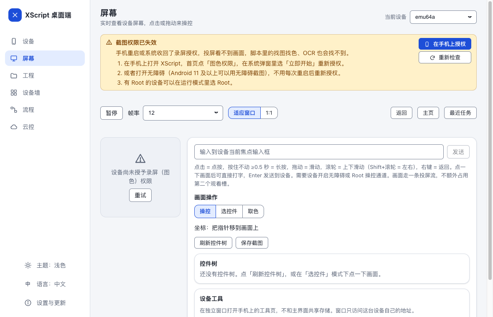

- **macOS**（Apple Silicon）：下载 `xscript-desktop-vX.Y.Z-macos-arm64.dmg`，打开后把 XScript 拖进「应用程序」。安装包只有 ad-hoc 签名、没有公证，第一次打开要在「系统设置 → 隐私与安全性」里点「仍要打开」（macOS 14 及以下：右键 →「打开」）。
- **Windows**（64 位）：运行 `xscript-desktop-vX.Y.Z-windows-x64-setup.exe`，装到当前用户下，不需要管理员权限。安装包没有代码签名，SmartScreen 提示时点「更多信息 → 仍要运行」。卸载在「设置 → 应用」里。
- **更新**：侧栏「设置与更新」→「检查更新」。有新版本时先下载（会核对签名和文件哈希），再点「安装并重启」确认，XScript 会退出、换成新版本后自动打开。也可以勾选「启动时自动检查」（每天最多一次）。当前正式版本还没有配置更新签名公钥，会提示到 GitHub Releases 手动下载。
- **诊断包**：同一个窗口里「导出诊断包…」，选择保存位置即可。里面是版本、系统信息、设备数量和桌面端日志，令牌、密码、配对码已替换成 `***`；发给别人前可以先解压看看。

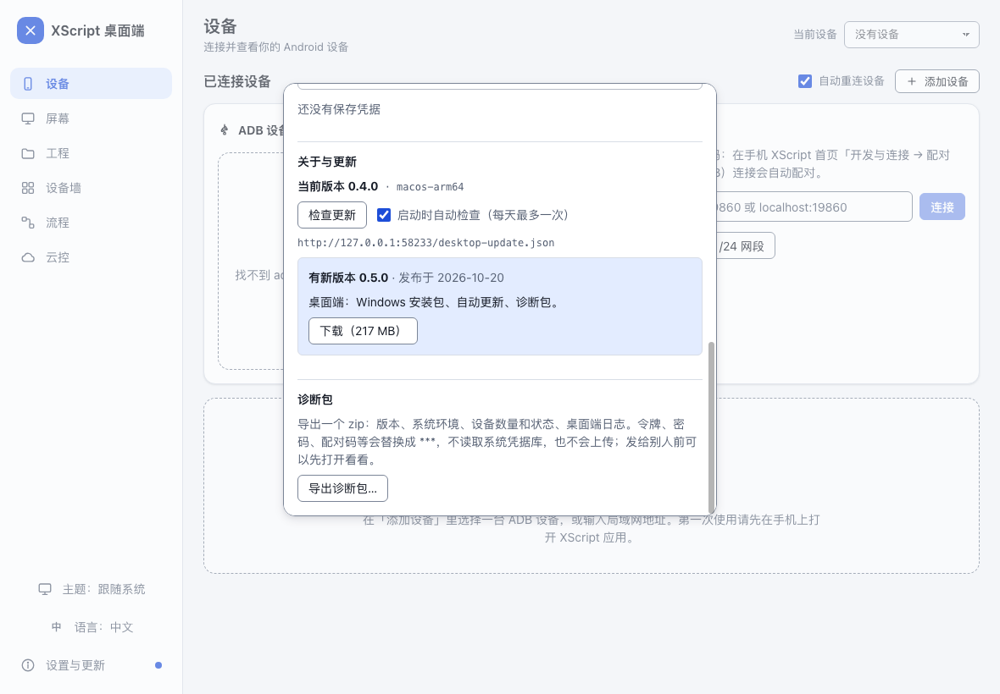

## 删除设备上的文件和文件夹

手机上的工程可以在四个地方删除。除桌面端工程页外，删除都不能撤销；工程入口 `__init__.py` 在任何地方都不能删。

桌面端工程页删除后，右下角提示里有 10 秒的 **撤销** 按钮：删除前桌面端会先把这些文件读到内存里，点撤销就原样写回手机（图片等二进制文件也一样）。一次删除超过 50 个文件的文件夹、或者其中有文件读不出来时，不提供撤销。关掉桌面端或刷新页面后也不能再撤销。新建文件和重命名后同样有 **撤销**：撤销新建会删掉这个文件（如果新建后已经写入内容，就不会删除）；撤销重命名会改回原来的路径。焦点不在输入框或代码编辑器里时，按 **Ctrl+Z**（macOS 为 **⌘Z**）等同于点最新一条提示里的「撤销」；在文件列表里选中一个文件后按 **Delete**（macOS 也可以按 **⌘⌫**）会弹出删除确认。

| 在哪里 | 删除单个文件 | 删除整个文件夹 |
| --- | --- | --- |
| 网页脚本 IDE（`/tools/`） | 选中文件 → 「删除文件」 | 在文件树里选中文件夹 → 「删除文件夹」，确认框列出其中的文件（最多 15 个） |
| 桌面端 **工程** 页 | 文件行右侧 🗑 | 文件列表上方的「文件夹」里，文件夹右侧 🗑，确认框列出其中的文件（最多 15 个） |
| VS Code / Cursor 插件 | 「上传时同步删除」（见下） | 同步删除后变空的文件夹会一起删除 |
| PyCharm 插件 | 「上传时同步删除」（见下） | 同上 |

桌面端工程页的样子见[「桌面端：安装、更新与诊断包」](#桌面端安装更新与诊断包)一节的截图。

### 上传时同步删除（VS Code / PyCharm）

默认 **关闭**：本地删掉的文件，手机上的那份会保留。打开后（VS Code 设置 `xscript.syncDeletes`；PyCharm 设置 → Tools → XScript →「上传时同步删除本地已删除的文件」），每次上传都会：

1. 找出手机上有、本地已没有、并且由上传管理的文件。被 `.vscode/.syncignore` 忽略的文件、点开头的文件、`__pycache__` 和 `.pyc` 永远不删。
2. 找出删完后会变空的文件夹：其中剩下的只有 `__pycache__` / `.pyc`，并且本地也没有任何文件在里面。只保留了 `.syncignore` 忽略的数据文件或点开头文件的文件夹不会删。
3. 在**一个**确认框里列出要删的文件和文件夹；取消则什么都不删。文件删除失败时，所在的文件夹也不会删。

想先看看会发生什么：VS Code 运行 **XScript: Preview Upload (dry run)**，PyCharm 用 **Tools → XScript → Preview Upload (Dry Run)**。它只读取手机上的文件列表，列出这次会新增、重新发送、跳过的文件，以及会删除或会保留的设备文件，不改动手机。

## 常见问题

**网页工具 / Cursor 突然连不上了**
模拟器或 adb 重启过，重新执行 `adb connect` 和 `adb forward`（第 2 节）。如果是刚全新安装，先打开 App 授予通知权限，HTTP 服务才会启动。完整的排查步骤见 [连不上手机怎么办](TROUBLESHOOTING.md)。

**`adb install -r` 报 `INSTALL_FAILED_UPDATE_INCOMPATIBLE`**
设备上已装的 XScript 签名不同（正式版，或别的电脑打的 Debug 包）。只能 `adb uninstall com.xscript.app` 后重装，**会清空 App 数据（工程、设置、授权）**，请先用脚本 IDE 的 **导出 ZIP** 备份工程。重装后要重新授予通知、无障碍、截图等权限。

**脚本 IDE 里新建或删除报错**
看状态栏的提示：`工程已存在` / `文件已存在` / `路径已存在` 表示重名；`不能删除工程入口` 表示想删 `__init__.py`；`文件夹非空` 表示要先删掉里面的文件；`路径须位于工程目录内` 或 `invalid path` 表示路径里有 `..` 等非法片段。

**首页“云端控制”一直显示“重连中”**
后台没在运行，或者地址 / 设备密钥不对（密钥被停用也会这样）。用浏览器打开后台地址试一下，再到「设备密钥」确认密钥有效。模拟器连本机时别忘了 `adb reverse`。

**脚本点击没反应**
确认无障碍服务开着（首页“辅助权限管理”显示“已开启”）。仍然不行可以把运行模式切到 Root。

**OCR 在模拟器上识别不出来**
改用 PaddleOCR：`screen.ocr(engine="paddle_v6t")`（PP-OCRv6 tiny），第一次会下载约 6 MB 模型。`engine="auto"` 也用它，下载失败时退回 ML Kit。

**打包的 App 提示“未激活，请输入卡密”**
这是开启了卡密的正常状态，输入有效卡密即可；也可以通过云控 `app_run` 带 `card` 参数激活。

---

## 深入文档

| 文档 | 内容 |
| --- | --- |
| [GETTING_STARTED.md](GETTING_STARTED.md) | 构建环境、模拟器设置、连接排错（英文） |
| [API.md](API.md) | 脚本 API：action、node、screen、yolo、pip、cloud、system、event、ui、AScript 兼容、开发工具（英文） |
| [CLOUD.md](CLOUD.md) | 云控协议、指令集、服务端 REST API |
| [PACKAGING.md](PACKAGING.md) | 打包参数、签名、卡密的完整说明和安全边界 |
| [功能对照.md](功能对照.md) | 和 AScript 逐项对照：哪些已有、哪些缺、下一步建议 |
| [路线图.md](路线图.md) | 还没做的功能分阶段策划：价值、范围、验收标准、工作量 |
| [商业化设计.md](商业化设计.md) | 走向 SaaS 和规模化的设计：套餐计费、多租户、架构、安全、合规、落地阶段 |
| [AGENT_RULES.md](AGENT_RULES.md) | 给 AI 编程时用的约束（英文） |
| [ARCHITECTURE.md](ARCHITECTURE.md) | 技术架构 |
| `protocol/openapi.yaml` | 设备 HTTP 接口契约 |
| [android/README.md](../android/README.md)、[backend/README.md](../backend/README.md)、[ide/README.md](../ide/README.md) | 三个部分各自的构建、运行和测试 |
