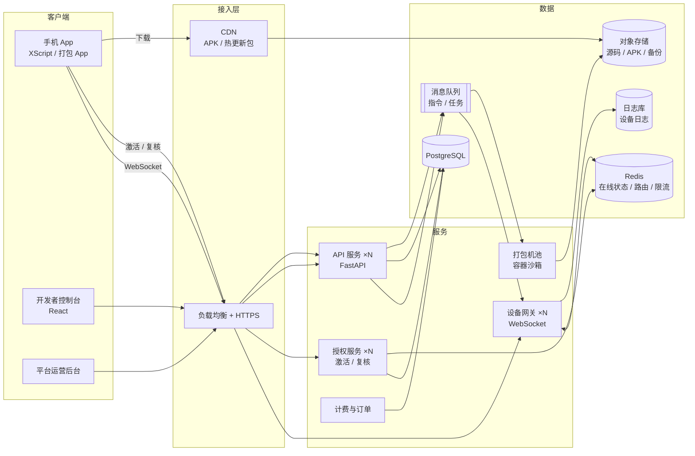

# 商业化设计（规模化方案）

这份文档设计 XScript 从「一个人或一个工作室自己部署的后台」走向「对外收费、支撑大量开发者和设备」的方案。功能层面的计划见 [路线图.md](路线图.md)，现状对照见 [功能对照.md](功能对照.md)。

文中的容量数字是估算，需要压测验证。涉及支付、资质、法规的内容只是提示风险，具体以律师和支付机构的意见为准。

---

## 1. 先做的决定：卖什么

| 模式 | 说明 | 优点 | 缺点 |
| --- | --- | --- | --- |
| **A. 私有部署版** | 把整套后台卖给工作室或企业，部署在客户自己的服务器上，按年收授权费 | 和现在的代码最接近；客户数据在客户手里；不用做多租户和支付 | 客户多了以后升级、排错要逐家处理；收入天花板低 |
| **B. SaaS 平台**（AScript 的做法） | 我们运营一套多租户平台。开发者注册后发布小程序、发卡、管理设备，按套餐 + 用量收费 | 规模效应；可以按卡、按并发持续收费；可以做应用商店和生态 | 要做多租户、计费、支付、运营后台；平台要承担合规和滥用风险 |
| **C. 两者都做（建议）** | SaaS 为主，同一套代码开启「单租户模式」作为私有部署版卖给大客户 | 小客户走 SaaS，大客户或有数据要求的走私有部署 | 工程上要保证两种模式都能跑，测试量增加 |

**建议选 C**，按 SaaS 来设计架构，单租户只是「只有一个租户」的特例。下文按这个方向写。

---

## 2. 客户和套餐

### 2.1 目标客户

| 客户 | 需求 | 付费点 |
| --- | --- | --- |
| 个人开发者 | 写脚本自用，或少量出售 | 免费入门，卖卡时付发卡费 |
| 脚本工作室 | 批量出售脚本，管理卡密和代理 | 发卡费、打包、热更新、代理功能 |
| 设备农场 / 自动化团队 | 几百到几千台设备挂机、群控 | 并发设备数、云控、屏幕墙、告警 |
| 企业（测试、运营自动化） | 稳定、数据隔离、对接内部系统 | 私有部署授权、SLA、技术支持 |

### 2.2 套餐（示例，价格待定）

| 能力 | 免费版 | 专业版 | 团队版 | 企业版 / 私有部署 |
| --- | --- | --- | --- | --- |
| 小程序数量 | 3 | 20 | 不限 | 不限 |
| 在线设备（并发） | 3 | 50 | 500 | 按合同 |
| 每月打包次数 | 2 | 30 | 200 | 不限（自有打包机） |
| 热更新、代码保护 | — | ✓ | ✓ | ✓ |
| 屏幕墙、远程操控 | 单台 | ✓ | ✓ | ✓ |
| 团队成员 | 1 | 3 | 20 | 不限 |
| 代理账号 | — | — | ✓ | ✓ |
| 告警通知 | — | ✓ | ✓ | ✓ |
| 日志保留 | 1 天 | 7 天 | 30 天 | 按合同 |
| 技术支持 | 社区 | 工单 | 优先工单 | 专属对接、SLA |

### 2.3 用量计费

套餐解决「能用什么」，用量计费解决「用了多少」：

| 计费项 | 计量方式 | 说明 |
| --- | --- | --- |
| 发卡 | 按张，按有效期分档（月卡 / 年卡 / 永久） | 和 AScript 一样，是卖脚本的开发者最主要的成本 |
| 超额并发 | 按「设备·月」 | 超出套餐的在线设备数 |
| 超额打包 | 按次 | 打包耗 CPU 和时间，成本最明确 |
| 流量 | 按 GB | APK 分发和热更新下载走 CDN，按量计费 |
| AI 识屏 / 智能体 | 按调用次数或 token | 平台代调大模型时加价；用户自带密钥则不收 |

开发者先充值「点数」（类似 AScript 的游币），各项用量从点数扣。点数和人民币的换算、套餐折扣都在平台配置里设定。

---

## 3. 目标规模

| 阶段 | 租户（开发者） | 在线设备 | 卡密激活 | 打包 |
| --- | --- | --- | --- | --- |
| 起步 | 100 | 1 万 | 每天 1 万次 | 每天 100 次 |
| 增长 | 1,000 | 10 万 | 每天 10 万次 | 每天 1,000 次 |
| 规模 | 1 万 | 100 万 | 每天 100 万次 | 每天 1 万次 |

主要压力来自三处：

- **设备长连接**：每台在线设备一条 WebSocket，每 25 秒心跳一次，每 60 秒上报一次状态。10 万台约每秒 1,700 条状态消息。
- **卡密激活和复核**：每台设备每 6 小时复核一次。100 万台约每秒 50 次，峰值更高。请求小，但不能慢，也不能挂。
- **打包**：每次占一台机器几分钟到十几分钟，内存 4–8 GB。

---

## 4. 架构

### 4.1 现状和瓶颈

现在的后台是单进程、单机。用户量上来后，下面这些会先成为瓶颈：

| 现状 | 代码位置 | 规模化后的问题 |
| --- | --- | --- |
| 在线设备连接保存在进程内存里 | `hub.py` 的 `Hub.conns` | 只能跑一个进程；重启时所有设备断开；没法加机器 |
| SQLite 数据库 | `db.py` | 单机写入，并发写有上限；不能多台机器共享 |
| 全服务一把签名私钥 | `config.key_path` | 所有租户共用；一旦泄露影响所有人 |
| 文件存在本机磁盘 | `pack/`、`scripts/`、`backups/` | 不能多机共享；APK 下载占用后台带宽 |
| 打包在后台机器上、一次一个 | `packer.py` | 和后台抢资源；没有隔离，用户上传的代码在后台机器上构建 |
| 限流、告警去重在进程内存里 | `alerts.py`、`security.py` | 多进程之间不共享，限流会失效 |
| 没有租户概念 | 所有表 | 不能区分不同开发者的数据 |

### 4.2 目标架构

### 4.3 各部分的设计

**设备网关（从 `hub.py` 拆出来）**

- 只负责维持 WebSocket 连接、转发消息，不直接写数据库。可以水平扩展多台。
- 设备连上哪台网关，记在 Redis（`device → 网关节点`）。API 要给设备发指令时，按这个路由把指令放进消息队列，由对应网关转发。
- 状态上报先写 Redis（在线状态、当前运行的脚本），每隔几十秒批量写回数据库。不再每条消息都写库。
- 一台网关按 2–5 万连接估算（Python + uvicorn，需压测确认）。10 万设备约 3–5 台。
- 截图、远程操控的画面数据量大，直接从网关返回给请求方，不经过消息队列。

**API 服务**

- 无状态，多台部署。会话、限流、告警去重全部放到 Redis。
- 每个请求带租户上下文。数据库查询统一在数据访问层加 `org_id` 条件，PostgreSQL 再开行级安全（RLS）兜底，防止漏写条件导致数据串到别的租户。

**授权服务（激活 / 复核）**

- 从 API 里拆出来，单独扩容。复核结果在 Redis 里缓存几分钟。
- 签名私钥按租户分开，用云厂商的 KMS 加密保存。只有授权服务能解密使用。
- 授权服务挂掉时，App 用本地的令牌继续运行（现在的 App 已经这样做：联网失败时保持当前授权）。

**打包机池**

- 打包任务进消息队列，由独立的打包机领取执行。打包机可以按量开关，比如用云厂商的抢占式实例降低成本。
- 每个任务在**一次性容器**里执行：限制 CPU、内存和执行时间。网络只放行 Maven、Chaquopy 和 PyPI 镜像；构建完销毁容器。用户上传的是任意代码，必须当作不可信处理。
- 预热好 Gradle 和 pip 缓存的镜像，把打包时间从十几分钟降到几分钟。
- 按套餐限制每个租户同时打包的数量，避免一个租户占满打包机。

**存储与分发**

- 小程序源码、构建产物、APK、备份放对象存储（阿里云 OSS / 腾讯云 COS / S3）。
- APK 下载和热更新包走 CDN，用带有效期的签名链接，不经过后台。

**数据库**

- PostgreSQL 主库加只读副本。统计、报表查只读副本。
- 设备日志量大，不放主库：用 ClickHouse 或日志服务按租户、设备、时间存，按套餐的保留天数清理。
- 数据库迁移改用 Alembic（现在是自己写的 `migrate.py`，适合单机）。

**可观测性**

- 指标：Prometheus + Grafana（在线设备数、指令延迟、激活成功率、打包队列长度、各租户用量）。
- 错误：Sentry（后台和 App 都接）。
- 链路：重要请求带 trace id，方便排查「指令发出去设备没执行」这类问题。

---

## 5. 多租户数据模型

在现有的表上加一层「组织」（租户）。主要新增和变化如下：

| 实体 | 说明 | 关键字段 |
| --- | --- | --- |
| **组织 Organization** | 一个开发者或一个团队 | 名称、套餐、到期时间、点数余额、状态（正常 / 欠费 / 封禁） |
| **成员 Member** | 用户在某个组织里的身份 | 用户、组织、角色（拥有者 / 管理员 / 操作员 / 只读 / 代理） |
| **用户 User** | 登录账号，可以属于多个组织 | 手机号或邮箱、密码、两步验证、实名状态 |
| **签名密钥 SigningKey** | 每个组织自己的卡密和热更新签名密钥 | 组织、公钥、KMS 加密后的私钥、状态 |
| **套餐 Plan / 订阅 Subscription** | 套餐定义和组织当前订阅 | 各项上限、价格、周期 |
| **用量 UsageRecord** | 计量明细 | 组织、计费项、数量、时间 |
| **点数流水 Ledger** | 充值、扣费、退款的账本 | 组织、变动金额、余额、关联订单 / 用量 |
| **订单 Order** | 充值和购买套餐 | 金额、支付方式、支付状态、发票状态 |
| **代理 Reseller** | 组织下的代理商 | 额度（可发卡数）、批发价、上级 |

现有的设备、设备密钥、小程序、版本、卡密、打包任务、定时任务、告警配置、操作日志，都加 `org_id`。

**平台运营后台**是另一个入口，只给平台员工用：管理组织和套餐、订单和退款、处理举报和封禁、查看全局数据。它和开发者控制台用不同的账号体系，权限完全分开。

---

## 6. 计费与支付

### 6.1 流程

1. 开发者在控制台充值点数，或者购买套餐（微信支付 / 支付宝）。
2. 平台实时计量用量（发卡、超额并发、打包、流量），每天汇总扣点数。
3. 余额不足时提醒；欠费后限制新增（不能发卡、不能打包），已经发出的卡和在线设备不受影响，给缓冲期。
4. 开发者可以申请发票。

已经发出的卡密要一直有效，不能因为开发者欠费就让终端用户的脚本停掉。AScript 也是这样规定的。

### 6.2 终端用户买卡

开发者卖卡给终端用户有两种做法：

| 做法 | 说明 | 风险 |
| --- | --- | --- |
| **开发者自己收款**（建议先做） | 开发者通过自己的渠道（淘宝、发卡网、私聊）卖卡，平台只负责生成和校验 | 平台不碰终端用户的钱，合规风险最低 |
| **平台内置发卡商城** | 终端用户在平台页面付款，自动发卡，平台再和开发者结算 | 平台代收代付属于「二清」，需要支付牌照或使用微信 / 支付宝的服务商分账能力；还要处理退款、纠纷 |

**建议先做第一种**。商城等有支付合规方案后再做。

### 6.3 代理分销

- 开发者给代理设置批发价和额度。代理在自己的账号里生成卡密，消耗的是额度（或代理自己的点数）。
- 代理只能看到自己生成的卡和对应的激活数据。
- 每个代理的销量、激活率按月统计，方便结算。

---

## 7. 安全与防盗版

### 7.1 平台安全

- 租户隔离：数据访问层统一加租户条件，数据库开行级安全兜底，再加自动化测试专门检查「A 租户能否看到 B 租户的数据」。
- 账号：两步验证（拥有者和管理员强制开启），异地登录提醒，敏感操作（导出卡密、改签名密钥、删除小程序）需要二次确认。
- 密钥：每个租户独立签名密钥，存在 KMS。设备密钥、API 令牌、Webhook 地址在数据库里只存哈希或密文。
- 打包沙箱见 4.3。
- 限流：按租户和 IP 两个维度，放在 Redis；激活接口单独限流，防止撞库猜卡密。

### 7.2 脚本防盗版

这一块永远是攻防，目标是提高破解成本，不可能做到绝对安全。

| 措施 | 现状 | 加强方向 |
| --- | --- | --- |
| 卡密签名校验 | ✅ ECDSA 签名，设备绑定 | 令牌有效期缩短，定期在线换新 |
| 代码保护 | ✅ 只打包字节码 | 按租户加密脚本包，运行时解密；关键逻辑放服务端（云函数） |
| APK 完整性 | ❌ | 启动时校验签名证书，发现被重新签名就拒绝运行，并上报 |
| 设备指纹 | 🟡 只用 ANDROID_ID | 多维指纹（硬件信息组合），降低改 ID 共享卡密的效果 |
| 异常检测 | ❌ | 同一卡密频繁换机、同一设备大量试卡、复核请求异常时告警，可自动拉黑 |

---

## 8. 合规提示

商业化之后平台要承担的责任会明显增加，上线前建议请律师确认：

- **主体和资质**：公司主体、ICP 备案；收费业务需要对公账户和支付接入；涉及代收代付时需要相应资质（见 6.2）。
- **用户协议和隐私政策**：开发者协议、终端用户协议、隐私政策。短信、定位、通知读取这类敏感能力要在协议里写清楚，App 里也要单独授权。
- **禁止用途**：明确禁止用于游戏外挂、刷量刷单、诈骗、未经授权获取他人数据等。平台保留下架小程序、封禁账号的权利，并提供举报入口。
- **实名认证**：卖卡的开发者需要实名，这是接入支付和处理纠纷的前提。
- **数据存储**：用户数据存放在境内机房；按法规保留必要的操作日志。

---

## 9. 运营支撑

| 模块 | 内容 |
| --- | --- |
| 注册与上手 | 手机号注册、新手引导、示例工程、文档站 |
| 工单与客服 | 开发者提交工单；企业客户有专属群 |
| 状态页 | 公开展示各服务是否正常，故障时发公告 |
| 公告与消息 | 控制台站内信、版本更新说明 |
| 运营数据 | 注册数、付费转化、续费率、发卡量、在线设备、各套餐收入 |
| 风控 | 举报处理、违规小程序下架、批量注册和薅免费额度的识别 |

---

## 10. 分阶段落地

| 阶段 | 目标 | 主要工作 | 完成标志 |
| --- | --- | --- | --- |
| **P0 打基础**（约 2 周） | 现有功能可靠，能部署 | 真机验证并修问题；Docker 部署；管理员两步验证；设备日志持久化 | 真机全流程跑通；新服务器一条命令部署 |
| **P1 多租户**（约 4–6 周） | 一套后台服务多个开发者 | 组织 / 成员模型；所有数据按 `org_id` 隔离；每个租户独立签名密钥；PostgreSQL + Alembic；对象存储；套餐上限（先手动分配套餐，不接支付）；平台运营后台；私有部署版用单租户模式运行 | 两个租户互相看不到数据（有自动化测试）；私有部署版功能不受影响 |
| **P2 规模化**（约 4–6 周） | 支撑 10 万在线设备 | 设备网关拆分 + Redis 路由 + 消息队列；授权服务拆分；打包机池和容器沙箱；CDN；监控告警；压测 | 压测 10 万在线设备、每秒 100 次激活、指令延迟 P99 < 1 秒 |
| **P3 计费**（约 3–4 周） | 能收钱 | 点数余额、充值订单、微信 / 支付宝支付、用量计量和扣费、欠费处理、发票申请；更多卡密类型；代理分销 | 开发者能自助充值、买套餐，用量自动扣费并有账单 |
| **P4 生态**（持续） | 留住开发者，扩大收入 | 应用商店 / 小程序展示页；AI 识屏和智能体（平台代调大模型加价）；网页 IDE；插件市场；发卡商城（有合规方案后） | 按各功能自己的验收标准 |

时间按 1–2 名全职开发估算，实际取决于人手和需求变化。P0 和 P1 是后面所有阶段的前提，建议按顺序做；P3 可以和 P2 并行。

**进度（2026-10）**：P0 中两步验证、设备日志持久化、Docker 部署已完成，剩真机验证（需要连接手机）和在真实服务器上构建 Docker 镜像。P1 的技术方案见 [多租户技术方案.md](多租户技术方案.md)（待补，尚未编写）。

---

## 11. 需要你决定的事

| # | 问题 | 选项 | 我的建议 |
| --- | --- | --- | --- |
| 1 | 商业模式 | A 私有部署 / B SaaS / C 两者都做 | C |
| 2 | 第一年目标规模 | 1 万 / 10 万 / 100 万在线设备 | 按 10 万设计，先上 1 万的机器 |
| 3 | 云厂商 | 阿里云 / 腾讯云 / 其他 | 选一家，对象存储、CDN、KMS、短信都在同一家 |
| 4 | 收费方式 | 套餐 + 点数用量 / 只卖套餐 / 只按用量 | 套餐 + 点数用量 |
| 5 | 终端用户买卡 | 开发者自己收款 / 平台发卡商城 | 先让开发者自己收款 |
| 6 | 公司主体和支付资质 | 已有 / 需要办理 | 影响 P3 的启动时间，建议尽早办理 |
| 7 | 免费版额度 | 见 2.2 | 先保守，上线后根据转化率调整 |

确定 1、2、3 之后，我就可以开始做 P0，并把 P1 拆成具体的开发任务。
