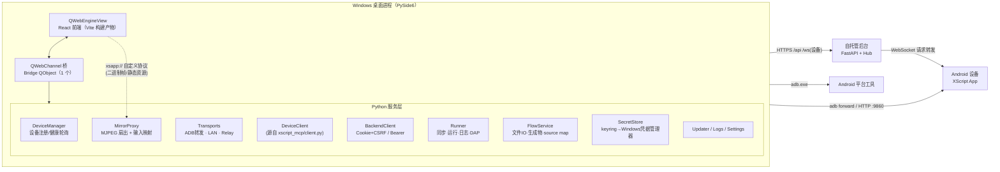
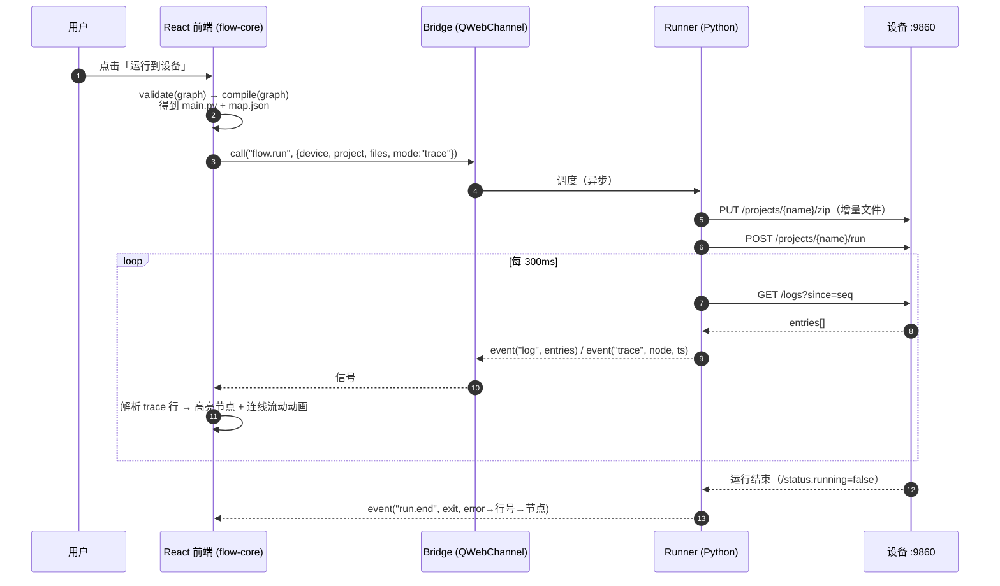
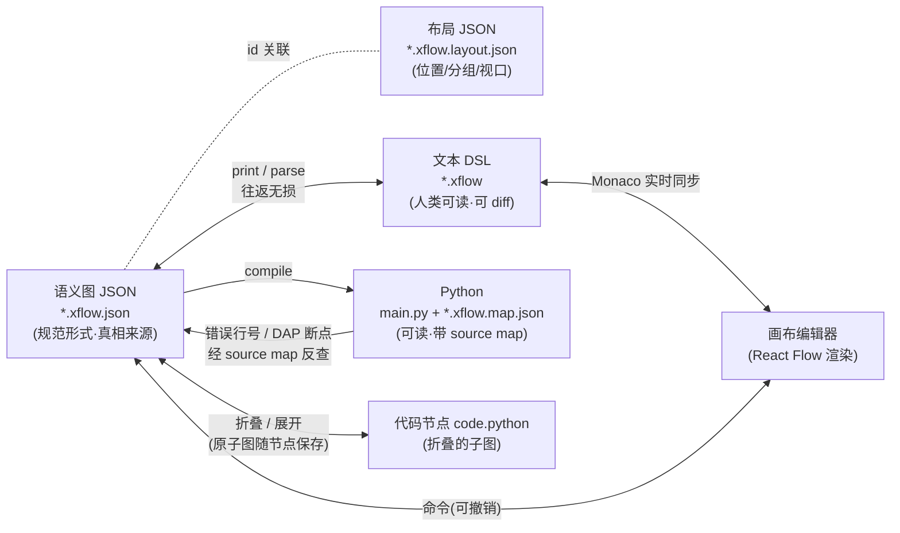
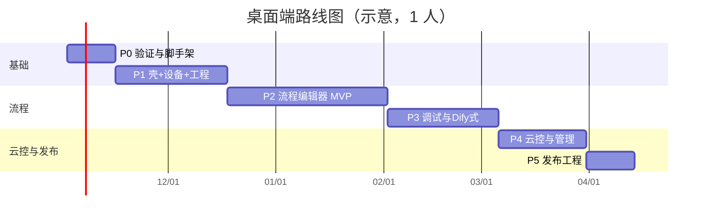

# XScript 桌面端（Windows）设计文档

> 状态：**设计稿；P0 已完成（macOS 上验证），P1 起的细化见 [§14](#14-细化设计p0-之后补全此前薄弱或未决的部分)**。代码在 `desktop/`，进展见 [`desktop/README.md`](../desktop/README.md)。测试见 [`桌面端-测试方案.md`](桌面端-测试方案.md)。
> 标记约定（§14 开头）：✅ 已实测　📖 源码推断（没运行）　📝 设计（未实现）　⚠ 未验证（尤其是 Windows）。
> 决策记录（2026-10-16，§13 开放问题未获回答，按本文推荐执行）：#1 五种 DSL 剥离（A–E）都做；#2 React Flow（`@xyflow/react`）；#3 QtWebEngine；#4 缩进式 DSL；#5 编译器先 TypeScript、后 Python 移植；#14 版本与标签和现有 Release 共用（本阶段不打 tag、不发布）；#15 放本仓库 `desktop/`。其余开放问题（#6–#13、#16）仍待拍板。
> 日期：2026-10-16　　作者：Grok Bot（代 Donna 起草）　　适用仓库：`JackLuguibin/xscript`（v0.2.6 之后）
> 本文所有"现状"都来自对仓库的只读调查（文件与行为均标了出处）；所有关于 Dify / UE Blueprint / React Flow / Qt 的说法都标了来源，见 [附录 C](#附录-c引用来源)。
> 唯一动过的东西：`/workspace/poc-xflow/` 里一个一次性概念验证（只验证 DSL 往返和代码生成，不在仓库里，见 [§8.9](#89-概念验证已跑通的部分)）。

---

## 0. 摘要（先看这一页）

**要做什么**：一个 Windows 桌面客户端，把现在分散在 *ADB 命令行 / 网页 IDE / VS Code 插件 / MCP / 管理后台网页* 里的能力收拢成一个应用：连接设备、投屏与操控、写脚本与调试、**蓝图式流程编辑器**、云控设备群管理、后台管理、打包。

**关键决策（推荐方案，全部可改）**

| # | 决策 | 推荐 | 一句话理由 |
| --- | --- | --- | --- |
| D1 | 壳 | **PySide6 + QWebEngineView + QWebChannel** | 你指定；QWebChannel 官方支持 Python↔JS 双向调用，带 Chromium，行为可预测（对比 pywebview 见 §5.1） |
| D2 | 前端 | **React 19 + TypeScript + Vite**，与 `backend/web` 同栈 | 复用栈和组件；流程编辑器可直接嵌进后台控制台 |
| D3 | 图库 | **React Flow（`@xyflow/react`）**，蓝图行为自己在上面搭 | MIT、维护活跃、自定义节点/多 Handle/连接校验齐全；Dify 的画布也用它（§4.2） |
| D4 | 网络 | **所有设备/后台请求都走 Python 服务，不让网页直接 `fetch`** | 设备 API 和后台都**故意不发 CORS 头**（`protocol/openapi.yaml`、`deps.py`），网页直连读不到响应 |
| D5 | 流程语义 | **蓝图模型：白色执行线（exec）+ 带类型的数据线**；节点库由 `api_catalog.json`（14 个模块 / 107 个函数）**自动生成**，再手工精修常用的 ~60 个 | 100% API 覆盖（未精修的走"通用调用节点"），又有好用的主力节点 |
| D6 | "DSL 剥离"的解释 | **三层**：① 语义 JSON（`*.xflow.json`）与布局（`*.xflow.layout.json`）**分离**；② 任何节点/选区可**导出为 DSL 文本片段**并在 DSL 页签里**双向实时编辑**；③ 选区可**折叠成 Python 代码节点**（无损可还原）。详见 §8.1，**请确认你要的是这个意思** | 你的原话有歧义，我按最有用的组合来设计 |
| D7 | 执行 | **编译为可读 Python（带 source map）上传到手机运行**，手机端不依赖电脑；解释执行只用于"单节点试跑" | 复用现有 `/projects/*/run`、日志、DAP 调试；离线也能跑 |
| D8 | 调试 | 节点断点 = 经 source map 映射到生成代码行，走现有 **DAP（debugpy）**；运行高亮靠生成代码里的轻量 trace 日志（经现有 `/logs` 回读） | 不需要改 Android 端就能做到"连线上有流动动画 + 节点断点" |
| D9 | 后台管理页 | 先**内嵌现有后台网页**（独立 QWebEngineView 页签），只把"设备群/批量下发/从流程部署"做成原生页 | 卡密、公告、更新、审计这些低频页面重做收益低 |
| D10 | 安全 | 设备 API **目前没有鉴权**（`openapi.yaml` 明写）。桌面端第一版只连 ADB 转发 / 局域网；**配对 token 需要改 Android 端**（P2，可选），凭据放 **Windows 凭据管理器**（`keyring`） | 不能假装安全；要改设备端就明说 |
| D11 | 打包 | **`pyside6-deploy`（Nuitka）→ Inno Setup 安装包 + 代码签名 + GitHub Release 自动更新**，接入现有 `release.yml` | Qt 官方推荐路径；不依赖应用商店 |
| D12 | 编译器语言 | **TypeScript 为参考实现**（浏览器/桌面/后台控制台共用），Python 端口等 CLI/MCP/CI 需要时再做，两者用同一份黄金语料对拍 | UI 需要即时反馈；双实现成本推迟到有需要时 |

**估算**：1 名全职开发约 **20.5–25 人周**（约 4.5–6 个月）到可发布的 v1；2 人并行约 3–3.5 个月（P0–P5，详见 §12.1）。详见 §12。

**已验证的东西（不是纸上谈兵）**：见 §8.9 —— 图 JSON ⇄ 文本 DSL ⇄ Python 的往返在 3000 个随机流程上 0 失败，生成的 Python 在假 `xscript` 模块上实跑通过，并且**这个 PoC 当场抓出了 4 个设计缺陷**（已写进 §8 的规则里）。
**没验证的东西**：React Flow + QWebChannel 在真实 Qt 里的表现（P0 没做 spike，计划见 §14.10）、PySide6 打包体积、Windows 上的任何东西（本机是 Mac，本文没有在 Windows 上跑任何东西，清单见 §14.9）。完整的未验证汇总在 §14.14。
**P0 之后新增的实测**（§14）：`/screen/stream` 的 2 观看者上限、429 响应与槽位释放延迟、录屏未授权时的槽位泄漏；设备 `/logs` 窗口按行数（≈2 000 行）而不是字节；**工程名与标准库同名会遮挡标准库、兄弟工程会遮挡绝对导入**（所以入口存根改用相对导入）。

---

## 1. 现状调研（只读，出处为仓库文件）

### 1.1 设备 HTTP API（`protocol/openapi.yaml`，1321 行）

- 默认端口 `9860`，被占用依次试到 `9869`。**没有鉴权**；服务端**不发 CORS 头**，"浏览器页面读不到响应"（`openapi.yaml` 开头描述）。任何能连上端口的人都可以上传并运行代码（`/eval`、`/projects/{name}/run`）。
- 能力清单（路径族）：
  - 状态：`/`、`/status`（含 `overlay`、`version`、`running`、`project`、`channel`…）、`/settings`
  - 屏幕与界面：`GET /screen`（`format`、`quality`、`max` 缩放）、`GET /screen/stream`（MJPEG，`fps≤15`、`scale`、`quality`，响应头 `X-Screen-Size: WxH`，**同时最多 2 个观看者，超出返回 429**）、`GET /ui-tree?mode=0|1`
  - 操控：`POST /action`（`type`: `click|swipe|input|key|node`，`x/y/x1/y1/x2/y2/dur/text/name/path/action/arg`）
  - 工程：`/projects`、`/projects/{name}`、`/files`、`/dir`、`/move`、`/file`、`/zip`、`/run`、`/stop`、`/config`、`/projects/{name}/debug`
  - 调试（DAP over HTTP 轮询）：`/debug/status|connect|request|messages`，`DELETE /debug`（`docs/DEBUGGING.md`：debugpy 1.8.22，进程内适配器，HTTP 缓冲 512 条/8 MiB）
  - 日志：`/logs`（`{entries:[{seq,ts,stream,line}], next}`，seq 游标）
  - 其他：`/schedules*`、`/ascript/*`、`/models*`、`/packages`、`/eval`（一次一个片段，超时 408 并杀掉 `:eval` 进程）、`/tools/*`（设备自带的图色工具 / 标注工具 / 投屏网页，`/tools/snapshots`、`/tools/vision`、`/tools/datasets*`）
- 云控 WebSocket 复用同一套请求（`docs/CLOUD.md`：`{"type":"request","method","path","query","body"}` → `{"type":"response","status","mime","body"(base64)}`），**不能流式传输**。

### 1.2 管理后台（`backend/xscript_server`，FastAPI，约 7650 行 Python）

- **认证**（`deps.py`、`routes/auth.py`）：网页登录得到 Cookie `xs_session`；Cookie 认证的写请求必须带头 `X-XScript-Csrf`（"浏览器不能在没有 CORS 预检的情况下给跨站请求加自定义头，而这个服务从不批准预检"）；或者 `Authorization: Bearer xsk_…` API 令牌（权限与账号角色相同）；**令牌只能在网页会话里创建**（`create_token` 里 `p.via != "web"` → 403）；支持 TOTP；角色 `viewer < operator < admin`；有登录限流。
- **设备与云控**（`routes/devices.py`、`hub.py`）：`GET /api/devices?q=&group=&online=&page=`、`/api/groups`、`/api/apps`、`PATCH /api/devices/{id}`、`POST /api/devices/batch-group`、`GET /api/devices/{id}/logs`（服务端保存的运行日志，离线也能查）、`POST /api/command`（`target`: `all|group:x|app:包名|设备id,…`，AScript 指令集 `app_run/app_stop/screen_shot/device_action/…`）、`POST /api/devices/{id}/http`（HTTP 转发；**operator 只能调只读接口 + `/action` + 运行/停止，上传文件和 `/eval` 要 admin**）、`/ws`（设备主动连入，设备密钥 `xsd_…`）。
- **其他模块**：`/api/tasks`（服务端定时任务）、`/api/scripts`（小程序、版本、`publish`、`deploy` 经云控安装到设备）、`/api/pack/*`（打包任务/日志/APK 下载/分发链接）、`/api/cards/*`（卡密批次、续期、体验卡、滥用告警、黑名单）、`/api/app-notices`、`/api/app-updates`、`/api/users`、`/api/audit`、`/api/settings`、`/api/maintenance/*`、`/pub/*`（公开接口）。
- **控制台**（`backend/web`）：React 19.3 + Vite 8 + react-router 7 + @tanstack/react-query 5 + TypeScript 5.9；页面 15 个（Overview/Devices/Wall/Tasks/Scripts/Pack/Cards/AppOps/Audit/Users/Settings/DeviceKeys/Account/Download/Login）。

### 1.3 现有开发工具

| 工具 | 实现 | 对桌面端的意义 |
| --- | --- | --- |
| **网页 IDE** | 设备 App 里的**纯 JS（无构建）**，`android/app/src/main/assets/tools/`（`editor.js`、`editor-model.js`、`editor-debug.js`、`editor-complete.js`… 共约 15 个文件，**没有用 Monaco**，自带轻量高亮和补全；`editor-api.js` 由 `scripts/gen_completions.py` 从运行时生成） | 桌面端换 **Monaco**（体验和 VS Code 一致）；补全数据直接复用 `gen_completions` / `python-stubs` |
| **VS Code 扩展** | TypeScript，`ide/vscode-extension/src/`：`client.ts`（**不依赖 `vscode`**，纯 Node/`fetch`；`DeviceClient`、`parseTarget`、`HttpError`、日志跟随 `followTick`）、`sync.ts`（`.syncignore`、增量上传计划、拉取工程）、`dap.ts`/`debugAdapter.ts`（标准 DAP ↔ 设备 `/debug/*`）、`devices.ts`、`newProject.ts` | **抽出共享的 `device-client` 包**（TS），桌面前端不直接用（CORS），但 Python 侧移植同样的协议；同步/DAP 逻辑是现成的算法参考 |
| **MCP 服务** | Python，`ide/mcp-server/xscript_mcp/`：`client.py`（设备 HTTP 客户端）、`server.py`（约 25 个 tool）、`api_catalog.json` | **`client.py` 可直接作为桌面 Python 服务的设备客户端起点**；`api_catalog.json` 是节点库的数据源 |
| **类型存根** | `ide/python-stubs/{xscript,ascript}`，由 `scripts/gen_stubs.py` 从 `android/python-runtime/` 用 `ast` 生成 | 节点库自动生成器可按同样方式读源码 |
| **设备端运行时** | `android/python-runtime/{xscript,ascript}`（Chaquopy 17，Python 3.10） | 生成的 Python 只能用这里存在的 API |

### 1.4 项目格式

- 一个工程 = 一个 Python 包：入口 `__init__.py`，工作目录是工程目录；可有 `res/`、`requirements.txt`、子模块；AScript 风格工程有 `build.as`（JSON：`{"name","version","entry"}`，设备也认）。VS Code 扩展新建工程模板见 `ide/vscode-extension/src/newProject.ts`。
- 设备端工程接口是"文件级"的（`/projects/{name}/files|file|dir|move|zip`），VS Code 扩展做了增量同步（大小 + 内容摘要）。

### 1.5 节点库的原料：`api_catalog.json`

按 `ide/mcp-server/xscript_mcp/api_catalog.json` 统计：**14 个模块、107 个函数**（另有类）：`xscript.android.action`(8)、`node`(1+Selector/Node)、`screen`(21)、`system`(16)、`ui`(5)、`event`(10)、`yolo`(2)、`paddle`(4)、`onnx`(1)、`models`(5)、`pip`(4)、`cloud`(6)，加 `ascript.android` 兼容层(19)和 `devtools`(5)。`ascript.android` 还带一份 `unsupported` 清单（HID、`YoLov5`、`sms`、`bluetooth`…）。`docs/功能对照.md` 逐项标了 ✅/🟡/⛔/❌，可以直接决定哪些节点显示"实验/不可用"徽标。

### 1.6 可复用清单（结论）

| 现有物 | 怎么用 | 改动量 |
| --- | --- | --- |
| `ide/mcp-server/xscript_mcp/client.py` | 桌面 Python `DeviceClient` 的起点 | 小（加异步、重试、传输抽象） |
| `ide/vscode-extension/src/sync.ts`、`client.ts` 算法 | 移植为 Python `Runner`；同时抽成 TS `device-client` 供测试/后台复用 | 中 |
| `dap.ts`（DAP↔HTTP 适配） | 流程节点断点、代码调试 | 中（逻辑可抄） |
| `backend/web` 的 React 栈、`api.ts`、`components.tsx` | 桌面前端同栈，共享 UI 组件 | 中（要拆包） |
| `backend/web/src/pages/*`（15 页） | 低频管理页**直接内嵌网页**；设备/Wall 页参考重做 | 小 |
| `api_catalog.json` + `gen_stubs.py` 思路 | 自动生成节点规格（`gen_nodespecs.py`） | 中 |
| 设备自带 `/tools/*` 网页 | 页签直接打开（ADB 转发时）：图色工具、标注工具、投屏 | 极小 |
| `release.yml`、`scripts/release.sh` | 加桌面安装包产物和校验 | 小 |

---

## 2. 目标、非目标、角色、功能清单

### 2.1 目标

1. **一个应用**完成：连接 → 看屏幕/操控 → 写脚本/流程 → 运行/调试 → 批量下发/云控 → 管理 → 打包。
2. **流程编辑器像虚幻蓝图**：拖拽节点、连线、执行线与数据线分离、类型校验、折叠、断点、运行时连线动画；**每个节点和整张图都能剥离成文本 DSL 并双向编辑**，也能编译成可读 Python 直接在手机上跑。
3. 不依赖电脑常驻：流程编译后在手机上独立运行（与现有"工程"模型一致）。
4. 与现有生态**互通**：流程存在工程里（`*.xflow.json` + 生成的 `.py`），VS Code 扩展、网页 IDE、MCP 照常能同步和运行；后台"小程序版本/发布/部署"照常用。
5. 中文优先，同时支持英文（i18n）。

### 2.2 非目标（第一版明确不做）

- 不做新的设备端运行时；不改 Python 版本（设备 3.10）。
- 不做 iOS；不做公网"设备直连"（设备端没有鉴权，不鼓励）。
- 不做 Marketplace / 节点市场（只预留第三方节点目录）。
- 不重写后台低频管理页（卡密/公告/更新/审计/用户/设置）——内嵌网页。
- 不做 AI 智能体（`docs/功能对照.md` 标注"没有"）；只留 `ai.*` 节点的接口位（调用用户自配的推理服务）。
- 不保证 macOS/Linux 发布（Qt 天然能跑，但第一版只测 Windows 10/11 x64；代码避免 Windows 专有 API）。
- 不做流程的"设备端解释器"（先编译为 Python）。

### 2.3 角色（Persona）

| 角色 | 诉求 | 主要使用的功能 |
| --- | --- | --- |
| **脚本作者**（个人开发者） | 快速试、可视化、能调试 | 设备连接、投屏取坐标/取色、流程编辑器、Monaco、断点 |
| **工作室 / 农场运营** | 几十到几百台设备批量下发、看状态、看日志、定时 | 设备群、批量命令、从流程部署、日志检索 |
| **小程序发布者** | 版本、灰度、打包、卡密 | 脚本版本发布/回滚、打包、卡密/公告/更新（内嵌后台） |
| **集成者 / AI 用户** | MCP、脚本化 | 流程导出 DSL/Python，CLI 编译（P4） |

### 2.4 功能清单与优先级

P0 = 第一版必须；P1 = 第一版期望；P2 = 之后。

| 模块 | 功能 | 优先级 |
| --- | --- | --- |
| **设备连接** | ADB 设备枚举 + 自动 `adb forward`；局域网扫描（9860–9869）；手动输入地址；已保存设备（分组/备注）；状态轮询（`/status`）；多设备同时连接 | P0 |
| | 二维码配对（App 显示 `xscript://pair?...`，桌面扫码/粘贴）+ 配对 token | P2（需 Android 改动） |
| | 经云控后台连接设备（relay 传输） | P1 |
| **投屏与操控** | 单设备实时投屏（MJPEG 代理 + 多窗口扇出）、点击/拖动/滚轮/按键/文本输入映射到 `/action`、坐标/取色/截图保存、`/ui-tree` 控件树检查器（点画面选控件、复制选择器/XPath/生成节点）、录制操作→生成流程（P2） | P0（投屏+点击）/P1（检查器）/P2（录制） |
| | 多设备墙（缩略图轮询）+ 同步操作（一键广播点击/按键） | P1 |
| **工程与编辑** | 工程浏览器（设备上的工程 ⇄ 本地工作区）、增量同步（`.syncignore`）、拉取、新建工程模板、Monaco 编辑（补全来自 python-stubs）、诊断、搜索替换 | P0 |
| | 运行/停止/日志实时跟随；断点调试（DAP）、变量/调用栈 | P0 |
| **流程编辑器** | 见 §7；MVP = 事件/控制流/动作/数据节点 + 类型校验 + 编译运行 + 运行高亮；之后加调试、子流程、Dify 式功能 | P0（MVP）→ P1 |
| **日志** | 多设备日志面板、过滤、导出；后台保存日志检索 | P0 / P1 |
| **云控 / 设备群** | 登录后台（Cookie 或 API 令牌）、设备列表（筛选/分页/分组）、批量命令、HTTP 转发、实时截图、服务端定时任务、设备密钥管理 | P1 |
| | 从流程/工程"部署到设备群"（`/api/scripts/{id}/deploy`） | P1 |
| **管理** | 小程序/版本/发布/回滚；卡密、公告、更新、审计、用户、设置——**内嵌后台网页** | P1 |
| **打包** | 打包任务创建/日志/下载 APK/分发链接（`/api/pack/*`） | P1 |
| **应用本身** | 设置、主题（亮/暗）、中英文、自动更新、崩溃日志、凭据管理 | P0 |

---

## 3. 总体架构

### 3.1 进程与模块



**要点**

1. **React 只负责界面**；所有网络、文件、ADB、密钥都在 Python 服务里。原因有三：①设备与后台都不发 CORS 头，网页直连读不到响应；②凭据不能进网页上下文；③可以在 Python 里做重试、限流、日志、审计。
2. **桥只有一个 QObject**（`Bridge`），暴露极少的槽（见 §3.3），避免把几十个 `@Slot` 都暴露给 JS（QWebChannel 把公开槽和属性都发布给远端，见 Qt 文档）。
3. **二进制数据不走 QWebChannel**（JSON 序列化 + base64 开销大）：投屏帧、截图、大文件用自定义 URL scheme 由 `QWebEngineUrlSchemeHandler` 提供（P0 已实现截图：`xsapp://app/_shot/<设备id>.jpg?max=N`；投屏帧通道见 §14.4，**尚未实现**）；React 构建产物也由 `xsapp://app/` 提供（避免 `file://` 的限制）。
4. **asyncio 与 Qt 事件循环**：服务层跑在一个专用的 asyncio 线程里（`httpx.AsyncClient`），通过 Qt 信号把结果投回 GUI 线程；不使用 `qasync`（成熟度风险）。

### 3.2 一次"运行流程"的时序



### 3.3 IPC 契约（QWebChannel）

不为每个功能建一个槽，而是一个**JSON-RPC 风格的单入口**：

```text
Bridge (QObject, 注册名 "xs")
  @Slot(str requestJson)            call(requestJson)        # {id, method, params}; 立即返回，结果走信号
  Signal(str)                       message(json)            # {id, ok, result|error}  应答
                                                              # {event, topic, data}    事件推送（日志/trace/设备状态/更新进度）
```

- **方法命名空间**：`device.*`（list/connect/status/screen/action/ui_tree）、`project.*`（list/pull/push/run/stop/logs/debug.*）、`flow.*`（save/load/run/stop/stepRun）、`cloud.*`（login/devices/command/relay/deploy/scripts/pack）、`secret.*`、`app.*`（settings/update/openExternal/pickFolder）。
- **请求/应答**用 `id` 关联；**事件**带 `topic`（`device.state`、`run.log`、`run.trace`、`mirror.frame` 仅通知，帧本体走自定义协议）。
- **类型**：前端用同一份 TypeScript 类型（由 JSON Schema 生成）；Python 侧用 `pydantic` 校验；**契约文件** `desktop/schema/ipc.schema.json` 进 CI，前后端各自校验。
- **错误**统一 `{code, message, retryable, details}`；设备返回的 `HttpError`（含 429 观看者已满、403 许可、409 已有脚本在运行）原样映射。
- 取消：`{method:"cancel", params:{id}}`。
- 约束（Qt 文档）：JS 数字映射为 double；重载槽按最佳匹配——另一个不用一堆槽的理由。

### 3.4 传输抽象（连接设备的 3 条路）

| 传输 | 怎么连 | 能做什么 | 限制 |
| --- | --- | --- | --- |
| **ADB 转发** | `adb devices` → `adb -s <序列号> forward tcp:<本地端口> tcp:9860`（本地端口自动分配，避免固定 19860 冲突） | 设备 API 全部（含 `/screen/stream`、DAP） | 需要 `adb.exe`；USB 调试 |
| **局域网直连** | 扫描子网 9860–9869，或手输 `host:port`（`parseTarget` 规则同 VS Code 扩展） | 全部 | 设备 API **无鉴权**，只在可信网络 |
| **云控 Relay** | `POST /api/devices/{id}/http`（后台转发）；批量走 `/api/command` | 只读接口 + `/action` + 运行/停止（operator）；上传文件/`/eval` 需 admin；**不能流式** | 投屏退化为轮询 `GET /screen?format=jpg&max=480&quality=40`（后台文档给出的小图方案）或 `screen_shot` 指令 |

统一接口 `request(method, path, query, body, timeout) -> Response` + `stream(path)`（仅直连）。所有上层（Runner/Mirror/Flow）只依赖这个接口，可以无感切换传输；Relay 下自动禁用不可用功能并在 UI 里解释原因（例如"此设备经云控连接：投屏为 2 帧/秒的截图模式"）。

**投屏的硬约束**：设备的 `/screen/stream` **最多 2 个观看者**（超出 429），而 VS Code 扩展、网页 IDE、桌面端都可能同时在看。所以桌面端：①每台设备**只开一条上游流**，在本进程里扇出给多个视图（主窗口、多设备墙、检查器）；②收到 429 时提示"观看者已满（被其它工具占用）"并给出降级（轮询截图）；③`X-Screen-Size` 用于把窗口坐标换算成屏幕像素。

---

## 4. 前端（React）

### 4.1 技术栈

| 项 | 选择 | 说明 |
| --- | --- | --- |
| 构建 | Vite + TypeScript 5.9 | 与 `backend/web` 同版本线（Vite 8 / React 19.3 / TS 5.9） |
| 状态 | **zustand**（编辑器/画布状态，细粒度订阅，便于做撤销栈）+ **@tanstack/react-query**（来自 Python 的服务端状态，与后台控制台一致） | 画布状态不要放 react-query |
| 路由 | react-router 7（与后台一致） | 桌面应用内多页签 |
| UI | 沿用后台控制台的 `components.tsx` 风格；窗口布局用 `dockview` 或 `react-resizable-panels`（待 P0 验证） | 面板可拖拽/停靠 |
| 代码编辑 | **Monaco Editor**（MIT，`microsoft/monaco-editor`；落地前复核其 LICENSE） | 补全/悬停数据来自 `python-stubs`（`.pyi`）→ 喂给 Monaco 的 Python 语言服务（或 `pyright` wasm，P2）；**DSL 页签**用 Monaco 自定义语言（见 §8.6） |
| i18n | `react-i18next`，`zh-CN` 为主、`en` 次；节点标题/说明在节点规格里带 `title:{zh,en}`（§8.7） | 与 README 双语策略一致 |
| 主题 | CSS 变量，亮/暗跟随系统；画布配色独立 | |
| 测试 | Vitest（单元）+ Playwright（组件/端到端，连 mock 桥） | |

### 4.2 图库选型：React Flow vs litegraph vs Rete vs 自绘

| 维度 | **React Flow（@xyflow/react）** | litegraph.js | Rete.js | 自绘 Canvas/WebGL |
| --- | --- | --- | --- | --- |
| 许可 | MIT¹ | MIT¹ | MIT¹ | 自有 |
| 与 React 的契合 | 原生 React 组件，节点就是 React 组件（"自定义节点 = 写一个 React 组件"）² | 自带 Canvas 渲染，与 React 集成要自己桥接 | 框架无关，有 React 渲染插件 | 全自己做 |
| 多类型 Handle | 一个节点可有任意多个 `Handle`，需 `id` 区分；`sourceHandle/targetHandle` 指到具体 Handle³ | 内建 slot 类型 | 内建 socket | 自己做 |
| 连接校验 | `isValidConnection` 回调（可返回 false 拒绝）⁴ | 内建类型匹配 | `socket.compatibleWith` | 自己做 |
| 拖线到空白弹菜单 | `onConnectEnd` + 官方"Add node on edge drop"示例³ | 内建 | 需插件 | 自己做 |
| 小地图/缩放/框选/多选/吸附 | 内建（`MiniMap`、`Controls`、`selectionOnDrag`、`snapToGrid`）⁴ | 内建 | 插件 | 自己做 |
| 大图性能 | `onlyRenderVisibleElements`（视口裁剪）⁴；DOM/SVG 渲染，千级节点需注意 | Canvas，大图更轻 | 取决于渲染插件 | 最好但成本最高 |
| 维护状况 | xyflow 团队持续维护（文档最后更新 2026-10-11）⁵ | 版本与提交都已很久没更新，**有维护风险**¹ | 有近期提交，活跃度指标偏弱¹ | — |
| 生态/先例 | **Dify 的工作流画布用它**（`reactflow` 11.x）⁶ | — | — | — |
| 蓝图特性要自己补 | exec 引脚外观、类型色、重连线、Reroute、注释框、撤销重做、子图导航、搜索菜单 | 部分自带，但定制困难 | 部分 | 全部 |
| 风险点 | 默认在右下角显示 React Flow 署名，"只有订阅才应移除"⁴ | 停更 | 学习曲线 | 工期 |

¹ LibHunt / npm trends 对比；² reactflow.dev Custom Nodes；³ reactflow.dev Handles；⁴ reactflow.dev API Reference；⁵ xyflow/xyflow；⁶ langgenius/dify `web/package.json`（`reactflow`，锁到 11.11.4）与 `web/app/components/workflow/index.tsx`。完整链接见附录 C。

**推荐：React Flow。** 蓝图要的"多类型引脚 + 连接校验 + 拖线弹出菜单 + 小地图 + 框选"它都有现成点；缺的部分（撤销重做、Reroute、注释框、子图）都在**数据层**做（我们自己的 zustand store 才是真相来源，React Flow 只做渲染和交互），不会被库绑死。若以后遇到千级节点的性能墙，渲染层可换成 Canvas 而数据层不动——所以**不让 React Flow 的 `Node/Edge` 类型泄漏进 flow-core**（flow-core 只认我们的 `xflow` 图模型，由适配层转换）。

署名：保留默认署名（免费），或购买订阅去掉——放进 §13 待决策。

### 4.3 前端工作区（npm workspaces）

```text
frontend/
  packages/
    flow-core/        # 纯 TS（无 DOM）：图模型、校验、DSL 解析/打印、编译器、节点注册表、source map
    flow-editor/      # React 组件：画布、节点、引脚、搜索菜单、检查器、DSL 页签、调试覆盖层
    device-client/    # 抽自 VS Code 扩展 client.ts 的纯 TS 协议类型 + 解析（用于类型与测试；真正的网络在 Python）
    ui-kit/           # 与 backend/web 共享的按钮/表格/表单（逐步从 components.tsx 抽）
    desktop-ui/       # 桌面应用外壳界面（设备页、工作区、设置…）
```

`flow-core` 必须能在 **Node 和浏览器**里无差别运行（编译、解析、校验、黄金语料测试）。`flow-editor` 对宿主只依赖一个接口：

```ts
interface FlowHost {                       // 桌面用 QWebChannel 实现；后台控制台用 REST 实现；测试用内存实现
  loadGraph(ref): Promise<FlowDoc>;       saveGraph(ref, doc): Promise<void>;
  listNodeSpecs(): Promise<NodeSpec[]>;   // 内置 + 工程自带 + 第三方
  run(ref, opts): RunHandle;              // 事件流：log / trace / end
  stepRun(ref, nodeId, inputs): Promise<StepResult>;   // Dify 式单节点试跑
  debug?: DebugHost;                      // 断点/单步（桌面实现）
}
```

---

## 5. 桌面壳（PySide6）

### 5.1 QtWebEngine vs pywebview（为什么选前者）

| | **PySide6 + QtWebEngine（推荐）** | pywebview（WebView2） |
| --- | --- | --- |
| 渲染引擎 | 随应用打包的 Chromium（版本固定，行为可预测） | 系统 WebView2 运行时（Windows 默认 Edge Chromium；Windows-only，需运行时存在）⁷ |
| 与 Python 通信 | **QWebChannel**（官方，信号/槽/属性自动同步，`qwebchannel.js` 内置）⁸ | `js_api` 桥，能力更简单 |
| 自定义协议/拦截 | `QWebEngineUrlSchemeHandler`，可做 `xsapp://`、禁用外部导航、证书/权限控制 | 受限 |
| 体积 | **大**（Chromium 随包；一般百兆以上，需实测）⁷ | 小（不带 Chromium） |
| 原生部件 | 完整 Qt（托盘、菜单、文件对话框、拖放、多窗口、投屏悬浮窗） | 窗口 + 少量原生 |
| 跨平台 | Win/macOS/Linux | 各平台后端不同 |
| 许可 | PySide6：LGPLv3/GPLv3/商业（§13.6） | pywebview 自身 BSD |

⁷ pywebview 文档与 Qt WebEngine 概述；⁸ Qt for Python `QWebChannel` 文档。

推荐 QtWebEngine：QWebChannel 的**双向事件**对"运行时连线动画、日志推送、设备状态"至关重要，且 Chromium 版本固定让 React Flow/Monaco 的行为一致。代价是安装包大（用 §5.4 的体积预算管理）。

### 5.2 Python 服务层

| 服务 | 职责 | 备注 |
| --- | --- | --- |
| `AdbService` | 定位/下载 `adb.exe`；`devices`、`forward`（本地端口自动分配并记账，退出时回收）、`reverse`、`shell`、`install` | **不随包分发 platform-tools**（需先核对 Android SDK 许可对再分发的限制）；首次运行从 Google 官方地址下载到 `%LOCALAPPDATA%\XScript\platform-tools`，或让用户指定已有路径/用 `PATH` |
| `Scanner` | LAN 扫描（并发探测 `GET /status`，9860–9869）、ADB 设备→转发→探测 | 复用 VS Code 扩展的扫描规则 |
| `DeviceManager` | 设备注册表（已保存/在线/离线）、健康轮询（`/status`，节流）、传输选择、事件广播 | 数据落 §10 的 SQLite |
| `DeviceClient` | 设备 HTTP 全部接口的异步封装（`httpx`），错误类型对齐 `HttpError`；`X-XScript-Client: desktop` 头 | 起点是 `xscript_mcp/client.py` |
| `BackendClient` | 后台登录（`POST /api/auth/login`，得到 `xs_session` Cookie；写请求带 `X-XScript-Csrf`）；创建并保存 API 令牌；设备/命令/脚本/打包/卡密等封装；401 自动回登录页 | 令牌只能在网页会话里创建（后台限制）→ 桌面端先用会话登录再换令牌，之后**只存令牌不存密码** |
| `Runner` | 增量同步（`.syncignore`、大小+摘要）、运行/停止、日志跟随（seq 游标）、DAP 会话（`/projects/{name}/debug` → `/debug/*` 轮询） | 逻辑移植自 `sync.ts`/`dap.ts` |
| `MirrorProxy` | 每设备一条 MJPEG 上游，扇出给多个视图；输入映射（窗口坐标→屏幕像素，`/action`）；429 降级 | 见 §3.4 |
| `FlowService` | 读写 `*.xflow.json` / layout / 生成物；调用前端编译结果落盘；管理 source map；`flow.stepRun`（见 §7.9） | 不含编译逻辑（编译在 TS，§8.8） |
| `SecretStore` | `keyring`（Windows 后端 = 凭据管理器）；条目：`xscript/backend/<url>` 令牌、`xscript/device/<id>` 配对 token、流程环境变量里标 `secret` 的值 | 绝不写入 SQLite/日志/导出 |
| `Updater` | 查 GitHub Release、校验 `SHA256SUMS`+签名、静默安装（§5.5） | |
| `LogService` | 滚动日志文件（脱敏），"导出诊断包" | |

### 5.3 窗口与进程模型

- 单进程多线程：GUI 线程（Qt）+ asyncio 线程（网络）+ 线程池（文件/哈希/压缩）。
- 一个主窗口，一个 `QWebEngineView` 承载 React；"内嵌后台"和"设备自带工具页"各开一个**独立** `QWebEngineView`（独立 `QWebEngineProfile`，避免和主界面共享 Cookie/存储；后台页的 Cookie 只存在于它自己的 profile 里）。
- 外链一律交给系统浏览器；主视图禁止导航到非 `xsapp://` 地址（`acceptNavigationRequest` 拦截）；`QWebEngineSettings` 关闭不需要的能力（本地文件访问、剪贴板 JS 写权限按需开）。
- 崩溃：渲染进程崩溃 → 自动重载并恢复路由和未保存草稿（草稿定时写本地）。

### 5.4 Windows 打包

| 步骤 | 方案 | 说明 |
| --- | --- | --- |
| 冻结 | **`pyside6-deploy`**（封装 Nuitka，`standalone` 目录模式）⁹ | Qt 官方推荐；Nuitka 需要 C 编译器和 `dumpbin`（VS 构建工具）。**不选 onefile**：每次启动解压几百 MB，且杀软误报多 |
| 备选 | PyInstaller（Qt 文档有专页，但 Qt 插件需要小心收集）¹⁰ | Phase 0 两者各打一次包，比较体积/启动时间/误报，再定 |
| 前端 | `vite build` 产物放进 `resources/app/`，由 `xsapp://app/` 提供 | |
| 安装器 | **Inno Setup**（单 exe 安装器，支持静默参数，便于自动更新）；备选 MSIX（见下） | Inno 自己没有自动更新机制，需应用自己实现检查/下载/静默运行¹¹ |
| 签名 | 安装器、卸载器、主 exe 都要签名；CI 里用 **Azure Artifact Signing（原 Trusted Signing）** 或 OV/EV 证书；SmartScreen 信誉要靠一贯的发布者身份和干净安装慢慢积累，**EV 不再能直接绕过 SmartScreen**¹¹ | 需要你提供证书/账号（§13.7） |
| MSIX | 经 Microsoft Store：微软重签、用户不见 SmartScreen、自动更新¹¹；但上架审核、沙盒（`adb.exe` 子进程、局域网扫描、写 `%LOCALAPPDATA%`）要验证 | 作为 P2 可选渠道，不做主渠道 |
| 体积预算 | 先记录基线（空窗口+WebEngine）；目标：安装包 ≤ 250 MB（待实测，文献给的是"百兆到数百兆"区间）⁷ | 不用 `onefile`；去掉未用 Qt 模块（QML、3D、多媒体等）；Nuitka 的 `--include-qt-plugins` 精确控制 |

⁹ Qt for Python `pyside6-deploy`；¹⁰ Qt for Python PyInstaller；¹¹ Microsoft Learn 代码签名/SmartScreen、Inno Setup 自动更新讨论。

### 5.5 自动更新

- 发布源：**GitHub Release**，复用现有 `release.yml`：新增产物 `xscript-desktop-<版本>-setup.exe` 和 `SHA256SUMS`（现有流程已有 `SHA256SUMS` 与签名校验）。
- 应用启动后（和每 24h）查 `releases/latest`，比较版本；下载安装器到临时目录 → 校验 SHA-256 与 Authenticode 签名 → 提示"重启并更新" → `setup.exe /SILENT /CLOSEAPPLICATIONS`。**不做静默强制更新**，用户可跳过某版本。
- 版本策略待决（§13.14）：沿用"同一个 tag 同一个 Release：App + vsix + 桌面端，版本号一致"（现有 `docs/发布.md` 对 vsix 就是这样做的），还是桌面端独立版本线。

### 5.6 许可（PySide6）

PySide6 以 LGPLv3 / GPLv3 / 商业许可发行（PyPI 与 Qt 文档）。闭源或 MIT 的应用用 LGPL 发布是允许的，**前提是满足 LGPL 义务**：动态链接（作为独立包随应用分发，不静态编进单个不可替换的二进制）、允许用户替换 Qt 库、附带 LGPL 许可文本与声明、能提供所用 Qt/PySide6 的源码或书面承诺；避免使用只在 GPL 下提供的 Qt 模块。Qt 官方建议"有疑问就用商业许可"并提醒应咨询法律意见。→ Nuitka `standalone` 目录模式（Qt 库保持为独立 DLL）符合"可替换"的要求；`onefile` 需要额外论证。本文**不构成法律意见**，列入 §13.6。

---

## 6. 安全设计

### 6.1 威胁模型（桌面端视角）

| 资产 | 威胁 | 对策 |
| --- | --- | --- |
| 设备控制权（可运行任意代码） | 同网段他人连接设备端口；中间人 | ①默认只经 ADB 转发（loopback）；②局域网直连时在 UI 里明确标红"设备 API 无鉴权"，首次连接要确认；③**P2：设备配对 token**（见下） |
| 后台账号 / API 令牌 | 令牌泄露、被恶意网页盗用 | 令牌只存 Windows 凭据管理器；渲染进程**永远拿不到**令牌（所有请求在 Python 里发）；后台页签用独立 profile |
| 流程里的密钥（API Key、账号） | 导出 DSL/JSON 时泄露 | 环境变量标 `secret` 的值**不进图文件**，只存引用名，值放凭据管理器（Dify 的做法同理：导出 DSL 默认不含 Secret 类环境变量，必须显式选择包含¹²）|
| 第三方节点 | 节点模板生成的代码在设备上执行 | 节点规格是**声明式 JSON**（不含可执行 JS）；安装第三方节点需显式信任提示并显示将生成的 Python 模板；P2 才考虑签名 |
| 生成代码注入 | 参数里的字符串拼进 Python | 编译器对所有字面量用 `repr`/AST 构造，**不做字符串拼接模板替换**（§8.8 的实现规则）|
| 自动更新 | 被替换安装包 | 校验 SHA-256 + Authenticode；仅 HTTPS；固定发布者名 |
| WebEngine | 加载外部内容 | 主视图只允许 `xsapp://`；CSP；禁用远程调试端口；`--no-sandbox` 绝不使用 |

¹² Dify 导出代码 `app_dsl_service.py` 与 CLI 文档（`--include-secret` 默认 false）。

### 6.2 设备配对 token（需要改 Android 端，P2、可选）

现状：设备 API 无鉴权（`openapi.yaml` 开头明写）。桌面端第一版**不假装安全**。建议后续在 App 里加可选的"安全模式"：

- App 生成随机 token，首页显示二维码 `xscript://pair?host=<ip>&port=9860&token=<随机串>&name=<设备名>`；
- 开启后，除 `/status` 的精简版外，所有接口要求 `Authorization: Bearer <token>`（关闭时行为不变，**向后兼容**）；
- 桌面端扫码/粘贴后把 token 存进凭据管理器 `xscript/device/<deviceId>`；
- `openapi.yaml` 增加 `securitySchemes`，VS Code 扩展/MCP/网页 IDE 同步支持。

这是一个**跨组件改动**（Android + 协议 + 三个客户端），只在你确认（§13.8）后做。

### 6.3 后台登录流程（桌面端）

1. 用户填后台地址（必须 `https://`，开发时可显式允许 `http://localhost`）。
2. `POST /api/auth/login`（用户名/密码，若账号启用 TOTP 再提交验证码）→ 得到 `xs_session` Cookie；写请求带 `X-XScript-Csrf`。
3. 用该会话 `POST /api/auth/tokens` 创建名为 `desktop-<机器名>` 的 API 令牌（只在创建响应里返回一次）→ 存凭据管理器；**销毁 Cookie 会话，之后一律用 `Authorization: Bearer xsk_…`**。
4. 令牌失效/吊销 → 回到登录页。角色限制（viewer/operator/admin）在 UI 里灰显相应按钮，并解释原因。

---

## 7. 流程编辑器（蓝图式）

> 参照：Unreal Engine Blueprint（执行线/数据线、变量、断点/Watch/调用栈）和 Dify 工作流（节点库、单节点试跑、运行历史、版本、环境变量、DSL 导入导出）。下面每一条"参照"都标了来源。

### 7.1 画布与交互

- **执行引脚（exec）**：白色、箭头形；**数据引脚**：圆形、按类型着色。UE 的定义是：输入执行引脚被激活时节点执行，执行完激活输出执行引脚；数据引脚有类型，只能连同类型（或可转换）的引脚；执行线是白色箭头，数据线按类型着色¹³。→ 我们完全照这个模型。
- **未接线的引脚显示空心，接线后实心**（UE 同）；有默认值的输入引脚在未接线时显示内联编辑框（数字/字符串/下拉/取色器/坐标选择器）。
- **连线**：左键从引脚拖到兼容引脚；悬停显示 ✓ 或不可连接的原因（UE 的连接提示同理¹⁴）；拖到空白处松手 → 弹出**上下文过滤**的搜索菜单（只显示能接这个引脚的节点——UE 的行为¹⁵，React Flow 官方有"拖线到空白添加节点"示例³）。
- **节点出现方式**：右键空白处 = 搜索菜单（分类树 + 模糊搜索 + 最近使用）；双击空白 = 同；拖线松手 = 过滤版；从左侧"变量/函数"面板拖入 = Get/Set 或调用节点（UE：Ctrl+拖 = Get，Alt+拖 = Set¹⁶）。
- **Reroute 节点**：线上的"延长线"（UE 同¹⁴）；**注释框/分组**：背景矩形，可着色，拖动带走框内节点；**小地图**；**框选 / Shift 多选**；**对齐/等距分布**；**网格吸附**；**对齐辅助线**（P2）。
- **复制/粘贴**：选区复制为 DSL 文本（见 §8.5）→ 粘贴时解析并重新分配冲突 id，保留相对位置，可跨流程/跨窗口、甚至粘进聊天或 issue。
- **撤销/重做**：数据层命令栈（每个用户动作 = 一条可逆命令，批量拖动合并）；与 DSL 页签共享同一个栈。
- **子图**：选中 → "折叠为子流程/函数/宏"；面包屑导航进入/返回；子图可从当前图"提升"成独立文件复用（Dify 也有 Snippets：复用和共享节点组¹⁷）。
- **搜索**：Ctrl+F 在当前图里按节点标题/参数/id 搜索并定位；Ctrl+P 跳转到流程/函数。
- **键盘**：全部操作有快捷键；Tab 在节点间移动（React Flow 的键盘可访问性选项⁴）；可达性（读屏标签 `ariaLabelConfig`）。

### 7.2 引脚类型系统与连接校验

**类型**（颜色沿用 UE 的色相约定，便于有蓝图经验的人上手¹⁸；最终配色走主题变量）：

| 类型 | 说明 | 色 | 对应 Python / 设备 API |
| --- | --- | --- | --- |
| `exec` | 执行流 | 白 | — |
| `bool` | 布尔 | 暗红 | `bool` |
| `int` | 整数 | 青绿 | `int` |
| `float` | 浮点 | 黄绿 | `float` |
| `string` | 字符串 | 品红 | `str` |
| `point` | `(x, y)` 屏幕点 | 金 | `Point/tuple`（`action.click(x, y)` 接受点状对象） |
| `rect` | `[l, t, r, b]` | 橙 | `screen.*` 的区域参数 |
| `color` | 颜色（`#RRGGBB`/整数） | 深蓝 | 取色/找色 |
| `image` | 位图（`PIL`/`cv2`/`capture`） | 紫 | `screen.capture*` 返回值 |
| `node` | 控件句柄（`node.Node`） | 天蓝 | `node.Selector().find()` |
| `list<T>` / `dict` / `json` | 容器 | 同元素色 + 方括号样式 | `list/dict` |
| `any` | 通配（仅 `code`/日志等少数节点） | 灰 | 任意 |
| `T`（泛型变量） | 列表节点的元素类型，在连线时解析 | 随绑定 | — |

可空：类型后缀 `?`（例如 `node?`，`node.find` 找不到时为 `None`）。

**连接规则**（编辑器和 `flow-core.validate` 共用同一个函数 `canConnect(from, to)`）：
1. `exec` 只能连 `exec`；一个输出 exec 引脚**只能连一条**（UE 同）；一个输入 exec 引脚可被多条连入（汇合）。
2. 数据：同类型可连；`int → float`、任意 → `string`（`str()`）、`bool/int/float` 互转按显式规则**自动插入转换节点**（UE 在不同类型可转换时会自动创建转换节点¹⁴）；`T?` 到 `T` 需要经过 `must`（断言非空）或 `default` 节点，否则标红警告；`any` 接受任意但会降低静态检查。
3. 一个输入数据引脚只能有一条入线；一个输出数据引脚可以连多条。
4. **环检测**：数据线不能成环；exec 线允许回边（用于自定义循环），编译时走状态机（§8.8.4）。
5. 校验失败返回结构化原因 `{code, message}`，同时用于悬停提示和 DSL 解析诊断。

### 7.3 变量与作用域

- 变量面板（"我的流程"）：**流程变量**（整个流程可见）、**局部变量**（函数/子流程内）、**循环变量**（`for` 节点的 `index/item` 输出）、**环境变量**（只读、可标 `secret`；Dify 的"环境变量"概念：把 API Key 等放在应用之外，分享 DSL 不泄露¹⁹）、**工程参数**（`system.params()`，由 `app_run` 的 `param` 传入）。
- Get/Set 节点：拖拽生成；Set 必须在执行线上（UE：Set 节点必须被执行线调用¹⁶）；Get 是纯数据节点。
- 变量属性：类型、默认值、说明、分类、是否"实例可编辑"（作为运行参数在"运行"对话框里填）——对应 UE 的 Instance Editable/Category/Tooltip¹⁶。
- 编译后：流程变量 = 模块级变量（需要 `global` 声明的地方自动生成）；局部 = 函数局部；环境 secret = 运行时从 `system.KeyValue` 或 `system.params()` 读取（桌面端运行时由 Runner 注入，不写进生成文件）。

### 7.4 节点分类（节点库）

> 来源：`api_catalog.json`（107 个函数）自动生成 + 手写的控制流/数据节点。"精修"= 有定制外观、参数控件和中文名；其余走通用调用节点。

| 分类 | 节点（示例） | 来源 |
| --- | --- | --- |
| **事件 / 触发** | `事件·启动`（`event.start`）、`事件·收到云控消息`（`cloud.on_message`）、`事件·按键`（`event.on_key`）、`事件·通知`（`on_notification`）、`事件·Toast`、`事件·无障碍事件`、`定时`（由设备 `/schedules` 或后台任务触发，**触发器本身不编进代码**，作为元数据）、`外部调用`（`xscript://run?...` 的 `params`） | `xscript.android.event`、`cloud`、`system.params` |
| **流程控制** | `分支`（`if`）、`多路分支`（`switch`，Dify 的 If-Else 有 IF/ELIF/ELSE²⁰）、`循环·次数`（`for_range`）、`循环·遍历`（`for_each`，Dify Iteration²¹）、`循环·条件`（`while`，带**最大次数**和"退出循环"，Dify Loop²²）、`跳出/继续`、`并行`（线程 + 汇合）、`延时`、`等待直到`（轮询条件，带超时）、`重试`、`尝试/捕获`（`try`）、`返回/结束`、`序列`（Sequence，一次触发多条执行线，UE 同名节点） | 手写 |
| **动作** | `点击`、`长按`、`滑动`、`多点手势`、`路径`、`输入文字`、`按键`（返回/主页/多任务…）、`打开应用`、`停止应用`、`等待应用`、`Toast`、`确认框`、`显示图片`、`悬浮窗`、`剪贴板`、`Shell（需 Root）`、`HTTP 请求`、`休眠` | `action`、`system`、`ui`；HTTP 用 `requests`（设备内置） |
| **查找 / 视觉** | `查找控件`（Selector 构建器：text/id/desc/type/clickable…，输出 `node`+`found`）、`查找所有控件`、`XPath`、`控件操作`（click/长按/设文本）、`截屏`、`取色`、`找色`、`找图`（模板匹配）、`OCR 查找/等待/点击`、`YOLO 检测`、`PaddleOCR`、`ONNX 推理`、`二维码` | `node`、`screen`、`yolo`、`paddle`、`onnx` |
| **数据** | 常量（各类型）、变量 Get/Set、数学（+ − × ÷ % 比较 取整 随机 范围）、逻辑（与或非）、字符串（拼接/格式化/截取/正则/分割/替换/包含）、列表（取/加/删/长度/排序/过滤/映射）、字典/JSON（取键/设键/解析/序列化）、时间（现在/格式化/差）、类型转换 | 手写（纯数据节点，无执行引脚） |
| **子流程 / 函数 / 宏** | `调用子流程`、`函数入口/返回`、`宏`（编译时内联）、**代码节点** `code.python`（自定义 Python，声明输入/输出引脚；Dify 的 Code 节点同理²³） | 手写 |
| **AI / 视觉服务** | `AI·识屏`（调用用户自配的推理服务，如 `examples/as_demo/vlm_custom_service.py`）、`AI·文本`（HTTP）；**仓库不含视觉大模型服务**（README 明写），所以这些节点只提供"客户端" | 手写 |
| **云控** | `云控·发送数据`（`cloud.send`）、`云控·等待消息`、`云控·连接/状态`、**桌面端专属**（只在桌面端运行的流程里出现，不编译到手机）：`群发命令`、`取设备列表`、`部署到分组`、`等待设备上线` | `cloud`；后者对应后台 REST |
| **调试 / 工具** | `日志`、`断言`、`断点标记`、`监视（Watch）`、`计时`、`注释`（备注节点） | 手写 |

**通用调用节点**：`py.call(module, func, args…)`——对未精修的函数，节点规格由生成器按签名自动产生（参数→输入引脚，返回值→输出引脚；类型无法推断就是 `any`），这保证**第一天就覆盖 100% 的 API**，再逐步精修。不可用的接口（`功能对照.md` 标 ⛔/🚫 或 `ascript.android` 的 `unsupported`）带"不可用"徽标并默认隐藏。

### 7.5 执行语义

- **令牌传递**：一次只有一条"当前执行线"，沿 exec 线逐个执行；`并行`/`序列`显式开多条。数据线按需求值：**纯数据节点（无 exec 引脚）在被消费时才计算**，同一次触发内多次被引用则缓存一次（UE：纯节点只在输出被连到有执行线的节点时才执行²⁴ ——没有执行引脚的节点本身不会被执行）。
- **潜伏（latent）节点**：`延时/等待/找控件(timeout)/OCR 等待`会阻塞当前线；规格里标 `latent: true`，调试和"最大运行时间"用得到。
- **事件**：`event.start` = 脚本入口（运行一次）；其它事件节点在编译时生成 `event.on_*` 回调 + `event.loop()`（设备端的事件循环）。
- **错误**：节点抛异常 → 默认终止当前线并在日志里给出 *节点 id/标题*（经 source map 从 Python 行号反查，§8.8.3）；`尝试/捕获`节点提供 `error` 输出引脚。
- **停止**：`POST /projects/{name}/stop`，等同用户停止（不会触发"停止后重新运行"）。

### 7.6 调试体验（蓝图式）

UE 的蓝图调试：节点上右键**添加断点**（红色八角形，位于节点左上角），执行到该节点**前**暂停并跳转到节点；可禁用而不删除；**Watch** 引脚值，暂停时悬停引脚显示值，未执行过的引脚显示"无调试信息"；**调用栈**与**执行轨迹**（最近执行过的节点列表）；断点持久化但不随项目同步给其他人²⁵。→ 全部照做，落地方式：

| 能力 | 实现 | 依赖 |
| --- | --- | --- |
| 节点断点 | 点节点左上角/F9；经 source map 把节点映射到生成代码的行，调用现有 **DAP**（`setBreakpoints` → debugpy；`/projects/{name}/debug`）；暂停后画布跳到节点并加"暂停"箭头 | 现有 `/debug/*`，**无需改 Android** |
| 单步 | 下一节点（= DAP `next`，按 source map 合并到节点粒度）、进入子流程（`stepIn`）、跳出、继续 | 同上 |
| 禁用断点 | 空心八角形，保存在本机（不进工程文件） | — |
| 值显示（Watch / 悬停） | 暂停时用 DAP `variables`/`evaluate`，把 Python 变量名按 source map 映射回 `节点.引脚`；悬停引脚显示值；未执行的显示"尚未执行" | DAP |
| 执行轨迹 | 底部面板：最近执行的节点列表（时间、耗时、输入/输出摘要） | trace 日志（见下） |
| **运行时连线动画** | 调试/"追踪模式"下，生成代码在每个节点前后输出 trace 行：`\x1fXF\tenter\t<nodeId>\t<毫秒>` / `exit` / 值摘要；Runner 经 `/logs` seq 游标读取，前端把刚执行的 exec 连线做 CSS `stroke-dashoffset` 流动动画、节点描边高亮，数据线上显示最近值徽标 | 现有 `/logs`；延迟约 0.3 s（轮询间隔），可接受；日后设备端加 WebSocket 推送可降到毫秒级 |
| 错误定位 | 日志里的 `File ".../main.py", line N` → source map → 节点标红 + 面板显示错误 | source map |

trace 行用一个不会出现在普通输出里的前缀（`\x1fXF`），Runner 把它们从"用户日志"里分流，普通日志面板看不到它们。追踪模式默认只在"调试运行"和"带动画运行"里开；正式部署的生成代码**不含** trace（零额外开销）。

### 7.7 Dify 式功能

| Dify 功能 | 来源 | 我们的落地 |
| --- | --- | --- |
| 同一画布 + 节点系统，拖拽→连线→配置，必要时才写代码²⁶ | Dify 文档 | 同 |
| **单节点试跑**：选中节点，在设置面板填测试输入，点运行看输出；"Last run" 展示最近一次的输入/输出/耗时/错误²⁷ | Dify Single Node | **节点试跑**：选中节点→"试跑"；输入来自面板；输出和耗时回显（实现见 §7.9） |
| **变量检查器**：逐节点运行时输出缓存在 Variable Inspector，可编辑缓存值再单独重跑下游节点，不用重跑上游²⁷ | Dify | 同：流程变量/节点输出缓存面板，可改值后"从此节点运行" |
| **运行历史**：每次整流程执行记录节点顺序、耗时、数据流²⁸ | Dify Run History | 本地 SQLite `runs`/`run_nodes` 表；可选上传到后台 |
| **版本**：先测"当前草稿"，再"发布更新"；旧版本可恢复到草稿再发布²⁹ | Dify Version Control | 草稿 = 工作区文件；"发布" = 打 tag 式快照 + 后台 `/api/scripts/{id}/versions` + `publish`（已有）；恢复 = 取回旧版本为草稿 |
| **环境变量**（含 secret）¹⁹ | Dify Key Concepts | 同 §7.3 |
| **DSL 导出/导入**（YAML；含 `version`、`workflow.graph.nodes/edges/viewport`、环境变量；导入时检查版本兼容；默认不含 secret）³⁰ | Dify | 见 §8；**我们把布局和语义分文件**（Dify 把 viewport、节点 position 与语义放在同一个 YAML 里） |
| Start 分"用户输入 / 触发器（定时、Webhook…）"²⁶ | Dify | 事件节点 + 设备定时/外部调用元数据 |
| Iteration（可顺序/并行）、Loop（循环变量、终止条件、最大次数、Exit Loop）²¹ ²² | Dify | `for_each`/`while` 节点，同语义 |
| Variable Aggregator（把互斥分支汇成一个输出）²⁰ | Dify | `合并` 节点（汇合 exec + 择一数据） |

### 7.8 界面草图

主界面（工作区）：

```text
┌──────────────────────────────────────────────────────────────────────────────┐
│ ☰ XScript            [设备: Pixel-7 ▾ ● 在线]   ▶ 运行  ■ 停止  🐞 调试  ⋯   │
├────────┬─────────────────────────────────────────────────────┬───────────────┤
│ 设备   │  daily_signin.xflow ×   main.py ×   签到.py ×        │ 属性 / 检查器 │
│ ▸ 本机 │ ┌─────────────────────────────────────────────────┐ │ ─────────────│
│   ADB  │ │              （流程画布 / 代码编辑器）            │ │ 节点: 查找控件│
│ ▸ 局域 │ │                                                   │ │ text  [签到 ]│
│ ▸ 云控 │ │                                                   │ │ 超时  [ 3.0 ]│
│ 工程   │ └─────────────────────────────────────────────────┘ │ [试跑] [DSL] │
│ ▾ demo │ ┌ 日志 ─ 运行轨迹 ─ 变量 ─ 断点 ─────────────────────┐ │               │
│  flows │ │ 12:01:03 [open] app.open  ✓ 0.21s                  │ │ 投屏(缩略)    │
│  res   │ │ 12:01:05 [btn] node.find  ✓ 0.84s                  │ │ ┌────┐       │
│        │ └───────────────────────────────────────────────────┘ │ │ 📱 │       │
└────────┴─────────────────────────────────────────────────────┴─┴────┴───────┘
```

流程画布（节点 + 白色执行线 + 彩色数据线）：

```text
 ┌ 启动 ────┐     ┌ 打开应用 ─────────┐     ┌ 延时 ───────┐
 │ ▶ then ──┼───▶ │▶ exec        then ▶┼───▶│▶ exec  then▶┼──▶ …
 └──────────┘     │ ○ package = com.…  │     │ ○ ms = 2000 │
                  └────────────────────┘     └─────────────┘
 ┌ 查找控件 ─────────────┐        ┌ 分支 ─────────┐       ┌ 点击 ──────────┐
 │▶ exec          then ▶ ┼──────▶ │▶ exec  then ▶ ┼─────▶ │▶ exec    then ▶│
 │ ○ text=签到            │  ┌───▶ │● cond  else ▶ │       │● target        │
 │ ○ timeout=3.0          │  │     └───────────────┘       └────────▲───────┘
 │        node ●──────────┼──┼─(天蓝)──────────────────────────────┘
 │        found ●─────────┼──┘ (暗红)
 └────────────────────────┘
 ▶/▷ = 执行引脚（白）   ●/○ = 数据引脚（实心=已连接，颜色=类型）
```

DSL 页签（与画布双向同步，Monaco）：

```text
┌ 画布 │ DSL │ Python(只读) │ JSON ────────────────────────────────────────────┐
│ 1  flow daily_signin  # xflow 1                                              │
│ 2  on start:                                                                 │
│ 3    open: app.open(package="com.example.shop")        ← 光标所在节点在画布高亮 │
│ 4    warm: wait(ms=2000)                                                     │
│ …                                                                            │
│ ⚠ 第 6 行: node.find 没有 `selector` 参数 (xflow/E102)     [修复建议: text=]   │
└──────────────────────────────────────────────────────────────────────────────┘
```

### 7.9 节点试跑（Dify 的 Single Node）怎么在设备上做

每个节点的规格里有 **Python 模板**（§8.7）。试跑 = 取该节点的模板，用**表达式 AST 注入输入值**生成一个短片段，经设备已有的 **`POST /eval`**（一次一个片段，把答案赋给 `_result`，超时 408 会杀掉 `:eval` 进程——文档所述）执行，输出回显。限制：①`/eval` 在独立进程里，**看不到**运行中脚本的内存状态（所以"上游节点输出"来自变量检查器里缓存/用户手填的值）；②`/eval` 不是长时任务（默认 8 s 超时，潜伏节点要降级为"带超时的试跑"）；③`event.*`/并行/子流程节点不支持试跑。这与 Dify"Answer 和 End 节点不支持单节点测试"的限制同类²⁷。

---

## 8. DSL 设计与"节点 DSL 剥离"

### 8.1 我对"DSL 剥离"的解释（请确认）

原话是"对每个节点可以进行 DSL 剥离"，可以有几种读法。我把它们都设计进去，因为它们互相配合：

| 读法 | 含义 | 本设计中的落点 |
| --- | --- | --- |
| **A. 文本化（导出）** | 每个节点/选区/整图都能"剥"出一段人类可读的文本 DSL | §8.5：节点右键"复制为 DSL"、选区复制即 DSL 文本、整图导出 `.xflow` |
| **B. 双向编辑** | 在 DSL 里改，画布实时跟着变；反之亦然 | §8.6：DSL 页签（Monaco）与画布共享同一份图模型，**往返无损** |
| **C. 代码化 / 还原** | 把一个子图折成一个"代码节点"（内部是文本），也能再展开回节点 | §8.6：折叠为 `code.python`，**无损可还原**（原子图随节点保存） |
| **D. 语义与外观分离** | 把"流程是什么"（语义）从"画在哪"（布局）里剥离，diff/合并友好 | §8.3/§8.4：`*.xflow.json`（语义）与 `*.xflow.layout.json`（布局）分文件 |
| **E. 编译剥离** | 从图中"剥"出可独立运行的 Python | §8.8：图 → 可读 Python + source map，手机上独立运行 |

**如果你的本意只是其中一种**（比如只要 A 或只要 E），告诉我，砍掉其余的可以省 2–3 周。

### 8.2 三种表示与流水线



**真相来源只有一份：语义图 JSON。**DSL 和画布都是它的"视图"，Python 是它的"编译产物"。文本 DSL 允许人写/改，但解析后一律进入同一个图模型，由同一个校验器检查。

### 8.3 语义图（规范 JSON，`*.xflow.json`，版本 `xflow: 1`）

规范形式的规则（保证 diff 友好）：键顺序固定；`nodes` 按 `id` 排序；`edges` 按 `(from, to)` 排序；**不含坐标、颜色、折叠状态、视口**（这些在布局文件里）；字面量用 JSON 原生类型；`secret` 值**绝不出现**。

下面是一个"每日签到"流程：启动 → 打开应用 → 等 2 秒 → 最多重试 3 次：找"签到"按钮，找到就点击并结束循环，找不到等 1 秒再试 → 打印结束。（**这个文件就是 PoC 里实际跑过的文件**，见 §8.9。）

```json
{
  "xflow": 1,
  "name": "daily_signin",
  "nodes": [
    {"id": "start",   "type": "event.start"},
    {"id": "open",    "type": "action.app.open", "inputs": {"package": "com.example.shop"}},
    {"id": "warm",    "type": "flow.wait",       "inputs": {"ms": 2000}},
    {"id": "attempt", "type": "flow.for_range",  "inputs": {"start": 0, "end": 3}},
    {"id": "btn",     "type": "node.find",       "inputs": {"text": "签到", "timeout": 3}},
    {"id": "ok",      "type": "flow.branch"},
    {"id": "tap",     "type": "action.click"},
    {"id": "msg",     "type": "debug.log",       "inputs": {"message": "已签到"}},
    {"id": "retry",   "type": "flow.wait",       "inputs": {"ms": 1000}},
    {"id": "done",    "type": "debug.log",       "inputs": {"message": "流程结束"}}
  ],
  "edges": [
    {"from": "start.then",        "to": "open.exec"},
    {"from": "open.then",         "to": "warm.exec"},
    {"from": "warm.then",         "to": "attempt.exec"},
    {"from": "attempt.body",      "to": "btn.exec"},
    {"from": "btn.then",          "to": "ok.exec"},
    {"from": "btn.found",         "to": "ok.cond"},
    {"from": "ok.then",           "to": "tap.exec"},
    {"from": "btn.node",          "to": "tap.target"},
    {"from": "tap.then",          "to": "msg.exec"},
    {"from": "msg.then",          "to": "attempt.break"},
    {"from": "ok.else",           "to": "retry.exec"},
    {"from": "attempt.completed", "to": "done.exec"}
  ]
}
```

**字段约定**
- 节点：`id`（流程内唯一，`[A-Za-z_][A-Za-z0-9_]*`，用户可改名）、`type`（节点规格的 `type`，`分类.名字`）、`inputs`（**未接线**的输入引脚的字面量默认值；已接线的引脚不写）、`config`（非引脚的静态配置，如 `switch` 的分支数、`code.python` 的源码）、`meta`（`comment` 备注、`disabled`、`origin`——折叠节点的原子图）。
- 边：`"from": "节点.输出引脚"`，`"to": "节点.输入引脚"`。**exec 边和数据边用同一种写法**，由节点规格里的引脚种类区分。循环用 `body/completed` 两个 exec 输出，`break` 是 `for_range` 的第二个 exec **输入**引脚。
- 版本：`xflow` 是文件格式版本（整数），另有 `registry`（用到的节点库版本，例如 `{"xscript.android": "0.2.6"}`）和每个节点的可选 `v`（节点规格版本，用于迁移，§8.7）。

**JSON Schema**（`desktop/schema/xflow.schema.json`，摘录）：

```json
{
  "$schema": "https://json-schema.org/draft/2020-12/schema",
  "$id": "https://xscript.dev/schema/xflow-1.json",
  "type": "object",
  "required": ["xflow", "name", "nodes", "edges"],
  "properties": {
    "xflow": {"const": 1},
    "name": {"type": "string", "pattern": "^[A-Za-z_][A-Za-z0-9_]*$"},
    "registry": {"type": "object", "additionalProperties": {"type": "string"}},
    "variables": {"type": "array", "items": {"$ref": "#/$defs/variable"}},
    "env": {"type": "array", "items": {"$ref": "#/$defs/env"}},
    "nodes": {"type": "array", "items": {"$ref": "#/$defs/node"}},
    "edges": {"type": "array", "items": {"$ref": "#/$defs/edge"}}
  },
  "$defs": {
    "id": {"type": "string", "pattern": "^[A-Za-z_][A-Za-z0-9_]*$"},
    "pinref": {"type": "string", "pattern": "^[A-Za-z_][A-Za-z0-9_]*\\.[A-Za-z_][A-Za-z0-9_]*$"},
    "node": {"type": "object", "required": ["id", "type"],
             "properties": {"id": {"$ref": "#/$defs/id"}, "type": {"type": "string"}, "v": {"type": "integer"},
                            "inputs": {"type": "object"}, "config": {"type": "object"}, "meta": {"type": "object"}},
             "additionalProperties": false},
    "edge": {"type": "object", "required": ["from", "to"],
             "properties": {"from": {"$ref": "#/$defs/pinref"}, "to": {"$ref": "#/$defs/pinref"}},
             "additionalProperties": false},
    "variable": {"type": "object", "required": ["name", "type"]},
    "env": {"type": "object", "required": ["name"], "properties": {"secret": {"type": "boolean"}}}
  }
}
```

JSON Schema 只管**结构**；"引脚存在吗？类型能连吗？"这类**语义**检查需要节点规格，由 `flow-core.validate(graph, registry)` 完成（返回 `{code, severity, node, pin, message}[]`，同一套诊断码用于画布、DSL 页签、CLI）。

### 8.4 布局文件（`*.xflow.layout.json`）

只放"怎么画"，不影响运行；丢了也能自动布局重建：

```json
{
  "xflowLayout": 1,
  "viewport": {"x": 0, "y": 0, "zoom": 0.8},
  "nodes": {
    "start":   {"x": 0,   "y": 0},
    "open":    {"x": 220, "y": 0},
    "attempt": {"x": 880, "y": 0, "collapsed": false}
  },
  "groups":   [{"id": "g1", "title": "启动", "color": "#4a90d9", "rect": [-20, -40, 480, 160]}],
  "comments": [{"id": "c1", "text": "最多重试 3 次", "at": [880, -60]}],
  "reroutes": [{"id": "r1", "at": [600, 120], "edge": "btn.node->tap.target"}]
}
```

- 合并冲突只会出现在布局文件，语义文件几乎不冲突。
- Dify 的导出把节点 `position` 和 `viewport` 与语义放在同一个 YAML 里（`workflow.graph.nodes/edges/viewport`）³⁰，我们刻意拆开。
- **Reroute 属于布局**（它不改变语义，导出时折叠为一条普通数据边）；**注释/分组**同属布局；节点备注（`meta.comment`）属语义，会进 DSL 注释。

### 8.5 文本 DSL（`*.xflow`）

**风格选择**：缩进式、接近 Python——写过 Python 的人零成本读懂，也最贴合"最终生成 Python"。备选方案（花括号、YAML）见 §13.4。

上面那张图的 DSL（**PoC 的真实输出，一字未改**）：

```text
flow daily_signin  # xflow 1
on start:
  open: app.open(package="com.example.shop")
  warm: wait(ms=2000)
  for attempt in range(0, 3):
    btn: node.find(text="签到", timeout=3)
    ok: if btn.found:
      tap: click(target=btn.node)
      msg: log(message="已签到")
      break
    else:
      retry: wait(ms=1000)
  done: log(message="流程结束")
```

**语法要点**（PoC 已实现的标 ✅，其余是设计）

| 构件 | 写法 | 对应图结构 | 状态 |
| --- | --- | --- | --- |
| 流程头 | `flow 名字  # xflow 1` | `name`、`xflow` | ✅ |
| 入口 | `on start:`（`on start as 标识:` 多入口） | `event.start` 节点 + `then` | ✅ |
| 节点语句 | `[id: ]别名(引脚=值, …)`；值是字面量（JSON 语法）或引用 `节点.引脚` | 节点 + `inputs` 或数据边 | ✅ |
| 顺序 | 同一缩进块内逐行 | `then`→`exec` 的 exec 边 | ✅ |
| 分支 | `[id: ]if 引用:` + 可选 `else:` | `flow.branch` 的 `then/else` | ✅ |
| 汇合 | `if` 块之后的语句 = 所有未终止分支的汇合点 | 多条 exec 边指向同一个 `exec` 输入 | ✅ |
| 计数循环 | `for 标识 in range(a, b):`；循环体内 `break` | `flow.for_range` 的 `body/completed`/`break` 输入 | ✅ |
| 游离链 | `floating:` + 块 | 没有入边、永不执行但保留在图里的 exec 链（UE 同样保留未连线节点） | ✅ |
| 变量/环境 | `var 名: 类型 = 值`、`env 名 secret` | `variables`/`env` | 设计 |
| 纯数据表达式 | 嵌套调用：`click(target=btn.node, x=add(a=1, b=2))`；被多处引用的纯节点写成 `let 标识 = add(...)` | 纯数据节点（无 exec 引脚） | 设计 |
| 其它控制流 | `while 条件 max=N:`、`for x in items:`、`match`、`parallel:`、`try:/except 标识:` | 对应 `flow.*` 节点 | 设计 |
| 子流程/宏 | `def 名(入参) -> 出参:` + `call 名(...)` | 子图 | 设计 |
| 非结构化跳转 | `label 名:` + `goto 名`（仅当图不可结构化时才打印） | 任意 exec 回边/汇合 | 设计 |
| 注释 | `# 备注` 紧跟节点行 → `meta.comment` | | 设计 |

**打印规则（保证稳定）**
- **标签（`id:`）**：节点 id 等于"按出现顺序自动编号 `n<k>`"时省略标签，否则必须写出；循环变量名就是循环节点 id（必须写）。解析器按同样顺序编号，所以 `print(parse(text)) == text`。
- **两种打印模式**：`export`（最少标签，适合分享/粘贴）和 `edit`（**所有节点都带标签**，DSL 页签用它，保证你在文本里改一行时 id 不漂移，布局不丢）。
- **结构化 vs 非结构化**：图能还原成 `顺序 / if / for / break` 的嵌套就用上表的漂亮形式；不能（例如 exec 线回跳）就退化成 `label/goto` 形式，**仍然往返无损**，只是不好看（编辑器给出提示）。

### 8.6 节点级"剥离"：三个操作

**① 导出为 DSL 片段（读法 A）**
- 右键节点 → "复制为 DSL"；选区 Ctrl+C 直接把**选区的 DSL 文本**放进剪贴板（同时放一个自定义格式 `application/x-xflow+json` 供应用内无损粘贴）。
- 粘贴：解析 DSL → 与当前图合并：冲突 id 自动改名并**同步改写片段内的引用**；选区外的引用（片段引用了不在片段里的 `btn.node`）变成悬空引脚并标黄；粘贴位置 = 鼠标位置，相对布局取原布局或自动布局。
- 一个节点的 DSL 就是它的单行语句，如 `btn: node.find(text="签到", timeout=3)`；节点规格里每个引脚都有名字，所以一行就足以复现该节点（含默认值）。

**② 在 DSL 里编辑，实时双向同步（读法 B）**
- 检查器里每个节点有 **「DSL」页签**：只显示/编辑**该节点的一行**（或选区的片段）。顶部工具栏的"DSL"页签显示整图。二者共用一个 Monaco 文本模型。
- 同步算法：
  1. 画布编辑 → 图模型变化 → `print(edit 模式)` → 以**最小差异**更新 Monaco 文本（不重置光标/撤销栈）。
  2. 文本编辑（停止输入 150 ms 后）→ `parse` → 产出图补丁（按 **id** 对齐：新增/删除/改参数/改连线）→ 通过**命令**应用到图（进入撤销栈，一次文本编辑 = 一条命令）。
  3. **回环防护**：每次更新带 `origin: canvas|text`，收到自己发出的变化直接忽略。
  4. **文本无法解析/校验失败时，图保持不变**，错误以行内波浪线 + 面板诊断显示（`E1xx` 语法、`E2xx` 引脚/类型、`W3xx` 可疑），并提供快速修复（例如"这个引脚叫 `text`，是不是想写 `text=`？"）。
  5. 保持 id 稳定：`edit` 模式下每个节点都有标签；用户改标签 = 改名（引用同步改写，布局按旧 id 迁移到新 id）；用户删掉标签则分配新 id。
- Monaco 自定义语言 `xflow`：词法着色（节点别名按分类着色，字面量/引用不同色）、补全（节点别名、引脚名、已有 id、当前类型兼容的引用）、悬停（节点说明、引脚类型、**最近一次运行的值**）、跳转（点引用跳到定义节点并在画布高亮）。语言服务由 `flow-core` 提供，不另起进程。

**③ 折叠为代码节点 / 展开还原（读法 C）**
- 选中一个子图 → "折叠为代码节点"：生成 `code.python` 节点：
  - `config.source` = 该子图的**生成 Python**（同 §8.8，缩进后作为函数体）；
  - 引脚 = 子图**边界**：被外部节点连入的数据线 → 输入引脚；被外部消费的数据输出 → 输出引脚；exec 入口 → 一个输入，各个 exec 出口 → 对应输出（多出口 = 多个输出 exec 引脚）；
  - **`meta.origin` 把原子图（语义 JSON）原样存进去**——所以"展开还原"是**无损**的：只要源码没被手改，展开就是把原子图放回去、重接边界线、恢复相对位置。
- 如果用户**手改了** `config.source`：源码与 `origin` 对不上 → 展开时提示"代码已被修改，无法无损还原"，可选 ①仍用原子图覆盖（丢失手改）②保留为代码节点 ③"尽力提升"（P2 研究项：把受限 Python 子集反向解析成节点，解析失败的语句留成 `code.python` 小节点）。
- 反方向：任何 `code.python` 节点也可以**手写**（Dify 的 Code 节点同理²³），在检查器里声明输入/输出引脚名称和类型；编译时变成一个局部函数，引脚 = 参数/返回值。
- **嵌套**：折叠的子图里还可以再有折叠节点；`origin` 递归保存。

### 8.7 节点规格注册表（Node Spec Registry）

**每个节点类型有一份声明式规格（JSON，无可执行代码）**，是画布外观、校验、DSL 别名、编译模板、试跑模板、中英文标题的**唯一来源**。示例（`node.find`，规格示意，字段为设计）：

```json
{
  "type": "node.find",
  "category": "find",
  "title": {"zh": "查找控件", "en": "Find node"},
  "doc": {"zh": "按文本/ID/描述等查找界面控件，找不到则 node 为空。"},
  "icon": "search",
  "latent": true,
  "exec": {"in": ["exec"], "out": ["then"]},
  "inputs": [
    {"name": "text",    "type": "string", "default": "",  "ui": "text"},
    {"name": "timeout", "type": "float",  "default": 5,   "ui": "number", "min": 0}
  ],
  "outputs": [
    {"name": "node",  "type": "node?"},
    {"name": "found", "type": "bool", "derive": "{node} is not None"}
  ],
  "py": {
    "imports": ["from xscript.android import node"],
    "stmt": "{node} = node.Selector().text({text}).find(timeout={timeout})"
  },
  "dsl": {"alias": "node.find"},
  "since": "0.2.6",
  "origin": "xscript.android.node.Selector.find",
  "availability": "ok"
}
```

**生成与来源**
- **自动生成**：新脚本 `scripts/gen_nodespecs.py`（仿 `scripts/gen_stubs.py`，用 `ast` 读 `android/python-runtime/`；或直接读 `api_catalog.json`）为每个公开函数产出"通用调用节点"规格：参数 → 输入引脚、默认值 → `default`、返回注解/文档 → 输出引脚类型（推不出就是 `any`）、docstring → `doc`；`availability` 取自 `docs/功能对照.md` 的状态表（✅ ok、🟡 partial、⛔ stub、🚫 不做 → 默认隐藏）。CI 里 `gen_nodespecs.py --check`（与现有 `gen_stubs.py --check` 同机制）保证运行时变了规格会跟着变。
- **手工精修**：`desktop/nodes/overlay/*.json` 按 `type` 覆盖：中文名、图标、`ui` 控件、类型细化（如 `point`、`rect`）、`derive` 派生输出（`found`）、分类、`latent`。精修优先级 = 常用的 ~60 个。
- **第三方/工程自带**：工程里的 `nodes/*.node.json`、用户目录 `%APPDATA%\XScript\nodes\`。**只允许声明式规格**（模板是字符串模板 + 类型，编译器用 AST 构造表达式，不执行任何 JS 或 Python）；首次加载弹出"信任此节点包？"并展示将生成的 Python 模板。
- **版本与迁移**：规格有 `since`/`deprecated`/`replacedBy`；图里每个节点的 `v` 记录用过的规格版本；加载旧图时按迁移表（`migrations/<type>.<from>-<to>.json`，声明式改名/加默认值）升级，升级后在 UI 里提示并可撤销。
- **校验**：规格自身有 `nodespec.schema.json`；CI 检查所有内置规格合法、DSL 别名唯一、引脚名不重复、模板里的占位符都对应引脚。

### 8.8 编译：图 → 可读 Python（带 source map）

#### 8.8.1 目标与形态

- 产物是**普通 Python**（`main.py` 之类），只用设备运行时已有的 API（`from xscript.android import action, node, system`），**手机独立运行，不依赖电脑**。
- 可读：保持结构化控制流（`if/else/for/break`），变量用节点 id，每个节点一到几行，文件头声明"由流程生成，请改流程而不是改这个文件"。
- 附带 `*.xflow.map.json`（source map）：`{"version":1,"file":"main.py","lines":{"4":"open","5":"warm","6":"attempt",...}}` 以及反向索引。用途：错误反查节点、节点断点、运行高亮。

PoC 对上面那张图生成的 Python（**一字未改**）：

```python
# generated from daily_signin.xflow.json by XScript Desktop; do not edit, edit the flow instead
from xscript.android import action, node, system

system.open('com.example.shop')
action.sleep(2000 / 1000)
for attempt in range(0, 3):
    btn = node.Selector().text('签到').find(timeout=3)
    if (btn is not None):
        btn.click()
        print('已签到')
        break
    else:
        action.sleep(1000 / 1000)
print('流程结束')
```

PoC 的 source map：`{4: open, 5: warm, 6: attempt, 7: btn, 8: ok, 9: tap, 10: msg, 11: msg(break), 12: ok(else), 13: retry, 14: done}`。

#### 8.8.2 追踪模式（设计，PoC 未实现）

调试运行时同一个图编译成带 trace 的版本（正式部署版没有这些行）：

```python
def _xf(kind, nid, v=""):                       # 文件头注入，一个函数，无依赖
    print("\x1fXF\t%s\t%s\t%s" % (kind, nid, v), flush=True)
...
for attempt in range(0, 3):
    _xf("enter", "btn")
    btn = node.Selector().text('签到').find(timeout=3)
    _xf("exit", "btn", btn is not None)         # 值摘要（截断、脱敏）
```
Runner 把 `\x1fXF` 开头的行从 `/logs` 里分流给前端，用来驱动连线动画/高亮/变量检查器。

#### 8.8.3 实现规则（PoC 教训，必须写进实现）

1. **字面量一律用 `repr`/AST 构造，不做字符串模板拼接**——否则"签到"这种带引号/换行/反斜杠的字符串会变成注入点（§6.1）。
2. **节点 id 不能直接当 Python 标识符**：PoC 用 `try` 当循环节点 id 时生成了 `for try in range(...)`，直接 `SyntaxError`。规则：关键字和导入名（`action/node/system/print/range`…）加后缀 `_`（`try_`）；DSL 的保留字（`flow on floating var env def if else for in range break pass goto label let`）不能当 id。
3. **纯数据节点**：被消费时才内联求值；被多个节点引用的提升为局部变量，避免重复副作用（`random()` 之类）。
4. **不可结构化的图**（exec 回边/多入口汇合）：回退为状态机——`pc = "entry"; while True: if pc == "n3": ...; pc = "n7"; continue`——保持正确，牺牲可读性；编辑器提示"此图生成状态机代码"。

#### 8.8.4 解释执行（只用于试跑和探索）

桌面端还有一个**小解释器**（TypeScript，在 `flow-core` 里），只覆盖"能映射到设备 HTTP 的节点"：点击/滑动/输入/按键走 `POST /action`；截屏走 `/screen`；控件树走 `/ui-tree`；其余走 `/eval`（§7.9）。用途：①单节点试跑；②**无需上传整个工程**的快速试验；③没有 Python 的测试环境里跑黄金语料。**它不是主执行路径**——主路径是编译后在手机上跑，行为以 Python 为准，两者不一致时以编译产物为准并给出差异警告。

### 8.9 概念验证（已跑通的部分）

在 `/workspace/poc-xflow/`（不在仓库里，约 290 行 Python）实现了上面最小子集：`event.start / app.open / wait / node.find / if / for_range+break / click / log` + `floating:` + 引用与字面量。

| 验证项 | 结果 |
| --- | --- |
| 图 JSON → DSL → 图，**语义相等**（忽略节点/边顺序和布局） | ✅ |
| DSL → 图 → DSL，**文本稳定**（`print(parse(text)) == text`） | ✅ |
| 图 → Python，`compile()` 通过 | ✅ |
| 生成的 Python 在伪造的 `xscript.android`（`system/action/node`）上**实际执行**：第 1 次找不到→等 1 秒→第 2 次找到→点击→打印"已签到"→跳出循环→打印"流程结束"，调用序列符合预期 | ✅ |
| 变体：删掉 `else` 边后往返仍相等 | ✅ |
| **属性测试**：随机生成 **3000** 个结构化流程（嵌套深度 ≤3 的 `if/else`、`for`、`break`），图⇄DSL 往返相等、DSL 打印稳定、生成 Python 可编译 | ✅ **0 失败** |

**PoC 当场抓出的缺陷（已转化为 §8.5/§8.8 的规则）**

1. 节点 id 与 Python 关键字冲突 → 生成非法代码（`for try in ...`）。
2. 未连线的孤立节点在结构化 DSL 里**丢失**（往返不相等）→ 必须有 `floating:`。
3. exec 线指向 `for` 的 `break` 引脚时打印器无限递归（既有"体内直接 break"，也有"循环结束后直接跳出外层"）。
4. 嵌套 `if` 的汇合点必须按**外层所有汇合点的并集**停止，否则外层后续语句被错误打进内层 `else`；并且 `if` 的 `else` 与 `then` 都是 `break` 时，`else` 块不能因"没有汇合点"而丢掉。
5. 自动编号 `n<k>` 必须把 `event.start` 节点也计入，否则"省略标签"的规则与解析器对不上。

**没有被这个 PoC 证明的（不要把它当成已解决）**：纯数据节点/变量/子流程/`while`/`for_each`/`parallel`/`try`、不可结构化图的状态机回退、`code.python` 折叠与展开、与 Monaco 的实时同步、真实设备上的运行与调试、Windows。属于 Phase 0/2 的验证项。

### 8.10 往返保证与测试策略

**保证（写进规格并用测试守住）**

| 编号 | 性质 | 说明 |
| --- | --- | --- |
| G1 | `parse(print(g)) ≅ g` | 对任何**合法图**，打印再解析得到**语义相等**的图（`≅`：忽略节点/边顺序、布局） |
| G2 | `print(parse(t)) = t` | 对任何**规范文本**（`print` 的输出），解析再打印文本不变 |
| G3 | `compile` 确定性 | 同一个图两次编译字节相同（便于 diff、缓存、可复现构建） |
| G4 | 布局无关 | 改布局文件不改变语义文件、生成物 |
| G5 | 折叠/展开 | 未手改源码时 `expand(collapse(S)) ≅ S`（含边界连线） |
| G6 | 非破坏性 | 任何解析/校验失败**不修改**当前图 |
| G7 | 生成代码语义等价 | 对"解释器能跑的子集"，解释执行与编译后在伪设备上执行的**调用序列一致** |

**测试**：
- **黄金语料**（`desktop/schema/golden/`）：成对的 `x.xflow.json` / `x.xflow` / `x.py` / `x.map.json`，TS（`flow-core`）和（以后）Python 端口都要逐字节通过。
- **属性测试**（`fast-check`）：随机生成图 → G1–G6；PoC 的随机程序生成器是现成原型。
- **变异测试**：对 DSL 做随机字符级破坏，断言 G6（不崩溃、图不变、有诊断）。
- **编译产物真跑**：在 CI 用伪 `xscript.android`（PoC 做法）执行；每个内置节点规格至少一个"生成→运行→断言调用序列"的用例。
- **规格校验**：`nodespec.schema.json` + 别名/引脚唯一性。

---

## 9. 复用与嵌入：哪些共享，流程编辑器要不要放进网页 IDE / 后台

| 组件 | 共享方式 | 结论 |
| --- | --- | --- |
| `flow-core`（图模型/校验/DSL/编译/注册表） | 纯 TS 包，桌面/后台控制台/VS Code 扩展/测试共用 | **共享，核心资产** |
| `flow-editor`（React 画布） | npm 包，宿主通过 `FlowHost` 接口注入能力（§4.3） | **嵌入后台控制台（P3）：值得**——同为 React 19 + Vite，用 REST 实现 `FlowHost`：读 `GET /api/scripts/{id}/versions/{vid}/source`、写 `POST /api/scripts/{id}/versions`（multipart 上传工程 zip）。可做"只读查看已发布版本的流程"→"在线编辑并发布新版本"两步走 |
| **设备上的网页 IDE** | — | **不嵌入**：它是无构建的纯 JS 随 APK 分发的静态资源（`assets/tools/*.js`），塞进 React Flow（数百 KB）会增大 APK、也没有构建链；流程文件本来就在工程里，网页 IDE 能看到 `.xflow` 和生成的 `.py`，**只读 DSL/Python 视图已经足够**；需要可视化请用桌面端或后台 |
| **VS Code 扩展** | 自定义编辑器（Webview）承载 `flow-editor`，打开 `*.xflow.json` | **P3 可选**：已有设备/同步/调试，补上画布就能在 VS Code 里编辑流程；工作量主要是 Webview 宿主适配 |
| `device-client`（TS 类型 + 解析） | 与 VS Code 扩展 `client.ts` 合并成一个包（扩展改为依赖它） | 共享**类型和解析**；真正的网络请求在桌面端走 Python（CORS） |
| 后台控制台页面 | 低频页（卡密/公告/更新/审计/用户/设置/设备密钥）**内嵌网页**；设备/Wall/打包/脚本页参考重做为原生页 | 不重复造轮子 |
| 设备自带 `/tools/*`（图色/标注/投屏网页） | ADB 转发连接时在页签里直接打开 | 零成本复用；Relay 下不可用（无流式） |
| 节点库 | `gen_nodespecs.py` 从运行时生成；MCP 的 `api_catalog.json` 作为输入之一 | 与 MCP 共用同一份 API 目录 |

---

## 10. 数据模型、存储与项目集成

### 10.1 本机存储

| 内容 | 位置 | 说明 |
| --- | --- | --- |
| 工作区（工程） | 用户选的目录，默认 `Documents\XScript\workspaces\<名字>` | 就是普通文件夹，可 git；与 VS Code 扩展的"工作区"同一概念 |
| 应用数据库 | `%LOCALAPPDATA%\XScript\desktop.db`（SQLite，WAL） | 设备表、运行历史、断点、设置、最近文件 |
| 凭据 | Windows 凭据管理器（`keyring`） | **不进数据库、不进日志、不进导出** |
| 日志 | `%LOCALAPPDATA%\XScript\logs\`（滚动，脱敏） | "导出诊断包"一键打包 |
| 用户节点包 | `%APPDATA%\XScript\nodes\` | 第三方节点规格 |
| 缓存 | `%LOCALAPPDATA%\XScript\cache\` | 截图、`platform-tools`、更新包 |

SQLite 表（示意）：

```text
devices(id TEXT PK, name, grp, transport, address, backend_id, last_seen, note)
runs(id INTEGER PK, flow, project, device_id, started_at, ended_at, status, error_node, error_line, exit)
run_nodes(run_id, seq, node, enter_ms, exit_ms, summary)          -- 来自 trace 行，可裁剪
breakpoints(flow, node, enabled)                                  -- 仅本机，不随工程同步
recent(path, kind, opened_at)   settings(key, value)
```

### 10.2 工程内的目录（流程如何融入现有"工程 = Python 包"）

```text
<project>/
  __init__.py                   # 入口：由桌面端生成的小存根（调用流程的 main），也可手写
  build.as                      # AScript 工程标记，沿用
  res/
  flows/
    daily_signin.xflow.json     # 语义（规范 JSON，提交 git，同步到设备）
    daily_signin.xflow.layout.json   # 布局（提交 git，不上传设备：默认写进 .vscode/.syncignore）
    daily_signin.xflow          # 可选：DSL 文本（便于代码评审，由桌面端维护）
    daily_signin.py             # 生成物（同步到设备；文件头带源哈希，防手改）
    daily_signin.xflow.map.json # source map（桌面端用；也同步，方便别的工具查）
  nodes/                        # 工程自带的第三方节点规格（可选）
  .xscript/                     # 本机私有（断点/运行缓存），.gitignore
```

- **生成物要提交并同步到设备**：这样 VS Code 扩展、网页 IDE、MCP、后台"部署"**不需要桌面端**也能运行这个工程——桌面端只是编辑器。
- **生成物防手改**：文件头一行 `# xflow-source-sha256: …`；桌面端打开发现生成物与源哈希不符 → 提示"生成物被手改：保存为独立代码工程 / 丢弃手改并重新生成"。
- **入口执行方式（P0 已在两台模拟器上实测，详见 [入口执行实测](桌面端-入口执行实测.md)）**：设备把工程目录当作**包**用 `importlib.import_module(<工程名>)` 导入——`__name__` 是工程名而不是 `__main__`（`__main__` 守卫里的代码**不会执行**），工作目录是工程目录，工程目录和其父目录都在 `sys.path` 上。所以生成物是 `flows/<名字>.py` 里的 `def main():`，`__init__.py` 存根**顶层直接调用**：`from .flows.daily_signin import main` + `main()`（不要 `__main__` 守卫）。**统一使用包内相对导入**（P0 之后在两台模拟器上实测：设备把 `<files>/projects` 放在 `sys.path` 最前，设备上若有另一个叫 `flows` 的兄弟工程，绝对导入 `import flows.daily` 会拿到**它**的文件；相对导入不受影响，见 §14.8）；同一工程内不要混用绝对与相对导入，否则同一文件会被导入两次。traceback 的文件名/行号与生成物一一对应（**没有行号偏移**），source map 可直接用。并行节点的线程必须 `daemon=False` 或显式 `join()`（默认守护线程，入口返回进程即被杀）。
- **同步规则**：沿用 VS Code 扩展的 `.syncignore` 语法与默认规则；桌面端读写同一个文件（`<project>/.vscode/.syncignore`）。

### 10.3 版本与发布

- **工作区 = 草稿**；**发布** = 生成快照（zip）→ 后台 `POST /api/scripts/{id}/versions`（已有，`publish` 可选）→ `POST /api/scripts/{id}/publish`；回滚/恢复 = 取回旧版本（`.../versions/{vid}/source`）为草稿。与 Dify"草稿→发布→恢复到草稿再发布"的流程一致²⁹。
- 流程文件格式有 `xflow` 版本号；节点规格有 `since/replacedBy`；打开旧文件时自动迁移并提示（§8.7）。
- 桌面端不自己发明另一套版本库：本地用户用 git，云端用后台已有的版本表。

---

## 11. 其它主要界面

### 11.1 投屏与操控

```text
┌ Pixel-7 · 1080×2400 · 直连(ADB) · 12 fps ───────────────────────────────────────┐
│ ┌─────────────┐  ┌ 工具 ─────────────────────┐ ┌ 控件树 ────────────────────────┐ │
│ │             │  │ ☐ 点击  ☐ 拖动  ☐ 取色     │ │ ▾ FrameLayout                  │ │
│ │   手机画面   │  │ 坐标: (540, 1203)  色:#2E7D │ │   ▾ LinearLayout               │ │
│ │  (可点击/    │  │ [返回] [主页] [多任务]      │ │     ● TextView "签到"  ← 选中   │ │
│ │   拖动/滚轮) │  │ [输入文字…]  [截图▾]       │ │ [复制选择器] [生成“查找控件”节点]│ │
│ │             │  │ 观看者槽: 1/2（占用: 桌面）  │ └────────────────────────────────┘ │
│ └─────────────┘  └───────────────────────────┘                                     │
└────────────────────────────────────────────────────────────────────────────────────┘
```
- 点画面选控件：`GET /ui-tree` → 命中测试 → 高亮；"生成节点"把选择器写成 `node.find` 节点放到画布（桌面端独有的高价值联动）。
- 经云控连接的设备：同一界面，但画面为低帧率截图，工具栏灰掉不可用项并解释。

### 11.2 设备群（云控）

```text
┌ 设备群 ─ 后台: https://cloud.example.com ─ 用户: ops(operator) ──────────────────┐
│ 筛选: [分组 ▾] [在线 ▾] [应用 ▾] 搜索 [      ]        [批量: 运行▾] [部署流程…]  │
│ ☑ │ 设备            │ 分组    │ 状态   │ 脚本        │ 最近活动  │ 缩略图          │
│ ☑ │ farm1-007       │ farm-1  │ ● 运行 │ daily_signin│ 12:01:03  │ ▢ (2 fps)       │
│ ☐ │ farm1-008       │ farm-1  │ ○ 空闲 │ —           │ 11:58:40  │ ▢               │
│ … 共 128 台 · 第 1/3 页                                                              │
│ ▸ 选中 1 台: [投屏] [日志] [运行/停止] [HTTP 转发…] [备注/分组]                      │
└──────────────────────────────────────────────────────────────────────────────────┘
```
- 对应后台接口：`GET /api/devices`、`POST /api/command`（`target=group:farm-1` 等）、`POST /api/devices/{id}/http`、`GET /api/devices/{id}/logs`、`POST /api/scripts/{id}/deploy`。
- 权限（viewer/operator/admin）决定按钮可用性；operator 不能上传文件（后台白名单），"部署流程"对 operator 置灰并说明需要 admin。
- 缩略图用 `screen_shot` 指令或 `/screen?max=480` 低频轮询，节流并只刷新可见行。

### 11.3 其余

- **设备页**：已保存设备卡片（名称/分组/传输方式/状态灯）、"扫描 / 添加 / 配对"。
- **管理**：内嵌后台网页（独立 profile），顶部显示当前账号与角色；"在浏览器中打开"备用。
- **打包**：新建任务（选工程、应用名/包名、云控/卡密开关…对应 `/api/pack/jobs`）、进度日志、下载 APK、生成分发链接。
- **设置**：语言、主题、后台账号、ADB 路径、默认工作区、更新通道、诊断包。

---

## 12. 路线图、估算、风险与测试

### 12.1 分阶段交付

> 估算按 **1 名熟悉本仓库的全职开发**，单位人周；"验收"是该阶段结束时必须能演示/自动验证的东西。

| 阶段 | 内容 | 估算 | 验收 |
| --- | --- | --- | --- |
| **P0 验证与脚手架** | ①最小 Qt 窗口 + QWebEngine + QWebChannel 往返；②React Flow 在 QWebEngine 里跑自定义节点；③`pyside6-deploy` 与 PyInstaller 各打一次包（体积/启动/杀软）；④设备入口执行方式实测（§10.2）；⑤流程 JSON Schema v1 + DSL 语法定稿 + 黄金语料首批；⑥CI `windows-latest` 能构建并跑 `--selftest` | 1.5–2 | 能在干净 Windows 虚拟机里双击运行打出来的包；PoC 的 DSL/编译搬到 TS 并通过同一批黄金语料。**完成情况（2026-10-16）**：①④ ✅（macOS + 两台模拟器）；⑥ 部分（CI 在 `ubuntu-24.04`，Windows job ⚠ 未做）；②③⑤ **未做**（②的验证计划见 §14.10）；"干净 Windows 虚拟机"这条验收 ⚠ 未达成，详见 §14.1 |
| **P1 壳 + 设备 + 工程** | 设备管理（ADB/LAN/手输）、传输抽象、投屏（扇出+429 降级）与点击/按键/输入、工程浏览器+增量同步、Monaco 编辑（补全）、运行/停止/日志、凭据管理器、设置/i18n/主题、设备自带工具页签 | 4–5 | 在两台模拟器（16KB/4KB）上：连接→投屏点击→编辑→同步→运行→看日志；`pytest`+Playwright 绿 |
| **P2 流程编辑器 MVP** | `flow-core`（模型/校验/注册表/DSL/编译/source map）、`gen_nodespecs.py` + 精修 ~60 节点、画布（引脚/连线/搜索菜单/框选/小地图/撤销/复制为 DSL）、DSL 页签双向同步、编译→上传→运行、追踪模式连线动画、错误行→节点 | 6–7 | 签到示例（§8.3）从零拖出来→运行→连线动画→故意出错能定位到节点；G1–G6 属性测试 3000+ 随机图 0 失败 |
| **P3 调试与 Dify 式功能** | 节点断点/单步/Watch（DAP+source map）、节点试跑（`/eval`）、变量检查器、运行历史、子流程/函数/宏、折叠为代码节点、版本发布/恢复、环境变量与 secret | 4–5 | 在断点处暂停并看到引脚值；折叠→展开无损（G5）；发布到后台再恢复 |
| **P4 云控与管理** | 后台登录/令牌、设备群表、批量命令、HTTP 转发、实时缩略图、日志检索、服务端任务、部署流程到分组、内嵌后台页、打包页 | 3–4 | 对一个本地起的后台（`xscript_server`）+ 模拟器设备完成：登录→批量运行→部署→看日志；operator/viewer 权限正确灰显 |
| **P5 发布工程** | Inno 安装包、代码签名、自动更新、崩溃/诊断包、`release.yml` 加桌面产物、文档（中英） | 2 | 干净机器安装→自动更新到下一个版本；签名校验通过 |
| **P6（之后）** | 设备配对 token（Android+协议+三客户端）、`flow-editor` 嵌入后台控制台、VS Code 自定义编辑器、Python 端口（CLI/MCP/CI 编译）、操作录制→流程、MSIX/Store | 视范围 | — |

**合计 P0–P5：约 20.5–25 人周**（含缓冲的口径约 4.5–6 个月；若两人并行、前后端分工，约 3–3.5 个月）。



### 12.2 风险

| # | 风险 | 影响 | 缓解 |
| --- | --- | --- | --- |
| R1 | Qt WebEngine 安装包大、启动慢 | 体验/下载 | P0 实测并设预算（§5.4）；`standalone` 目录 + 精简模块；必要时评估 WebView2 路线 |
| R2 | QWebChannel 传大数据慢 | 投屏卡 | 二进制走自定义协议（§3.1）；桥只传小 JSON |
| R3 | 设备 API 无鉴权 | 局域网被利用 | 默认 ADB；局域网显式提示；P6 配对 token（需 Android 改动） |
| R4 | `/screen/stream` 只允许 2 个观看者 | 多工具抢占 | 单上游扇出；429 降级；UI 显示槽占用 |
| R5 | 云控 Relay 不能流式，且 operator 权限受限 | 功能缩水 | 明确降级与提示；管理员才可上传/`eval` |
| R6 | React Flow 在大图（千级节点）性能 | 卡顿 | `onlyRenderVisibleElements`⁴；折叠/子图；数据层与渲染层解耦，必要时换 Canvas 渲染 |
| R7 | DSL/编译器范围蔓延；TS 与 Python 两份实现不一致 | 工期/质量 | 先 TS 单实现；黄金语料对拍；Python 端口推迟到有 CLI/MCP 需求 |
| R8 | Nuitka/PyInstaller 打包坑、杀软误报 | 发布受阻 | P0 两条路各试；签名；提交白名单申诉流程 |
| R9 | SmartScreen 信誉 | 用户看到"未知发布者" | 稳定的发布者身份、签名、MSIX/Store 备选¹¹ |
| R10 | PySide6 LGPL 合规 | 法律风险 | 目录模式动态链接；附声明；必要时商业许可（§13.6）；咨询法律意见 |
| R11 | DAP 经 HTTP 轮询 → 调试延迟 | 单步卡顿 | 接受 0.3–1 s；日后设备端加 WebSocket 推送 |
| R12 | trace 日志占用设备日志缓冲 / 污染用户日志 | 日志丢失 | 前缀分流；只在调试运行开启；采样/截断值摘要；**已实测：`/logs` 只保留尾部约 512 KiB（20 000 行只剩最后 1 998 行），追踪行必须节流**，见 [入口执行实测 §6](桌面端-入口执行实测.md) |
| R13 | Windows 上 ADB 的老问题（多 adb server、驱动、与 VS Code 扩展抢端口） | 连不上 | 复用同一个 adb server；端口自动分配并记账；诊断页 |
| R14 | 节点规格与运行时漂移 | 节点失效 | `gen_nodespecs.py --check` 进 CI；`availability` 来自功能对照表 |
| R15 | **本机开发环境是 Mac，没有 Windows** | 无法本地验证 | 以 `windows-latest` CI 为主；需要你提供一台 Windows 机器或虚拟机做人工验收（§13.12） |

### 12.3 测试策略

| 层 | 工具 | 覆盖 |
| --- | --- | --- |
| Python 服务单元 | `pytest` + 现有 `scripts/mock_device.py`（设备假服务）+ 后台 `xscript_server` 测试夹具 | 传输、`DeviceClient`、`Runner` 同步/日志、`BackendClient` 登录/CSRF/令牌、`MirrorProxy` 429 |
| Qt 集成 | `pytest-qt`（`QT_QPA_PLATFORM=offscreen`） | 桥往返、`xsapp://` 协议、导航拦截、崩溃恢复 |
| 前端单元 | Vitest | `flow-core`（校验/打印/解析/编译）、store、命令栈 |
| **图往返属性测试** | `fast-check` + 黄金语料（TS） | G1–G6（§8.10）；PoC 的 3000 随机流程是先例 |
| 前端交互 | Playwright（对 Vite dev server + mock 桥） | 画布：拖线、校验提示、搜索菜单、DSL 双向同步、撤销重做 |
| 编译产物 | CI 里用伪 `xscript.android` 真跑 | 每个内置节点"生成→运行→断言调用序列"（G7） |
| **设备端到端** | 沿用现有模拟器脚本风格（`scripts/device_*_e2e.py`：16KB API 37 / 4KB API 34） | 连接→同步→运行→日志→投屏→调试→断点；只在本地/自托管 runner 跑（CI 不覆盖设备） |
| 打包冒烟 | 打出的包带 `--selftest`：起窗口、桥 ping、加载前端、退出码 0 | CI `windows-latest` 每次 PR（⚠ 未做；P0 的 `desktop` job 在 `ubuntu-24.04` 上跑源码版 `--selftest`） |

> **测试用例的完整分层、编号表与落地情况见 [`桌面端-测试方案.md`](桌面端-测试方案.md)**（本节是策略摘要，该文档是实现）。

### 12.4 CI（目标 `windows-latest`；P0 实际 `ubuntu-24.04`，见 §14.1）

新增 `desktop` job（并入 `ci.yml`）：Python 3.10（与仓库统一的最低版本一致；PySide6 6.12 支持 3.10–3.15）+ Node；步骤：`pip install -e desktop/app[test]` → `pytest -m "not device"` → `npm ci && npm test` → `vite build` → `pyside6-deploy` 打包 → `--selftest`。发布时 `release.yml` 增加：签名（Azure Artifact Signing 或证书 Secret，只列名字不进仓库）、Inno 打安装器、把 `xscript-desktop-<版本>-setup.exe` 加入 `SHA256SUMS` 并上传到同一个 Release。

### 12.5 仓库布局提议

```text
desktop/
  app/                      # Python 包 xscript_desktop（PySide6 壳 + 服务层）
    xscript_desktop/{main.py,bridge.py,transports/,services/,resources/}
    tests/                  # pytest / pytest-qt
    pyproject.toml          # 依赖：PySide6, httpx, keyring, pydantic
    packaging/              # pyside6-deploy 配置、Inno .iss、签名脚本
  frontend/                 # npm workspaces
    packages/{flow-core,flow-editor,device-client,ui-kit,desktop-ui}
  nodes/overlay/            # 手工精修的节点规格；generated/ 由脚本产出
  schema/                   # xflow.schema.json、nodespec.schema.json、ipc.schema.json、golden/
scripts/gen_nodespecs.py    # 仿 gen_stubs.py，含 --check
docs/桌面端设计.md           # 本文；以后拆分 docs/desktop/*
```
- 与 `backend/web` 的关系：先各自 `npm ci`（与仓库现状一致）；`ui-kit` 稳定后再考虑根级 npm workspaces。
- 许可证：沿用 MIT；`THIRD_PARTY_NOTICES.md` 增加 PySide6/Qt（LGPL）、React Flow、Monaco、Inno Setup 等条目。

---

## 13. 待决策问题（请你拍板）

| # | 问题 | 我的推荐 | 不选推荐的后果 |
| --- | --- | --- | --- |
| 1 | **"DSL 剥离"到底是哪几种**？（§8.1：A 文本化 / B 双向编辑 / C 折叠为代码节点 / D 语义-布局分离 / E 编译剥离） | 全做，优先级 B、E > A、D > C | 只做 A+E 可省约 2–3 周（砍掉实时双向同步和折叠/展开） |
| 2 | 图库：React Flow / litegraph / Rete / 自绘 | **React Flow**（§4.2） | litegraph 停更风险；自绘 +6–8 周 |
| 3 | 壳：QtWebEngine（推荐）还是 pywebview/WebView2？ | QtWebEngine | pywebview 体积小很多，但没有 QWebChannel 的双向对象通道，需自建桥；且仅 Windows |
| 4 | DSL 语法风格：缩进式（Python 味，推荐）/ 花括号 / YAML | 缩进式 | YAML 与 Dify 更像但对"节点语句"表达啰嗦；花括号易与 JSON 混淆 |
| 5 | 编译器实现语言：TS 单实现（推荐，Python 端口后做）/ Python 单实现 / 双实现从第一天 | TS 为参考实现 | Python 单实现则网页/VS Code/后台嵌入时要来回调桥；双实现起步成本 +1.5 周 |
| 6 | PySide6 许可：LGPL 动态链接 + 声明（推荐）/ 购买商业许可 | LGPL；先咨询法律意见 | `onefile` 需要额外论证；商业许可有费用 |
| 7 | 打包与签名：`pyside6-deploy`（Nuitka，推荐）vs PyInstaller；安装器 Inno（推荐）vs MSIX；**代码签名证书/账号由谁提供**（Azure Artifact Signing 或 OV/EV 证书） | Nuitka + Inno + 签名 | 不签名：SmartScreen 警告严重；MSIX 需要 Store 账号与沙盒验证 |
| 8 | **是否同意修改 Android 端 + `openapi.yaml`** 加可选的"配对 token / 安全模式"（P6）？ | 同意，作为独立任务 | 局域网直连始终无鉴权，桌面端只能建议"用 ADB" |
| 9 | 管理页：内嵌后台网页（推荐）还是原生重做？ | 内嵌，只重做设备群/部署/打包 | 全重做 +4–6 周 |
| 10 | 平台范围：只发 Windows（推荐）还是同时 macOS/Linux？ | 只发 Windows，但代码避免 Windows 专有 API | 多平台发布要各自打包、签名、公证，工期翻倍 |
| 11 | 节点库是否**只基于 `xscript.*`**（推荐），还是也给 `ascript.*` 兼容 API 做节点？ | 只 `xscript.*`；AScript 工程用代码节点/原样运行 | 兼容层有 `unsupported` 清单，做节点会把"不可用"带给用户 |
| 12 | **Windows 验收环境**：你能提供一台 Windows 机器/虚拟机吗？（本机是 Mac，我无法本地验证 Windows 行为） | 需要 | 只靠 `windows-latest` CI 无法覆盖安装、杀软、高 DPI、多显示器 |
| 13 | React Flow 署名：保留默认署名（免费，推荐起步）还是购买订阅去掉？ | 先保留 | — |
| 14 | 桌面端版本线：与 App/vsix **同一个 tag 与 Release**（沿用现行 `docs/发布.md` 对 vsix 的做法，推荐）还是独立版本？ | 同一个 tag | 独立版本需要第二条发布流水线 |
| 15 | 仓库位置：放本仓库 `desktop/`（推荐）还是新仓库？ | 本仓库 | 新仓库要重新搭 CI/发布，且与 `protocol/`、`ide/` 共享变麻烦 |
| 16 | 追踪模式的连线动画延迟约 0.3 s（HTTP 轮询）是否可接受？ | 可接受；以后设备端加 WebSocket 推送 | 要毫秒级就得先改 Android 端（加事件推送） |

---

## 14. 细化设计（P0 之后；补全此前薄弱或未决的部分）

> 本章在 2026-10-16 补写，来源有三类，**每一条都带标记**，请按标记判断可信度：
>
> | 标记 | 含义 |
> | --- | --- |
> | ✅ | **已实测**：在本机（macOS）或两台模拟器（5554：API 37、16 KB 页；5556：API 34、4 KB 页，App 0.2.6）上跑过，写明了怎么跑的 |
> | 📖 | **源码推断**：读了仓库源码得出，**没有运行验证** |
> | 📝 | **设计**：决定怎么做，代码还没有 |
> | ⚠ | **未验证**：需要某个环境（尤其是 Windows）或某个实验才能确认；在验证之前不要当作事实 |
>
> 本机是 Mac，**没有在 Windows 上运行过任何东西**；凡 Windows 行为一律 ⚠。

### 14.1 P0 实测回填：设计原文 vs 实际实现

P0 做完后，下面这些地方与本文早先的写法不一致，**以"P0 实际"一列为准**（正文相应位置已改，或在此处注明）。

| 位置 | 设计原文 | P0 实际 | 状态 |
| --- | --- | --- | --- |
| §3.1 要点 3 | 二进制走 `xsapp://frame/<id>`、`xsapp://shot/<id>` | 截图走 `xsapp://app/_shot/<设备id>.jpg?max=N`（同一 origin `app`；`Syntax.Host`，标志 `Secure|CorsEnabled|FetchApiAllowed`）；`frame` 流式通道**还没有**（见 §14.4） | ✅ |
| §3.3 IPC | 单入口 JSON-RPC | 已实现：`Bridge` 注册名 `xs`，槽 `call(json)`，信号 `message(json)`；请求 `{id,method,params}`、应答 `{id,ok,result｜error}`、事件 `{event:true,topic,data}`、取消 `{method:"cancel",params:{id}}`；单条请求上限 4 MiB（`rpc.too_large`） | ✅ |
| §3.3 方法清单 | `device.*` 等 | P0 只有：`app.ping`、`app.hello`、`app.settings.set`、`device.adb.list`、`device.connect`（`transport: adb｜lan`）、`device.list`、`device.refresh`、`device.disconnect`、`device.scan`；事件 `device.state`、`device.removed` | ✅ |
| §3.3 错误 | `{code,message,retryable,details}` | 已实现；P0 的码见 §14.12 的表。`DeviceError` 映射：`connect→device.unreachable`、`timeout→device.timeout`、`protocol→device.protocol`、其余→`device.http`；HTTP 429/502/503/504 与 connect/timeout 为 `retryable` | ✅ |
| §3.4 ADB 转发 | 本地端口自动分配 | `adb -s <序列号> forward tcp:0 tcp:9860`，adb 回显分配的端口；只回收**本进程创建**的 forward（别的工具的 `19860` 等不动） | ✅（两台模拟器） |
| §4.3 前端工作区 | `packages/{flow-core,…}` 的 npm workspaces | P0 是**单个包** `desktop/frontend/`（`src/{bridge,components,…}`）；拆成 workspaces 推迟到 P2（flow-core 出现时） | ✅ |
| §5.3 / §6.1 CSP | "CSP" | 以 `<meta http-equiv="Content-Security-Policy">` 注入 `index.html`（`QWebEngineUrlRequestJob` 的响应头 API 在 PySide6 里不可靠），策略：`default-src 'self'; script-src 'self'; style-src 'self' 'unsafe-inline'; img-src 'self' data: blob:; font-src 'self' data:; connect-src 'none'; object-src 'none'; base-uri 'none'; form-action 'none'`。**没有 `worker-src`**（会回落到 `default-src 'self'`，Monaco 的 worker 需要重新评估，见 §14.3）；meta 方式不支持 `frame-ancestors` | ✅（真 QtWebEngine 里 `fetch`/XHR 被拦，测试守着） |
| §5.3 导航 | 只允许 `xsapp://` | 白名单：`xsapp://app/…`、`about:blank`、（开发）`--dev-url` 同源；外部 `http(s)` 链接点击→系统浏览器；其余拦截并记日志；`window.open` 不建新窗口 | ✅ |
| §10.2 入口 | 绝对导入 `from flows.x import main` | **改为包内相对导入**，见 §14.8 的实测（兄弟工程名 `flows` 会遮挡绝对导入） | ✅（两台模拟器） |
| §12.1 P0 内容 | ①–⑥ 六项 | **完成**：① Qt 窗口+QWebEngine+QWebChannel 往返、④ 入口执行实测、⑥ CI（**实际是 `ubuntu-24.04` 的 `desktop` job**，不是 `windows-latest`）。**没做**：② React Flow 在 QWebEngine 里跑（见 §14.10）、③ 打包（pyside6-deploy / PyInstaller）、⑤ 流程 JSON Schema/DSL 定稿 | ✅ |
| §12.4 CI | `windows-latest` | `ubuntu-24.04` + Python 3.10 + Node 22，`QT_QPA_PLATFORM=offscreen`，`QTWEBENGINE_CHROMIUM_FLAGS=--no-sandbox --disable-gpu`（**仅 CI 容器需要 `--no-sandbox`；应用本身绝不使用**，§6.1）。Windows job：⚠ 未做 | ✅ |
| R12 日志窗口 | "只保留尾部约 512 KiB" | **更正**：用 19 字节的短行打 100 000 行，`/logs` 同样只剩**最后 1 998 行**；用 118 字节的行打 20 000 行也是 1 998 行。所以可取回的窗口是**按行数（≈2 000 行）**而不是按字节（两台模拟器一致，见 §14.7） | ✅ |

### 14.2 工程同步（P1）

**范围**：本地工作区目录 ⇄ 设备上的一个工程（`<files>/projects/<名>`）。桌面端是编辑器，设备永远是运行方；同步逻辑是 `ide/vscode-extension/src/sync.ts` 的 Python 移植（📖 已读源码），两边共用同一份 `.syncignore`（`<工程>/.vscode/.syncignore`）。

**用到的设备接口**（📖 来自 `protocol/openapi.yaml`；`PUT /zip` 在 P0 实测可用）：

| 动作 | 接口 | 备注 |
| --- | --- | --- |
| 列设备端文件 | `GET /projects/{name}/files` → `{files:[{path,size}], dirs:[…]}` | **只有大小，没有哈希、没有修改时间** → 冲突检测能力有限（见下） |
| 批量上传 | `PUT /projects/{name}/files` body `{files:[{path,content,encoding}]}` | 工程不存在时自动创建；路径含 `..`、`.`、空段、前导 `/` → 400 |
| 读文件 | `GET /projects/{name}/file?path=…&raw=1` | 拉取用 |
| 删文件 | `DELETE /projects/{name}/file?path=…` | 入口 `__init__.py` 不可删（400）；非空目录 409 |
| 整包 | `PUT /projects/{name}/zip?replace=true｜false`；`GET …/zip` | 首次上传/大量文件时用；单一顶层目录会被剥掉；没有 `__init__.py` 直接拒绝 |
| 建目录/移动 | `POST …/dir`、`POST …/move`（原子重命名，不覆盖） | 工程浏览器里的新建/重命名 |

**上传计划**（📝，算法与 `planUpload` 相同）：
1. 扫描本地目录，按 `.syncignore` 过滤；**始终跳过**点文件/点目录、`__pycache__`、`*.pyc`、虚拟环境（默认规则文本见 `DEFAULT_SYNCIGNORE`）；
2. 对每个文件算 `sha1`；取设备端清单；
3. **跳过条件**：设备端有同路径、**大小相同**，且 `sync_cache` 里记录的"上次上传的 sha1"等于现在的 sha1；否则上传；
4. 分批：每批 JSON 体 ≤ 1 MiB（📝 保守取值；设备端 HTTP 服务有 4 MiB 内存阈值和 200 MiB 总上限的常量，📖 `DeviceHttpServer.kt`，但其精确语义没读透，所以不依赖）；单个超大文件单独一批；
5. 成功后把本批 `(device_key, project, path, sha1, size)` 写进 `sync_cache`（§14.5）；中断后重跑是**幂等**的（没有事务，也不需要）。

**删除传播**：默认**不**自动删设备端多余文件（与 `writePulled` 不删本地多余文件的行为一致）；提供"镜像同步"选项，先列出将删除的文件让用户确认，再逐个 `DELETE`；入口文件永远不删。

**冲突**：设备上的网页 IDE 或别的工具可能改了同一个文件。检测手段只有大小：设备端 `size` ≠ `sync_cache.size` ⇒ "设备端已被修改"，弹出三选一（用本地覆盖 / 拉取设备版本 / 并排比较）。**大小相同但内容不同的改动检测不到** ⚠（设备清单没有哈希）；"严格模式"逐个 `GET /file?raw=1` 比对 sha1，慢，只在用户要求或首次同步时用。

**拉取**：只写"新增或不同"的文件，不删本地多余文件；`safeRelative` 规则（拒绝空、前导 `/`、含 `\`、含 NUL、含 `.`/`..`/空段）原样移植，并**在 Windows 上额外拒绝**保留设备名（`CON`、`NUL`、`COM1`…）、结尾为点或空格的名字、与已有文件仅大小写不同的名字 ⚠（Windows 行为未验证）。

**进度与取消**：事件 `sync.progress {device, project, phase, done, total, path}`；取消用既有的 `cancel`（§3.3）；取消后已上传的文件保留。

**大小上限**：云控部署约 11 MB（附录 A）；直连没有测过上限，批量大小按 §14.2-4 控制，**整包 > 50 MiB 时提示**（📝 阈值待定）。

### 14.3 Monaco（P1）

> 目标：设备工程里的 `.py`/`.json`/`.txt`/`.as` 能在桌面端编辑、补全、看诊断，体验接近 VS Code；**P0 没有任何 Monaco 代码**。

- **打包**：用 `monaco-editor` 的 ESM 构建，`vite` 把编辑器与 worker 打进 `resources/app/`（不走 CDN，不联网）。版本号落地时再定（本文不写，避免编造）；LICENSE 落地前复核（§4.1）。
- **CSP（⚠ 必须验证）**：当前 CSP 没有 `worker-src`，会回落到 `default-src 'self'`。Monaco 的语言 worker 如果用 `blob:` URL 创建会被拒；用 `new Worker(new URL(…, import.meta.url))` 指向 `xsapp://app/assets/*.js` 则同源。**这两点都没有在 QtWebEngine 里验证**（`xsapp` 是自定义 scheme，能否作为 Worker 脚本来源要实测）。验证项 M1；若不行，备选是 `worker-src 'self' blob:`（仍不放开 `connect-src`），或关闭 worker 在主线程跑（性能降级）。
- **语言能力**：Monaco 自带 Python 的语法高亮，**不含**语言服务。补全/悬停由我们提供：构建期把 `ide/python-stubs/{xscript,ascript}` 与 `api_catalog.json` 转成 `completions.json`（与网页 IDE 的 `editor-api.js` 同源，`scripts/gen_completions.py` 已有），用 `registerCompletionItemProvider` 注册。📝
- **诊断**：由 Python 端 `ast.parse(source, feature_version=(3, 10))` 给语法错误（设备 Python 3.10，桌面端自己的 Python 可能更新，所以必须固定 `feature_version`），经 `project.diagnose` 返回 `[{line,col,endLine,endCol,message,code}]`，前端 `setModelMarkers`。📝 不做类型检查（pyright wasm 是 P2，§4.1）。
- **文件读写**：Monaco model ⇄ 桥 `fs.read/fs.write`（路径限定在工作区内，§14.8 的路径规则同样适用）；> 2 MiB 的文件只读并提示；二进制（含 NUL 字节）不用编辑器打开；保持文件原有的换行（LF/CRLF）和 UTF-8（不加 BOM）。📝
- **脏状态/草稿**：未保存内容每 2 秒写入 `%LOCALAPPDATA%\XScript\drafts\`（⚠ Windows 路径未验证），渲染进程崩溃重载后恢复（§5.3）。
- **验证计划**：M1 worker 在 `xsapp://` 下能否创建；M2 中文输入法（IME）在 QtWebEngine 里的组合输入；M3 1 MB 文件的输入延迟；M4 补全列表的触发与排序；M5 暗/亮主题切换。全部 ⚠ 未做。

### 14.4 镜像流（投屏）：2 观看者上限与 429（P1）

#### 14.4.1 设备端行为实测（`desktop/app/tools/stream_probe.py`，2026-10-16）

| 现象 | 5554（16 KB，录屏已授权） | 5556（4 KB，录屏**未**授权） |
| --- | --- | --- |
| `GET /screen/stream?fps=15&scale=0.4&quality=40` | 200，`Content-Type: multipart/x-mixed-replace; boundary=xscriptframe`，`Cache-Control: no-cache, no-store`；**14.9 fps**（3 秒 45 帧）；每个 part 带 `X-Screen-Size: 1080x2337`；首帧约 0.1 s | 200 和同样的头，**但一帧都不来**（读 ≥ 6 s） |
| 第 2 路并发 | 200；两路同时开时第一路仍 **14.7 fps**（3.06 s 45 帧） | — |
| 第 3 路并发 | **429**，`Content-Type: application/json`，body `{"error":"too many screen streams (max 2)"}`，**没有 `Retry-After`** | 见下 |
| 两路都关闭后再开 | 前 5 次尝试（间隔 0.25 s）都是 429，**约 1.35 s 后**才 200：槽位在客户端断开后**不是立刻**释放 | — |
| `GET /screen?format=jpg&max=200` | 200 | **503** `{"error":"capture_unavailable"}`（`/status.capture=false`） |
| 槽位泄漏 | 无 | **有**：无录屏授权时流虽返回 200 却没有帧；客户端断开后槽位**一直不释放**，累计 2 个之后所有新流都是 429，实测要等到重启 XScript 进程（`am force-stop` + 重新启动，**没有卸载、没有清数据**）才恢复 |

**泄漏原因（📖 `android/app/src/main/java/com/xscript/app/tools/ScreenStream.kt`）**：生产者线程里 `CaptureEngine.captureBitmap()` 返回 `null` 时只 `sleep(500)` 然后 `continue`，**从不向管道写数据**，所以发现不了客户端已断开；`active` 计数只在写失败（`IOException`）后才减。这是**设备端缺陷**，本阶段不改 Android；桌面端靠"先查后开"规避（下）。注意：我在做上面的实验时自己踩中了这个泄漏（5556 的两个槽位），已用重启 App 进程恢复，并把它写进设计。

#### 14.4.2 `MirrorProxy` 设计（📝）

状态机（每台设备一份）：

```text
idle ──open()──▶ preflight ──capture=false──▶ blocked(no_capture)      # 绝不对未授权设备开流（会泄漏槽位）
                    │ capture=true
                    ▼
               connecting ──200──▶ streaming ──无帧 ≥ 3 s──▶ stalled ──▶ closed(stalled)   # 主动关闭，不自动重试
                    │ 429                │ 断开/错误
                    ▼                    ▼
                 busy ──────────────▶ backoff ──(0.5,1,2,4,8 s 封顶；每次 ≥1.5 s)──▶ connecting
                (降级轮询 /screen?format=jpg&max=480&quality=40，约 2 fps)
```

- **先查后开（preflight）**：开流前读 `/status.capture`；`false` 时不开流，界面提示"设备尚未授予录屏（图色）权限"（与 P0 设备卡片的提示一致）。`capture` 在 `/status` 里是可靠字段（5554 为 `true`、5556 为 `false`，✅）。
- **看门狗**：开流后 3 秒内必须收到第一帧；之后 3 秒无帧视为卡住，主动断开（不重试，等待用户点击或 `capture` 变化）。
- **429**：显示"观看者已满（2/2）：可能被网页 IDE、VS Code 扩展或浏览器里的投屏页占用；也可能是刚关闭的连接还没释放（设备端约 1–2 秒后才释放）"。因为**设备没有"当前观看者"接口** ⚠，无法指出是谁。立即降级为轮询截图，同时以 `0.5→1→2→4→8 s`（上限 8 s，每次不早于关闭后 1.5 s，对应实测的 1.35 s 释放延迟）退避重试开流；成功后切回流并停止轮询。
- **单上游扇出**：每台设备只开**一条**上游流；主窗口、多设备墙、检查器订阅同一路；最后一个订阅者离开后 **立即关闭**上游并**等待响应结束**（避免占着槽位）。应用退出、断开设备、设备离线时同样必须关闭。
- **解析**：按 `--xscriptframe` 切 part，读 `Content-Length` 与 `X-Screen-Size`（实测两者都有，✅）；`X-Screen-Size` 变化（旋转）时通知前端重算坐标映射。
- **参数默认**：`fps=12, scale=0.5, quality=60`；窗口放大时提高 `scale`（≤ 1）。设备端把 `fps` 夹到 1–15、`scale` 夹到 0.2–1、`quality` 夹到 10–95（📖 `ScreenStream.Options.from`）。只有 `fps=15, scale=0.4, quality=40` 这一组在 5554 上测过（14.9 fps）；其余组合的带宽/CPU ⚠ 未测。
- **帧到页面的通道（⚠ 两个方案都要 spike）**：
  - **方案 B（默认）**：Python 把"最新一帧"放在内存，推事件 `mirror.frame {id, seq, w, h}`；页面用 `?seq=N">` 取（`fetch` 被 CSP 禁止，所以用 ``/`createImageBitmap` 之外的方式不可用）；页面只请求最新 `seq`（落后就丢帧）。风险：每帧一次 scheme 请求的开销，未测。
  - **方案 A（优化）**：让 `xsapp://app/_mirror/<id>` 直接返回 `multipart/x-mixed-replace` 的流式响应（`QWebEngineUrlRequestJob` 回复一个可增量写入的 `QIODevice`）。`` 对 `multipart/x-mixed-replace` 的支持是 Chromium 的既有行为（设备端 `ScreenStream.kt` 的注释写明"viewable in an ``"，📖），**但 `QWebEngineUrlRequestJob` 能否做持续流式回复没有验证** ⚠。
- **坐标映射**：`x_dev = round((x − rect.left) / rect.width × W)`，`W×H` 取自 `X-Screen-Size`；`/action` 的 `click/swipe` 字段见 `openapi.yaml`。📝
- **经云控 relay**：不能流式（§3.4），固定轮询截图（≤ 2 fps），观看者上限不适用。
- **设备端建议（不在本阶段做，列入 P6 的 Android 改动项）**：`capture` 不可用时 `/screen/stream` 直接返回 503；生产者线程在等待帧期间也要探测管道是否已关闭；`429` 增加 `Retry-After`；增加"当前观看者数"字段到 `/status`。
- **测试**：用 `httpx.MockTransport` 与自制 asyncio 流式服务器覆盖 429、无帧看门狗、断流重连、扇出（见 [测试方案](桌面端-测试方案.md)）；真机用 `tools/stream_probe.py` 复测。

### 14.5 已保存设备与应用数据库（SQLite）（P1）

位置 `%LOCALAPPDATA%\XScript\desktop.db`（macOS 开发：`~/Library/Application Support/XScript/desktop.db`，路径常量见 `main.default_data_dir()` ✅；Windows ⚠ 未验证）。`journal_mode=WAL`、`foreign_keys=ON`、`user_version` 记录 schema 版本。**不存任何密钥**（§5.2 `SecretStore`）。

```sql
-- schema v1。这段 DDL 已在 SQLite 3.46.1（Python 3.13 的 sqlite3）上执行并验证：WAL 生效、
-- UNIQUE / CHECK 约束触发、integrity_check = ok（2026-10-16，Linux 箱子）。Windows 上的 SQLite 行为 ⚠ 未验证。
CREATE TABLE devices (
  id           TEXT PRIMARY KEY,     -- 'adb:<序列号>' | 'lan:<host>:<port>' | 'relay:<后台设备id>'，与运行时 DeviceRecord.id 一致
  name         TEXT NOT NULL DEFAULT '',
  grp          TEXT NOT NULL DEFAULT '',            -- 分组
  transport    TEXT NOT NULL CHECK (transport IN ('adb','lan','relay')),
  address      TEXT NOT NULL,        -- adb: 序列号；lan: host:port；relay: 后台设备 id。**绝不存 adb 自动分配的本地转发端口**（每次连接都变）
  device_id    TEXT NOT NULL DEFAULT '',            -- /status.device_id：识别"同一部手机"（ADB 与 LAN 两条路径合并显示）
  model        TEXT NOT NULL DEFAULT '',
  note         TEXT NOT NULL DEFAULT '',
  auto_connect INTEGER NOT NULL DEFAULT 0 CHECK (auto_connect IN (0,1)),
  sort_order   INTEGER NOT NULL DEFAULT 0,
  created_at   REAL NOT NULL,
  last_seen    REAL,
  UNIQUE (transport, address)
);
CREATE INDEX devices_grp ON devices(grp);
CREATE TABLE settings (key TEXT PRIMARY KEY, value TEXT NOT NULL);       -- language / theme / adbPath / lastWorkspace …
CREATE TABLE sync_cache (                                                -- §14.2
  device_key TEXT NOT NULL,         -- 优先 device_id（跨传输共享缓存），没有则 transport:address
  project TEXT NOT NULL, path TEXT NOT NULL, sha1 TEXT NOT NULL, size INTEGER NOT NULL,
  PRIMARY KEY (device_key, project, path)
) WITHOUT ROWID;
PRAGMA user_version = 1;
-- 之后（§10.1 示意）：runs / run_nodes / breakpoints / recent
```

- **并发**：所有读写在**一个专用线程**（`ThreadPoolExecutor(max_workers=1)`）里串行执行，asyncio 侧 `run_in_executor`；不在 GUI 线程碰数据库。
- **迁移**：`user_version` 逐版本升级，每一步在一个事务里；升级前复制 `desktop.db` 为 `desktop.db.bak-v<旧版本>`；**不支持降级**（遇到更高的 `user_version` 只读打开并提示"数据库来自更新的版本"）。
- **损坏**：启动时 `PRAGMA quick_check`；失败则把文件改名 `desktop.db.corrupt-<时间戳>`，建新库，并在界面里提示（不静默吞掉）。
- **连接策略**：已保存设备**不会**在启动时自动连接，除非 `auto_connect=1`；ADB 设备按序列号重新 `forward`（端口重新分配）；设备离线显示"离线"卡片而不是消失（§14.12）。
- **WAL 与网络盘/杀软**：把数据库放在本机 `%LOCALAPPDATA%`（不放在网络驱动器）；杀软锁文件的情形 ⚠ 未验证。

### 14.6 i18n（P1）

现状：P0 只有 `src/strings.ts`（中文常量，注释里已指向本节）。设计（📝）：

- **库**：`react-i18next`（§4.1）。语言：`zh-CN`（源语言）、`en`；设置项 `language ∈ {system, zh-CN, en}`，`system` 读 `navigator.language`（以 `zh` 开头→`zh-CN`，其余→`en`）。
- **命名空间**：`common`、`devices`、`errors`、`flow`（按功能区拆，便于懒加载）；键名 `区域.组件.含义`，如 `devices.card.disconnect`。
- **复数**：英文用 i18next 的 `_one/_other`；中文无复数。**插值**：`{{count}}`，不拼接字符串；插值值由 React 转义，i18next 的 `escapeValue` 关闭。
- **回退**：`en` 缺键 → 回退 `zh-CN` 并在开发模式 `console.warn`（测试里把 warn 当错误）。
- **Python 来的错误只传"码"**：界面用 `errors.<code>` 渲染本地化文案，`error.message`（Python 侧目前是中文）只作为"详情"折叠显示。这样切语言不需要 Python 参与。（P0 里只有 `adb.not_found` 做了这件事，见 §14.12。）
- **数字/日期**：`Intl.NumberFormat`/`Intl.DateTimeFormat`，locale 取当前语言。
- **文本膨胀**：英文通常比中文长，布局测试要用"拉长 40% 的伪本地化字符串"检查不溢出（视觉回归里加一个 `pseudo` 语言）。
- **CI 检查**：脚本比较两种语言的键集合（缺键/多余键）、占位符一致、未使用键；失败即红。
- **字体**：中文优先栈 `-apple-system, "Segoe UI", "PingFang SC", "Microsoft YaHei", sans-serif`；Windows 的实际回退效果 ⚠ 未验证。

### 14.7 trace 节流（追踪模式，P2/P3 的前置约束）

**实测（✅ 两台模拟器一致，`entry_probe.py --burst` 与 2026-10-16 的短行实验）**：

| 实验 | 结果 |
| --- | --- |
| 打印 20 000 行（每行约 118 字节） | `/logs` 只剩**最后 1 998 行** |
| 打印 100 000 行（每行约 19 字节，形如 `\x1fXF\tenter\tn2\t98002`） | 同样只剩**最后 1 998 行**（`98002…99999`） |
| 设备打印吞吐 | 100 000 行用时约 17–20 秒 ≈ **5 000–5 800 行/秒** |
| `\x1f` 控制字符 | 在 `/logs` 里完整保留（见入口执行实测 §3） |

结论：可取回的日志窗口是**约 2 000 行**，与行长无关。桌面端以 300 ms 间隔轮询 `/logs`，所以**只要两次轮询之间产生的行数 < ~1 900**就不丢；可是脚本一旦在循环里每次迭代都打 trace，几毫秒内就能写几千行。

**预算（📝，设计值）**：

| 参数 | 值 | 理由 |
| --- | --- | --- |
| 平均速率上限 | **≤ 500 行/秒** | 即使轮询停顿 3 秒（1 500 行）仍在窗口内，留 ≥ 25% 余量 |
| 突发上限 | 200 行（令牌桶容量） | 一次轮询间隔（0.3 s）内最多 150 行，远小于 1 998 |
| 进/出合并 | 节点退出时只写**一行** `span`（含耗时），不再写 `enter`；仅"潜伏节点"和"断点节点"额外写 `enter` | 让每个节点执行 = 1 行 |
| 循环 | 同一节点在循环里：前 3 次各写 1 行，之后每 250 ms 汇总写 1 行 `loop <节点> <次数>` | 防止紧循环刷屏 |
| 值摘要 | ≤ 80 字符，超出截断加 `…` | 控制行长（虽然窗口按行计，仍影响 CPU 与传输） |
| 丢失检测 | `/logs` 返回的 `seq` 不连续 → 界面提示"追踪数据被截断（设备日志窗口约 2 000 行）" | 保证不静默丢数据 |

实现位置：生成代码里的 `__xf_trace` 小函数（令牌桶 + 聚合，纯 Python，只在"追踪模式"生成，§7.6）。验证：用一个紧循环脚本在两台模拟器上打到上限，检查 ≤ 预算且无 `seq` 缺口——⚠ 待 P2 实现后做。

### 14.8 工程名校验：同名遮挡的实测与规则（P1）

**实测（✅ 两台模拟器一致，`tools/shadow_probe.py`、`tools/shadow_probe2.py`）**：设备把 `<files>/projects` 放在 `sys.path` 最前、工程目录第二（入口执行实测 §3），并且 `import_module(<工程名>)`。

| 场景 | 结果 |
| --- | --- |
| 工程名 `colorsys` / `random` / `json`（标准库同名） | 运行"成功"（有 `finished` 行），但工程内 `import json` 得到的是**工程自己**（`json is sys.modules[__name__]` 为 True，且没有 `dumps`；`random` 没有 `randint`）→ 标准库被遮挡 |
| 设备上另有一个叫 `flows` 的**兄弟工程**，工程 A 的入口写 `import flows.daily`（绝对导入） | 导入的是**兄弟工程的** `flows/daily.py`（结果 `SIBLING project named flows`）→ **绝对导入会被其它工程遮挡** |
| 同样场景，入口写 `from .flows import daily`（相对导入） | 导入的是工程 A 自己的（模块名 `xsprobe_relative.flows.daily`）→ **相对导入不受影响** |
| 顶层包改名为 `xf_flows` 的绝对导入 | 正常（但仍可能被叫 `xf_flows` 的兄弟工程遮挡） |

**设计结论（📝）**：
1. **生成的入口存根和生成物之间一律使用包内相对导入**：`__init__.py` 写 `from .flows.daily_signin import main` + `main()`；`flows/*.py` 里引用同工程的模块也用相对导入。这修正了 §10.2 和入口执行实测 §4-2 早先"统一绝对导入"的建议（那条建议在没有兄弟工程冲突时才成立）。注意相对导入的模块名是 `<工程名>.flows.…`，与同一文件被绝对导入时是**不同对象**，所以**同一个工程内不得混用**。
2. **工程名校验（新建/重命名/导入时）**，拒绝并说明原因：
   - 不符合设备规则 `[\p{L}_][\p{L}\p{N}_]*`（📖 `ProjectStore`，见入口执行实测 §2）；
   - 是 Python 关键字，或在 `sys.stdlib_module_names` 里（Python ≥ 3.10 才有该集合；设备 Python 是 3.10.19，✅ 入口执行实测）；
   - 与设备运行时/常用包同名：`xscript`、`ascript`、`numpy`、`cv2`、`PIL`、`requests`、`yaml`、`paddle`、`onnxruntime` 等（静态清单；之后可从设备 `GET /packages` 动态补充 📝）；
   - 以 `__` 开头结尾的名字；
   - Windows：保留设备名（`CON`、`PRN`、`AUX`、`NUL`、`COM1–9`、`LPT1–9`）及与已有工程仅大小写不同的名字 ⚠ 未验证。
3. **兄弟冲突提示**：新建工程时若设备上已有同名顶层包（如另一个叫 `flows`/`helper` 的工程），提示风险；有了相对导入这只影响第三方库（如工程名 `requests`），所以仍然要拒绝。
4. 校验函数 `validate_project_name(name, existing=())` 已实现并测试，见 `desktop/app/xscript_desktop/services/project_names.py`。

### 14.9 Windows 验证方案（全部 ⚠ 未验证）

**现状**：开发在 macOS；CI 的 `desktop` job 跑在 `ubuntu-24.04`；**没有任何 Windows 运行记录**。下面是"拿到一台 Windows 机器或 `windows-latest` job 之后"要做的事，按风险排序。需要你回答 §13.12（是否提供 Windows 机器/虚拟机）。

**环境矩阵**：Windows 10 22H2、Windows 11（x64）；显示缩放 100% / 125% / 150% / 200%；单显示器与双显示器（不同缩放）；用户名含中文、路径含空格；有/无 Android Studio；有/无 Defender 之外的杀软。

| 编号 | 检查项 | 通过标准 | 怎么验 |
| --- | --- | --- | --- |
| W-01 | `pip install -e desktop/app[test]` + `pytest -q` | 全绿（`device` 标记的用例跳过） | `windows-latest` job + 人工 |
| W-02 | `python -m xscript_desktop --selftest` | 退出码 0，输出 `selftest ok` | 同上 |
| W-03 | `adb.exe` 定位 | 按顺序命中 `--adb`/`XSCRIPT_ADB`/`ANDROID_SDK_ROOT`/`ANDROID_HOME`/`PATH`/`%LOCALAPPDATA%\XScript\platform-tools`/`%LOCALAPPDATA%\Android\Sdk`（单测已覆盖路径构造，**未在 Windows 执行**） | 人工：移除/放置 adb |
| W-04 | 启动 adb 不闪黑窗 | 无控制台窗口弹出（`CREATE_NO_WINDOW`） | 人工观察 |
| W-05 | `adb devices` / `forward tcp:0` | 与 macOS 行为一致，回显端口可解析 | 真机/模拟器 |
| W-06 | 路径：中文用户名、空格、长路径（>260）| 数据目录、工作区、日志都能创建 | 人工 |
| W-07 | QtWebEngine 加载 `xsapp://app/` | 页面渲染、`qwebchannel.js` 加载、桥往返 | 人工 + selftest |
| W-08 | CSP 与导航白名单 | `fetch` 被拦；点击外链打开默认浏览器；`window.open` 无新窗口 | `test_shell.py` 同款用例在 Windows 跑 + 人工 |
| W-09 | 高 DPI | 125/150/200% 下文字清晰、无裁切；窗口在不同缩放显示器间拖动后布局正确 | 人工 + 截图 |
| W-10 | 输入法（IME） | 中文输入在地址框内可正常组合上屏 | 人工 |
| W-11 | 退出清理 | 关闭窗口后 `adb forward --list` 不再有本进程创建的转发；无残留 python/QtWebEngineProcess | 人工 |
| W-12 | 深色/浅色跟随系统 | 切换系统主题后页面随之切换（`prefers-color-scheme`） | 人工 |
| W-13 | 杀软/SmartScreen | 未签名构建在 Defender 下不被删除；记录 SmartScreen 提示 | P5 |
| W-14 | 打包产物（Nuitka standalone / PyInstaller） | 体积、冷启动时间、误报；干净虚拟机双击可运行 | P5（§5.4） |
| W-15 | 安装器/卸载器（Inno） | 安装、静默安装、卸载干净；**卸载不得删除用户工作区** | P5 |
| W-16 | 凭据管理器（`keyring`） | 写入/读取/删除；不进日志与数据库 | P4 |
| W-17 | 文件名规则 | 保留设备名、结尾点/空格、大小写冲突被拒（§14.2、§14.8） | 单测 + 人工 |
| W-18 | 日志滚动与脱敏 | 滚动文件、诊断包不含令牌 | P5 |

**CI（📝）**：在 `ci.yml` 增加 `desktop-windows`（`windows-latest`）：Python 3.10 + Node 22；`npm ci && npm test && npm run build`；`pip install -e desktop/app[test]`；`pytest -q`；`--selftest`。不装 Android 模拟器，设备相关只跑 mock。**在这个 job 绿之前，文档里 Windows 的一切都保持 ⚠。**

### 14.10 React Flow 在 QtWebEngine 里的验证计划（⚠ 未执行）

P0 原定的第②项（§12.1）**没有做**。下面是要做的最小 spike，**通过标准先写死**，避免事后调标准：

| 编号 | 验证项 | 通过标准 |
| --- | --- | --- |
| S1 | `@xyflow/react` 在 `xsapp://app/` 下渲染（自定义节点、多 Handle、边） | 页面无 CSP 报错、节点可见 |
| S2 | 样式：React Flow 自带 CSS 与我们的 CSP（`style-src 'unsafe-inline'`）共存 | 无样式丢失 |
| S3 | 拖动节点、从 Handle 拖线、`isValidConnection` 拒绝 | 鼠标事件在 QtWebEngine（offscreen + 真窗口）里都生效 |
| S4 | 缩放/平移的流畅度 | 200 节点/300 边：平移时 `requestAnimationFrame` 间隔 p95 < 33 ms（真窗口，开 GPU 与 `--disable-gpu` 各测一次） |
| S5 | 1 000 节点的首次渲染与 `onlyRenderVisibleElements` | 首次渲染 < 2 s；平移 p95 < 50 ms |
| S6 | 键盘可达性（Tab 在节点间移动、`ariaLabelConfig`） | 读屏标签存在，焦点环可见 |
| S7 | 中文输入法在节点内联输入框里 | 组合输入不丢字 |
| S8 | 与 QWebChannel 同页共存，桥事件高频推送（100 事件/秒）时画布不卡 | 平移 p95 不劣于 S4 的 1.3 倍 |
| S9 | 打包进 `resources/app/` 后体积 | 记录 gzip 前后大小（不设阈值，只记录） |
| S10 | 默认署名（"React Flow"）可见且不遮挡控件 | 截图确认 |

**产出**：`docs/桌面端-ReactFlow验证.md`（实测数据 + 截图）；任何一项不过，回到 §4.2 评估 litegraph/自绘。执行环境：macOS（offscreen + 真窗口）；Windows 复测 ⚠。

### 14.11 流程编辑器：界面与交互细则（📝，P2 起；数值是起点，要用 S4/S5 的实测调整）

**布局**（§7.8 草图的细化）：顶部工具栏（设备选择、运行/停止/调试、撤销/重做、缩放百分比、适应窗口、DSL/画布/Python 视图切换）；左侧"节点库/变量/函数"面板（可折叠，宽 280 px，Ctrl+B 切换）；中间画布；右侧"属性/检查器"（宽 320 px）；底部面板（日志/轨迹/变量/断点，高 240 px，可拖动）。窗口 < 1100 px 宽时左右面板自动收成图标栏。

**节点的构造**（从上到下）：
1. 标题栏：分类色条 + 图标 + 标题（中文名，可改显示名）+ 右上角徽标位（实验、不可用、断点、运行状态）；
2. 引脚行：左侧输入（exec 在最上），右侧输出；每行高 24 px，引脚圆点直径 10 px，命中区 ≥ 24×24 px（便于点击/触屏）；
3. 内联编辑：未接线的输入引脚显示控件（数字、字符串、下拉、取色器、坐标选择器）；
4. 折叠状态：只显示标题与 exec 引脚。
节点最小宽 200 px、最大 360 px；标题过长省略并以 `title` 属性/悬停提示完整名。

**引脚外观**：exec = 箭头形，白；数据 = 圆点，按类型着色（§7.2）；未接线空心，接线实心；`list<T>` 外加方括号；可空类型 `?` 在圆点右上加小点。颜色同时带**形状/文字提示**（不只靠颜色，见 §14.13）。

**画布交互**（滚轮、鼠标、键盘）：

| 操作 | 行为 |
| --- | --- |
| 滚轮 | 缩放（以指针为中心），范围 10%–200%，默认 100%；`Ctrl+滚轮` 同；触控板双指平移 |
| 中键拖动 / 空格+左键拖动 | 平移 |
| 左键空白处拖动 | 框选（`Shift` 追加，`Alt` 减选） |
| 左键拖节点 | 移动；吸附网格 16 px（`Alt` 临时关闭吸附）；拖动多选一起动；批量拖动合并为一条撤销记录 |
| 从引脚拖线 | 悬停到兼容引脚显示 ✓，不兼容显示原因（`xflow/E1xx` 的本地化文案）；松手在空白处 → 过滤版搜索菜单；松手在不兼容引脚 → 取消 |
| 双击空白 / 右键空白 / `Space`（无输入焦点时） | 打开搜索菜单（分类树+模糊搜索+最近使用） |
| 双击线 | 插入 Reroute |
| `Delete` / `Backspace` | 删除选中；删除节点**不**自动重连它前后的 exec 线（避免意外）；`Ctrl+Delete` = 删除并把前驱的 exec 接到后继（📝 待用户确认这个行为） |
| `Ctrl+C / X / V` | 复制/剪切/粘贴；复制内容是 DSL 文本（§8.5），粘贴到画布光标处，冲突 id 重新分配 |
| `Ctrl+D` | 就地复制选中 |
| `Ctrl+Z / Ctrl+Shift+Z`（`Ctrl+Y`） | 撤销/重做，与 DSL 页签共用栈 |
| `Ctrl+F` | 在图里搜索并定位；`Ctrl+P` 跳转到流程/函数 |
| `F9` | 切换选中节点的断点；`F5` 运行；`Shift+F5` 停止；`F10/F11` 单步（调试时） |
| `F`（有选中）/ `Shift+F`（无选中） | 聚焦选中 / 适应全部 |
| `C` | 框选内的节点加注释框；`M` 折叠/展开选中节点 |
| 方向键 | 微移选中节点 1 格（`Shift` = 5 格） |
| `Tab` / `Shift+Tab` | 在节点间移动焦点（读屏播报节点标题、引脚数、状态） |
| `Enter`（焦点在节点上） | 进入节点：焦点跳到第一个可编辑输入；`Esc` 返回画布 |

**运行态可视化**（§7.6）：节点状态 `idle | queued | running | success | error | skipped | paused`：边框色 + 角标图标（不只靠颜色）；exec 线上的流动动画用 `stroke-dashoffset`，**`prefers-reduced-motion: reduce` 时改为静态高亮 + 次数徽标**；一次运行结束后保留"上次运行"的状态 5 分钟，之后淡出（可在设置里常驻）。

**校验反馈**：错误即时标在引脚/节点上（红色描边 + 角标 `!`），底部"问题"面板按流程列出，点击定位；错误码 `xflow/E1xx`（连线）、`xflow/E2xx`（参数）、`xflow/E3xx`（结构，如缺少事件入口）。

**大图**：`onlyRenderVisibleElements`、折叠、子图（§7.1）；超过 300 个节点时默认关闭边动画。**撤销栈**上限 200 条，超出丢弃最早的并在状态栏提示一次。

### 14.12 错误状态与空状态

**原则**：①每个错误都有**码**、**人话文案**、**下一步动作**；②界面渲染"码→本地化文案"（§14.6），Python 的 `message` 作为可展开的"详情"；③错误不吞：能重试的给"重试"，不能的给"怎么办"；④加载态 > 300 ms 才显示骨架（避免闪烁）；⑤错误区域用 `role="alert"`（紧急）或 `role="status"`（信息），见 §14.13。

**P0 已有的错误码（✅ 来自代码）与界面处理**：

| 码 | 触发 | 文案要点 | 动作 | 可重试 |
| --- | --- | --- | --- | --- |
| `adb.not_found` | 找不到 adb | "找不到 adb。请安装 Android platform-tools，或设置环境变量 XSCRIPT_ADB / ANDROID_HOME。" | 指定 adb 路径 / 打开下载页 | 否 |
| `adb.spawn` | 无法启动 adb 进程 | 带系统错误 | 检查路径与权限 | 否 |
| `adb.timeout` | adb 命令 15 s 超时 | "adb 超时" | 重试；提示"可能有多个 adb server" | 是 |
| `adb.failed` | adb 退出码非 0 | 显示 adb 的 stderr | 重试 | 视情况 |
| `adb.no_such_device` | 设备已断开 | "ADB 设备不存在或已断开" | 刷新设备列表 | 否 |
| `adb.not_ready` | 设备状态不是 `device`（如 `unauthorized`/`offline`） | "状态为 unauthorized：请在手机上允许 USB 调试" | 按钮置灰 + 说明 | 否 |
| `adb.bad_serial`/`adb.bad_port`/`adb.forward` | 参数非法/转发失败 | 技术性，进"详情" | — | 否 |
| `device.unreachable` | 连不上设备端口 | "已建立 forward，但 127.0.0.1:N 没有响应 XScript：App 没打开或服务未启动？" | 重试 | 是 |
| `device.timeout` | 设备请求超时 | "设备响应超时" | 重试 | 是 |
| `device.protocol` | 响应不是合法 JSON/不是对象 | "设备返回了无法识别的数据（版本不匹配？）" | 提示更新 App | 否 |
| `device.http` | 设备返回 4xx/5xx（含 429） | 带状态码；429 见 §14.4 | 视状态码 | 429/502/503/504 是 |
| `device.not_found` | 设备记录不存在（已断开） | 静默刷新列表 | — | 否 |
| `rpc.bad_params` | 参数缺失/类型错/地址非法 | 地址格式提示 | 修正输入 | 否 |
| `rpc.method_not_found`/`rpc.invalid`/`rpc.parse`/`rpc.too_large` | 前后端版本不一致/协议错误 | "界面与外壳版本不匹配" | 重启 | 否 |
| `rpc.cancelled` | 请求被取消 | 静默 | — | — |
| `rpc.internal` | Python 未捕获异常（会写日志） | "内部错误" + 详情 | 导出诊断包 | 否 |
| `rpc.timeout`/`rpc.aborted`/`rpc.disposed`（前端生成） | 超时/中止/客户端销毁 | "等待外壳响应超时" | 重试 | 超时是 |

**空状态**：

| 位置 | 触发 | 内容 |
| --- | --- | --- |
| 已连接设备 | 没有连接任何设备 | 图示 + "还没有连接设备" + 主按钮"从 ADB 设备中选择"/"输入地址" |
| ADB 设备列表 | `adb devices` 为空 | "没有发现 ADB 设备。请用 USB 连接并开启 USB 调试，或启动模拟器。" + 刷新 |
| ADB 设备列表（adb 缺失） | `adb.not_found` | 错误提示替代空列表，**不**同时显示"没有设备" |
| 扫描结果 | 扫描完成但无命中 | "没有发现设备（已扫描 /24 网段，9860–9869 端口）" |
| 截图区 | 未点击 | 占位图 + "点击『刷新截图』" |
| 截图区 | 设备未授权录屏（`capture=false`） | "设备尚未授予录屏（图色）权限，截图会失败：请在设备 App 里授权。" |
| 截图区 | 截图请求失败 | "截图失败" + 重试 |
| 设备卡片（离线） | 健康轮询失败 | 卡片保留，状态"离线" + 错误详情 + "重试/断开" |
| 工程浏览器（P1） | 设备上没有工程 | "设备上还没有工程" + "新建/从本地同步" |
| 日志面板（P1） | 没有日志 | "运行脚本后日志会显示在这里" |
| 流程画布（P2） | 空流程 | 居中提示"双击或按空格添加第一个节点" + 模板入口（签到示例） |

**加载态**：设备列表刷新用行内旋转图标（按钮内），连接中显示卡片骨架；全页加载只在启动阶段；所有加载态有 `aria-busy`。

### 14.13 可访问性与快捷键

**目标**：WCAG 2.2 AA（📝）。已实现并有自动测试守着的部分见 [测试方案](桌面端-测试方案.md)；Windows 读屏（Narrator/NVDA）实测 ⚠ 未做。

| 方面 | 要求 | 做法 |
| --- | --- | --- |
| 对比度 | 正文 ≥ 4.5:1；大号文字与界面部件边界/图标 ≥ 3:1（亮、暗两套主题都要满足） | 令牌表在单测里计算对比度（见[测试方案](桌面端-测试方案.md)） |
| 键盘 | 全部功能无鼠标可达；焦点可见（≥ 2 px 环，对比 ≥ 3:1）；焦点顺序 = 视觉顺序；无键盘陷阱；`Esc` 关闭浮层并归还焦点 | `:focus-visible` 统一样式；对话框焦点管理 |
| 语义 | 地标：`header/nav/main`；`h1→h2→h3` 不跳级；设备卡片是 `article`，名称可读；图标按钮有 `aria-label`；状态不只靠颜色（徽标含文字/图标） | 组件测试用 `getByRole` 守着 |
| 动态通知 | 错误 `role="alert"`；成功/进度 `role="status"`（`aria-live=polite`）；加载 `aria-busy` | |
| 动效 | 尊重 `prefers-reduced-motion`；无自动闪烁 | CSS 媒体查询 |
| 缩放/高 DPI | 浏览器缩放 200% 时无需横向滚动（reflow）；布局用相对单位 | 视觉回归含 2× 与窄窗口；Windows 实机 ⚠ |
| 高对比 | `forced-colors: active` 下边框、焦点环可见 | 样式里用 `Canvas/CanvasText/Highlight` 系统色；实测 ⚠ |
| 触控 | 可点击目标 ≥ 24×24 CSS px（WCAG 2.2 2.5.8），主要按钮 ≥ 32 px 高 | |

**全局快捷键**（📝；macOS 开发时 `Ctrl` 对应 `⌘`；**QtWebEngine 会吃掉部分系统快捷键**（复制粘贴等），冲突要在实机测 ⚠）：

| 快捷键 | 功能 |
| --- | --- |
| `Ctrl+K` | 命令面板（搜索所有操作） |
| `Ctrl+R` / `F5`（设备页） | 刷新 ADB 设备列表 |
| `Ctrl+L` | 聚焦"设备地址"输入框 |
| `Ctrl+1…9` | 切换左侧导航到第 N 项 |
| `Ctrl+,` | 设置 |
| `Ctrl+B` | 收起/展开侧边栏 |
| `Ctrl+Shift+T` | 切换主题（系统→浅→深） |
| `?` | 快捷键帮助（输入框内不触发） |
| `Esc` | 关闭对话框/菜单/命令面板 |

快捷键必须可在设置里关闭"单键快捷键"（WCAG 2.1.4），且不得与输入框内文字输入冲突。

### 14.14 未验证事项汇总

| 编号 | 事项 | 为什么没验证 | 怎么验证 |
| --- | --- | --- | --- |
| U1 | Windows 上的一切行为（§14.9） | 没有 Windows 环境 | 提供机器 / `windows-latest` job |
| U2 | React Flow 在 QtWebEngine 的渲染/性能（§14.10） | P0 没做 spike | S1–S10 |
| U3 | Monaco worker 在 `xsapp://` 下能否运行（§14.3） | 没做 | M1 |
| U4 | 镜像帧通道方案 A（流式 scheme 响应）/方案 B 的开销（§14.4） | 没做 | spike |
| U5 | 设备端同大小不同内容的改动检测（§14.2） | 设备清单无哈希 | 严格模式 / 设备端加哈希（需改 Android） |
| U6 | 云控 `app_run`/`xscript://run` 传参 | 沿用入口执行实测 §7 | P1 |
| U7 | `fps/scale/quality` 其它组合的带宽 | 只测了一组 | 参数扫描 |
| U8 | 5556（4 KB）上的流帧率 | 录屏未授权，且无授权会泄漏槽位 | 授权后用 `stream_probe.py` 复测 |
| U9 | 兄弟工程遮挡的 AScript 风格工程（`.pyc`）行为 | 没测 | P1 |
| U10 | 追踪节流预算在真实流程上的效果（§14.7） | 编译器未实现 | P2 |
| U11 | 读屏软件（Narrator/NVDA/VoiceOver）实际播报 | 没有测 | 人工 |
| U12 | 中文输入法在 QtWebEngine 输入框/Monaco 内的行为 | 没有测 | 真机人工 |

---

## 附录 A　实现注意清单（来自调查，开发时逐条核对）

- 设备与后台**都不发 CORS 头** → 网页不能直连；所有请求走 Python。
- `/screen/stream` ≤ 2 观看者，429；帧头 `X-Screen-Size: WxH`；`fps≤15`。
- `/eval`：一次一个片段；超时 408 并杀掉 `:eval` 进程（状态丢失）；看不到运行脚本的内存。
- `/logs`：`{entries:[{seq,ts,stream,line}], next}`，用 seq 游标；`/debug/messages` 有 `dropped_before`；HTTP 缓冲 512 条/8 MiB，DAP 单帧 4 MiB。
- 后台：Cookie 写请求需 `X-XScript-Csrf`；API 令牌**只能在网页会话里创建**；角色 `viewer<operator<admin`；operator 的 relay 白名单（只读 + `/action` + `/projects/<name>/run|stop`）。
- 云控 `app_run` 会先停掉正在运行的脚本再启动；`device_id@应用包名` 区分同机多个 App。
- 设备工程上限（云控部署）约 11 MB。
- 默认端口 9860，被占用顺延到 9869；`parseTarget` 的地址解析规则（IPv6、路径、端口校验）以 VS Code 扩展 `client.ts` 为准。
- `scripts/mock_device.py` 可作桌面端测试用的假设备；`scripts/device_*_e2e.py` 是模拟器端到端的风格范本。
- Python 版本：仓库统一 3.10+；设备 3.10；PySide6（6.12）支持 3.10–3.15（PyPI）。

## 附录 B　术语

| 词 | 含义 |
| --- | --- |
| exec 引脚/线 | 表示"下一步执行谁"的白色引脚/连线（UE 同名概念） |
| 数据引脚/线 | 带类型的值通道 |
| 纯节点 | 没有 exec 引脚、只在输出被消费时求值的节点 |
| 潜伏（latent）节点 | 会阻塞等待的节点（延时、带超时的查找） |
| source map | 生成代码行号 ↔ 节点 id 的映射 |
| 规格（NodeSpec） | 节点类型的声明式描述（引脚、模板、标题、别名） |
| 剥离 | 见 §8.1 |

## 附录 C　引用来源

> 于 2026-10-16 实际抓取/检索；Dify 与 UE 的文档会更新，落地前请复核。标 † 的是搜索摘要，不是我逐页读完的原文。

**图库 / React Flow / 同类**
1. LibHunt：litegraph.js vs Rete.js；npm trends（许可证与维护状况对比，†）— https://js.libhunt.com/compare-litegraph-js-vs-rete 、 https://npmtrends.com/litegraph.js-vs-react-flow-vs-rete
2. React Flow：Custom Nodes — https://reactflow.dev/learn/customization/custom-nodes
3. React Flow：Handles（多 Handle、`sourceHandle/targetHandle`、拖线添加节点示例、`connecting`/`valid` 类名）— https://reactflow.dev/learn/customization/handles
4. React Flow：`<ReactFlow />` API（`isValidConnection`、`onConnectEnd`、`MiniMap` 相关、`onlyRenderVisibleElements`、`selectionOnDrag`、`snapToGrid`、署名 `proOptions`、`ariaLabelConfig`）— https://reactflow.dev/api-reference/react-flow
5. xyflow 仓库 / React Flow Quick Start（文档更新于 2026-10-11）— https://github.com/xyflow/xyflow 、 https://reactflow.dev/learn
6. Dify 前端依赖 `reactflow`（锁到 11.11.4）与画布实现（†）— https://github.com/langgenius/dify/blob/main/web/package.json 、 https://github.com/langgenius/dify/blob/main/web/app/components/workflow/index.tsx

**Qt / PySide6 / 打包**
7. pywebview Web engine；Qt WebEngine 概述（†）— https://pywebview.flowrl.com/guide/web_engine 、 https://doc.qt.io/qtforpython-6/overviews/qtwebengine-overview.html
8. Qt for Python：QWebChannel、WebChannel JavaScript API — https://doc.qt.io/qtforpython-6/PySide6/QtWebChannel/QWebChannel.html 、 https://doc.qt.io/qtforpython-6/overviews/qtwebchannel-javascript.html
9. Qt for Python：`pyside6-deploy` — https://doc.qt.io/qtforpython-6/deployment/deployment-pyside6-deploy.html
10. Qt for Python：PyInstaller / Nuitka — https://doc.qt.io/qtforpython-6/deployment/deployment-pyinstaller.html 、 https://doc.qt.io/qtforpython-6/deployment/deployment-nuitka.html
11. Microsoft Learn：代码签名选项、SmartScreen 信誉、分发功能状态；Inno Setup 自动更新讨论（†）— https://learn.microsoft.com/en-us/windows/apps/package-and-deploy/code-signing-options 、 https://learn.microsoft.com/en-us/windows/apps/package-and-deploy/smartscreen-reputation 、 https://stackoverflow.com/questions/53073973/how-to-automatically-update-an-application-installed-with-inno-setup
- PySide6 许可/依赖：PyPI（`LGPL-3.0-only OR GPL-2.0-only OR GPL-3.0-only`，Python `>=3.10,<3.16`）、Qt 的 GPL/LGPL 义务、Qt for Python 商业使用 — https://pypi.org/project/PySide6/ 、 https://www.qt.io/development/open-source-lgpl-obligations 、 https://doc.qt.io/qtforpython-6/commercial/index.html

**Dify**
12. Dify 导出 DSL 服务源码（secret/credential 处理）与 CLI（`--include-secret` 默认 false，导出草稿 vs 已发布）— https://github.com/langgenius/dify/blob/main/api/services/app_dsl_service.py 、 https://docs.dify.ai/en/cli/reference/apps
17. Dify 文档索引（Version Control、Snippets、各节点、Hotkeys）— https://docs.dify.ai/_llms/en/cloud.md
19. Dify Key Concepts（环境变量、会话变量、节点输出不可变）— https://docs.dify.ai/en/learn/key-concepts
20. If-Else — https://docs.dify.ai/en/cloud/use-dify/nodes/ifelse
21. Iteration — https://docs.dify.ai/en/cloud/use-dify/nodes/iteration
22. Loop — https://docs.dify.ai/en/cloud/use-dify/nodes/loop
23. Code 节点（见文档索引 17）
26. Workflow & Chatflow — https://docs.dify.ai/en/use-dify/build/workflow-chatflow
27. Single Node（单节点试跑、Last run、Variable Inspector）— https://docs.dify.ai/en/cloud/use-dify/debug/step-run
28. Run History（†）— https://docs.dify.ai/en/cloud/use-dify/debug/history-and-logs
29. Version Control（†）— https://docs.dify.ai/en/cloud/use-dify/build/version-control
30. Dify DSL 格式（`version`、`workflow.graph.nodes/edges/viewport`、`environment_variables`…，当前 0.6.x，†）— https://github.com/lingyichen-ai/workflow-skill/blob/main/skills/dify-workflow/references/dsl-format.md 、 https://docs.dify.ai/en/self-host/use-dify/workspace/app-management

**Unreal Engine Blueprint**
13. Nodes in Unreal Engine（exec/data 引脚与线）— https://dev.epicgames.com/documentation/unreal-engine/nodes-in-unreal-engine?lang=en-US
14. Connecting Nodes（连接提示、转换节点、Reroute）— https://docs.unrealengine.com/4.27/en-US/ProgrammingAndScripting/Blueprints/BP_HowTo/ConnectingNodes/
15. 执行线只能连执行线、拖线弹出按类型过滤的搜索菜单（社区教程，†）— https://mythiclemon.com/academy/events-nodes-and-wires-beginplay/
16. Blueprint Variables（类型/颜色、Get/Set、Ctrl/Alt 拖拽、属性）— https://dev.epicgames.com/documentation/en-us/unreal-engine/blueprint-variables-in-unreal-engine
18. UE4 连线颜色含义（论坛，†）— https://forums.unrealengine.com/t/ue4-node-lines-colour-meanings/404255
24. Blueprint Fundamentals（社区 wiki：节点颜色、纯节点只在被消费时执行）— https://michaeljcole.github.io/wiki.unrealengine.com/Blueprint_Fundamentals/
25. Blueprint Debugger（断点、Watch、调用栈、执行轨迹）— https://dev.epicgames.com/documentation/en-us/unreal-engine/blueprint-debugger-in-unreal-engine
- Blueprints Visual Scripting 总览 — https://dev.epicgames.com/documentation/en-us/unreal-engine/blueprints-visual-scripting-in-unreal-engine

**其它**
- Blockly：代码生成（"不能直接运行积木，要生成代码再执行；每个块各自负责生成代码"，本设计"编译为 Python"的同类思路）— https://developers.google.com/blockly/guides/create-custom-blocks/generating-code

**仓库内出处**（只读调查）：`protocol/openapi.yaml`、`docs/CLOUD.md`、`docs/DEBUGGING.md`、`docs/功能对照.md`、`docs/发布.md`、`backend/xscript_server/{deps.py,routes/*.py}`、`backend/web/package.json`、`ide/vscode-extension/src/{client.ts,sync.ts,dap.ts,newProject.ts}`、`ide/mcp-server/xscript_mcp/{client.py,server.py,api_catalog.json}`、`ide/python-stubs/`、`scripts/{gen_stubs.py,gen_completions.py,mock_device.py}`、`android/app/src/main/assets/tools/`。

---

---

*文档结束。P0 的应用代码在 `desktop/`；唯一的设计期实验品是 `/workspace/poc-xflow/`（一次性，不入库）；§14 的设备实测工具在 `desktop/app/tools/`。*

