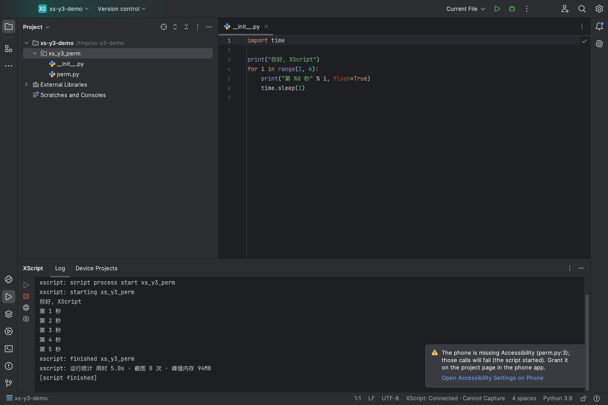
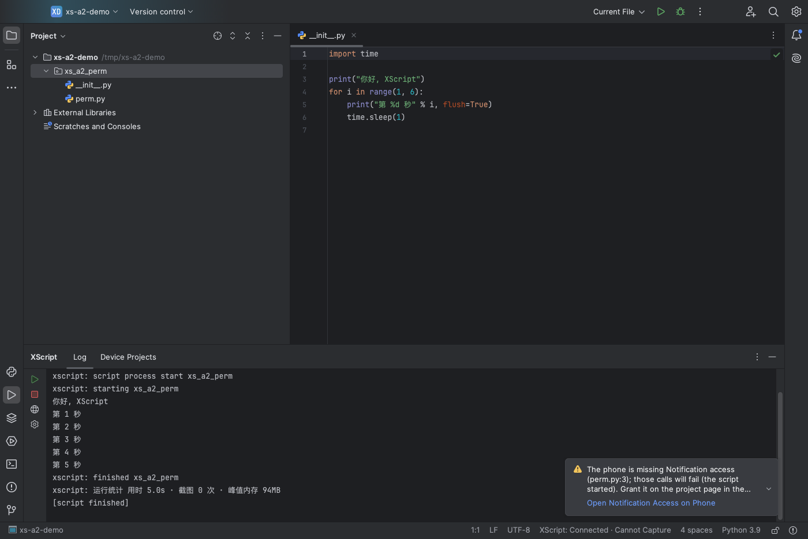
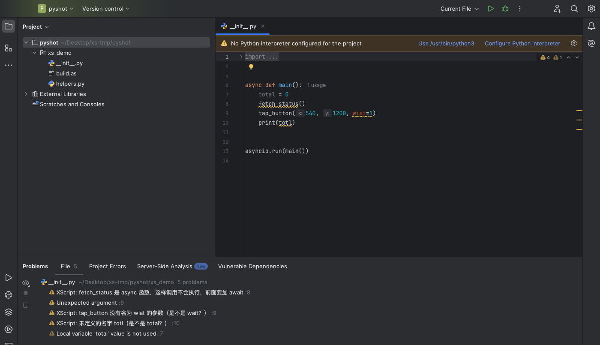

# XScript: PyCharm plugin

Upload XScript / AScript-style projects to an Android phone from PyCharm (2024.2 or newer, Community or Professional), run and stop them, follow the log live, and get completion for `xscript.*` / `ascript.*`. It matches the [VS Code extension](../vscode-extension/README.md) for upload and run, logs, completion and new projects. Breakpoint debugging is still only in the VS Code extension and the web IDE (see the [plan](../../docs/plans/pycharm-plugin.md), Chinese).

It talks to the device HTTP API (`protocol/openapi.yaml`, default port 9860). Only point it at a phone on a trusted network, or at `127.0.0.1` via `adb forward tcp:9860 tcp:9860`.










(Sandbox PyCharm 2024.2.6 connected to the local mock device `scripts/mock_device.py`; results are mock data.)

## Install

The plugin is not on JetBrains Marketplace. Its version is the App version, and every Release after v0.4.0 attaches `xscript-pycharm-<version>.zip` (checksum in `SHA256SUMS`). Or:

- download the **xscript-pycharm-plugin** artifact (a zip) from a `ci` run in GitHub Actions, or
- build it (JDK 17+; Gradle downloads JDK 21 into `~/.gradle`): `cd ide/pycharm-plugin && ./gradlew buildPlugin` → `build/distributions/xscript-pycharm-<version>.zip`.

Then in PyCharm: **Settings → Plugins → ⚙ → Install Plugin from Disk…** and pick the zip (do not unpack it).

## Use

**Tools → XScript** and the **XScript** tool window at the bottom:

**Connect to Device** (Tools → XScript, or a click on the status bar when offline): press Check and Connect and the plugin checks, in order, address format → address reachable (refused vs. timeout) → XScript app responds → it is XScript → pairing code. It stops at the first failure and shows the fix plus a Troubleshooting link. The address is saved and connected only when the checks pass (or only the pairing code is missing, which is asked for next); after a failed check the button becomes Save Anyway. Check alone never saves.

The **status bar** (bottom right) shows the phone: "XScript: Connected", "Running <project>", "Offline", "Pairing Needed" or "Error". Hover for the address and app version; when offline, unpaired or failing, a click opens Connect to Device, otherwise it opens the XScript tool window. It checks every 5 seconds while the IDE is in front and once a minute in the background, and right after upload, run and stop. Turn it off from the status bar's context menu ("XScript Device Status") if you do not need it.

| Action | Shortcut | What it does |
| --- | --- | --- |
| Upload and Run on Device | Ctrl+Alt+Shift+R; editor and Project view context menus | Stops the script running on the phone, uploads the project of the current file and runs it; the log streams into the XScript tool window. Only files new or changed since the last upload from this IDE are sent (device file size + local content hash, the VS Code extension's rule); the log says how many were skipped. If the connection drops while following the log (Wi‑Fi lost, phone locked), it reconnects automatically for about 30 s and continues where it stopped; if the device stays unreachable it stops and shows a notification with Resume Log. Cannot-reach-device errors have Retry and Troubleshooting buttons; the latter opens the [checklist](../../docs/TROUBLESHOOTING.md) |
| Upload All and Run on Device | | Same, but sends every file again (use it after editing the project on the phone) |
| Stop Script on Device | | Stops the running script |
| XScript tool window → "Device Projects" | | Lists the phone's projects and marks the running one; for the selected one: **Run on Device** (no upload, runs the phone's copy), **Stop**, **Pull into This Project**. Loaded when the tab is first opened, then with Refresh |
| Pull Project from Device… | | Pick one of the device's projects and download it: into the IDE project (or its sub-folder) when it has the same name, else into a new folder of that name under a folder you choose. Only new and different files are written; overwriting local edits asks first, listing them; local files the device does not have are kept |
| Run Selection on Device | Ctrl+Alt+Shift+E; editor context menu | Evaluates the selected code (or the current line) in the phone's eval process and prints the result in the XScript tool window; assign `_result` to see a value; times out after 8 s by default, adjustable in Settings (200–15000 ms) |
| Connect to Device… | | Sets the phone address (`IP[:port]`), checks it step by step, then saves and connects (see below) |
| New XScript Project… | | Picks one of the 7 templates shared with the VS Code extension, web IDE and phone app; writes `__init__.py`, `build.as`, `res/` |
| Enable / Disable XScript Completion | | Adds or removes the bundled stubs as the module library "XScript stubs" |
| XScript Settings… | | Opens **Settings → Tools → XScript** |

- **Project**: the topmost folder above the current file with `__init__.py` or `build.as`; its name is the project name on the phone. Uploads skip hidden files, `__pycache__`, `.pyc` and virtual environments, and honour `.vscode/.syncignore` (the same file the VS Code extension uses).
- **Pairing code**: the phone asks for one by default (XScript home → Development and connection → Pairing code). On the first 401 the plugin asks for it and keeps it in the IDE password safe (the macOS keychain etc.), per device address. You can also enter it in Settings.
- **Basic checks**: `.py` files of an XScript project are checked with the same rules as the Web IDE and the VS Code extension (undefined names with "did you mean", unknown attributes, wrong call arguments, import typos, async / await misuse, duplicate definitions); warnings start with `XScript:` and show in the editor and the Problems view. PyCharm already greys out unused imports / variables and unreachable code, so those are not repeated; some problems (an extra argument, say) are also reported by PyCharm, and the XScript one adds the "did you mean" hint. The rules run in the IDE's built-in browser (JCEF); without JCEF (some remote setups) nothing is checked. Turn it off under **Settings → Tools → XScript → Basic checks in the editor**. The messages are in Chinese, as in the Web IDE.
- **Completion**: when you open a project that looks like an XScript project, the plugin offers to enable completion. That only adds the plugin's own `stubs/` folder (generated by `scripts/gen_stubs.py`, the same files the VS Code extension bundles) as a module library; nothing is copied into your project, and disabling removes the library.

## Develop

```bash
cd ide/pycharm-plugin
./gradlew test                       # JUnit + headless PyCharm platform tests; the client tests start scripts/mock_device.py (needs python3)
./gradlew buildPlugin verifyPlugin   # plugin zip; Plugin Verifier against PyCharm 2024.2.6 and 2025.1.6 (internal API counts as a failure)
./gradlew runIde -PrunIdeProject=/path/to/project   # sandbox PyCharm under .intellijPlatform/sandbox; your installed IDEs are untouched
```

`src/main/resources/templates.json` is generated from the VS Code extension's `src/newProject.ts` by `ide/vscode-extension/scripts/export-templates.js`; CI checks it with `--check`.
