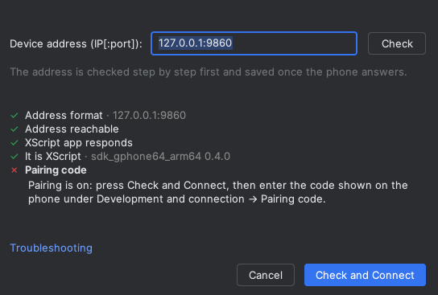
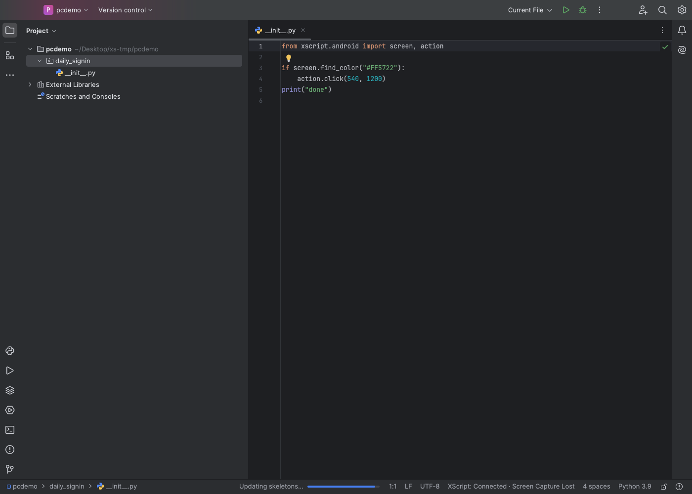

# XScript：PyCharm 插件

> **English:** see [README.en.md](README.en.md).

在 PyCharm（2024.2 及以上，社区版和专业版都行）里把 XScript / AScript 风格的工程上传到 Android 手机运行、停止、看实时日志，并为 `xscript.*` / `ascript.*` 提供补全。功能与 [VS Code 扩展](../vscode-extension/README.md)的上传运行、日志、补全、新建工程一致；断点调试暂时只有 VS Code 扩展和网页 IDE 有（原因见 [计划](../../docs/plans/pycharm-plugin.md)）。

通过设备 HTTP API（`protocol/openapi.yaml`，默认端口 9860）通信。只指向可信网络中的手机，或用 `adb forward tcp:9860 tcp:9860` 指向 `127.0.0.1`。





（沙盒 PyCharm 2024.2.6，连接本机模拟设备 `scripts/mock_device.py`，结果是模拟数据；连接检查一图连的是模拟器上的 XScript。）

## 安装

插件不上架 JetBrains Marketplace。版本号与 App 相同，从 v0.4.0 之后的下一个 Release 起附带 `xscript-pycharm-<版本>.zip`（校验值在 `SHA256SUMS` 里）。也可以：

- 下载 CI 产物：在 GitHub Actions 的 `ci` 运行里下载 artifact **xscript-pycharm-plugin**（一个 zip）；
- 或自己构建（需要 JDK 17 以上；Gradle 会把 JDK 21 下载到 `~/.gradle`）：

```bash
cd ide/pycharm-plugin
./gradlew buildPlugin            # 生成 build/distributions/xscript-pycharm-<版本>.zip
```

然后在 PyCharm 里 **Settings → Plugins → ⚙ → Install Plugin from Disk…**，选这个 zip（不用解压）。

## 使用

菜单 **Tools → XScript**，以及底部的 **XScript** 工具窗口：

**连接设备**（Tools → XScript → Connect to Device…，状态栏离线时点一下也会打开）：填好地址后点「检查并连接」，插件按顺序检查 地址格式 → 能连到这个地址（区分「拒绝」和「超时」）→ XScript App 在响应 → 对方是 XScript → 配对码，停在第一个失败的步骤并给出修法和「排查文档」链接。通过（或只差配对码）才保存地址并连接，只差配对码时接着弹出输入框；检查没通过时按钮变成「仍然保存」，再按一次就不检查直接保存。「检查」按钮只检查，不保存。

**状态栏**右下角显示手机状态：「XScript：已连接」「运行中 工程名」「离线」「需要配对」或「出错」。鼠标悬停显示地址和 App 版本；离线、需要配对或出错时点击打开「连接设备」，否则点击打开 XScript 工具窗口。IDE 在前台时每 5 秒检查一次，在后台时每分钟一次；上传、运行、停止之后立即刷新。不需要时可以在状态栏右键菜单里关掉「XScript 设备状态」。

手机截不了图时（录屏授权失效、也没有无障碍 / Root 截图），状态栏后面加上「· 截图权限已失效」或「· 不能截图」，悬停说明影响；这时点一下（或 Tools → XScript → Grant Screen Capture on Phone）会在手机上弹出系统录屏授权窗口，在手机上选「立即开始」即可（需要新版手机 App，旧版会提示升级）。判断规则和桌面端「截图状态」卡片相同。



| 动作 | 快捷键 | 作用 |
| --- | --- | --- |
| Upload and Run on Device | Ctrl+Alt+Shift+R；编辑器、项目视图右键 | 先停止手机上正在运行的脚本，再上传当前文件所在的工程并运行，日志实时显示在 XScript 工具窗口。只发送上次从本 IDE 上传后新增或改动的文件（设备上文件大小 + 本地内容哈希，与 VS Code 扩展规则一致），日志里会显示跳过了几个。跟随日志时如果连接中断（Wi‑Fi 断开、手机锁屏），会在约 30 秒内自动重连并从断开处继续显示；仍然连不上时停止跟随，并弹出通知，点「继续跟随日志」可以接着看。连不上设备的错误通知带「重试」和「连不上怎么办」按钮，后者打开[排查清单](../../docs/TROUBLESHOOTING.md) |
| Upload All and Run on Device | | 与上一项相同，但重新发送所有文件（手机上改过工程后用） |
| Stop Script on Device | | 停止手机上正在运行的脚本 |
| XScript 工具窗口 →「设备工程」 | | 列出手机上的工程，正在运行的那个有标记；选中后可 **在设备上运行**（不上传，直接运行手机上的版本）、**停止**、**拉取到本工程**、**打开本地副本**（双击或回车也可以：打开本工程里已拉取的副本的 `__init__.py` 并在工程视图中定位；还没有副本时询问是否现在拉取）；工具栏和右键菜单里还有 **在设备上运行选中代码**（作用于当前编辑器，不用切回编辑器）和 **复制名称**；第一次打开这个标签页时加载，之后点「刷新」 |
| Pull Project from Device… | | 从设备列出的工程中选一个下载：IDE 工程（或其下的子文件夹）与设备工程同名时直接拉到那里，否则选一个文件夹，在其下新建同名子文件夹。只写入新增和不同的文件；会覆盖本地修改时先列出文件请你确认；设备上没有的本地文件保留不动 |
| Run Selection on Device | Ctrl+Alt+Shift+E；编辑器右键 | 把选中的代码（没选中时为光标所在行）发到手机的 eval 进程执行，结果打印在 XScript 工具窗口；要看某个值就赋给 `_result`；超时默认 8 秒，可在设置里改（200–15000 毫秒） |
| Connect to Device… | | 填写手机地址（`IP[:端口]`），先逐项检查再保存并连接（见下） |
| New XScript Project… | | 选模板（与 VS Code 扩展、网页 IDE、手机 App 同一套 7 个模板），生成 `__init__.py`、`build.as`、`res/` |
| Enable / Disable XScript Completion | | 把插件自带的存根作为模块库 “XScript stubs” 加入或移除 |
| XScript Settings… | | 打开 **Settings → Tools → XScript** |

- **预览上传**：Tools → XScript → Preview Upload (Dry Run)，不改动手机，只在 XScript 工具窗口里列出「上传并运行」会新增、重新发送、跳过和删除的文件。有需要上传或删除的内容时，右下角通知里有 **上传并运行** 按钮，直接执行同一次增量上传（删除仍会先弹确认框）。
- **工程**：当前文件之上、含有 `__init__.py` 或 `build.as` 的最顶层文件夹；文件夹名就是手机上的工程名。上传时跳过隐藏文件、`__pycache__`、`.pyc`、虚拟环境，并遵守 `.vscode/.syncignore`（与 VS Code 扩展同一个文件）。设备上有、本地已删除的文件默认保留；在设置里勾选「上传时同步删除本地已删除的文件」后，每次上传会先列出这些文件，确认后才在设备上删除（被 `.syncignore` 忽略的文件、点开头的文件、`__pycache__` 和工程入口 `__init__.py` 永远不删；删除后变空的文件夹连同其中的 `__pycache__` 一起删除，也在同一个对话框里列出；同 VS Code 的 `xscript.syncDeletes`）。
- **配对码**：手机默认需要配对码（XScript 首页「开发与连接 → 配对码」）。第一次遇到 401 时插件会弹窗询问，保存在 IDE 的密码库（macOS 钥匙串等），也可以在设置页填写。按设备地址分别保存。
- **基本检查**：XScript 工程里的 `.py` 文件，用和网页 IDE、VS Code 扩展同一套规则检查（未定义的名字及「是不是 …」、属性不存在、调用参数不对、import 拼错、async / await 用错、重复定义），以 `XScript:` 开头的警告画在编辑器里并列在问题面板。PyCharm 自己已经会把未使用的 import / 变量和执行不到的代码变灰，这几类不重复报；有的问题（例如多余的参数）PyCharm 也会报一条，XScript 的那条多了「是不是 …」提示。规则在 IDE 自带的浏览器（JCEF）里运行，没有 JCEF 时（例如部分远程开发环境）不检查。不想要时在 **Settings → Tools → XScript** 取消「编辑器里的基本检查」。
- **补全**：打开像 XScript 工程的项目时，插件会提示「启用 XScript 补全」。它只是把插件目录里的 `stubs/`（由 `scripts/gen_stubs.py` 生成，与 VS Code 扩展内置的是同一份）加为模块库，不往工程里复制任何文件；关闭时移除这个库。

## 开发

```bash
cd ide/pycharm-plugin
./gradlew test                   # JUnit + 无界面 PyCharm 平台测试；设备客户端测试会启动 scripts/mock_device.py（需要 python3）
./gradlew buildPlugin verifyPlugin   # 插件 zip；Plugin Verifier 对 PyCharm 2024.2.6 和 2025.1.6 检查（内部 API 也算失败）
./gradlew runIde -PrunIdeProject=/path/to/project   # 沙盒 PyCharm（.intellijPlatform/sandbox），不影响本机已装的 IDE
```

- 新建工程模板 `src/main/resources/templates.json` 是生成的：改 `ide/vscode-extension/src/newProject.ts` 后，在 `ide/vscode-extension` 里 `npm run compile && node scripts/export-templates.js`。CI 用 `--check` 检查。
- 截图：先在 `.intellijPlatform/sandbox/xscript-pycharm/PC-2024.2.6/config_runIde/options/xscript.xml` 里把设备地址设为本机 mock 设备，再 `./gradlew runIde -PrunIdeProject=<演示工程> -PrunIdeHeadlessConsent -PrunIdeScreenshotDemo=run -PrunIdeScreenshotOut=<目录>`（模式还有 `settings`、`eval`、`pull`、`projects`、`connect`、`lint`（只打开 `__init__.py` 和问题面板，看基本检查；演示工程里要有写错的代码）；`connect` 用 `-PrunIdeScreenshotConnect=<地址>` 指定要检查的地址）。这些开关只用于这个一次性的沙盒：跳过用户协议，打开演示工程，执行对应功能（`pull` 会自动按下选择和覆盖对话框的默认按钮；演示工程里要有与设备工程同名的文件夹），约 25 秒后把 IDE 窗口（有对话框时截对话框）存成 `<目录>/<模式>.png`，不需要系统录屏权限。
- 本机没有系统 JDK 时可以用 Android Studio 自带的：`JAVA_HOME="/Applications/Android Studio.app/Contents/jbr/Contents/Home"`。
