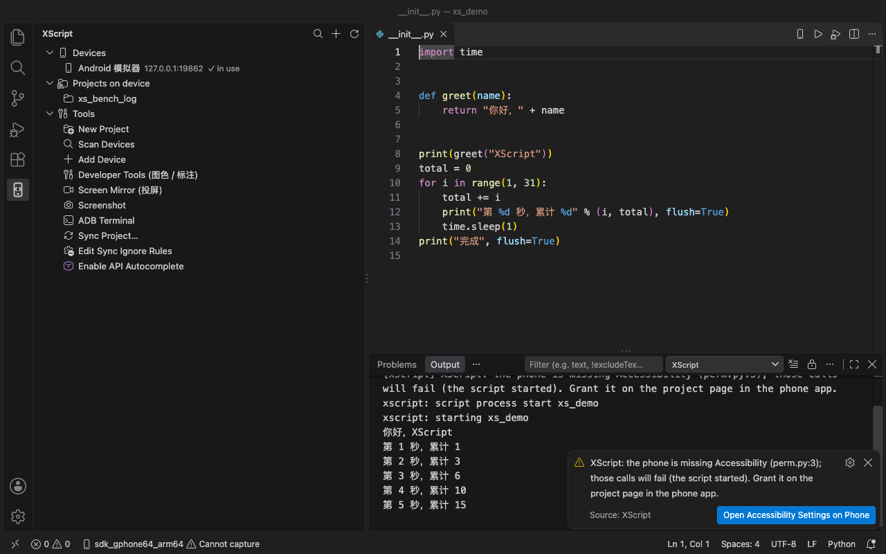
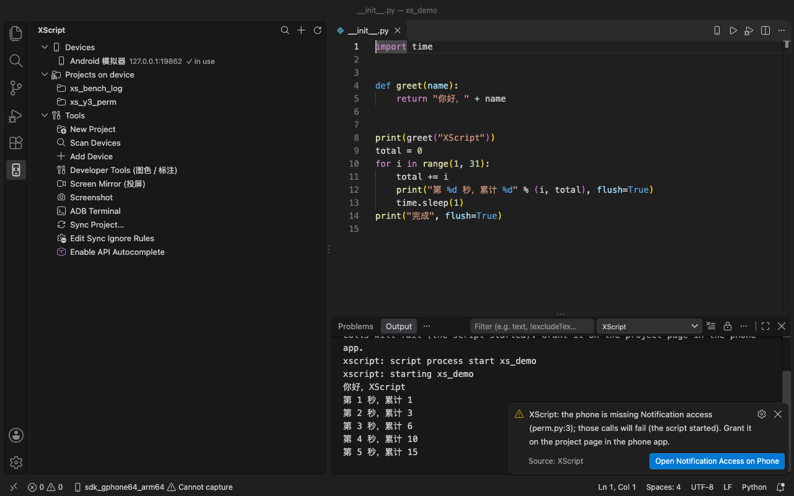
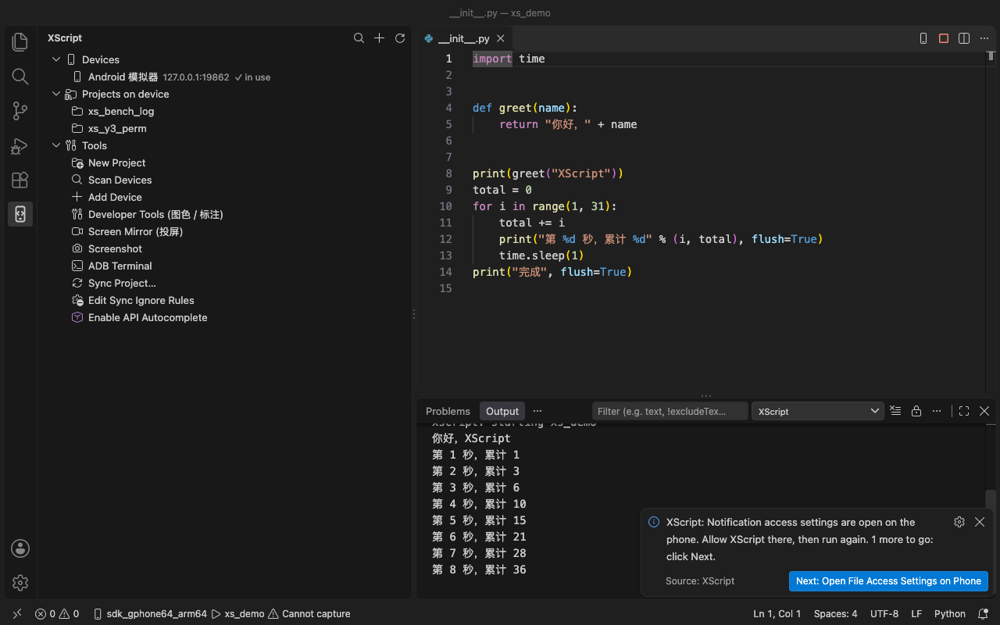
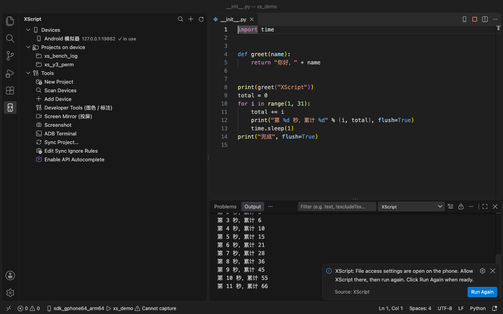
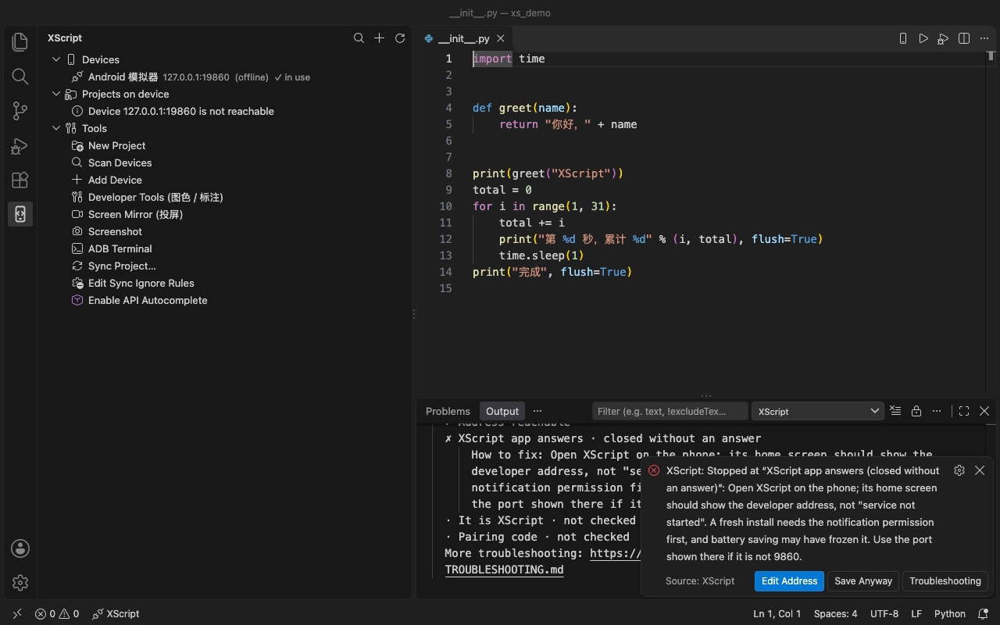
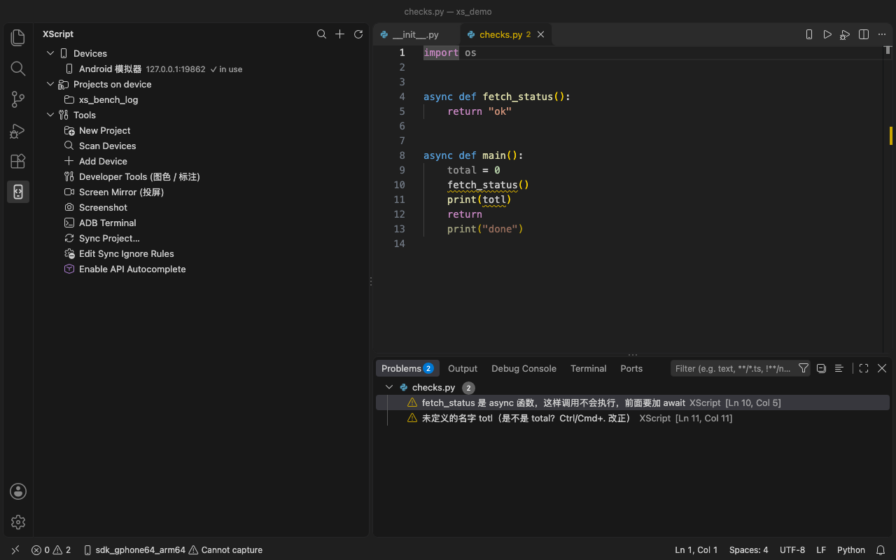
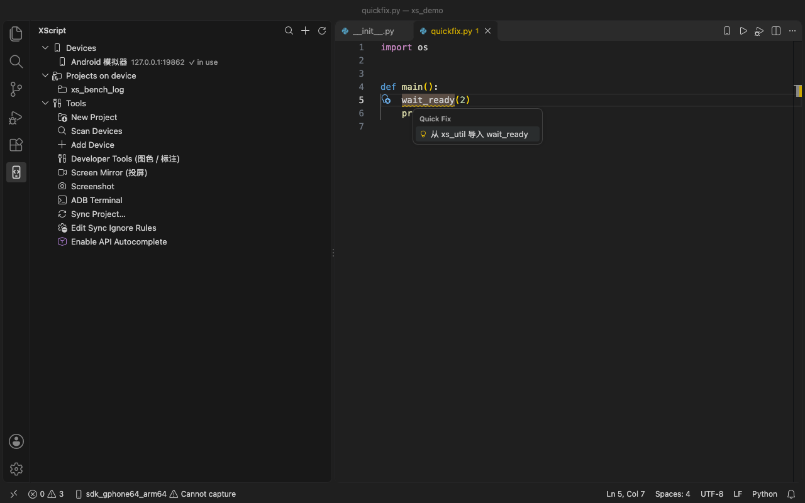

# XScript：VS Code / Cursor 扩展

> **English:** run, stop and debug XScript / AScript-style projects on an Android phone from VS Code or Cursor, with live logs. Download `xscript-vscode-<version>.vsix` from the [GitHub Release](https://github.com/JackLuguibin/xscript/releases/latest) and install it with `code --install-extension xscript-vscode-<version>.vsix`, or build it with `cd ide/vscode-extension && npm ci && npm run package`. It talks to the device HTTP API (default port 9860, no login), so only point it at a phone on a trusted network or at `127.0.0.1` via `adb forward`. The details below are in Chinese. See the [English README](../../README.en.md) for the project overview.

把 XScript / AScript 风格的工程上传到 Android 手机，运行、停止、调试，看日志。通过设备 HTTP API（`protocol/openapi.yaml`，默认端口 9860）通信，没有登录。只指向可信网络中的手机，或用 `adb forward` 指向 `127.0.0.1`。

```bash
# 方式一：从 GitHub Release 下载（v0.2.4 及更早的 Release 没有，从下一个发布起附带） xscript-vscode-<版本>.vsix（和 App 同一个 Release，版本号相同，校验值在 SHA256SUMS 里）
code --install-extension xscript-vscode-<版本>.vsix      # Cursor：cursor --install-extension ...
# 方式二：自己打包
cd ide/vscode-extension && npm ci && npm run package     # 生成 xscript-vscode-<版本>.vsix
```

扩展版本号 = App 发布版本号（同一个 Git 标签、同一个 Release 页面），不上架 VS Code 应用市场。发布流程见 `scripts/release.sh` 和 [docs/发布.md](../../docs/发布.md)。

## 截图

















（真实 VS Code（运行、调试两图 1.142，连接检查 1.143）、隔离配置，连着一台 Android 模拟器的演示工程；`bash scripts/vscode-screenshots.sh` 可重新生成，连接检查一图用 `XS_SHOT_NAMES=connect`，先在手机上强制停止 XScript；基本检查和快速修复两图用 `XS_SHOT_NAMES="problems quickfix"`（VS Code 1.143）。）

## 使用

1. 打开 **XScript** 活动栏图标：**Devices** 里列出已保存的设备（在线 / 离线、正在运行的工程），点一下就把它设为当前设备；**Projects on device** 列出手机上的工程（行内按钮：运行、拉取到本地）；**Tools** 里是常用入口。
2. **扫描设备**（视图标题栏的放大镜）：自动找 ADB 设备（USB / 模拟器，必要时自动 `adb forward`）和局域网内 9860 端口上的 XScript。也可以用 **添加设备** 手动填 App 里的「开发者地址」。
3. **新建工程**（命令面板或 Tools）：选模板、选父目录、填名字。生成 `__init__.py`、`build.as`（AScript 的工程标记，手机端也认）和 `res/`。
4. 打开 `__init__.py`，点编辑器右上角的 ▶ 或按 **Ctrl+Shift+R**（F6 也行）。扩展会：停掉正在运行的脚本（再次运行等于「重新运行」）→ 把变化的文件同步到手机（按内容摘要和文件大小对比，只传新增或修改的）→ 启动，日志实时输出到 **Output → XScript**。**Shift+F6** 或 ■ 停止；**Alt+F6** 调试。
5. **工程同步**：上传（强制全量，忽略对比缓存）或从手机拉取（本地有差异的文件会先确认；手机上没有的本地文件不动）。
6. **编辑同步忽略规则**：`.vscode/.syncignore`（和 AScript 同一个位置），gitignore 风格（`*.log`、`dist/`、`/build/`、`!keep.log`）。以 `.` 开头的文件和目录、`__pycache__`、`.pyc`、虚拟环境始终不上传。
7. **基本检查**：XScript 工程里的 `.py` 文件，边打边检查，和网页 IDE 是同一套规则（未定义的名字及「是不是 …」、属性不存在、调用参数不对、import 拼错、async / await 用错、重复定义），以警告列在「问题」面板并画波浪线；未使用的 import / 变量和执行不到的代码变暗。提示里写「Ctrl/Cmd+. …」的都可以一键修复：「是不是 …」的拼写（包括关键字参数名、确定无误的类型转换）直接改正，没定义但工程里别的模块有的名字加上 `from 模块 import 名字`（放在文件开头的文档字符串和 import 之后；有几个模块时每个一项）；还可以删除未使用的 import / 变量和执行不到的代码、补上缺少的参数、跳到被覆盖的重复定义。设置 `xscript.lint` 设为 `false` 可关闭。

## 命令（命令面板里的名字有中文版，跟随 VS Code 显示语言）

| 命令 | 默认快捷键 | 说明 |
| --- | --- | --- |
| 选择运行设备 `xscript.selectDevice` | 编辑器右上角手机图标 | 从列表里选（含扫描、添加）；保存在工作区的 `.vscode/settings.json`（`xscript.device`） |
| 管理设备列表 / 添加 / 编辑 / 删除 / 扫描设备 | | 设备列表保存在扩展的全局存储里 |
| 新建工程 `xscript.newProject` | | 模板：空工程、Hello（屏幕 + 点击）、AScript 写法 |
| 运行 `xscript.run` | Ctrl+Shift+R、F6 | 先停止、再增量同步、再运行 |
| 停止 `xscript.stop` | Shift+F6 | |
| 调试当前工程 `xscript.debug` | Alt+F6 | 见 `docs/DEBUGGING.md` |
| 上传工程 / 工程同步 / 从设备拉取工程 | | |
| 编辑同步忽略规则 | | |
| 跟踪运行日志、显示设备状态、连接设备（手填地址） | 状态栏 | 连接设备先逐项检查地址（地址格式 → 能连到 → App 在响应 → 是 XScript → 配对码），通过才保存；没通过时说明停在哪一步和修法 |
| 逐项检查连接 `xscript.checkConnection` | | 只检查当前地址，结果写到 Output → XScript |
| 在手机上授权截图 `xscript.grantCapture` | | 手机截图权限失效时状态栏显示「⚠ 截图权限已失效」，点击即运行此命令，在手机上弹出录屏授权窗口（需要新版手机 App） |
| 在设备上运行选中代码 `xscript.eval` | | 走 `/eval` |
| 截图、打开开发者工具（图色 / 标注）、投屏 | | 开发者工具和投屏用浏览器打开手机上的页面 |
| ADB 终端 | | 对当前 USB / 模拟器设备开 `adb shell` |
| 启用 API 自动补全 | | 把自带的 `xscript.*` / `ascript.*` 存根加到 `python.analysis.extraPaths` |

**XScript: Preview Upload (dry run)**：不上传、不删除，只在输出面板列出这次「运行」会新增、重新发送、跳过的文件，以及（开启 `xscript.syncDeletes` 时）会删除的设备文件和变空的文件夹，或（未开启时）只在设备上、会保留的文件。有需要上传或删除的内容时会弹出提示，点 **Upload Changes** 即按预览做一次增量上传（只上传，不运行；删除仍会先弹确认框）。

设置：`xscript.device`、`xscript.logPollMs`、`xscript.evalTimeoutMs`、`xscript.syncDeletes`（上传时同步删除本地已删除的文件，默认关；开启后先在对话框里列出要删的设备文件，确认后才删，被 `.syncignore` 忽略的文件、点开头的文件和 `__pycache__` 永远不删；工程入口 `__init__.py` 不会删；删除后变空的文件夹连同其中的 `__pycache__` 一起删除，也在同一个对话框里列出）、`xscript.adbPath`（空 = 自动找 ANDROID_HOME / 常见 SDK 目录 / PATH）、`xscript.scanLan`（扫描时是否也扫局域网，默认开）。

## UI 设计器

`XScript: 新建界面（UI 设计器）`（命令面板，或在工程里右键）创建 `res/ui/<name>.ui.json` 并用设计器打开；任何 `*.ui.json` 都默认用设计器打开（「重新打开编辑器的方式…」可切回文本）。左边点或拖控件进表单（文本、密码、多行、数字、勾选、选项列表、单选、说明文字），中间拖动排序，右边改属性和窗口标题/按钮/大小，最右是预览。保存时生成：

- `res/ui/<name>.html`：给 `ui.Window` 显示的页面（提交时 `xscript.call("submit", JSON)`）；
- `ui_<name>.py`：`show(values=None)` 显示表单、阻塞到提交，返回按类型转换好的 dict（取消返回 None）。

```python
from ui_settings import show
values = show({"rounds": 5})   # 预填
if values:
    print(values["name"], values["rounds"], values["loop"])
```

两个生成文件每次保存都会重写，改界面请改 `.ui.json`。生成器和设计器界面与手机网页 IDE 共用（`android/app/src/main/assets/tools/ui-form.js`、`ui-designer.js`，构建时复制进扩展），两边打开同一个 `.ui.json` 结果一致。「选项列表」在手机上显示为页内列表，不是系统下拉框：`ui.Window` 的悬浮窗里系统下拉框弹不出来。

## 和 AScript 官方扩展的对照

对照依据（2026-10-15）：

- 应用市场里的 **AScript (ascript)**，发布者 `ascript-aojoy`，版本 0.3.0（2026-05-12 更新）。下载了它的 vsix，只读了 `package.json`（命令、菜单、快捷键、视图、设置、调试器）、`readme.md`、`templates/` 和编译后脚本里的界面文字，没有拷贝代码。
- 官方文档 <https://www.ascript.cn/docs/android/devtools/vscode/>。
- 这些信息之外的实际界面（图标、网页面板的外观）没有在真实 AScript 扩展里运行过，所以下表只比较命令、菜单、行为描述，不比较像素。

| AScript 扩展 0.3.0 | XScript 扩展（与 App 同版本） | 状态 |
| --- | --- | --- |
| `新建 AScript 工程`（网页面板；Android 工程要从设备拉取；生成 `build.as`、`__init__.py`、`res/`） | `新建 XScript 工程`：模板 + 父目录 + 名字，本地生成同样的三项；不需要先连设备 | ✅ 对齐（体验不同） |
| `选择运行设备`（编辑器右上角手机图标；设备记在 `.vscode/settings.json`） | 同名图标、同样记在工作区设置（`xscript.device`） | ✅ |
| `运行`，**Ctrl+Shift+R**；再按一次先停止再同步再启动；对比本地与设备文件、只传新增 / 修改的 | **Ctrl+Shift+R**；同样先停止再运行；按大小 + 内容摘要增量上传 | ✅ |
| `停止` 按钮（运行时替换运行按钮，上下文 `ascript.running`） | `xscript.running` 上下文：运行时 ▶ 换成 ■ | ✅ |
| 日志经 WebSocket 到 Output → AScript | HTTP 轮询 `/logs`（约 1 秒）到 Output → XScript | ✅ 效果相同，实现不同 |
| 活动栏 AScript 视图：网站 / 设备 / 工具 / 导出 | 活动栏 XScript 视图：Devices / Projects on device / Tools | ✅ 部分（见下） |
| 设备：添加 / 编辑 / 删除，一键扫描 ADB 和局域网（端口 9096），设备行内的运行 / 停止按钮 | 同样的操作，局域网扫描 9860，行内运行 / 停止（按设备实时状态切换） | ✅ |
| `管理设备列表`（网页表单，公网地址 + 公网密码） | 命令面板里的选择菜单；没有公网地址 / 密码 | ◐ 设备接口用配对码保护（首次连接提示输入，存进系统钥匙串；命令「XScript: 配对设备」），不做公网登录 |
| `工程同步[Android/iOS]`（网页面板：拉取 / 推送，标「本地新 / 远端新」） | `工程同步` 选择菜单：上传 / 拉取，拉取前列出会被覆盖的本地文件并确认 | ◐ 设备文件没有修改时间，做不了「谁更新」的判断 |
| `编辑同步忽略规则 (.syncignore)`，位于 `.vscode/.syncignore` | 同样的路径和命令，gitignore 风格规则 | ✅ |
| `调试当前工程 (Android)`，**F6**，调试类型 `ascript`（attach） | `调试当前工程`，**Alt+F6**，调试类型 `xscript`（launch：上传、启动、连接）；F6 仍是运行 | ◐ 功能对齐，快捷键保留原来的 F6 = 运行 |
| 工具：控件检索、图色助手、UI 生成器、Yolo 标注 / 训练 / 检测（打开网页） | `Developer Tools` 打开手机上的 `/tools/`（图色、标注、投屏）；没有 UI 生成器和云端训练 | ◐ |
| 工具：ADB 终端、投屏（下载 scrcpy） | `ADB 终端`（用系统 adb）；`投屏` 打开手机自带的网页投屏。不下载 scrcpy | ✅ / ◐ |
| 命令标题是中文 | `package.nls.zh-cn.json`，中文显示语言下是中文标题 | ✅ |
| 工程识别：`build.as` | `build.as` 或 `__init__.py` | ✅ |
| 设置：`ascript.pythonPath`（Windows 本地运行用） | 没有对应项：XScript 脚本只在手机上运行。另有 `xscript.adbPath`、`xscript.scanLan` 等 | ⛔ 不适用 |
| `在 Windows 本地运行`、`选择工程类型`（Windows / Android / iOS）、iOS 设备、`安装 ascript 库`（桌面 pip） | 不做：XScript 只有 Android；桌面补全用扩展自带存根（`启用 API 自动补全`） | ⛔ |
| `导包`（打 `.was` 引擎包）、`从设备导出并保存`、上传分发小程序 / 插件、官网 / 开发者后台 / 云控 / 云数据库链接 | 不做：这些是 AScript 官方服务和格式；XScript 的 APK 打包在管理后台（`docs/PACKAGING.md`） | ⛔ |
| 自动下载 ADB 和 scrcpy | 不做：使用本机已有的 adb | ⛔ |
| 没有状态栏项、没有「运行选中代码」、没有截图命令 | XScript 额外有：状态栏设备型号、`在设备上运行选中代码`、`截图` | 额外 |
| 没有代码片段（snippets）、也没有自带补全（靠 pip 装的 `ascript` 库 + Pylance） | 自带存根补全；没有片段 | 不需要 |

## 测试

```bash
npm test                                    # 38 个单元测试（对接 scripts/mock_device.py）
bash scripts/vscode-host-test.sh            # 装 vsix 到隔离配置的真实 VS Code（--user-data-dir / --extensions-dir 都在临时目录），在扩展宿主里跑真实命令（默认连 mock）
XS_VSCODE="/path/to/Visual Studio Code.app/Contents/MacOS/Code" bash scripts/vscode-host-test.sh   # 指定 VS Code；默认找 /tmp/vscode-real 和 /Applications
# 连模拟器 / 真机：adb forward tcp:19860 tcp:9860，再加
XS_HOST_TEST_DEVICE=127.0.0.1:19860 XS_HOST_TEST_REAL=1 XS_HOST_TEST_ADB=1 bash scripts/vscode-host-test.sh
python3 -m venv .venv && .venv/bin/pip install debugpy   # 有 debugpy 时 mock 也提供调试桥（scripts/host-test/debug_mock.py），宿主测试会在编辑器里真实启动调试、命中断点、求值、停止
```

### 验证不会弹登录

`scripts/vscode-env.sh` 给两个脚本一份「永远不要登录」的临时配置：临时 `HOME`（不碰 `~/.vscode`、不碰你的钥匙串和账号）、临时 `--user-data-dir` / `--extensions-dir`、关闭 GitHub 认证 / Copilot 等内置扩展、`--use-mock-keychain`、`settings.json` 里关 AI、欢迎页、云端更改、遥测、更新、工作区信任。`bash scripts/vscode-no-prompt-check.sh` 读取编辑器真实显示的内容和 macOS 窗口，证明没有任何登录 / 钥匙串 / 欢迎页。原因和排查过程见 `docs/DEBUGGING.md`。成功的运行会删掉临时目录；失败时保留（或设 `XS_HOST_TEST_KEEP=1`）方便看日志。

扩展宿主测试里覆盖：激活、27 个命令、活动栏视图和树节点、快捷键、状态栏文字、添加 / 编辑 / 删除设备、ADB 和局域网扫描、新建工程、运行（`.syncignore`、再次运行先停止并只同步改动）、停止、拉取、截图在编辑器里打开、通过 VS Code 调试 API 在断点处停下并求值。验证只在真实 VS Code 1.142.0（官方稳定版，隔离配置）里做过，Cursor 没有测。没有覆盖：真实按键、图标和视图的外观、选择菜单 / 输入框（用带参数的命令代替）、中文显示语言下的标题。
